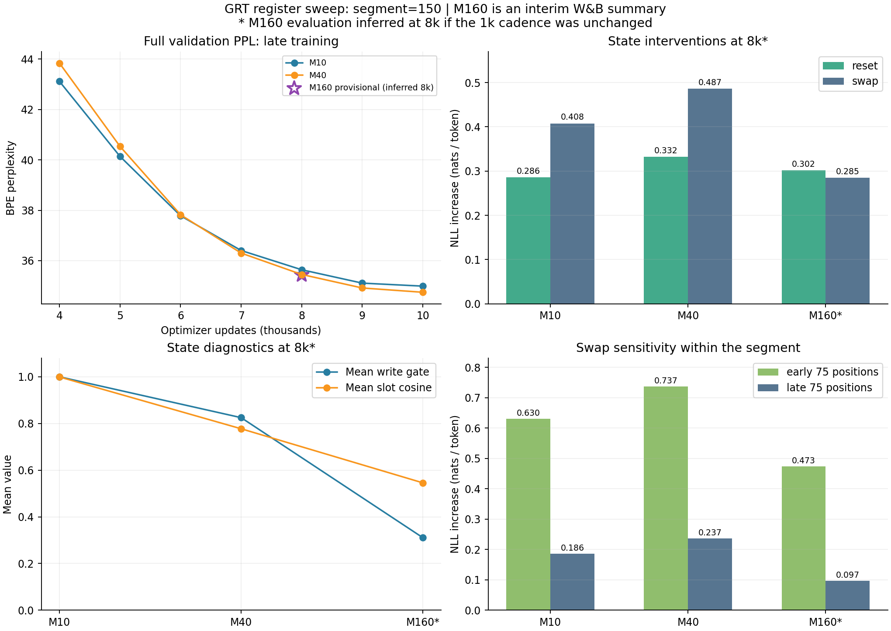

# GRT M10·M40·M160 중간 비교 보고서

작성일: 2026-10-14 · 범위: segment150 / small 레지스터 sweep · M160 진행 중

## 2026-10-15 완료 결과 추가

[M160 완료 원본](../results/0e0ead4744594b59a7d9a771049c79a1.json) · [누적 결과표](20261012_experiment_plan.md)

아래 본문의8k 비교와 당시 판단은 중간 기록이다. M160 완료 후 품질 결론은 갱신한다. **10k 최종 validation PPL은 M160이 가장 낮고, swap ΔNLL은 M40이 가장 크다.** 중간값만으로 M40의 최종 품질 우위를 확정하지 않는다.

| 10k 결과 | M10 | M40 | M160 |
|---|---:|---:|---:|
| validation PPL | 34.9897 | 34.7458 | 34.1511 |
| reset ΔNLL | 0.294231 | 0.345704 | 0.323459 |
| swap ΔNLL | 0.422916 | 0.524916 | 0.294080 |
| write mean | 1.000000 | 0.825000 | 0.325191 |
| slot cosine | 0.999348 | 0.759750 | 0.529918 |
| 실행 h | 5.812 | 7.009 | 13.150 |

M160은 M40보다 PPL0.5947 낮지만 시간은 약1.88배다. 실제 배치는 M40과 동일한 micro32×accum4×GPU2/global256, T4×2/FP32다. 데이터·학습 예산·평가·probe 조건은 일치한다. 다만 M160은 Python3.12.13/PyTorch2.10.0, 기존 M10/M40은3.13.15/2.11.0으로 소프트웨어 차이가 있다. 단일 seed에서 용량만의 효과·최적 압축률을 확정하지 않는다.

기존8.7k W&B summary의 val/RTLA는 정식 report의8k와 일치해 시점이 확인됐다. M160도3k→4k write0.0671→0.3809, PPL1244.35→45.51, reset −2.0430→+0.2395로 전환했다. 반면6k→7k에는 write0.3811→0.3270 감소와 함께 relative update0.0610→0.0751 및 PPL41.92→36.03 개선이 나타난다. write가 중요하다는 가설은 유지하되 큰 평균 write가 항상 더 좋은 학습을 만든다고 해석하지 않는다. 슬롯별 기여·gate 분포·retention은 사후 분석으로 확인한다.

---

2026-10-14 중간 판단:

**현재 M40은 완료 결과에서 품질·문맥 민감도의 유력 후보이고, M160은 상태 표현의 분화와 더 큰 용량의 동작을 확인하는 후보다. M160의 슬롯 유사도는 더 낮지만, 현재 validation 품질은 M40과 거의 같고 swap 효과는 작다. 용량 확대가 실제 예측 이득으로 이어졌다고 판단하기에는 아직 근거가 부족하다.** 사용자의 용량 선택 전 검토 자료이며 선택 M은 비워둔다.

## 1. 원본과 비교 시점

- [M10 완료 보고서](../results/22ab31a56cb546f993197e5ce937e5de.json): best step10,000, 완료.
- [M40 완료 보고서](../results/22cfd16b44964befbe42912c4aba28c5.json): best step10,000, 완료.
- [M160 사용자 제공 W&B summary](../results/interim/20261014_grt_m160_wandb_step8700.json): train/global step8,700, 진행 중. 정식 experiment report가 아니며 설정·환경·학습 곡선 전체는 없다.
- [공통 계획·누적 결과표](20261012_experiment_plan.md): 완료 결과는 계속 이 표에 누적한다. 본 보고서는 이번 중간 비교의 날짜별 기록이다.

**W&B summary는 모든 지표가 같은 step의 측정이라는 뜻이 아니다.** 현재 코드는 학습을10 updates마다, validation/RTLA를1,000 updates마다 기록한다([학습 코드](../src/grt/stream_training.py), [W&B 기록 코드](../src/grt/logger.py)). 따라서 M160 설정이 동일하다면 `train/*`는8,700, `val/*`와 `grt/*`는 마지막 평가인8,000의 값이다. 원본 snapshot에는 평가 step이 따로 없으므로 **8k는 코드와 기존 주기에서 추론한 시점**으로 표시한다. 임의8.7k validation이나 보간값을 만들지 않는다. 평가 주기가 변경됐거나 별도 평가를 실행했다면 이 비교를 다시 맞춰야 한다.

M10/M40의 **8k validation·RTLA 원본 행**을 주 비교로 쓰고, **8.7k 학습 경과시간·target 수**를 비용 비교로 쓴다. 완료10k 품질은 참고값으로 따로 둔다. M160의 best checkpoint나10k 결과는 아직 확정하지 않는다.

M10/M40은 WikiText-103/GPT-2 BPE, small D256/6 layers/8 heads/FF1024, segment150/K3/global256/FP32, MLP512, router attention D256/head8, read gate off/write bias−2, seed54와 데이터 hash가 같다. actual microbatch는64/32로 다르다. M160의 target 수와 LR은 동일8.7k 예산·10k cosine 설정과 일치하지만, snapshot만으로 GPU·world size·microbatch·precision·MLP·seed·데이터 hash·RTLA window까지 검증할 수는 없다. 아래 M160 해석은 사용자가 기존 R2 조건을 유지한 실험이라는 전제다.

## 2. segment150에서 용량 배치가 의미하는 것

| 항목 | M10 | M40 | M160 |
|---|---:|---:|---:|
| M / segment150 | 6.67% | 26.67% | 106.67% |
| segment token / register | 15.00 | 3.75 | 0.94 |
| slot 수 증가 배수 | 1× | 4× | 16× |
| segment stack 길이 N+M | 160 | 190 | 310 |
| 저장 state FP32 / stream, D256 | 10 KiB | 40 KiB | 160 KiB |
| 전체 parameter 수 | 18,669,588 실측 | 18,708,048 실측 | 18,861,888 예상¹ |

¹ M160 parameter 수는 기존 D256/MLP512 구조를 유지했을 때의 계산값이다. `initial_memory`와 두 gate 출력층 때문에 M당1,282 parameters가 늘어난다. M10 대비 M160 증가분은192,300(약1.03%)이며 정식 보고서로 실측 확인한다. read gate off에서도 read MLP parameter는 모델에 포함된다.

**10→40→160의4배 간격은 강한 압축·중간 용량·segment 길이와 비슷한 용량을 구분하는 첫 sweep으로 적절하다.** 다만 register 하나가 token 하나를 저장한다는 계약은 없으므로 M≈150이 최적이라는 이론적 근거는 아니다. state는 여러 segment의 문맥을 누적할 수 있고 K3은 gradient를 전달할 과거 구간이며 저장 가능한 문맥을450 tokens로 제한하지 않는다.

M 증가로 단순히 저장 tensor만 커지지 않는다. register candidate도 매 segment 전체 stack을 통과하고 token은 과거 register를 읽는다. 현재 dense attention 구현의 score 행렬 크기 `(N+M)^2`는 M10 대비 대략 **1 / 1.41 / 3.75배**, token→memory 항은 **1 / 4 / 16배**다. 이는 연산 구성 설명이며 실제 속도·전체 FLOPs·VRAM 배수는 아니다. M160은 parameter를 조금 더 늘린 모델이면서 activation·attention 비용은 상당히 늘릴 수 있는 설정이다.

그림의 M160 점은 평가 주기 유지 시8k로 추론한 값이며, 선을 연결하거나10k 성능을 외삽하지 않았다.

## 3. 정상 품질과 state 개입

### 3.1 주 비교: 8k 평가, M160 시점은 추론

| 지표 | M10 | M40 | M160 중간 |
|---|---:|---:|---:|
| validation NLL | 3.573452 | 3.568195 | 3.567546 |
| validation PPL | 35.6394 | 35.4525 | 35.4295 |
| 정상 probe NLL | 3.516986 | 3.506804 | 3.574959 |
| 정상 probe PPL | 33.6828 | 33.3415 | 35.6931 |
| reset ΔNLL | 0.285898 | 0.332226 | 0.301698 |
| swap ΔNLL | 0.407814 | 0.486578 | 0.285321 |
| reset probe NLL | 3.802884 | 3.839030 | 3.876657 |
| swap probe NLL | 3.924800 | 3.993382 | 3.860280 |
| reset probe PPL | 44.8303 | 46.4804 | 48.2626 |
| swap probe PPL | 50.6430 | 54.2380 | 47.4786 |

RTLA는 정상 state와 같은 입력·target을 고정하고 **reset: 학습된 초기 state S0로 교체**, **swap: 다른 validation stream의 state로 교체**한다. 양의 ΔNLL은 해당 probe에서 정상 과거 state가 예측에 도움이 됐다는 근거다. M10/M40의 probe는 warmup3·측정8 segments·batch8·9,600 targets이고, M160도 target9,600이지만 다른 probe 조건은 정식 report 확인이 필요하다. probe PPL과 전체 validation PPL은 서로 다른 표본이다.

- **M10→M40:** 전체 validation PPL은0.1869 낮고 reset/swap ΔNLL은 모두 커진다. 이 시점에는 더 많은 용량과 더 강한 문맥 개입 효과가 함께 나타난다.
- **M40→M160:** 전체 validation PPL은0.0230(약0.065%) 낮아 사실상 비슷하다. reset ΔNLL은9.19%, swap ΔNLL은41.36% 작다. 정상 probe PPL은 오히려33.3415→35.6931로 높다. 전체 validation과 probe의 차이를 한쪽만 선택해 우열로 단정하지 않는다.
- **M10→M160:** 전체 validation PPL은0.2099 낮다. reset ΔNLL은5.53% 커지지만 swap ΔNLL은30.04% 작다. 큰 용량에서 모든 활용 지표가 일관되게 개선되는 패턴은 아니다.

probe의 정상 PPL 대비 reset 악화율은 M10 **33.10%**, M40 **39.41%**, M160 **35.22%**다. swap 악화율은 각각 **50.35% / 62.67% / 33.02%**다. 이는 `exp(ΔNLL)−1`로 계산한 같은 probe 내부 비율이며 전체 validation PPL 개선율이 아니다.

M10/M40은 swap 피해가 reset보다 크고 M160은 반대로 reset 피해가 조금 더 크다. M160이 잘못된 문맥에 덜 민감해졌거나 문맥 특이적인 정보를 덜 읽을 가능성이 있지만, 둘 다 가설이다. 더 큰 ΔNLL은 활용 근거인 동시에 잘못된 state에 대한 취약성일 수 있다. **최대 ΔNLL 자체를 목표로 정하지 않고 정상 품질·reset/swap·비용을 함께 판단한다.** M160에서도 두 delta가 양수이므로 메모리를 쓰지 않는다고 해석하지 않는다.

### 3.2 완료10k 결과는 별도 참고

| 모델 | 10k validation NLL | 10k validation PPL | 10k reset / swap ΔNLL |
|---|---:|---:|---:|
| NeoX baseline | 3.636507 | 37.9590 | 미측정 |
| RMT M10 baseline | 3.551781 | 34.8754 | 미측정 |
| GRT M10 | 3.555054 | 34.9897 | 0.294231 / 0.422916 |
| GRT M40 | 3.548059 | 34.7458 | 0.345704 / 0.524916 |
| GRT M160 | — | — | — |

M40은10k에서 M10보다 PPL0.2439 낮지만 RMT 대비 차이는0.1296이다. 단일 seed의 작은 차이이며 신뢰구간이 없다. M160 중간 PPL35.4295를 이 표의 완료값과 바로 비교해 순위를 정하지 않는다. 동일 seed도 M·초기화·microbatch 차이의 모든 RNG/수치 효과를 통제한다는 뜻은 아니다.

## 4. segment 내 어디서 메모리가 도움이 되는가

현재 `early`는 segment의 앞75 target 위치, `late`는 뒤75 위치다([정의](../src/grt/memory_analysis.py)). warmup의 앞/뒤 segment나 장기 retention 구간을 뜻하지 않는다.

| 지표 | M10 | M40 | M160 중간 |
|---|---:|---:|---:|
| reset early ΔNLL | 0.443591 | 0.503147 | 0.398633 |
| reset late ΔNLL | 0.128205 | 0.161305 | 0.204763 |
| swap early ΔNLL | 0.630020 | 0.736539 | 0.473299 |
| swap late ΔNLL | 0.185609 | 0.236617 | 0.097344 |

- 셋 모두 early 개입 피해가 더 크다. segment 초반에는 현재 segment의 관측 문맥이 짧아 과거 state가 더 중요하고, 뒤로 갈수록 현재 token 문맥으로 일부 보완한다는 해석과 맞는다. 이 설명은 관측과 일치하는 가설이다.
- **M40**은 M10보다 early와 late 모두 reset/swap 효과가 크다. 특히 late swap도0.185609→0.236617로 커져 뒤쪽 위치에서 문맥 교환의 영향이 더 남아 있다.
- **M160**은 late reset이0.204763으로 가장 크지만 late swap은0.097344로 가장 작다. 초기 state로 지우는 것과 다른 문맥으로 바꾸는 것의 효과가 분리된다. 이를 한 값의 평균만으로 설명하기 어렵다.
- swap의 late/early 비율은 M10 **29.46%**, M40 **32.13%**, M160 **20.57%**다. M160에서는 문맥 교환 피해가 segment 뒤쪽에서 더 빠르게 완화되는 모습이다. 여러 segment 동안 기억이 얼마나 지속되는지는 별도 retention/horizon 분석이 필요하다.

9,600 targets는 고정된 stream들의 상관된 token이며 독립적인 seed 반복9,600개가 아니다. early/late 평균만으로 효과의 통계적 유의성이나 slot별 기여를 확정하지 않는다.

## 5. write gate·state·slot 구조를 함께 읽기

| 지표 | M10 | M40 | M160 중간 |
|---|---:|---:|---:|
| write gate 평균 | 1.000000 | 0.825000 | 0.310781 |
| slot cosine 평균 | 0.999360 | 0.777399 | 0.545708 |
| register norm 평균 | 27.736984 | 23.447910 | 11.986197 |
| candidate distance 평균 | 4.409822 | 9.331638 | 22.872887 |
| 실제 update distance 평균 | 4.409822 | 4.616151 | 4.377977 |
| relative update 평균 | 0.079488 | 0.081651 | 0.080395 |

수식은 `S_next=(1−w)S+wC`다. candidate distance는 `mean(||C−S||)`, 실제 update distance는 `mean(||w(C−S)||)`, relative update는 `mean(||w(C−S)|| / (||S||+||C||))`다([trace 정의](../src/grt/rtla.py)). register norm은 segment 시작 state의 평균 norm이고 gate는 slot별 scalar다.

### 5.1 M10: 높은 gate와 거의 같은 방향의 state

write 평균1.0이며 candidate와 실제 update가 같다. probe 평균상 gate가 열린 쪽으로 포화된 모습이다. slot cosine0.999360은 slot state 방향들이 매우 비슷하다는 강한 관측이다. **용량이 서로 비슷한 표현으로 채워졌을 가능성**은 있지만, norm·RoPE 위치·layer별 projection 때문에 완전히 같은 기능을 수행한다고 단정할 수 없다. cosine만으로 rank나 유효 slot 수를 계산할 수도 없다.

M10에서도 reset/swap 피해가 양수이므로 유사한 slot들이 유용한 과거 정보를 전달한다. write gate가1이라는 사실과 큰 state norm27.737만으로 높은 활용성을 증명하지 않는다.

### 5.2 M40: 표현 분화와 강한 문맥 개입 효과

gate 평균은0.825, cosine은0.777399로 내려간다. candidate 변화는9.332로 M10보다 크지만 실제 변화는4.616이고 relative update는0.081651이다. slot들이 더 다른 방향을 갖고 write-back에서 변화량을 조절하는 모습이다. 동시에 정상 품질과 reset/swap이 M10보다 좋아, **현재 세 후보 중 활용성과 품질을 연결하는 근거가 가장 일관된 후보**다. 아직 단일 seed·고정 probe의 관측이다.

### 5.3 M160: 낮은 gate·더 다른 방향·비슷한 실제 변화

gate0.310781과 cosine0.545708은 더 적은 평균 혼합량과 더 분화된 state 방향을 보여준다. candidate distance는22.873으로 커졌지만 실제 update는4.378, relative update는0.080395다. **gate가 내려가도 실제 상대 업데이트는 셋 모두 약0.08로 거의 같다.** gate만 보고 M160이 거의 갱신하지 않는다고 판단하면 틀릴 수 있다. candidate 변화가 커져 작은 gate를 거친 실제 변화량이 비슷해진 것으로 읽을 수 있다.

집계된 `실제 update / candidate distance`는 M10 **1.000**, M40 **0.495**, M160 **0.191**이다. 이는 norm 가중의 변화 억제 비율이며 단순 gate 평균과 같지 않다. `mean(w)×mean(distance)`를 실제 update로 대신하지 않는다.

| 파생값 | M10 | M40 | M160 |
|---|---:|---:|---:|
| M × gate 평균 (gate 합의 평균) | 10.000 | 33.000 | 49.725 |
| 실제 update / candidate distance | 1.000 | 0.495 | 0.191 |

gate 합은 slot 수 증가 때문에 M160에서 더 크다. **49.725를 활성 slot49.725개나 유효 기억 용량으로 해석하지 않는다.** 평균0.31은 모든 slot이0.31일 수도, 일부만 열려 있을 수도 있다. 선택적 write인지 확인하려면 slot별 gate 분포·시간 변화가 필요하다. 낮은 cosine도 더 유용한 정보나 높은 유효 rank의 직접 증거는 아니다.

현재 결합 관측은 **용량 확대 → cosine 감소·gate 평균 감소 → 실제 update 크기는 유사**다. 이 구조 변화가 M160의 정상 품질이나 문맥 특이적 활용성 개선으로 바로 이어지지는 않았다. read gate off이며 이 write 진단으로 token이 어떤 slot을 얼마나 읽는지 알 수는 없다.

## 6. 학습 곡선과 안정성

| update | M10 val PPL | M40 val PPL | M160 val PPL |
|---:|---:|---:|---:|
| 1,000 | 123.4827 | 208.9937 | — |
| 2,000 | 87.7662 | 432.5057 | — |
| 3,000 | 79.3278 | 727.0352 | — |
| 4,000 | 43.1153 | 43.8405 | — |
| 5,000 | 40.1375 | 40.5349 | — |
| 6,000 | 37.7818 | 37.8219 | — |
| 7,000 | 36.4037 | 36.3005 | — |
| 8,000 | 35.6394 | 35.4525 | 35.4295¹ |
| 9,000 | 35.1090 | 34.9164 | — |
| 10,000 | 34.9897 | 34.7458 | — |

¹ M160에서 받은 값은 하나이며 기존 평가 주기 유지 시8k다. 이전 구간이나9k/10k를 추정하지 않았다.

M40은 초기1k→3k PPL208.99→432.51→727.04 악화 후4k43.84로 회복했다. M10도 초기 reset 효과가 음수였다. M160은 초기 학습·개입 로그를 받지 않았으므로 같은 현상이 있었는지 알 수 없다. 현재 snapshot만으로 더 안정적이었다고 결론내리지 않는다.

8k→10k PPL 개선은 M10 **0.6497**, M40 **0.7067**다. M160에서 동일한 개선폭이 발생한다고 가정해 최종 PPL을 예측하지 않는다. M160의8.7k LR은 **2.0561e−5**, 초기5e−4의약4.11%로 schedule 후반이다. 10k 종료까지 관측하면 고정 예산 비교를 완성할 수 있지만, 종료 시LR0인 cosine의 평탄화 자체가 장기 수렴을 증명하지 않는다.

## 7. 같은8.7k 학습량의 비용

| 지표 | M10 | M40 | M160 중간 |
|---|---:|---:|---:|
| train step | 8,700 | 8,700 | 8,700 |
| 누적 target tokens | 334,025,216 | 334,025,216 | 334,025,216 |
| 누적 train elapsed (h) | 5.053 | 6.094 | 11.482 |
| elapsed / update (초) | 2.091 | 2.522 | 4.751 |
| peak allocated (GiB) | 11.269 | 6.538 | 9.686 |
| 단일 train loss | 3.625933 | 3.627338 | 3.596057 |

동일 누적334,025,216 targets에서 M160 경과시간은 M10의 **2.27배**, M40의 **1.88배**다. 이는 사용자 snapshot의 실측 경과시간 비교이며 GPU·배치 정보가 아직 없어 순수 아키텍처 비용 배수로 확정하지 않는다. W&B `_runtime`11.496h와 `train/elapsed_seconds`11.482h는 집계 범위가 달라 이 표에서는 후자를 통일했다.

M10/M40 환경은 Kaggle T4×2 FP32, micro64×accum2 / micro32×accum4다. M160 peak9.686GiB는 allocated 측정값이고 reserved·device 총량·microbatch가 없다. 따라서 M160이 VRAM을 몇% 채웠는지나 M40보다 비효율적인 배치인지 확정할 수 없다. microbatch 차이 때문에 M40 allocated가 M10보다 작게 나온 점도 그대로 유지한다.

M160의 현재 평균속도4.751초/update가 유지된다면 남은1,300 updates는 **약1.716h**, 총10k는 **약13.197h**다. 준비·preflight는 제외하고 후반 평가·RTLA·저장·세션 변동·최종 재평가에 따라 실제 값은 달라진다. T4×2임이 확인된다면 총약26.395 GPU-hours로 환산할 수 있지만 Kaggle quota 차감 방식과 같다는 뜻은 아니다. 세션 종료 전 checkpoint 보존이 필요하며, 종료 후 정식 report의 wall time으로 교체한다.

train loss3.625933/3.627338/3.596057은 각 run의8.7k 단일 update 값이다. 더 낮은 M160 값을 근거로 학습·일반화 우위를 확정하지 않는다. validation과 달리 dropout이 켜져 있고 batch·RNG 영향도 있다.

## 8. 현재 판단과 다음 확인

| 관점 | M10 | M40 | M160 중간 |
|---|---|---|---|
| 정상 품질 | 10k PPL34.9897 | 10k PPL34.7458; 현재 완료 후보 중 가장 낮음 | 추정8k PPL35.4295; M40 같은 시점과 거의 같음 |
| 과거 state 활용 | reset/swap 모두 양수 | 8k·10k에서 두 delta와 late swap이 M10보다 큼 | 둘 다 양수; swap·late swap은 M40보다 작음 |
| state 구조 | cosine≈1, gate≈1 | cosine 감소, gate 일부 억제 | cosine 더 감소; candidate는 크고 실제 update는 비슷 |
| 비용 | 가장 짧은 관측 경과시간 | M10보다 느림 | 같은8.7k에서 M40 대비약1.88배; 환경 확인 필요 |
| 역할 제안 | 최소 용량·포화 비교 기준 | 다음 MLP sweep의 유력 후보 | 큰 용량이 더 분화된 표현을 만드는지 확인하는 후보 |

**우선 M160을 현재10k schedule 끝까지 관측하고 정식 report로 조건·평가 step·best checkpoint를 확인하는 것이 가장 가치 있다.** 이후 같은10k의 정상 validation과 RTLA를 다시 비교한다. 현재 값만으로 M160을 중단하거나 최종 M을 확정할 이유는 부족하다. 다만 현재 결과는 '큰 용량일수록 활용성과 성능이 좋아진다'는 주장도 지지하지 않는다.

그 뒤 활용성 우선 판단에서는 정상 품질을 유지하면서 reset/swap 효과가 여러 checkpoint에서 지속되는 후보를 택한다. 지금은 M40이 유력하지만 확정은 사용자의 판단과 M160 완료 결과 후로 남긴다. MLP sweep은 선택 M을 고정한 다음 별도로 진행한다. M512 추가 여부는 비용과 목적을 보고 결정하며, 이번 비교만으로 자동 실행하거나 계획에서 제거하지 않는다.

slot 중복·선택적 write의 이유를 더 확인하고 싶다면 보존 checkpoint에서 slot별 gate/normalized state spectrum/slot reset, token→register attention mass를 확인할 수 있다. 평균 cosine과 gate만으로 결론을 내릴 수 없는 질문에 대응하는 사후 분석이다. 메모리 지속성 주장을 하려면 현재 segment 내 early/late보다 별도 retention/horizon 개입이 필요하다. 작은 품질 차이를 논문 결과로 확정할 때는 우선 선정 후보·baseline의 추가 seed와 고정10k 예산 검증을 고려한다.

### 사용자 판단 기록

| 결정할 점 | 사용자 판단 / 근거 |
|---|---|
| 품질·활용성·시간의 우선순위와 허용 성능 차이 | |
| 선택 M 또는 유지할 후보 | |
| M160 완료 후에도 비용 대비 이득이 작다면 어떻게 할지 | |
| M512의 극단 용량 확인을 계속할지 | |
| gate 포화·slot 분화를 추가 분석할지 | |
| M 선택 후 MLP128/256/512/1024 범위 | |
| 추가 seed / 더 긴 schedule이 필요한 최종 비교 | |

M160 완료 report를 받으면 이 중간 snapshot은 보존하고 공통 누적 결과표의R2 행을 완료값으로 갱신한다. 이번 보고서의8k 추론과 비용 가정은 정식 metadata로 확인하며, 완료 결과의 우열을 여기서 미리 확정하지 않는다.
