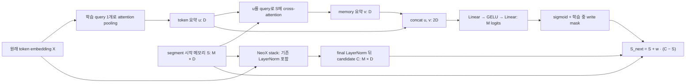

# Write loss regularization으로 레지스터 분화를 유도하는 설계 검토

작성·갱신: 2026-10-16 · 상태: 설계 검토, regularizer 미구현·미실험

[실험 기록: L75 dropout·bias](experiments/20261015_l75_write_gates.md) · [현재 구현 명세](20261011_current_spec.md) · [문서 목록](README.md)

**이 문서의 정규화는 loss에 추가하는 regularization이다.** LayerNorm/RMSNorm 등의 normalization은 필요한 scale 보정을 위한 보조 도구로만 다룬다. 실험 보고서에서 설계 논의를 분리했으며, 측정 결과·실행 조건은 실험 문서에 남긴다.

현재 구조의 근거는 [router.py](../src/grt/models/router.py), [neox.py](../src/grt/models/neox.py), 학습 loss의 근거는 [stream_training.py](../src/grt/stream_training.py)다. 이하 후보 손실은 기존 구현에 없는 제안이다.

## 1. 현재 write 계산: candidate와 gate

배치 축을 생략하면 segment 입력은 `X=Embedding(ids)`∈R^(L×D), 시작 메모리는 S∈R^(M×D)다. Small은 D256·router head8(각32차원)·write MLP hidden512이며, M은8/20/75다. 현재 read gate는 off다.

Router가 쓰는 X는 backbone 출력이나 contextual hidden이 아니라 **backbone embedding을 조회한 직후의 원래 X**다. Router 호출은 backbone의 input dropout보다 앞이고, 두 router attention의 dropout은0이다. 별도의 router 위치 embedding·RoPE·attention residual·LayerNorm은 없다. 이 구조에서 gate·상태·갱신량 중 무엇에 보조 손실을 걸지 구분해야 한다.

각 multi-head attention은 head별로 다음 계산을 하고 concat 뒤 출력 projection을 적용한다. 현재 PyTorch MHA의 학습 가능한 projection bias도 포함되며, 아래 수식에서는 생략한다.

$$
A(Q,K,V)=\operatorname{Concat}_h\left[\operatorname{softmax}\left(\frac{(QW_Q^h)(KW_K^h)^T}{\sqrt{d_h}}\right)VW_V^h\right]W_O.
$$

공통 학습 query q_pool 한 개로 segment를 요약하고, 그 요약으로 시작 메모리를 조회한다.

$$
u_t=A_{pool}(q_{pool},X_t,X_t),\qquad
v_t=A_{mem}(u_t,S_t,S_t),\qquad z_t=[u_t;v_t].
$$

이 router attention에는 위치가 없으므로 token 행 또는 memory 행을 순열로 바꾸면 해당 attention 요약은 수학적으로 불변이다(dropout0, 실수 연산 기준). Backbone에는 위치 정보가 있지만 router 자체는 현재 입력의 순서와 각 슬롯의 주소를 직접 보존한 요약이 아니다. **모든 슬롯이 공유하는 한 요약 벡터**라는 구조적 제약은 loss regularization과 별개다. 보조 손실이 슬롯별 query를 새로 만들지는 않는다.

Write MLP와 슬롯별 gate는 다음과 같다.

$$
h_t=\operatorname{GELU}(W_1z_t+b_1),\qquad
\ell_{t,i}=a_i^Th_t+b_{2,i},\qquad w_{t,i}=\sigma(\ell_{t,i}).
$$

W1은512×512, W2=[a_i^T]는M×512다. 슬롯별 a_i와 b2_i는 독립 파라미터이며 모든 슬롯에 같은 h를 사용한다. b2_i만 선택한 bias로 동일 초기화하고, W1/W2와 b1은 PyTorch Linear 기본 초기화를 사용한다. Backbone Linear/embedding의 std=.02 초기화를 router에 동일 적용하는 구조가 아니다. q_pool은 Xavier 초기화하며, 공유 pool_attn/reg_attn은 read 계산에도 사용하지만 read/write MLP는 별개다. Read off에서는 계산된 read gate가 저장 state 읽기에 적용되지 않는다.

평가에서는 위 w를 그대로 쓰고, 학습 중 dropout p에서는 example·segment·slot별 독립 mask d_i∼Bernoulli(1−p)를 적용한다.

$$
\widetilde w_{t,i}=d_{t,i}\sigma(\ell_{t,i}),\qquad
s_{t+1,i}=s_{t,i}+\widetilde w_{t,i}(c_{t,i}-s_{t,i}).
$$

구현은 mask된 logit을−∞로 만들어 gate0을 얻는다. Mask는 한 슬롯의 D개 feature에 공통이며 1/(1−p) rescaling은 없다. Sigmoid들은 독립적이므로 합1·총 write 예산·슬롯 간 경쟁 제약도 없다.

Candidate C는 `[X; S]`를 공통 NeoX stack에 넣은 뒤 **final LayerNorm 이후** register 행에서 꺼낸다. Backbone은 layer별 attention/MLP 전에 이미 LayerNorm을 사용한다. Token은 모든 layer에서 시작 S를 정규화·projection한 K/V만 읽고, 중간 candidate hidden은 읽지 않는다. Candidate는 전체 segment 정보를 모을 수 있지만 write-back은 stack 종료 후 한 번, 다음 segment에만 적용한다.

슬롯의 구분 근거는 독립적인 S0의 각 행(현재 모두0에서 시작), W2의 슬롯별 행, backbone RoPE 위치 L+i다(i=0..M−1). Slot-specific backbone weight나 직교·비중복 제약은 없다. 같은 역할이나 유사한 표현으로 학습되는 것을 막지는 않는다.

## 2. Regularization의 목표: gate 비율·내용·기능을 구분한다

학습 목적을 다음처럼 확장하는 논의다. 기존 구현의 loss는 task CE이고 아래 보조항은 아직 없다.

$$
\mathcal L=\mathcal L_{CE}+\lambda_dR_{div}+\lambda_vR_{var}+\lambda_sR_{sat}+\lambda_rR_{role}.
$$

모든 항을 처음부터 켜자는 식이 아니다. 아래 항들은 목적이 다른 후보이며 하나씩 효과를 분리한다. **핵심 후보는 메모리 내용의 불필요한 중복을 줄이는 regularizer이고, 과도한 포화 억제·역할 구성 제약은 별도 후보**다. Normalization은 표현 scale을 맞춰 손실이 크기만 보고 판단하지 않게 하는 보조 수단이다.

건강한 분화는 다음 세 축을 함께 본다.

| 축 | 관측 / 유도 대상 | 이것만으로 부족한 이유 |
|---|---|---|
| 쓰기 동작 | 닫힘·열림·문맥에 따라 달라지는 gate, 서로 다른 갱신 시간척도 | gate만 다르고 저장 내용은 같을 수 있음 |
| 내용 | 문맥에 따라 달라지는 state·actual update의 중복 감소 | 독립적인 잡음·슬롯 ID를 저장해도 차이는 생김 |
| 기능 | 전체 validation·그룹 개입·복원·보존 범위 | 유용한 공통 정보는 중복될 수 있고 개입 효과는 합산 불가 |

현재 closed/open/other는 gate의 관측 분류다. Other는 부드럽고 고정된 gate일 수도 있어 자동으로 문맥 선택형이라는 뜻이 아니다. Closed도 warmup 정보를 보존할 수 있다. 그러므로 세 유형을1:1:1로 만들거나 모든 슬롯의 write를 같게 만드는 것을 기본 목표로 정하지 않는다. 사용자가 원하는 역할 비율을 탐색하는 실험은 가능하지만, 특정 비율이 건강하다는 결론은 기능 비교로 검증해야 한다.

기존 증거는 [L75 실험 보고서](experiments/20261015_l75_write_gates.md#46-그룹-개입-m75의-중간형은-기능적으로도-구별된다)에 있다. M8/p.1은 cosine이 줄어도 actual update rank≈1이고, M20/p.1은 중간형이 사라지며 성능이 악화한다. M75/p.1은 중간형5개 swap ΔNLL.3678 대 동일 크기 random.0026으로 기능 차이가 있다. 이는 **분화의 외형과 실제 기여를 함께 통제해야 한다**는 근거이며 특정 regularizer가 효과적이라는 증거는 아니다.

## 3. 1차 후보: 문맥에 따른 내용 중복을 줄이는 항

### 3.1 무엇에 걸 것인가

관측 n은 학습 중의 example·측정 segment를 뜻한다. 임의의 head/feature 평균을 관측 축과 혼동하지 않는다.

| 대상 | 예시 | 의견 |
|---|---|---|
| 원래 state | S_next | 슬롯별 상수 offset·S0 차이만으로 다양성 손실을 줄일 수 있음 |
| 문맥 평균을 제거한 state | Z_ni=S_next,ni−mean_n(S_next,ni) | 문맥 정보의 중복을 겨냥하는 첫 후보. 시간에 따라 쓰지 않는 보존 슬롯도 포함 가능 |
| 실제 update | Δ_ni=w_ni(C_ni−S_ni) | 갱신 내용의 분화에 직접적. 닫혀 보존하는 슬롯은 거의0이라 모든 슬롯에 강제하면 불리 |
| candidate | C_ni | 실제 저장되지 않는 후보만 다양해지는 우회 가능 |
| gate만 | w_ni 또는 logit | 동작 분화이며 내용 분화를 대신하지 못함 |

**첫 내용 regularizer는 문맥 평균을 제거한 S_next를 대상으로 하는 것이 더 일반적**이다. Actual update는 별도 ablation 후보로 두며, 보존형을 미사용으로 취급하지 않는다. 평가용 rank/CKA도 state와 update를 따로 확인한다. 평균 제거는 학습 통계 계산이며 저장 state를 직접 바꾸는 연산이 아니다.

### 3.2 가벼운 방향 중복 penalty

각 관측에서 슬롯 feature 벡터의 방향 유사도를 구한다.

$$
q_{n,i}=\frac{Z_{n,i}}{\max(\|Z_{n,i}\|_2,\epsilon)},\qquad
R_{div}=\frac{1}{NM(M-1)}\sum_n\sum_{i\ne j}
\left[(q_{n,i}^{T}q_{n,j})^2-\tau^2\right]_+.
$$

이는 정규화한 표현의 Gram matrix off-diagonal을 억제하는 방향 다양성 항의 예시다. `[x]_+=max(0,x)`다. Tau0이면 squared-cosine penalty, tau>0이면 일정 수준의 공유 성분을 허용한다. 제곱은 부호만 뒤집어 같은 정보를 저장하는 해도 중복으로 다루기 위한 것이다. 작은 epsilon은 분모 안정화이며 LayerNorm module 삽입과 다르다.

장점은 M×M Gram으로 구현이 비교적 단순하고, 손실을 pair 수로 평균해 M이 커질 때 계수가 자동으로 커지는 문제를 줄인다는 것이다. 비용은 대략 O(NM²D)라서 M75를 매 BPTT segment에 적용하는 비용이0은 아니다. 정확한 T4 비용은 구현 후 측정해야 한다.

중요한 실패 가능성도 있다.

- **모두0인 해:** 분모에 epsilon을 넣으면 Z=0에서 q=0·R_div=0이어서 붕괴가 손실을 줄인다. 이 항 하나에 anti-collapse 보장이 있다고 주장하면 안 된다.
- **좌표 변환 우회:** 같은 정보를 슬롯마다 서로 다른 회전·feature 배치로 저장하면 cosine은 낮아도 정보 중복은 남을 수 있다.
- **잡음 우회:** task에 쓰지 않는 서로 다른 변동을 추가해 손실을 줄일 수 있다.
- **유용한 공유 정보 억제:** 완전 직교가 최적 메모리라는 근거가 없으므로 작은 계수·허용 threshold를 우선 검토한다.

따라서 이 손실을 “정보 독립성”이라고 부르지 않고 **방향 중복에 대한 proxy**로 기록한다. Train 중 방향 penalty가 줄었는지와, 사후 CKA·그룹 기여·validation이 좋아졌는지를 구분한다.

### 3.3 Variance floor를 함께 고려하는 이유와 한계

VICReg류의 variance/covariance 접근처럼 중복 억제와 붕괴 방지를 분리할 수 있다. 이 모델에서는 모든 슬롯의 variance를 강제로 키우기보다, 예를 들어 전체 문맥 변동이 사라지는 것을 막는 약한 항부터 검토한다.

$$
e_i=\sqrt{\frac{1}{ND}\sum_n\|Z_{n,i}\|_2^2+\epsilon},\qquad
R_{var}=\left[\gamma-\frac1M\sum_i e_i\right]_+^2.
$$

Gamma는 기존 정상 run에서의 표현 scale을 참고해 결정할 실험 변수다. 이 예시는 평균 변동의 하한이라 일부 보존·저변동 슬롯을 허용하지만, 한 슬롯의 큰 변동으로 만족할 수도 있다. 슬롯별 floor `mean_i[gamma−e_i]_+²`는 더 강력하지만 모든 슬롯에 같은 변화량을 요구하므로 기본안으로 정하지 않는다. 고정 K개나 non-closed 묶음에만 적용하는 것도 별도 역할 가정이다.

또한 정확히 모든 Z가0이면 위 제곱 기반 variance의 미분도0일 수 있다. 따라서 이미 완전히 붕괴한 checkpoint를 이 항으로 반드시 회복시킬 수 있다고 보지 않는다. 큰 gamma는 크기 부풀리기·잡음 추가로 만족할 수 있다. **다양성 항+variance 항은 표준적인 출발 프레임워크지만 이 GRT에 맞춘 대상·축·계수는 새 설계이며 검증이 필요하다.**

### 3.4 Covariance·CKA·effective rank 대안

표준 decorrelation의 기본 형태는 관측별 표현 F를 중심화·표준화한 뒤 covariance의 off-diagonal을 제곱해 평균하는 것이다. 다만 F를 `[N,M×D]`로 펼치면 모든 feature쌍을 통제하며 비용과 제약이 크다. 슬롯별 scalar norm만 F로 쓰면 내용 대신 진폭의 동조만 통제한다. 어떤 축의 covariance인지 먼저 정해야 한다.

슬롯 i의 관측 행렬 Z_i∈R^(N×D)에 대한 linear CKA penalty는 서로 다른 feature 회전으로 같은 정보를 저장하는 우회에 더 강하다. 하지만 작은 N에서는 편향되고, 계산·메모리 비용이 커지며 상수 슬롯 처리도 필요하다. 처음에는 사후 검증 지표로 유지하고 필요하면 일부 슬롯쌍·정해진 간격에서의 loss 후보로 올린다. 계산량을 줄이려고 샘플링하면 sampling protocol도 비교 조건이다.

Log-det·effective rank 최대화도 가능한 다양성 regularizer지만 같은 문제가 남는다. 표현0의 정의·gradient, feature/관측 수에 따른 최대 rank, 공통 정보 억제를 명시해야 한다. `[N,M]` 중심화 통계의 rank는 min(N−1,M) 이하여서 N<M인데 identity covariance를 요구하면 달성 불가능하다. 이 한계는 per-state `[M,D]`의 직교 가능 조건 M<=D와 다른 것이다. 높은 rank 자체가 task에 유용한 기억을 뜻하지 않는다.

## 4. 2차 후보: 과도한 gate 고착을 억제하는 loss

Gate 포화를 줄이는 것과 내용을 분화시키는 것은 다른 목적이다. Extreme logit이 gate 학습을 막는다면 다음 항을 독립 비교할 가치가 있다.

$$
R_{sat}=\frac1{NM}\sum_{n,i}\left[|\ell_{n,i}|-c\right]_+^2.
$$

허용 범위 c 안에서는 간섭하지 않고 지나치게 큰 raw logit에만 비용을 준다. Logit L2는 모든 값을0으로 미는 반면 이 항은 일정 수준의 열림/닫힘을 허용한다. 허용 폭 c와 lambda_s는 HPO 변수이며 sigmoid slope·기억 보존 요구를 보고 정한다. 이것도 위 범위가 정답이라는 가정을 넣는 방법이다.

이 항은 **sigmoid를 통과하기 전 raw logit에 직접 걸기 때문에**, 큰 logit에서도 해당 경로에 복원 gradient를 줄 수 있다. 반면 `w(1−w)`·gate entropy에만 의존하는 penalty는 이미 포화돼 sigmoid 미분이 거의0이면 약해질 수 있다. 학습 중 write dropout으로−∞를 넣은 logit이 아니라 mask 전 finite logit을 사용해야 한다. 이번 비교의 dropout은0이지만 확장 시 필요한 구분이다.

단점은 장기 보존을 위한 강한 닫힘과 즉시 갱신을 위한 강한 열림을 방해할 수 있다는 것이다. 모든 슬롯의 극단화를 막는 것이 곧 건강한 분화는 아니다. 먼저 `CE+lambda_s R_sat`를 내용 regularizer와 분리해, gate가 덜 고착되는 것만으로 내용·기능도 달라지는지 본다. 그 자체를 메인 분화 장치로 간주하지 않는다.

## 5. 역할 비율과 사용량을 유도하는 항

사용자가 지적한 유형 비율은 중요한 실험 변수다. **특정 비율을 미리 정해 그 비율의 효과를 검증하는 것**과 **관측된 균형을 자동으로 건강하다고 부르는 것**을 구분한다.

### 5.1 Write 예산·coverage

평균 write에 하한/상한을 주는 예시는 다음과 같다.

$$
\bar w=\frac1{NM}\sum_{n,i}w_{n,i},\qquad
R_{budget}=[\rho_{min}-\bar w]_+^2+[\bar w-\rho_{max}]_+^2.
$$

모두 닫히거나 모두 열리는 극단을 제한할 수 있지만 모든 gate가 같은 중간값인 해도 가능하다. 또한 큰 write의 한 슬롯과 작은 write의 여러 슬롯을 구분하지 못한다. Write를 줄이는 L1만 넣으면 오히려 미사용·닫힘을 장려할 수 있다. 평균 사용량 항은 내용 분화의 대체물이 아니다.

### 5.2 부드러운 유형 비율 penalty

Gate 기준 a<b와 부드러움 T>0에 대해 예를 들면

$$
p_c(w)=\sigma((a-w)/T),\quad p_o(w)=\sigma((w-b)/T),\quad
p_m(w)=1-p_c(w)-p_o(w).
$$

a<b이면 이 식의 p_m은 음수가 되지 않는다. `q_g=mean_(n,i) p_g(w_ni)`를 전체 비율로 보고 target pi에 대해 `R_role=sum_g(q_g−pi_g)²`를 둘 수 있다. 정확한 비율 대신 하한·상한 범위만 주면 가정이 조금 약해진다. Pi=(1/3,1/3,1/3)을 기본으로 채택할 근거는 없다.

**이 q는 gate 관측의 비율이고, 사후의 슬롯 유형 비율과 다르다.** 하나의 슬롯이 관측마다0/1로 바뀌어도 q_c/q_o를 채울 수 있다. 사후 closed/open은 한 슬롯의 모든 관측에서의 범위를 기준으로 한다. 슬롯의 평균·변동이나 smooth max/min으로 유형 penalty를 설계할 수도 있지만 관측 길이·T·통계 편향에 민감하다. 이 구분 없이 목표 비율을 달성했다고 보고하지 않는다.

또한 슬롯별 역할을 미리 고정하면 분화를 유도하기는 쉽지만 역할 할당을 설계자가 강제하는 새로운 가정이다. 초기에는 슬롯 인덱스에 대해 대칭적인 약한 penalty를 우선 검토한다. 같은 전체 비율에서도 실제로 어느 슬롯이 무엇을 기억하는지 달라질 수 있으므로 group 개입을 유지한다.

### 5.3 Entropy·시간척도

각 gate의 Bernoulli entropy `H(w)`를 최대화하면 모든 gate=.5가 쉬운 해라서 분화 손실로는 불충분하다. `H(mean_i w)−mean_i H(w)`를 키우면 슬롯 사이 열린/닫힌 양극화를 만들 수 있지만 M8/p.1처럼 binary 두 묶음만 남는 현상을 장려할 수 있다. 축을 example/time으로 바꾸면 문맥에 따른 전환을 장려하지만 모든 슬롯을 같은 방식으로 전환시키는 해도 남는다.

현재 모델은 같은 logit을 공유하지 않지만 공통 h를 사용한다. Gate·실제 update의 서로 다른 시간척도를 유도하는 penalty도 가능하다. 다만 state 변화량에 L2를 걸면 모든 슬롯이 정지하는 해가 쉽고, 슬롯마다 서로 다른 목표 rate를 주면 시간척도를 사전에 지정하게 된다. 실제로 분화된 기억 기간인지는 retention·동일 task 품질로 확인해야 한다.

## 6. 기능에 직접 거는 보조 손실과 그 비용

무작위 일부 메모리를 훼손한 분기의 task CE를 학습에 추가하는 robustness loss는 가능하다. 하지만 추가 forward/BPTT 비용이 들고, 메모리를 무시하는 모델도 훼손에 강하다. 현재 write dropout도 상태 보존 mask이며 슬롯 제거와 다르므로 같은 실험으로 부르지 않는다.

Normal 예측이 swap보다 좋도록 margin을 주는 `max(0,m+L_normal−L_swap)`도 떠올릴 수 있다. 그러나 모델이 L_swap을 일부러 악화시켜 만족할 수 있어 올바른 메모리 활용과 잘못된 문맥 취약성을 혼동한다. 첫 regularizer로 권하지 않는다. Reset/swap은 우선 학습 objective와 분리한 held-out 기능 평가로 유지한다.

중복 표현을 줄이는 contrastive loss나 auxiliary retrieval도 가능하지만 negative·추가 target·task 가정이 생긴다. 이번 단계에서는 표준적인 내용 중복 penalty, anti-collapse, 제한적인 gate 고착 억제를 먼저 비교하는 편이 작고 해석 가능하다.

## 7. Normalization은 scale을 맞추는 보조 수단

Loss 안에서 cosine/correlation을 계산하기 위한 feature 표준화·L2 normalization과, 모델 forward에 LayerNorm/RMSNorm을 추가하는 것은 다른 개입이다. 전자는 regularizer가 크기만 보고 판단하지 않도록 하는 정의의 일부이며, 후자는 학습 모델의 gate 자체를 바꾼다.

현재 관측된 큰 u/v scale 차이는 보조 normalization을 고려할 근거지만 regularization보다 먼저 해결해야 한다는 전제로 두지 않는다. Forward normalization을 시험한다면 최소 후보는 u/v 각각의 feature-wise LN 또는 RMSNorm이다. 저장 S를 매번 정규화하면 gate0에서도 원래 state 보존이 깨지므로 다른 구조 변경으로 다룬다. QK norm·hidden norm도 별도 가설이다.

Regularizer의 scale 불변성도 공짜가 아니다. 작은 변동을 단위 norm으로 키우면 잡음이 큰 의미를 갖고, epsilon은0 근처 loss/gradient를 바꾼다. 입력 state의 학습 가능한 크기를 loss의 단위로 쓰면 모델이 그 크기를 조절해 항을 우회할 수도 있다. 어떤 통계·축·epsilon·detach를 썼는지 기록한다.

## 8. 실제 학습 loss로 옮길 때의 구현 계약

이 문서는 구현 전 검토이며 현재 code에 auxiliary loss/config는 없다. 다음은 구현 시 지켜야 할 조건이다.

- **Gradient가 살아 있는 값 사용:** 기존 TraceBuffer/RegisterObserver는 no-grad·detach·CPU 통계라 학습 loss 입력으로 재사용할 수 없다. Forward 중 graph가 살아 있는 S_next·update·raw logit에서 계산해야 한다.
- **BPTT 재계산 중복 방지:** 현재 학습은 과거3개 segment를 replay하고 새 segment만 CE target을 갖는다. 같은 과거 segment의 reg를 매번 새 관측으로 과다 계상하지 않도록, 첫안은 이번 새 target segment의 정해진 state에만 적용한다. 초기 S0와 graph의 gradient 범위를 임의로 detach해 바꾸지 않는다.
- **Microbatch·GPU 조건 명시:** covariance·variance·비율 손실은 비선형 통계라 microbatch별 loss 평균이 global batch 통계 loss와 같지 않다. Effective batch256만 같다고 auxiliary objective까지 같다고 말하면 안 된다. 고정 N_aux의 통계 protocol을 쓰거나 올바른 autograd 분산 통계를 구현해야 한다. Auto-batch가 바뀌어도 비교 대상의 N_aux와 샘플링을 맞춘다.
- **계수 scale:** CE는 target token 평균, reg는 example·slot·pair 평균으로 정규화한다. M/L·aux 측정 구간이 달라져도 항의 원소 개수 때문에 lambda 효과가 자동 증가하지 않게 한다. Lambda는 LM loss 대비 gradient 영향과 함께 살핀다.
- **별도 logging:** CE, 각 raw R, lambda R, 전체 loss를 분리하고 보조 loss만 감소한 것을 품질 개선으로 보고하지 않는다. Validation PPL과 best checkpoint 선택은 기존 task CE를 유지한다.
- **새 run과 재현성:** regularizer 종류·계수·threshold·스케줄·통계 batch는 resolved config/run hash에 반영한다. 구조가 같더라도 학습 objective가 바뀌면 새 초기화 run이다. Bias/dropout/seed·정규화 사용 여부를 동시에 바꿔 효과를 섞지 않는다.

초기부터 큰 coefficient를 주거나 너무 늦게 켜면 각각 task 학습 방해·이미 고착된 상태에서 gradient 부족 문제가 생길 수 있다. Lambda ramp-up은 실험 변수지만 기존 cosine20k와6k/12k epoch 경계 전환을 함께 기록한다. 짧은 pilot은 수치·gradient 검사용이고 최종 분화 순위 판정용으로 사용하지 않는다.

## 9. 제안하는 우선순위와 아직 정해야 할 점

현재 확정된 실험은 dropout0·bias−2/+2의 추가6run이다. Bias0은 기존 결과를 재사용한다. 아래 regularization은 구현·학습이 승인된 확정 조건이 아니라, 그 다음 비교를 위한 설계 후보다.

1. **내용 분화가 주목적이면:** 문맥 평균 제거 state의 약한 R_div를 첫 내용 후보로 두고, R_var의 필요성과 계수를 함께 설계한다. R_div 단독을 anti-collapse 해법으로 부르지 않는다. Actual update를 대상으로 바꾸는 것은 별도 ablation이다.
2. **Gate 고착과 구분하려면:** raw-logit 범위 penalty R_sat만 사용한 조건을 별도로 비교한다. 내용 차이와 단순 포화 완화가 각각 얼마나 설명하는지 본다.
3. **유형 비율을 직접 통제하려면:** 목표 비율/허용 범위를 명시한 R_role을 별도 가설로 시험한다. 3유형 균등을 기본 정답으로 넣지 않는다.
4. **필요할 때만:** 수치 scale 때문에 비교가 어려우면 최소 normalization을 추가하고 reg-only/norm-only/조합을 구분한다. 이것을 메인 분화 기제로 바꾸지 않는다.
5. **재현성:** 유망한 조건과 baseline을 같은 추가 seed에서 비교한다. 비율이 달라도 기능과 품질이 유지되면 건강한 분화일 수 있다.

구체 실험 전 정할 것은 (a) state 대 actual update 중 주 대상, (b) 허용할 공유 성분 tau와 문맥 변동 floor gamma, (c) lambda와 적용 시점, (d) aux 통계 N, (e) 유형 비율을 직접 가정할지 여부다. 제 초기 의견은 **state 내용 중복 penalty+약한 anti-collapse를 주 후보, raw-logit penalty를 원인 분리용 대조군, 유형 비율 제약을 후속 후보**로 두는 것이다. 이 조합은 기존 모델에서 검증된 처방이 아니며 수치 검증과 GPU 결과를 보고 좁혀야 한다.

최종 성공 기준은 validation 품질 유지·개선, 같은 크기 random보다 구별되는 held-out group 기여, 문맥에 따른 실제 표현 차이, seed/초기 bias 변화에 대한 안정성이다. Loss가 목표한 비율·낮은 cosine·높은 rank를 달성했다는 것만으로 성공 처리하지 않는다.

## 10. 표준 방법의 참고 문헌

다음은 설계에 참고할 표준적인 출발점이다. 이 논문들이 현재 GRT에 위의 손실항을 검증했다는 뜻은 아니다. 특히 VICReg/Barlow Twins의 목적과 축을 슬롯 메모리에 옮기는 부분은 별도 설계다.

- [VICReg — Variance-Invariance-Covariance Regularization (2021)](https://arxiv.org/abs/2105.04906): 중복 억제와 anti-collapse를 별도 항으로 다루는 관점. 여기서는 원래의 두-view invariance를 그대로 요구하지 않는다.
- [Barlow Twins (2021)](https://arxiv.org/abs/2103.03230): cross-correlation 기반 redundancy reduction. 서로 다른 슬롯을 같은 view로 간주해 동일 표현을 강제하는 것으로 오용하지 않는다.
- [Similarity of Neural Network Representations Revisited / CKA (2019)](https://arxiv.org/abs/1905.00414): 표현 유사도 평가와 단순 cosine의 한계 검토.
- [Layer Normalization (2016)](https://arxiv.org/abs/1607.06450), [RMSNorm (2019)](https://arxiv.org/abs/1910.07467): 보조적인 scale 통제.

문서 검토 범위: 현재 write 구조·학습 CE/BPTT·사후 통계의 detach 경로와 대조한 설계다. Regularizer의 학습 gradient·비용·GPU 효과를 검증한 구현은 아직 없다. 실험 수치는 원래 실험 문서에서 관리한다.
