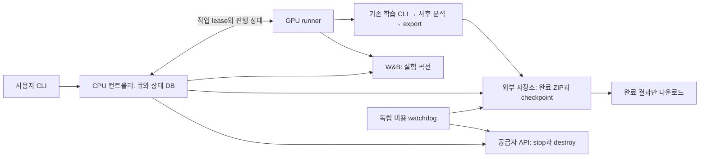

# 원격 GPU 장기 실험과 실행 큐 설계 보고서

작성: 2026-10-21 · 코드 검토 기준: `10defc9` · 상태: **설계 제안, 미구현**

## 1. 권장안

**고정된 환경의 단일 GPU 한 대에서 실험을 순차 실행하고, GPU 밖에 큐 상태·결과·과금 감시를 두는 구성을 권장한다.** 사용자는 독립 실험들을 미리 등록한다. SSH와 브라우저를 닫아도 실행은 계속되며, 실험마다 학습·사후 분석을 끝내고 완료 결과를 게시한 뒤 다음 실험으로 넘어간다. 큐가 소진되면 외부 백업을 확인하고 임대를 종료한다. 사용자 다운로드를 기다리며 GPU를 켜두지 않는다.

초기에는 Vast.ai **on-demand** 인스턴스로 운영 절차를 안정화하고, 장기적으로 높은 가동률을 유지할 수 있다면 물리 GPU 컴퓨터 임대와 비교한다. 선택 기준은 시간당 최저가보다 **같은 조건의 실험을 완료하는 총비용**이다. Interruptible, 다중 노드, 자동 증설은 초기 범위에서 제외한다.

기존 Kaggle/Colab 노트북과 실행 방식은 유지한다. 새로운 원격 실행기는 공통 CLI·Config·checkpoint·사후 분석·결과 형식을 재사용한다. 노트북을 복제하거나 연구 조건별 스크립트를 늘리지 않는다. 이번 변경은 이 보고서와 문서 목록뿐이며 구현·CPU/GPU 검사·유료 자원 임대는 수행하지 않는다.

큐는 실험 사이의 공백을 줄이고, 종료 정책은 큐가 빈 뒤의 과금을 줄인다. 두 기능이 함께 필요하다. 큐를 넉넉히 채우더라도 총비용과 임대 시간의 상한은 독립적으로 적용한다.

## 2. 현재 실측과 해결할 문제

[M20 gate 경로 최종 보고서](experiments/20261019_l75_gate_paths.md)의 실측은 다음과 같다. 공통 조건은 T4×2·FP32·global256·L75/M20·40k다. 학습 wall에는 validation·RTLA·checkpoint 저장이 포함되고, 준비·preflight·별도 사후 분석은 제외된다.

| 경로 | 40k 학습 wall | wall/update | 별도 사후 분석 |
|---|---:|---:|---:|
| independent | 12.530시간 | 1.128초 | 90.935초 |
| separate_head | 13.670시간 | 1.230초 | 58.439초 |
| candidate | 12.488시간 | 1.124초 | 82.490초 |

사용자가 겪는 Kaggle 세션 약12시간·주간 약30시간 제약을 운영상의 출발점으로 삼는다. 계정별 한도나 GPU-hours와 quota의 환산 규칙을 여기서 확정하지 않는다. 현재 실측만으로도 40k를 한 세션 안에 마치기 어려운 경우가 확인된다.

Candidate 실측을 단순 비례하면 같은 장비에서 80k는 약24.98시간, 100k는 약31.22시간이다. 이는 계획용 추정이며 새 GPU 속도나 수렴 보장이 아니다. 현재 40k 결과도 일반적인 완전 수렴을 증명하지 않는다. 장기 run은 처음부터 최종 예산과 LR 스케줄을 정해 시작해야 한다.

원격 운영에서 추가로 해결해야 할 문제는 다음과 같다.

- SSH 연결과 학습 프로세스의 수명을 분리한다.
- 한 실험이 실패해도 원인을 보존하고 독립적인 다음 실험으로 진행한다.
- 학습 완료·사후 분석 완료·외부 저장 완료를 구분한다.
- 중간 checkpoint와 데이터는 보존하되, 평소에는 작은 완료 결과만 다운로드한다.
- 큐 소진·장애·예산 소진 시 과금 종료까지 확인한다.
- 현재 실험과 전체 큐의 ETA를 구분하고, 추정 근거와 오차를 표시한다.

## 3. 임대 방식과 GPU 선택

### 3.1 물리 컴퓨터와 Vast.ai 비교

| 항목 | 물리 GPU 컴퓨터 원격 임대 | Vast.ai 인스턴스 |
|---|---|---|
| 장점 | 고정 장비와 로컬 디스크를 오래 유지하기 편함 | 수일 단위로 빌리고 반납하기 쉬우며 장비 선택 폭이 넓음 |
| 확인할 비용 | 일/주/월 임대료, 전기·네트워크·디스크 포함 여부 | 전체 compute 단가, 디스크, 업로드·다운로드 단가 |
| 운영 확인 | 독점 사용 여부, 관리자 권한, 장애 대응, 반납 절차 | 호스트 신뢰도, CPU/RAM 할당, 대역폭, 계약 종료 시각 |
| 연결 종료 후 | 서비스 관리자로 실행 유지 | 컨테이너의 시작 명령·supervisor로 실행 유지 |
| 큐 종료 후 | 백업·프로세스 종료·장비 반납; 전원 종료가 계약 종료인지 확인 | 공급자 API로 stop/destroy하고 실제 상태 확인 |
| 적합한 경우 | 긴 backlog와 높은 장기 가동률 | 우선 운영 검증, 짧은 실험 묶음, 장비 비교 |

월정액 물리 임대에서는 컴퓨터를 꺼도 임대료가 줄지 않을 수 있다. 큐는 구매한 시간의 활용률을 높이지만 계약 반납을 대신하지 않는다. 반납 API가 없으면 마지막 수동 절차를 운영 상태에 명시한다.

Vast.ai 가격은 호스트와 시점에 따라 바뀌며 compute·storage·bandwidth가 합산된다. 특정 GPU의 현재 최저가를 고정 추천하지 않는다. 임대 직전 조회한 **인스턴스 전체 시간당 요금**과 저장·전송 단가를 정책에 기록한다. [공식 가격 구조](https://docs.vast.ai/guides/instances/pricing)

### 3.2 초기 장비 기준

Small 실험은 우선 **24GB급 단일 GPU**를 후보로 둔다. RTX 3090/4090 등과 더 큰 VRAM 장비를 실제 견적으로 비교한다. 현재 T4×2의 GPU당 peak 약11.8GiB를 합쳐 단일 GPU 필요량으로 계산하지 않는다. Microbatch·누적·world size가 달라 직접 측정해야 한다.

신규 장비에서는 global256을 유지하며 preflight로 microbatch×accumulation을 정한다. 예를 들어 단일 GPU의 micro64×accum4 또는 2GPU의 micro64×accum2×2를 고려할 수 있지만, 실측 전 권장 배치로 확정하지 않는다. 원격 runtime의 초기 VRAM 목표는 0.85~0.90을 제안하며 기존 Kaggle의 0.95는 바꾸지 않는다.

초기 견적에서는 RAM32GB 이상·SSD100GB를 후보 조건으로 삼고, 실제 dataset·checkpoint 크기와 업로드 대기량에 맞춰 수정한다. CPU 할당·디스크 속도·네트워크가 느리면 GPU만 빠른 장비에서도 준비·저장 비용이 커진다.

FP32 계약을 유지하고 AMP 전환은 별도 실험으로 둔다. 새로운 GPU에서는 TF32 사용 여부도 명시적으로 고정·기록한다. 기존 사후 분석은 TF32 off를 강제하지만 학습 코드에는 같은 명시 설정이 없다. 원격 학습에는 이 정책을 추가하고 과거 학습과의 수치 동등성을 주장하지 않는다. 해당 GPU를 지원하는 CUDA·PyTorch 조합을 검증해 고정하고, `transformers==4.45.2`는 유지한다. GPU에 맞지 않는 과거 CUDA 이미지를 그대로 복제하지 않는다.

초기에는 GPU 자원 묶음당 한 실험만 실행한다. GPU 2장을 빌렸다면 한 실험의 DDP와 GPU별 독립 실험의 비용을 나중에 비교할 수 있다. 동시 실행은 별도 자원 할당과 측정이 필요한 확장이다.

### 3.3 비용 계산과 비교 예시

```text
총비용 = Σ(전체 인스턴스 compute 단가 × 가동 시간)
       + 가동/정지 중 디스크 + 전송 + 외부 저장소 + 컨트롤러
완료당 비용 = 총비용 / 검증된 완료 실험 수
월정액 손익 시간 = 월 고정비 / (동급 처리량의 시간당 임대비 - 별도 시간당 운영비)
```

가동 시간에는 준비·학습·평가·RTLA·저장·사후 분석·동기화 대기·재시도까지 포함한다. 기존 보고서 wall은 이 중 일부이므로 청구 시간과 구분한다. GPU-hours는 GPU 수×wall이고, 견적이 이미 전체 GPU 요금이면 다시 GPU 수를 곱하지 않는다.

계산 예로 기존 candidate 100k의31.22시간에 대해, 후보 A가 전체 wall 기준2배 빠르고 시간당 $0.40이면 학습 약$6.24, 후보 B가4배 빠르고 $0.60이면 약$4.68이다. **가상의 가격·가속률**이며 견적이나 실측이 아니다. 실제 선택은 같은 조건의 preflight와 짧은 GPU pilot으로 결정한다. 제조사 FLOPs나 다른 모델 benchmark를 GRT 가속 배율로 사용하지 않는다.

## 4. 구성: GPU 실행기와 외부 관리 영역



| 요소 | 책임 |
|---|---|
| CPU 컨트롤러 | 등록·FIFO·우선순위·lease·상태·결과 index·임대 종료 조율 |
| GPU runner | 환경 검증, 실행 단계·프로세스 그룹 관리, heartbeat, 파일 전송 |
| 외부 저장소 | 결과·복구 checkpoint·dataset manifest·큐 snapshot·운영 정책 보관 |
| 독립 watchdog | 컨트롤러/runner 장애와 비용 deadline 감시, 공급자 종료 재확인 |

컨트롤러는 소형 상시 CPU 서버에서 서비스로 실행하고 SQLite를 **그 서버의 로컬 디스크**에 둔다. 네트워크 파일시스템의 DB를 여러 클라이언트가 직접 수정하지 않는다. 인증된 CLI/API 또는 SSH로 등록·조회하며, 초기에는 별도 웹 UI가 필요하지 않다. 정합적인 DB snapshot과 이벤트 journal을 외부에 백업한다.

실험마다 이미지 설치·데이터 준비를 반복하지 않는다. Allocation 시작 시 고정 환경과 공유 dataset을 준비하고, job마다 별도 자식 프로세스와 출력 경로만 만든다. Claim한 job은 불변 실행 명세를 로컬에 보관한다. 컨트롤러 연결이 끊기면 실행 중 job은 저장하며 마무리할 수 있지만 새 lease 없이 다음 job을 시작하지 않는다. 저장된 로컬 이벤트는 연결 복구 후 대조하며, 단절 상태에서도 운영 deadline은 적용한다.

Watchdog는 컨트롤러와 실행 수명이 다른 예약 작업/서버리스 함수로 둔다. 임대 ID·hard deadline·저장 상태를 GPU와 컨트롤러가 모두 죽어도 읽을 수 있어야 한다. GPU 안의 timeout 프로세스 하나로 과금 감시를 완료했다고 보지 않는다. 개인 PC 컨트롤러도 가능하지만 절전·종료될 수 있는 PC만으로 무인 과금 관리를 보장하지 않는다.

외부 저장소는 전용 S3 호환 bucket을 권장한다. 상시 서버의 SSH/SFTP 저장소도 동일한 hash 검증·보관 계약을 만족하면 가능하다. Vast.ai Cloud Sync는 보조 전송 수단으로 선택할 수 있다. 공식 문서상 Docker 인스턴스에서 지원하며 임시로 호스트에 자격 증명이 전달되므로 전용 계정이나 제한된 bucket 권한을 쓴다. [Cloud Sync 안내](https://docs.vast.ai/guides/instances/storage/cloud-sync)

Vast.ai volume은 현재 같은 물리 호스트에 묶인 local volume이다. 다른 호스트로 옮길 수 있는 공용 저장소나 백업으로 간주하지 않는다. GPU host·volume이 모두 사라져도 큐 정의와 외부 checkpoint로 복구할 수 있어야 한다. [Volume 범위](https://docs.vast.ai/guides/instances/storage/volumes)

## 5. 실험 등록과 설정 계약

### 5.1 식별자

- `experiment_id`: 실험 ID. 같은 제출 요청을 재전송해도 중복 생성하지 않는 제출 키를 둔다.
- `spec_hash`: 코드 commit·dataset/tokenizer hash·연구 조건·최종 예산·분석 옵션의 정규화된 hash.
- `resolved_config_hash`: 실제 경로와 preflight 배치 보정을 포함한 최종 Config hash. 엄격한 재개 비교에 사용한다.
- `attempt_id`: 장애 후 재실행 구분. 이전 로그·실패 사유·실제 청구 시간을 보존한다.
- `allocation_id`: 임대/장비 구분. 공급자 instance ID, GPU 모델·수, 시작·종료 시각과 전체 단가를 연결한다.

동일 조건의 의도적인 반복은 새 experiment_id로 허용한다. 같은 experiment_id의 retry가 중복 학습을 만드는 것은 막는다. Spec에서 경로를 정규화하더라도 기존 trainer의 Config 비교를 생략하지 않는다.

### 5.2 제안하는 큐 입력

다음은 **향후 구현할 manifest 예시**이며 현재 CLI에서 실행되지 않는다. 예시는 이 문서에만 두고 이번 변경에서 실제 설정 파일은 만들지 않는다.

```yaml
queue_version: 1
campaign: candidate_transfer_long
code_ref: <검토한 전체 commit SHA>
dataset_ref: wt103-gpt2-<manifest hash>
execution_profile: remote_single_gpu_fp32
posthoc_profile: grt_standard_windows
defaults:
  task: wikitext103
  model: grt
  size: small
  tokenization: gpt2_bpe
  budget: 100k
  seed: 54
  overrides:
    model.segment_len: 75
    model.router.write_source: candidate
    model.router.write_detach_source: false
    model.register.conditional_read: false
    model.register.write_gate_bias_init: 0
    model.register.dropout_prob: 0
    model.register.write_logit_threshold: 10
    model.register.write_logit_coef: 0.0001
    training.global_batch_size: 256
    training.warmup_ratio: 0.05
    training.min_lr_ratio: 0.01
    evaluation.batch_size: 10
    evaluation.every_steps: 1000
    evaluation.test_at_end: false
jobs:
  - id: candidate_m8_seed54_100k
    overrides: {model.num_registers: 8}
  - id: candidate_m20_seed54_100k
    overrides: {model.num_registers: 20}
  - id: candidate_m75_seed54_100k
    overrides: {model.num_registers: 75}
```

100k는 운영 예시이며 다음 연구 계획의 확정이 아니다. 같은 M의 independent 대조·여러 seed도 같은 최종 예산으로 사전 등록할 수 있다. 기존40k와 장기 run은 warmup·cosine도 달라 같은 checkpoint의 연장으로 취급하지 않는다.

`grt_standard_windows`는 현재 비교와 같은 batch8·warmup3·측정8 segments·horizon4·window 시작0/16/32·무작위 반복3·slots/registers 분석을 가리키도록 명시적으로 정의한다. 옵션이 달라지면 별도 분석 spec/hash로 기록한다. 학습은 전체 validation으로 best를 선택하고 test는 후보 선정에 사용하지 않는다.

병합 순서는 `기존 카탈로그 → remote runtime → queue defaults → job overrides → 허용된 preflight 배치 보정 → 최종 Config 동결`이다. Operator 변경도 등록 시 반영하고, 실행 후 숨은 환경변수로 연구 조건을 바꾸지 않는다. 모델 선택과 override가 충돌하면 거부한다.

Remote runtime은 환경·초기 배치·W&B 연결 방법을 담당한다. L/M·gate source·학습 예산은 runtime에 넣지 않는다. 현재 카탈로그의 일반 GRT 기본값은 bias−2·penalty off이므로 연구 조건 bias0·A를 예시처럼 명시한다. Kaggle preset에서 GPU 수만 바꿔 쓰지 않는다.

### 5.3 사용자 조작

제안 CLI는 `submit / list / status / pause / resume / cancel / retry / collect / drain`이다. Submit은 전체 job을 검증한 뒤 일괄 등록하며 잘못된 job을 조용히 누락하지 않는다. 미시작 job의 순서·우선순위·취소는 수정 가능하지만 실행 시작 후 spec 변경은 금지하고 새 job으로 등록한다.

Campaign의 code commit SHA와 환경 image digest를 고정한다. 다른 commit의 실험은 별도 campaign과 checkout을 만들며 실행 중 checkout을 git pull하지 않는다. 비밀값은 manifest·Git·결과 ZIP에 넣지 않는다.

## 6. 큐 실행과 장애 처리

### 6.1 실행 단위와 상태

**1 job = 1모델 학습 + 필요한 사후 분석 + 결과 검증·공개**로 정의한다. 학습은 Python 자식 프로세스/torchrun으로 실행한다. Job마다 새 프로세스를 쓰고, 이전 프로세스 그룹이 종료되어 GPU 메모리가 해제된 것을 확인한다. DDP job은 지정한 전체 GPU를 점유한다.

FIFO를 기본으로 하고 같은 우선순위에서는 등록 순서를 따른다. 다음 job의 작은 설정 준비나 완료 파일의 CPU 전송은 겹칠 수 있지만 동일 GPU에서 학습과 사후 분석을 겹치지 않는다. 초기에는 사후 분석까지 순서대로 끝낸다. 현재 약1분 수준인 단계를 단축하려고 복잡한 GPU 병렬 처리를 먼저 도입하지 않는다.

```text
QUEUED → LEASED → PREPARING → PREFLIGHT → TRAINING
       → TRAINED → POSTHOC → EXPORTING → UPLOADING → SUCCEEDED

중간 단계 → RETRY_WAIT / PAUSED / FAILED / CANCELLED
TRAINED → POSTHOC_FAILED       : 학습 결과 유지, 분석만 재시도
EXPORTING 이후 → PUBLISH_RETRY : GPU 없는 전송·공개 재시도
```

NeoX/RMT 등 분석 대상이 아니면 POSTHOC를 명시적으로 생략한다. 학습만 끝난 GRT는 `TRAINED`, 지정 분석이 실패하면 `POSTHOC_FAILED`다. 둘 다 모든 단계가 끝난 `SUCCEEDED`에는 포함하지 않는다. 원하면 별도 옵션으로 학습 결과만 받을 수 있다.

Exit code0이나 W&B finished만으로 성공을 판정하지 않는다. `summary.status=completed`, step과 사전 예산 일치, 선택 checkpoint와 hash, 지정 posthoc의 대응, JSON 구조를 확인한다. 현재 trainer는 시간 상한으로 중단되어도 정상 종료할 수 있으므로 exit code만 확인하면 미완료를 완료로 오인할 수 있다.

### 6.2 중복 실행 방지와 재시도

DB transaction으로 한 건씩 claim하고 worker lease·heartbeat·lease 세대 번호를 부여한다. 초기 worker는1개다. Lease가 만료되어도 기존 worker의 생사가 불명확하면 새 worker에서 같은 job을 즉시 시작하지 않는다. 기존 프로세스 종료 또는 기존 instance stop을 확인한 뒤 세대를 바꾼다. 구세대의 결과 공개는 거부한다.

각 단계는 저장된 manifest와 checkpoint hash에서 재개 가능해야 한다. 실행 재시도는 생길 수 있지만 동일 experiment_id의 완료 공개는 한 번만 한다. DB 복구 시 외부 completion marker도 확인해 이미 성공한 job을 재학습하지 않는다. 재시작 때 PID 파일만 신뢰하지 않고 OS 프로세스 식별 정보·소유 job·GPU 할당을 확인한다.

| 상황 | 초기 처리 방침 |
|---|---|
| SSH/브라우저 종료 | 실행 유지. 로그 조회 연결과 학습 프로세스를 분리 |
| 일시적 네트워크/API 오류 | 저장 결과 유지, 지수 backoff, 연구 설정 유지 |
| Job별 Config 오류·NaN·반복 OOM | 실패 원인 기록 후 격리. LR/precision을 자동 변경하지 않음 |
| Preflight OOM | 신규 Config 확정 전만 기존 auto-batch 범위에서 보정 |
| 재개 시 OOM | 확정 batch를 몰래 바꾸지 않고 실패·장비 재선정 처리 |
| Driver 이상·disk full·dataset 불일치 | Worker 격리, 새 job 중단. 정상 job도 같은 환경에서 연속 실패시키지 않음 |
| W&B 장애 | 로컬 저장·학습 유지, tracking 경고. 학습 재실행 사유로 사용하지 않음 |
| Posthoc 실패 | 학습된 checkpoint에서 분석 단계만 재시도 |
| Upload 실패 | 불변 로컬 산출물에서 전송만 재시도. 다음 job은 용량·백업 조건 충족 시에만 시작 |
| 시간·비용 상한 | 새 시작 금지, 필요하면 checkpoint 중단. 완료로 표시하지 않음 |

자동 재시도 초기값은 회복 가능한 오류에 한해2회, 반복 worker 장애3회에 campaign 정지로 제안한다. Job 고유 오류는 해당 job을 격리하고 독립적인 다음 job으로 진행한다. 횟수뿐 아니라 retry 소비 시간도 제한하고 전체 예산에 포함한다.

## 7. 실험 의존성과 장기 run 재개

### 7.1 미리 큐에 넣을 수 있는 범위

M8/20/75·seed·dropout 등 조건이 미리 정해진 실험은 같은 wave로 등록할 수 있다. 반면 ‘M20 결과를 해석해 gate 경로를 고르고 M8을 돌린다’는 선택 후 다음 wave를 등록한다. 사람의 해석을 요하는 의존성을 최저 PPL 자동 선택으로 대체하지 않는다.

Job 안의 train→posthoc→export는 기계적 단계 의존성이다. 초기 버전은 job 간 DAG를 구현하지 않는다. 나중에 고정 artifact를 기다리는 의존성을 추가하더라도 의존 대기 job만 남으면 `BLOCKED`로 표시하고 GPU를 반납한다. 다음 wave를 고민하는 동안 GPU를 계속 보유하지 않는다.

### 7.2 기존 재개 계약

WikiText checkpoint는 model/optimizer/scheduler/RNG, rank별 BPTT history·boundary state, stream offset, target 수, world size, manifest를 보존한다. 기존 trainer는 같은 출력 디렉터리의 `last.pt`에서 복원하고 Config·world size·dataset 정합성을 확인한다. 운영 계층도 실행 전에 같은 조건인지 확인한다.

- 처음부터100k로 시작했다가 중단된 run은 같은100k 설정으로 재개한다.
- 끝난40k의 `max_steps`를100k로 고쳐 재개하지 않는다. Cosine/warmup이 바뀌므로 새 run이다.
- 2GPU의 중간 run을1GPU로 재개하지 않는다. 같은 global batch여도 rank별 state/RNG·world size 계약이 다르다.
- 장비 이전은 같은 world size·확정 batch·소프트웨어 조건을 충족할 때만 고려한다. 다른 GPU에서 수치 bit 일치를 보장하지 않는다.
- 기존 Config에는 절대 경로도 들어 있다. 다른 host에서도 고정 mount 위치를 재현하며, 경로를 고쳐 엄격 비교를 우회하지 않는다.

### 7.3 원격 운영을 위해 추가할 부분

현재 stream trainer의 `last.pt`는 기본적으로 validation 때와 종료 시 저장한다. 표준1k 평가 간격은 T4 실측 기준 대략18분의 갱신 간격이다. 갑작스러운 host 장애는 그 사이의 계산을 잃을 수 있고, 외부 백업이 더 오래되었다면 복구 시점은 더 이전이다.

평가 간격과 별도로 checkpoint 간격을 추가한다. 초기 목표는5~10분이며 저장 비용과 허용 재계산량을 실측해 조정한다. DDP 전 rank가 같은 optimizer update 경계에서 저장·중단을 결정한다. Signal handler는 중단 플래그만 세우고 signal 안에서 CUDA·collective·직렬화를 실행하지 않는다.

현재 SIGTERM 전용 안전 저장 경로는 없다. `training.max_seconds`도 누적 학습 시간이며 Config에 포함되므로 attempt별 제한으로 매번 바꿀 수 없다. 별도의 운영 deadline/중단 요청을 추가해 연구 Config와 스케줄을 바꾸지 않고 저장·중단하도록 한다. Hard kill이면 마지막 미저장 update는 손실될 수 있다.

임시 파일→atomic rename이 끝난 `last.pt`만 백업한다. Uploader는 계속 바뀌는 path를 직접 읽지 않고, 확정 checkpoint의 불변 snapshot을 만들어 hash를 계산하고 전송한다. 외부에는 step/hash별 이름을 쓰며 새 세대 확인 전에 유일한 이전 세대를 삭제하지 않는다. Best/last와 함께 Config·manifest·W&B identity·복원에 필요한 상태도 묶어 보관한다.

## 8. 완료 결과 공개와 다운로드

### 8.1 파일과 완료 판정

기존 `grt.experiment_report/1`, `grt.posthoc_report/1` 형식을 유지한다. 실험별 작은 결과 묶음은 다음과 같이 구성한다.

```text
<experiment_id>.zip
  experiment_report.json
  posthoc/grt/posthoc_report.json   # 필요한 GRT만
  execution_manifest.json          # ID·commit·환경·hash·attempt 이력
```

공개 순서는 `파일 확정 → schema/step/hash 검사 → 불변 key로 업로드 → 외부 크기/hash 확인 → completion marker 게시 → DB를 SUCCEEDED로 변경`이다. Object storage의 rename에 의존하지 않고 마지막 marker를 공개 경계로 삼는다. Multipart ETag를 SHA256으로 간주하지 않고 실제 SHA256을 기록·검증한다. DB와 storage는 단일 transaction이 아니므로 marker 게시 후 DB 갱신이 실패한 경우 재조정한다.

일반 `collect`는 marker가 있는 `SUCCEEDED`만 가져오고, 로컬 receipt에 받은 ID/hash를 기록한다. 다시 실행하면 새로 끝난 결과만 받는다. 부분 ZIP·동명의 다른 실험 파일·손상된 다운로드를 완료로 취급하지 않는다. 학습만 끝났거나 실패한 결과는 `--include-partial` 같은 명시 옵션으로 별도 수집한다.

Wave 종료 시 `campaign_results.zip`과 JSON index/Markdown 목록을 만든다. 각 실험 ZIP·원본 JSON의 bytes는 유지한다. 모든 job이 terminal이어도 실패·중단이 있으면 ‘전체 성공’으로 표시하지 않는다. 성공/실패/취소/미완료를 분리하며, 운영 목록으로 연구 결론까지 자동 생성하지 않는다.

### 8.2 큰 복원 자산의 보관

| 자산 | 제안하는 보관 방식 |
|---|---|
| 결과 JSON·ZIP·실행 manifest | 외부 저장 필수, 작은 파일 장기 보관, 평소 다운로드 대상 |
| best.pt | 나중의 재분석을 위해 외부 저장 필수, 완료 후 초기안30일 |
| last.pt·복원 bundle | 중단 중 필수 유지, 완료 후 초기안7일 |
| Prepared dataset/tokenizer | manifest/hash로 공유, 한 번 저장, run마다 중복 전송 금지 |
| Console·JSONL·환경 정보 | attempt별 보관, 압축·용량 상한·저장 기간 설정 |
| 재생성 가능한 cache/scratch | 용량 부족 시 정리. 미동기화 결과를 먼저 지우지 않음 |

7일/30일은 설계 초기안이며 기존 결과에는 적용하지 않는다. 중단 중이거나 미동기화된 유일한 checkpoint는 기간만으로 삭제하지 않는다. 삭제 대상·기한을 시작 전에 표시한다. Checkpoint는 평소 결과 ZIP에 섞지 않고 필요할 때 별도 다운로드한다.

전송은 대역폭을 제한한 background 작업으로 다음 GPU 실험과 겹칠 수 있다. 단, 미보관 run이1건을 초과하거나 여유 디스크가 다음 run＋snapshot 공간보다 작으면 새 실험을 멈춘다. 외부 저장소에 접속할 수 없는데 긴 큐를 계속 소비하지 않는다. 마지막 집계·압축은 CPU 쪽에서도 가능하므로 그 단계와 사용자 다운로드를 위해 GPU를 기다리게 하지 않는다.

## 9. ETA와 W&B 모니터링

### 9.1 시간 추정 범위

현재 `WikiTextRun.preflight()`의 ETA는 update·validation/test의 개략 계산이며 준비·startup·checkpoint I/O·RTLA를 제외한다. 이를 큐 전체 남은 시간으로 표시하지 않는다.

| 표시 | 정의 |
|---|---|
| 학습 ETA | 남은 update＋예정 평가·RTLA·저장＋최종 평가 |
| 현재 job ETA | 학습 ETA＋필수 사후 분석·export·전송 |
| 큐 ETA | 현재 job 잔여＋시작 가능한 미시작 job 추정. 대기·pause는 분리 |
| 예산 잔여 | Campaign/allocation 상한에서 실소비 추정·예약 비용을 뺀 값 |
| 복구 가능 시점 | 외부 저장된 마지막 checkpoint step/시각. 현재 step과 구분 |

```text
학습 ETA = (목표 step - 현재 step) × 최근 일반 update 시간
         + 남은 평가 횟수 × 최근 평가·RTLA·저장 시간 + 최종 처리
큐 ETA = 현재 job 잔여 + Σ(미시작 job 준비·학습·분석·전송 추정)
```

일반 update와 평가 포함 block 시간을 혼용해 평가 시간을 이중 계산하지 않는다. 처음은 preflight로 추정하고, 이후 최근의 안정적인 여러 block·평가 주기로 갱신한다. Replay가 채워지기 전 step·초기화·중단 대기·retry 사이 시간은 일반 update 속도에서 제외한다. 시간 차이는 monotonic clock, 날짜는UTC 저장·Asia/Seoul 표시를 사용한다.

미시작 job은 같은 GPU·world size·L/M·batch·BPTT·모델·분석 옵션의 이력으로 추정한다. M8 측정을 M75에 그대로 적용하지 않는다. 근거가 없으면 unknown/preflight pending이며0시간이 아니다. 중앙 추정·보수적인 상향 추정·측정 건수·갱신 시각을 표시한다. 초기20~30% 여유는 통계적 신뢰구간으로 부르지 않고 실제 오차로 보정한다.

### 9.2 W&B 연결 방식

실험별 기존 Quality/Optimization/Memory/Runtime을 유지하고, 향후 `04_runtime/eta_training_hours`, `04_runtime/eta_job_hours`를 추가한다. `monitoring.py`의 공통 allowlist에 정의하고 기존 trainer 로그로 공급한다. Runtime의 축은 global step, 품질은 target tokens를 유지한다. [W&B 사용자 정의 축](https://docs.coreweave.com/products/wandb/track/log/customize-logging-axes)

큐 전체는 별도 운영 W&B run에 pending/running/succeeded/failed 수, queue ETA, 현재 job ID, 예산 추정, heartbeat 시각을 보낸다. 다른 프로세스가 실험의 같은 run에 동시에 로그를 쓰지 않는다. 운영 run은 경과 시간/event 번호를 축으로 사용한다.

기존 Monitor는 run ID를 저장하고 `resume='allow'`로 연결한다. 하지만 checkpoint보다 앞선 step이 이미 업로드된 뒤 복구하면 같은 run에 작은 step으로 다시 쓰면서 이력이 누락될 수 있다. 원격 실행은 **attempt별 tracking run을 만들고 experiment_id/campaign으로 묶는 방식**을 권장한다. 최종 학습 곡선은 로컬 JSONL과 checkpoint/attempt 이력으로 재개 분기를 판별한다. 재계산으로 중복된 step과 채택하지 않은 분기도 원본에서 지우지 않는다.

큐 DB·completion marker·checkpoint가 운영상 기준이며 W&B는 보조 화면이다. API key가 없으면 비활성화 또는 명시적인 offline을 사용하고, 원격 실행 중 Kaggle/Colab secret이나 대화형 login을 호출하지 않는다. W&B 전송 실패만으로 학습·완료 결과를 무효로 만들지 않는다. 로컬 JSON/TXT를 항상 보존하고 모니터링이 모델 RNG를 소비하지 않도록 한다.

W&B Launch에도 queue/agent 기능이 있다. 다만 이를 사용해도 Vast 임대 종료·복구·완료 파일 공개는 별도 설계가 필요하다. 초기에는 공통 CLI를 감싼 작은 runner와 W&B 표시를 사용하고, 여러 worker가 필요해지면 재평가한다. [Launch queue/agent 개념](https://docs.wandb.ai/ja/launch/launch-terminology)

## 10. 유휴 비용, 지출 상한, 자동 종료

### 10.1 정상적인 큐 소진

1. 컨트롤러 transaction에서 시작 가능한 job이 없는지 확인하고 allocation을 `DRAINING`으로 바꾼다. 마지막 submit과의 경쟁을 방지한다.
2. 초기안2분의 짧은 유예 동안 신규 job을 다시 확인한다. `STOPPING` 확정 후 들어온 job은 다음 allocation을 기다리며 사라지지 않는다.
3. 필수 산출물·복원 자산의 외부 보관을 확인한다. 미동기화·미완료 목록을 남긴다.
4. Vast에서는 대상 instance를 stop하고 공급자 상태를 다시 조회해 실제 정지를 확인한다.
5. 정상적인 전체 완료 시 외부 보관 확인 후 instance를 destroy하고 종료를 기록한다. 별도 volume·외부 storage의 잔존 비용도 표시한다.

Vast에서 stop은 데이터가 남는 대신 storage 과금이 이어지고, destroy는 instance 데이터를 삭제한다. 정지 후 같은 GPU를 다시 확보하는 것도 보장되지 않는다. 따라서 ‘Python 종료’를 임대 종료로, ‘stop’을 비용0으로 간주하지 않는다. [공식 stop/destroy·재시작 동작](https://docs.vast.ai/guides/instances/manage-instances)

### 10.2 장애가 종료를 막는 경우

| 감시 항목 | 초기 제안 | 동작 |
|---|---|---|
| Runner heartbeat | 30초 주기, 3분 단절 시 조사 | 프로세스·공급자 상태 확인. 중복 실행 금지 |
| 학습 진도 정체 | 가장 긴 정상 평가/저장 시간도 고려한 timeout | 상태 조사→안전 중단 요청→기한 후 프로세스 그룹 종료 |
| 빈 큐·의존 대기만 남음 | 2분 drain 유예 | 백업 후 stop/destroy |
| 업로드 장애 | 15분 전송 재시도 한도 | 신규 시작 금지, 기한 후 stop해 디스크 보존·구출 |
| 반복 오류·용량 부족 | 횟수·공간 상한 | Worker 격리, 추가 실행 대신 보관·정지 |
| 시간·비용 hard limit | 시작 전 필수 | 여유를 두고 checkpoint 중단 요청, deadline에 외부 watchdog stop |

수치는 실측 전 초기안이다. GPU 사용률0%만 보고 정지하지 않는다. 평가·checkpoint·사후 분석 초기화·전송 중에는 저사용률이 정상일 수 있다. Heartbeat와 실제 학습 progress를 별도로 확인해 살아 있는 controller가 멈춘 학습을 정상으로 오인하지 않도록 한다.

Stop/destroy API 오류를 성공으로 처리하지 않는다. 공급자 상태 재확인과 유한 재시도를 수행하고, 끝내 실패하면 `STOP_FAILED`와 과금 지속 상태를 외부에 남긴다. W&B가 끊기거나 사용자 PC가 offline이어도 watchdog은 작동한다. 알림 수신을 기다리는 대신 정해진 기한으로 정지하며, 알림 채널 연동은 선택 기능이다.

### 10.3 보관과 비용 상한이 충돌할 때

GPU를 가동한 채 업로드를 무기한 기다리지 않는다. Stop으로 로컬 디스크를 남긴 뒤 외부에서 구출하고, 구출 기한 초기안24시간과 정지 중 storage 금액 상한을 둔다.

다만 장애 시 ‘미동기화 데이터 무손실’과 ‘기한 후 저장 비용까지 반드시0’은 동시에 보장할 수 없다. 시작 정책에서 다음을 명확히 고른다.

- `preserve_unsynced`: 초기 권장. 유일한 미동기화 자산은 destroy하지 않고 미해결로 표시한다. GPU compute는 멈추지만 storage 비용이 남을 수 있다.
- `cap_total_cost`: 사전 지정 기한 후 미동기화 데이터 손실까지 수용하고 destroy한다. 대상과 deadline을 기록한다.

정상 종료의 자동 destroy는 필수 자산을 외부에 모두 보관한 경우에만 한다. 이 설계서는 실제 삭제 권한을 행사하는 것이 아니며, 구현 시 각 campaign의 종료·보관 정책에 위 선택을 명시해야 한다.

금액 상한은 공급자의 최종 청구액 자체가 아니라 단가×실시간·전송량 추정이다. API 지연·청구 단위·환율 등으로 금액의 엄밀한 일치를 보장할 수 없다. 예비비와 margin을 확보하고 hard wall deadline도 병행한다. Credit 고갈이나 자동 충전을 정지 장치 대신 사용하지 않는다.

### 10.4 다음 실험 시작 조건

다음 job의 보수적 ETA＋준비·저장·정지 여유가 남은 시간/예산/계약 기간 안에 들어갈 때 시작한다. 부족하면 job을 삭제하지 않고 `DEFERRED_BUDGET`으로 다음 기회까지 보존한다. 중간 저장 후 분할 실행을 허용하는 긴 job은 명시 정책으로 두며 저장 여유를 예약한다.

Campaign 예산, allocation 최장 시간, retry 한도, 빈 큐 정책, posthoc 필요 여부, 저장소와 보관 기간을 시작 전에 확정한다. 자동 연장·무제한 재임대는 초기 범위에서 제외한다. 새 job 추가만으로 기존 hard deadline이 연장되지 않는다.

정책 입력 예시는 다음과 같다. **값은 가상의 운용 예시**이며 실제 지출 승인이나 임대 명령이 아니다. Job마다 이 정책을 복사하지 않고 campaign/allocation에 한 번 연결한다.

```yaml
policy_version: 1
max_campaign_cost_usd: 30
max_allocation_hours: 48
shutdown_reserve_minutes: 30
max_retries_per_stage: 2
idle_grace_seconds: 120
upload_retry_minutes: 15
recovery_deadline_hours: 24
on_unsynced_deadline: preserve_unsynced
on_drained_and_archived: destroy
auto_rent_replacement: false
```

48시간 상한에 전체 큐가 들어가지 않아도 등록은 가능하다. 실행 가능한 부분만 처리하고 나머지는 보존한다. 준비·다운로드 지연도 allocation 시간을 사용하며, 시작 직후부터 controller와 watchdog이 같은 고정 deadline을 참조한다.

## 11. 기존 코드와 연결할 구현 범위

다음은 **후속 구현 후보**이며 이번 문서 작업에서 생성·수정하지 않는다.

| 위치 | 역할 |
|---|---|
| `scripts/queue.py` | Submit/status/collect 등 사용자 명령 |
| `src/grt/queue/` | 입력 검증·controller·DB·lease·runner·상태 전이·공급자 adapter |
| `src/grt/utils/execution.py`, `reporting.py` | 기존 helper에서 공통 subprocess·hash·데이터 검증·report 생성 추출 |
| `configs/experiments.yaml`의 remote runtime | GPU 수·실행 환경별 초기값. 연구 조건은 catalog/job override |
| `containers/remote/` | 고정 image·의존성 lock·bootstrap·supervisor. 비밀값 제외 |
| `stream_training.py`, `monitoring.py`, `logger.py` | 안전 중단·독립 checkpoint 간격·ETA·attempt별 tracking의 공통 확장 |

`utils/kaggle.py`에는 재사용할 `run_logged`, `file_hash`, `read_metrics`, `estimate_time`, report 조립이 있다. 반면 `WikiTextRun.setup()`의 secret 취득과 `report(download=True)`는 노트북 전용이다. Runtime 이름만 바꿔 클래스 전체를 원격 실행에 사용하지 않는다.

공통 처리 추출 시 기존 import/API와 Kaggle/Colab 노트북 셀·순서·결과 형식을 유지한다. Posthoc의 `utils.kaggle.file_hash` 참조도 정리 대상이다. 모델·데이터 adapter에 큐 분기를 추가하지 않고 trainer에는 중단 요청·progress 이벤트 같은 작은 공통 계약만 추가한다.

학습은 기존 `load_experiment`·typed Config·`scripts/train.py`, 분석은 `WikiTextPosthoc`/`scripts/posthoc.py`를 이용한다. Manifest/hash로 준비 데이터를 공유하고 조건별 preflight의 확정 batch를 보관한다. 실험별 flat YAML을 수작업으로 늘리지 않고 run 디렉터리에 resolved YAML을 생성한다.

물리 PC에서는 호스트 서비스 관리자가 runner를 실행한다. Vast의 Docker형 인스턴스는 고정 image와 시작 명령/supervisor로 실행한다. 호스트 systemd나 Docker-in-Docker를 전제로 하지 않는다. SSH는 관리 수단이며 학습 수명을 그 연결에 묶지 않는다.

### 작업 영역 예시

```text
CPU controller / durable disk
  queue.sqlite, events/, policies/, completed-index/
GPU fixed mount /grt-work
  code/<commit>/
  prepared/<manifest-hash>/
  runs/<experiment-id>/       # 재개 시 같은 경로
  attempts/<attempt-id>/      # attempt별 console·시간·중단 이유
  snapshots/, upload-spool/
External storage
  datasets/<manifest-hash>/
  campaigns/<campaign-id>/
  experiments/<experiment-id>/results/<content-hash>/
  checkpoints/<experiment-id>/<step>-<sha256>/
```

설정 가능한 root 아래에 파일을 두고 root 권한·개인 home 쓰기를 필수로 하지 않는다. Worker에는 자기 campaign prefix 저장 권한만 주며 광범위한 공급자 API key는 controller/watchdog에 둔다. API/SSH는 인증하고, 다운로드 URL이 필요하면 만료 시간을 설정한다.

## 12. 도입 순서와 검증 계획

### 단계1: 원격 환경에서 한 job의 전체 흐름

Remote runtime·환경 고정·preflight·학습 CLI·posthoc·export를 연결한다. 공통 처리는 기존 helper에서 추출하고 기존 Kaggle/Colab 노트북은 유지한다.

### 단계2: 무인 실행 가능한 최소 큐

SQLite 상태, 순차 claim, 프로세스/lease 소유권, 안전 저장·중단, 외부 보관·완료 marker, collect, 예산 입장 조건, drain, 독립 watchdog을 완성한다. **이 단계 전에는 장시간 유료 무인 실행으로 넘어가지 않는다.** GUI·여러 GPU의 동시 배치·자동 탐색을 먼저 만들지 않는다.

### 단계3: 짧은 유료 GPU pilot과 장기 wave

시간·금액을 작게 제한한 복수 job으로 실측과 장애 처리를 확인한다. 후보 GPU의 비용을 비교하고 최종 upload·stop/destroy까지 확인한 뒤 장기 wave를 등록한다. 아래는 구현 후의 검증 계획이며 이번에는 수행하지 않는다.

| 수용 기준 | 확인할 결과 |
|---|---|
| 독립 job3개 등록 후 SSH 종료 | 순서대로 실행, GPU job 중복 없음 |
| 두 번째 job만 실패 | 첫째·셋째 완료 결과 수집 가능, 실패는 성공 목록에서 제외 |
| 학습 중 runner 재시작 | 같은 Config/world size의last에서 복원, attempt 이력 보존 |
| Posthoc만 실패 | 학습 없이 분석 단계만 재시도 |
| 업로드 중단·collect 반복 | 미완성 ZIP 비공개, 검증된 결과만 중복 없이 수집 |
| W&B 차단 | 학습·로컬 기록·큐 유지, tracking 경고 |
| Runner/controller 장애 | 독립 watchdog이 deadline에 stop 시도와 공급자 결과 기록 |
| 빈 큐·의존 대기·예산 부족 | 새 실행을 멈추고 보관 후 compute 해제 |
| 단일/2GPU 별도 run | Global batch 유지, world size를 바꾼 중간 복원은 거부 |
| Drain과 동시에 새 submit | Job 유실 없이 실행 재개 또는 다음 allocation 대기 |

ETA는 pilot부터 예측 대비 실제 오차를 기록하고 학습·분석·전송 원인을 구분한다. 적은 관측으로 높은 정확도를 주장하지 않는다. 장기 wave의 연구 예산·대조군은 별도로 정하며 운영 시스템이 임의 선택하지 않는다.

## 13. 시작할 때 확정할 항목과 권장 운영

| 항목 | 권장 출발점 |
|---|---|
| 임대 | 단일 GPU on-demand, 짧은 pilot 후 장기 실행 |
| 장비 | 24GB급부터 실측 비교, VRAM/FP32/CPU/네트워크 확인 |
| 실행 | 고정commit·image, 자원 묶음당1 job, FIFO |
| 연구 설정 | 최종 예산·대조군·seed를 사전에 정하고 wave 단위 등록 |
| 저장소 | GPU 외부 전용 bucket 또는 상시 SSH 저장 서버 |
| 관리 | 소형 상시 CPU controller＋수명이 독립된 watchdog |
| 결과 | 완료 ZIP만 증분 수집, checkpoint는 별도 보관·필요 시 다운로드 |
| 종료 | 외부 저장 확인 후 stop/destroy, 미동기화 예외 정책 명시 |
| 확장 시점 | 여러 worker·고급 의존성이 실제로 필요해진 뒤 |

운영의 기본은 ‘사전에 정한 독립 실험을 한 묶음으로 연속 실행하고, 해석이 필요한 경계에서 GPU를 반납한다’이다. 평소에는 W&B로 곡선·ETA를 보고 `collect`로 새 완료 결과만 받는다. Kaggle/Colab은 기존 방식으로 계속 사용하며 원격 큐를 장기 실험에 추가한다.

## 14. 근거와 이번 변경 범위

내부 근거는 [현재 구현 명세](20261011_current_spec.md), [실험 workflow](20261011_experiment_workflow.md), [M20 gate 경로 보고서](experiments/20261019_l75_gate_paths.md)와 `utils/kaggle.py`, `stream_training.py`, `trainer.py`, `logger.py`, `monitoring.py`, `utils/posthoc.py`다. 외부 운영·과금 관련 공식 문서는 본문 링크를2026-10-21에 확인했으며 계약 직전에 재확인해야 한다.

이번 변경은 본 설계서와 문서 목록 링크만 포함한다. 코드·설정·노트북·기존 연구 보고서·원본 결과는 변경하지 않는다. 사용자 요청에 따라 구현과 CPU 검사는 수행하지 않고 문서 차분·참조를 확인한 뒤 커밋·push한다.
