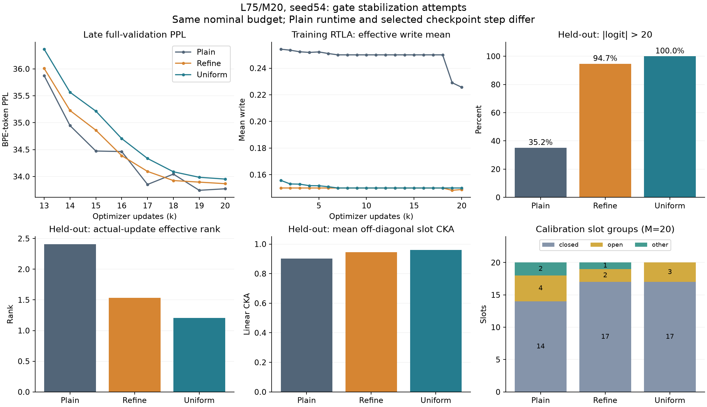
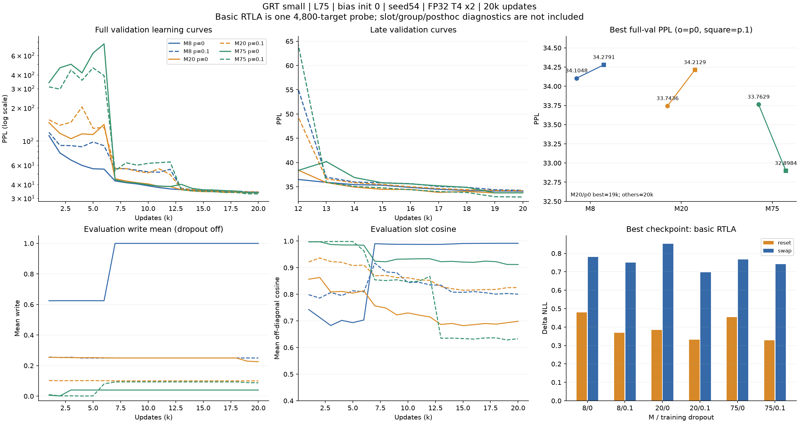
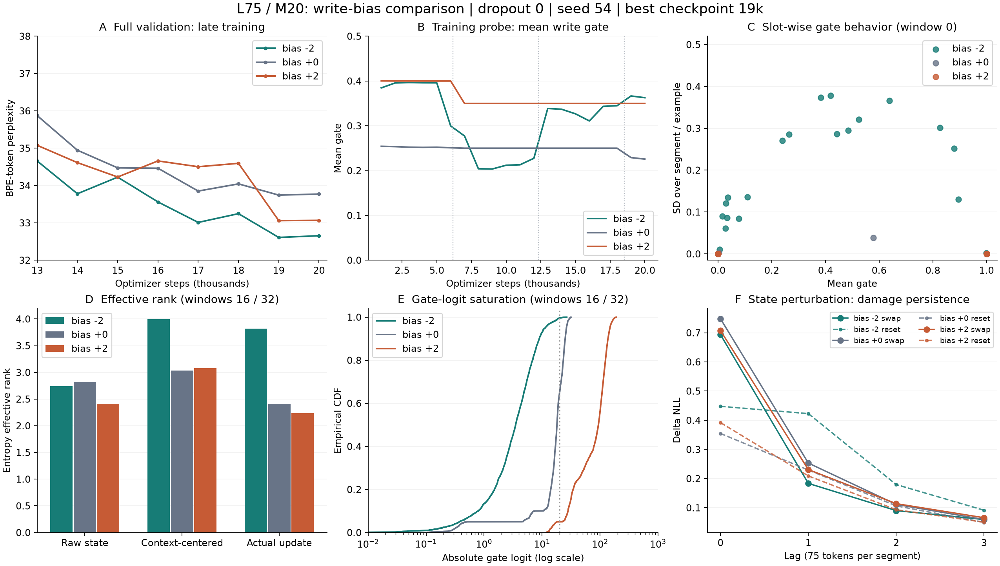
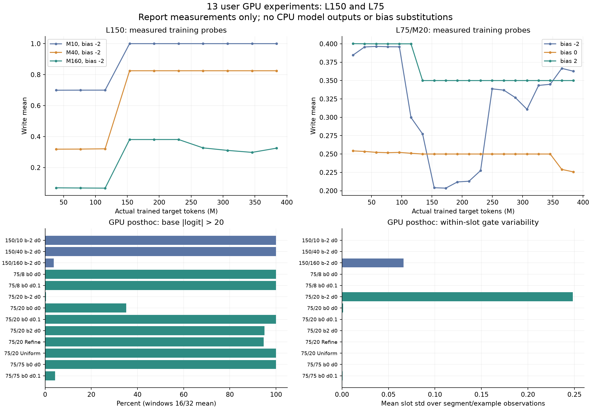
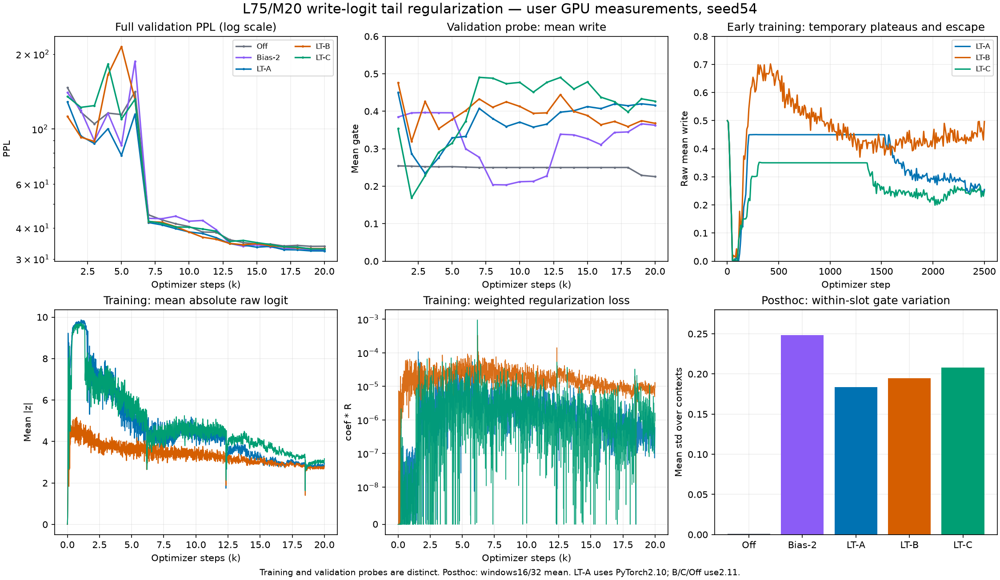

> 정리 전 기록입니다. 최신 실행은 [실험 workflow](../20261011_experiment_workflow.md), 현재 결과는 [gate 안정화 보고서](../experiments/20261018_l75_gate_stabilization.md)를 따릅니다. 이 문서의 당시 계획·기능 상태·그림은 최신 기준이 아닙니다.

# L75 small: gate 안정화 실험

작성: 2026-10-15 · 통합·갱신: 2026-10-19 · 상태: M20 A/B/C·M8 A 결과 반영, M75 A 및 write dropout 비교 대기

[공통 실행 안내](../20261011_experiment_workflow.md) · [L150 용량 비교](../experiments/20261012_small_register_sweep.md) · [원본 보관](../../results/README.md) · [Regularization 설계 검토](20261016_write_regularization.md)

## 1. 결론과 범위

**2026-10-19 추가: logit tail 패널티 A/B/C는 이번 L75/M20·seed54에서 기존 bias0 Off보다 품질과 gate 가변성이 개선됐다.** Best PPL은 Off33.7436 → A32.3376 / B33.0368 / C32.9088이다. 세 조건 모두 사후 abs(logit)>20 비율0%, 슬롯 내 gate std 약.18~.21로, Refine·Uniform과 달리 동적 갱신 회복의 근거가 있다. 잠정 후보는 A지만 A는 PyTorch2.10, B/C·Off는2.11이고 초기 optimizer 경로의 비교 요인도 있어 threshold·coef만의 인과 효과로 확정하지 않는다. B/C의 일부 표현 rank는 Off보다 낮아 건강한 표현 분화까지 모두 달성했다는 결론도 보류한다. [조건·원본·상세 분석](#logit-tail)을 따른다.

**Refine과 Uniform Gate Initialization은 이번 L75/M20·seed54에서 gate 고착 완화와 품질 개선에 실패했다. 두 실험 전용 구현을 제거하고 결과만 이 보고서와 원본 JSON에 보존한다.** 단일 seed이고 기존 대조군의 소프트웨어 환경이 달라, 두 방법 일반에 효과가 없다는 주장으로 확대하지 않는다. 추가 Refine·Uniform seed와 결합 조건은 실행하지 않았다.

**M8 추가 결과:** A의 best PPL33.5383(Off34.1048 대비−1.66%), 최종20k33.6620이며 사후 gate std0→.1700·abs>20 비율100%→0%다. 작은 M에서도 동적 갱신 회복이 관측됐다. [상세 결과](#lt-a8-result)를 반영했고 남은 새 학습은 M75 A 및 dropout.1 세 조건의4run이다.

기존 L75 dropout·bias와 이후 Refine·Uniform을 같은 안정화 질문의 연속 실험으로 통합했다. Dropout은 M별 효과가 달랐고, M20 bias−2에서는 동적 gate와 품질 개선이 관측됐다. 이들까지 모두 실패로 분류하지 않는다. 고정 bias·write dropout은 표준 write 구조의 조절값으로 유지하고 실패한 두 전용 경로만 정리한다.

| 시도 | 실제 실행 | 관측과 판단 |
|---|---|---|
| Write dropout | M8/20/75, bias0에서 p0/p.1 각1seed | Best PPL: M8 34.1048/34.2791, M20 33.7436/34.2129, M75 33.7629/32.8984. M별 효과 상이, 일반적인 고착 해소로 채택하지 않음 |
| 고정 write bias | M20, dropout0에서 −2/0/+2 각1seed | Best PPL 32.6100/33.7436/33.0599. −2의 문맥별 갱신이 양호했으나 seed 재현성 미확인. M8/M75의 ±2는 미실행 |
| 중립 Refine | M20/bias0/dropout0, seed54 | Best PPL 33.8667, 기본·refine 동반 포화. 안정화 실패, 전용 구현 제거 |
| Uniform 초기화 | M20/dropout0, Refine 없이 seed54 | Best PPL 33.9524, 닫힘17/열림3/중간형0, 극단 logit100%. 안정화 실패, 전용 구현 제거 |
| Logit tail 패널티 | L75/M20/bias0/dropout0, seed54의 A/B/C 완료 | Best PPL32.3376/33.0368/32.9088, gate 가변성 회복. [상세 결과](#logit-tail); 환경 차이·단일 seed 한계, A 잠정 후보 |

## 2. Refine·Uniform 비교 조건과 원본

GRT small D256·6layers·head8·FF1024, L75/M20, router attention D256/head8·MLP512, read off·write dropout0·학습 가능한 S0의0 초기화다. 기존 WikiText-103 GPT-2 BPE artifact, FP32, model/data seed54, global256·micro128×accum1×T4 2개, BPTT 이전3segments, 새 초기화20k를 사용했다. Adam LR5e−4·betas(.9,.999)·decay0·clip.25·cosine20k·warmup0, backbone residual dropout.1이다. 실제 학습 targets383,975,424개, 전체 validation248,420개, 매1k 평가·RTLA이며 test는 미평가다.

- **Plain:** 기존 A20-0, 고정 write bias0의 일반 sigmoid.
- **Refine:** 같은 hidden에서 `p=σ(a)`, `q=σ(b)`, `w=p+(2q−1)p(1−p)`. 추가 head weight·bias0으로 q=.5, w=p에서 시작했고10,260 parameters를 추가했다. UGI는 사용하지 않았다.
- **Uniform:** Refine 없이 슬롯별 `u~U[1/M,1−1/M]`, `bias=logit(u)`만 적용했다. M20의 sigmoid(bias) 범위는.05~.95, bias는약±2.944다. 출력층 weight는 유지했고 추가 loss·파라미터는 없었다. 실제 입력의 gate까지 균등하게 강제한 것은 아니다. 공통 초기 가중치·이후 RNG를 보존하도록 표본을 별도 범위에서 추출했다.

두 방식은 [Gu et al., ICML 2020](https://arxiv.org/abs/1910.09890)의 각각을 GRT에 적용한 단독 비교다. 원논문의 전체 UR-LSTM이나 두 방법 결합의 재현은 아니다. 위 수식과 실행 설정은 종료된 실험의 설명이며 현재 config 옵션이 아니다.

| 조건 | best step / NLL / PPL | 최종20k PPL | 15k~20k PPL 평균 | wall h / peak GiB | 학습 / 사후 JSON |
|---|---|---|---|---|---|
| Plain | 19,000 / 3.518790 / 33.7436 | 33.7718 | 34.0582 | 6.695 / 11.721 | [학습](../../results/86fb2481ac1e45f29da0164863b28d66.json) / [사후](../../results/posthoc/5435927747a34aa895d5804c2b5772a6.json) |
| Refine | 20,000 / 3.522433 / 33.8667 | 33.8667 | 34.1717 | 6.954 / 11.721 | [학습](../../results/89571cd181a4465b8e818a2407be8924.json) / [사후](../../results/posthoc/450dd855d0634475af09aefef2239125.json) |
| Uniform | 20,000 / 3.524960 / 33.9524 | 33.9524 | 34.3801 | 6.605 / 11.721 | [학습](../../results/51a6bf7d37db4e5b82ce96709c15885f.json) / [사후](../../results/posthoc/dafd436622a6482092a621db3bbd0b3c.json) |

Uniform−Plain best ΔNLL=+0.006169, ΔPPL=+0.2088(+0.619%)다. 동일20k 최종끼리도 ΔPPL=+0.1806(+0.535%)이며 후반 평균도 개선되지 않았다. Refine 역시 best/최종 PPL 모두 개선이 없다. 차이가 작아 통계적 성능 악화를 확정하지 않지만, 아래 동작까지 합치면 이번 탐색 목표는 충족하지 못했다.

**비교 한계:** Plain 학습은 Python3.13.15/PyTorch2.11.0+cu128, Refine·Uniform은3.12.13/2.10.0+cu128이다. Transformers4.45.2·CUDA12.8·T4는 같다. Plain 사후는 PyTorch2.11.0+cu130/CUDA13.0, 나머지는2.10.0+cu128/CUDA12.8이다. Config·같은 seed만으로 동일 수치 경로를 보장하지 않는다. Plain best는19k, 나머지는20k여서 사후 분석도 정확한 동일 step 비교가 아니다. 같은20k 품질은 위 최종 열에서 비교한다. 시간 차이를 방식의 순수 연산 비용으로 해석하지 않는다.

| 조건 | 학습 commit | checkpoint SHA256 |
|---|---|---|
| Plain | `90d407c` | `919e91014cda899df36e4346a952627beb258c00624a8340e8065dd3eda1281a` |
| Refine | `454cd58` | `86bbb718a2f313ce3d1a01c05988da39ce303c3e03cc1fb0bd37750a51894dff` |
| Uniform | `1a493c1` | `12a6ff8bc60a01f8b9a3581a6cc499dd5a3975a9dbd6d654c5c3ef1ef159f5ad` |

Uniform 학습·사후 Config와 manifest, selected step·RTLA scalar가 일치한다. Clean commit `1a493c1`의 분석 source hash30개와 대조했고 경고·metrics parse 오류·W&B 실패는 없다. 학습 로그2,001개와 validation·RTLA20개를 확인했다. Uniform 사후 분석은 FP32/TF32 off·단일 T4에서93.24초였고 [W&B run](https://wandb.ai/joyyoj1-korea-university/grt-research/runs/2db84d45)도 완료됐다. 수신 ZIP의 학습·사후 JSON bytes를 변경하지 않고 저장했다.



## 3. Uniform 결과: 초기화만으로 고착을 막지 못했다

### 학습 중 변화

| step | Plain PPL / write | Refine PPL / write | Uniform PPL / write |
|---:|---|---|---|
| 1,000 | 146.7764 / 0.254258 | 146.2787 / 0.149999 | 194.8107 / 0.155736 |
| 6,000 | 141.2861 / 0.251004 | 186.0947 / 0.150000 | 174.6522 / 0.150939 |
| 7,000 | 45.1793 / 0.250000 | 45.7414 / 0.150000 | 45.6902 / 0.150000 |
| 13,000 | 35.8741 / 0.250000 | 36.0087 / 0.150000 | 36.3658 / 0.150000 |
| 18,000 | 34.0446 / 0.250000 | 33.9245 / 0.149993 | 34.0879 / 0.150000 |
| 19,000 | 33.7436 / 0.229072 | 33.8959 / 0.148260 | 33.9856 / 0.150000 |
| 20,000 | 33.7718 / 0.225676 | 33.8667 / 0.148850 | 33.9524 / 0.150000 |

Uniform의 평균 write는1k .155736에서6k .150939로 줄고, **7k부터20k까지 기록된 평가점 모두 .150000**이다. Refine도 일찍 .15 근처에 붙었으며, Plain의 후반 평균 변화와 달리 Uniform에는19k~20k의 회복이 없다. 1k 이전의 슬롯별 trajectory와 초기 가중치 hash는 전달 자료에 없으므로, 정확한 고착 시점과 초기 역할 배정의 원인은 확정하지 않는다.

Uniform의 RTLA reset ΔNLL은1k에서−.4275,6k에서−.5817이었다가7k에서+.3065로 바뀐다. 초기에는 probe에서 기억을 초기화하는 편이 유리했다. 이후에는 평균 write가 고정된 채 PPL과 메모리 기여가 개선된다. 즉 **gate 가변성 회복과 모델 전체의 학습 진행은 다른 현상**이다. 큰 품질 전환은 이전 실험처럼 epoch 경계6,169/12,338/18,507 이후 평가와도 겹쳐 gate가 유일한 원인이라고 해석하지 않는다.

### 최종 슬롯·표현 진단

사후 protocol은 batch8·warmup3·측정8·horizon4·windows0/16/32·slots/registers true·random3/seed54로 같다. 유형은 window0에서 정하고 아래 연속값은 window16/32 평균이다. 각 window·lag의 target 수는4,800으로 동일하다. Refine의 logit·sigmoid slope는 내부 기본 p 기준이고, write 평균·유형·update는 최종 유효 w 기준이다.

| 지표 | Plain | Refine | Uniform |
|---|---:|---:|---:|
| closed / open / other (window0) | 14 / 4 / 2 | 17 / 2 / 1 | 17 / 3 / 0 |
| 유효 write 평균 | 0.229279 | 0.149114 | 0.150000 |
| 슬롯별 gate std 평균 | 1.158e-03 | 5.269e-04 | 2.940e-27 |
| 기본 sigmoid logit abs>20 | 35.16% | 94.69% | 100.00% |
| 기본 abs logit 중앙값 | 18.08 | 55.44 | 73.26 |
| 기본 sigmoid slope 평균 | 1.230e-02 | 2.181e-03 | 1.694e-27 |
| Router context / MLP hidden norm | 44.36 / 108.06 | 87.51 / 298.76 | 81.77 / 217.12 |
| 문맥 평균 제거 state rank | 3.0334 | 2.3794 | 2.0662 |
| 실제 update rank | 2.4098 | 1.5316 | 1.2059 |
| 실제 update 첫 방향 에너지 | 67.61% | 85.62% | 95.50% |
| 평균 off-diagonal slot CKA | 0.9016 | 0.9451 | 0.9592 |

Uniform은 세 window와 threshold .001/.01/.05 모두 닫힘17·열림3·other0이고 **열린 슬롯은5·12·13(0-based)**이다. 기본 sigmoid logit abs>20이100%, 평균 slope≈1.69e−27, 슬롯 내 문맥별 gate std≈2.94e−27로 사실상 고정 경로다. 닫힌 gate가 수학적으로 모두 정확한0이라는 뜻은 아니다. 매우 작은 양수도 포함하며 유효 write의 정확한1은15%다. 측정 중 닫힌 슬롯의 실제 state update는 FP32에서0이었다.

표현도 실제 update rank1.206, 첫 방향 에너지95.50%, CKA.959로 Plain보다 더 적은 방향에 집중된다. 슬롯들이 기능적으로 모두 같다는 증명은 아니지만, 목표했던 문맥별 갱신 다양화의 근거는 없다. 초기 bias 분산이 학습 중 커지는 router context·hidden/logit scale을 지속적으로 제어하지 않는다는 해석과 부합한다. 초기화 실패의 인과적 원인을 이 관측만으로 확정하지 않는다.

### 기능적 기억은 남아 있다

아래는 평가 window16/32의 lag0 ΔNLL이며 양수는 개입으로 예측이 나빠졌다는 뜻이다. 그룹 효과는 비가산적이므로 합쳐 기여율로 쓰지 않는다. Uniform의 빈 other 그룹은 분석할 대상이 없으며 그 효과0을 별도 기능의 증거로 세지 않는다.

| 개입 | Plain reset / swap | Refine reset / swap | Uniform reset / swap |
|---|---|---|---|
| all | +0.354744 / +0.748015 | +0.401240 / +0.683010 | +0.387380 / +0.642072 |
| closed | +0.015488 / -0.002815 | +0.050791 / -0.002679 | +0.072280 / +0.000083 |
| open | +0.104487 / +0.457523 | +0.057256 / +0.254581 | +0.311737 / +0.627070 |

Uniform open3개의 swap ΔNLL은+.6271로 같은 수 random3개 mask 평균+.0197보다 크다. 전체 swap+.6421과 함께 유용한 문맥 정보가 남아 있음을 보여준다. 그러나 이는 고착 완화 성공이나 Plain보다 좋은 기억 능력의 증거가 아니다. 닫힌17개도 reset+.0723·문맥별 state 변동 norm≈9.27이므로 미사용·제거 가능으로 취급하지 않는다. Slot 단독 reset 합은 window0에서.1195, 전체 reset은.4181로 비가산적이다.

전체 swap의 lag0→lag3는 Plain .7480→.0597, Refine .6830→.0358, Uniform .6421→.0334다. 손상 후 회복은 유용한 기억 길이와 같지 않다. 평가 window16/32의 합성 PPL도 Plain33.3691, Refine33.3695, Uniform33.4391로 Uniform의 국소 이득을 뒷받침하지 않는다.

## 4. Refine 실패에서 남길 관측

Refine의 최종17/2/1 분할과 작은 gate std, 기본 logit 극단화94.69%·refine logit 극단화79.38%, 낮은 실제 update rank1.532는 보정 경로가 다수 슬롯을 재활성화하지 못했음을 보여준다. 유효 write와 기본 p의 평균 차이는+.001423, 최대 관측 차이는+.049017이며 거의 슬롯13에 집중됐다. 그 슬롯도 p 평균.9603/.9474에서 w .9862/.9784로 더 여는 방향이었다. q가 커도 p≈0이면 쓰기는 거의0이고, q가 작아도 p=1이면 쓰기는1이다.

중립 초기화 q=.5에서 ∂w/∂a=p(1−p), ∂w/∂b=.5p(1−p)다. 공유 hidden을 쓰므로 초기 task gradient는 refine 출력층과 기본 출력층에서 같은 방향이며, 추가 head가 음의 피드백·포화 억제 장치는 아니었다. 이 관계는 수식의 성질이며 GPU 학습 경로의 실측 근거는 아니다. CPU 모델 검사에서 만든 수치는 아래 전체 실측 비교에서 제외한다. 두 기본 경로가 포화되면 보정 여지도 p(1−p)로 줄어든다.

이번 결과는 GRT용 공유 hidden·중립 Refine 단독 조건의 실패다. 원논문의 다른 초기화·전체 UR 결합·다른 모델까지 부정하지 않는다. 그러나 현재 실험 목적과 자원 기준에서는 유지할 근거가 없어 제거한다.

## 5. 구현 정리와 검증

Write의 forward는 일반 sigmoid를 유지한다. Refine head·유효 gate 보정식·Uniform 초기화, 관련 Config/카탈로그/노트북 변수, Refine 전용 RTLA scalar·사후 observer 분기·전용 테스트를 제거했다. 고정 write bias·write dropout·read gate, 공통 RTLA·슬롯/표현/그룹 개입·retention·학습 후 ZIP 출력은 유지한다. 이후 추가한 logit tail 패널티는 학습 loss에만 적용하며 아래8절에 기록한다. 노트북은 L75/M20·20k·seed54·bias0·dropout0·A 설정을 기본으로 하고, 모델/카탈로그의 패널티 coef 기본값0은 off다.

실패 실험의 재실행·checkpoint 분석은 위 기록된 commit에서 수행한다. 특히 Refine checkpoint는 추가 head가 있고 Uniform report의 Config에는 제거한 키가 있어 최신 코드로 그대로 복원하지 않는다. 키를 무시하거나 가중치를 변환하는 호환 경로는 추가하지 않는다. JSON 원본의 과거 설정·진단값은 수정하지 않는다.

검증 결과: 관련 CPU 검사106개 통과, optional W&B 미설치로2개 생략. 단일 프로세스103개와2-worker 학습·preflight3개를 확인했다. 분산 검사는 처음에 sandbox의 localhost 소켓 차단으로 실패해 로컬 소켓을 허용한 동일 검사로 통과를 확인했다. 별도로 bias−2/0/+2·dropout0/.2·train/eval의12조건에서 정리 전후 일반 router의 parameter·RNG·forward·gradient가 정확히 같았다. 학습 재개·causality·전체 report ZIP·확장 사후 JSON·캐시도 검증했다. 노트북 코드 문법·문서 링크·제거한 실행 옵션 부재·수신 및 기존 결과 bytes 보존을 확인했다. GPU 학습은 새로 실행하지 않았다.

## 6. 기존 dropout·bias 상세 기록

아래는2026-10-17까지의 실행 조건·수치·분석을 보존한 세부 기록이다. 당시의 계획·추가 seed 제안과 미기입 판단란은 이력이며 새 실행 지시가 아니다. 현재 채택·중단 상태는 위 결론을 따른다.

<details>
<summary>Dropout·bias의 전체 표와 사후 분석 펼치기</summary>

### 1. 목적과 고정 조건

L과 M을 함께 줄인 별도 실험으로, write dropout이 품질·분화에 미치는 영향과 초기 write bias에 따른 차이를 확인한다. 현재 단계에서 NeoX/RMT를 새로 학습하지 않는다. 이전 L150 결과는 참고 자료이며 L75 baseline이나 동일 조건 대조군으로 사용하지 않는다.

| 항목 | 조건 |
|---|---|
| 모델 / 데이터 | GRT small D256·6 layers·FF1024 / 기존 WikiText-103 GPT-2 BPE prepared artifact 재사용 |
| L / M | L75 고정, M8 / 20 / 75 |
| M/L | 0.1067 / 0.2667 / 1.0000; 이전10/150·40/150·160/150와 유사한 범위, 정확한 축소 복제는 아님 |
| Router | attention D256/head8, MLP hidden512 고정; head 수는 M의 배수 조건이 아님 |
| Read gate / S0 | read gate 항상 off; 학습 가능한 S0를 0으로 초기화 |
| 기본 write | bias 초기값0, write dropout0; 아래 두 단계에서만 변경 |
| 학습 예산 | 새 초기화에서20,000 optimizer updates; nominal targets=256×75×20,000=384M, 실제 tail 반영 수는 report 기준 |
| BPTT | 이전3 segments 유지: 과거225 tokens, 현재 포함 최대300 tokens 재계산 |
| Optimizer / schedule | Adam LR5e−4, betas(.9,.999), decay0, cosine20k·warmup0, global norm clip.25 |
| Dropout / precision | backbone residual.1 / backbone·router attention0 / FP32 |
| 배치 / seed | global256, model/data seed54; auto_batch·예약 VRAM 목표95%, micro×accum×GPU수 유지 |
| 평가 | validation batch10·매1k updates·best validation checkpoint, test 미평가; 학습 중 RTLA on |

20k는 update 수다. L150/10k와 nominal target 예산은 같지만 optimizer update 횟수, 과거 token 기준 BPTT, write 빈도·메모리 용량이 달라 동일 학습 조건은 아니다. 이번 두 단계 안에서는 L/M별 고정 조건과20k schedule을 유지한다.

### 2. 실험 순서: 총12개 고유 run

**A. 각 M에서 bias0으로 dropout0과0.1을 비교한다(6회).** best validation NLL/PPL을 우선 보고 학습 곡선·시간·분화 지표를 함께 확인한다. 품질 차이를 확신하기 어려우면 dropout0을 우선하는 잠정 선택을 기록한다. 한 seed에서 작은 차이를 확정하지 않는다.

**B. 사용자 최신 결정에 따라 모든 M에서 dropout0을 고정하고 bias−2/0/+2를 비교한다(추가6회).** bias0은 A8-0/A20-0/A75-0의 run/checkpoint/report를 그대로 재사용한다. bias만 바꾼 두 조건은 매번 새로 초기화해20k 학습한다. A의 품질 기준 dropout 선택은 M별 결과로 남기되 이번 B에는 적용하지 않는다. B는 세 M 모두 dropout0으로 통제한다.

Bias는 모든 슬롯의 write MLP 마지막 bias 초깃값이며 학습 가능하다. bias−2/0/+2의 sigmoid 기준값은 약.119/.500/.881이지만 실제 gate는 hidden 출력에 따라 달라진다. write dropout.1은 학습 중 example·slot별 확률.1로 write logit을−∞로 만들어 기존 state를 보존하며, state를 지우거나 rescaling하지 않는다. 평가·사후 분석에서는 dropout을 끈다. 새 정규화·분화 보조 손실은 이번 비교에 넣지 않는다.

| M | A의 품질 기준 잠정 dropout | B의 고정 dropout | 근거 / best PPL (p0 → p.1) | B 실행 여부 |
|---:|---:|---:|---|---|
| 8 | 0 | 0 | 34.1048 → 34.2791; 차이가 작아 p0 우선 | 미실행 |
| 20 | 0 | 0 | 33.7436 → 34.2129; 한 seed에서 더 낮은 validation NLL | −2/0/+2 완료 |
| 75 | 0.1 | 0 | 33.7629 → 32.8984; 한 seed에서 더 낮은 validation NLL | 미실행 |

A의 선택은 seed54 한 번의 품질 기준이며 유의성을 주장하지 않는다. B에서는 dropout0의 bias0 결과를 재사용하고 새 bias−2/+2만 학습한다.

### 3. 학습 결과 기록

각 행은 별도 run이다. B의 bias0 결과는 A의 dropout0 행을 참조해 중복 학습하지 않는다. 실제 micro/accum/GPU·환경·target 예산·코드 hash는 원본 report에 보관하고 차이가 있으면 판단에 적는다.

| ID | M | bias init | write dropout | 상태 | best step / PPL(best·20k) | wall h / peak GiB | 학습 JSON / 확장 사후 JSON |
|---|---:|---:|---|---|---|---|---|
| A8-0 | 8 | 0 | 0 | 완료 | 20,000 / 34.1048 · 34.1048 | 5.511 / 10.849 | [학습](../../results/ccf041592f3e4ebe8f287e69195205a5.json) / [사후](../../results/posthoc/10b47cdf69034d8d91a842f60f226ede.json) |
| A8-1 | 8 | 0 | 0.1 | 완료 | 20,000 / 34.2791 · 34.2791 | 6.054 / 10.849 | [학습](../../results/746ab4ab41e84ec0bdd0f3f0ed6bffdb.json) / [사후](../../results/posthoc/17f1bc032be54c249e645fa01275bac2.json) |
| A20-0 | 20 | 0 | 0 | 완료 | 19,000 / 33.7436 · 33.7718 | 6.695 / 11.721 | [학습](../../results/86fb2481ac1e45f29da0164863b28d66.json) / [사후](../../results/posthoc/5435927747a34aa895d5804c2b5772a6.json) |
| A20-1 | 20 | 0 | 0.1 | 완료 | 20,000 / 34.2129 · 34.2129 | 6.442 / 11.721 | [학습](../../results/51bafa3f611d48c2808a7a55d732c91d.json) / [사후](../../results/posthoc/1ae377fe64e243749040cf61991c37f0.json) |
| A75-0 | 75 | 0 | 0 | 완료 | 20,000 / 33.7629 · 33.7629 | 10.093 / 8.326 | [학습](../../results/b4b4414578524de0a6e9de50851b91b2.json) / [사후](../../results/posthoc/f5a1825cc5d84f6da400eb249ec409ac.json) |
| A75-1 | 75 | 0 | 0.1 | 완료 | 20,000 / 32.8984 · 32.8984 | 10.041 / 8.326 | [학습](../../results/06fe396a3e6b4e258b779481409de1ba.json) / [사후](../../results/posthoc/df797486d1cd4606acc91fc478535e33.json) |
| B8− | 8 | -2 | 0 | 미실행 | | | |
| B8+ | 8 | +2 | 0 | 미실행 | | | |
| B20− | 20 | -2 | 0 | 완료 | 19,000 / 32.6100 · 32.6552 | 6.423 / 11.721 | [학습](../../results/3001e7328e87456395275745ada7b946.json) / [사후](../../results/posthoc/3cb39cb5ceaf40e4b2ac4790af009b6d.json) |
| B20+ | 20 | +2 | 0 | 완료 | 19,000 / 33.0599 · 33.0679 | 6.698 / 11.721 | [학습](../../results/0bb9e51192d54a398d771bab611e9fb1.json) / [사후](../../results/posthoc/b9d1e1ea89bd4499989c6968dfc63957.json) |
| B75− | 75 | -2 | 0 | 미실행 | | | |
| B75+ | 75 | +2 | 0 | 미실행 | | | |

#### 3.1 조건 검증과 품질·비용

6개 모두 Kaggle Tesla T4×2·FP32·global256·동일 model/data seed54·코드 `90d407c`에서20k를 완료했다. Python3.13.15/PyTorch2.11.0+cu128/Transformers4.45.2/CUDA12.8과 prepared manifest가 일치한다. 실제 학습 target은 각383,975,424개, validation은248,420개이며 test는 평가하지 않았다. 같은 M의 두 Config는 write dropout·출력/run 이름 이외에 동일하다. M8/20은 micro128×accum1×GPU2, M75는 micro64×accum2×GPU2다. M 사이의 RNG·수치 차이는 남지만 dropout 쌍 안의 배치는 같다.

| M | p.1−p0 best ΔNLL | p.1−p0 best ΔPPL | PPL 상대 변화 | 잠정 선택 |
|---:|---:|---:|---:|---:|
| 8 | +0.005099 | +0.1744 | +0.51% | 0 |
| 20 | +0.013814 | +0.4694 | +1.39% | 0 |
| 75 | -0.025941 | -0.8646 | -2.56% | 0.1 |

M8은 작은 차이로 p0을 유지하고, M20은 p0, M75는 p.1을 우선한다. A단계 안에서 가장 낮은 best PPL은 M75/p.1의32.8984다. **M20/p0의 best는19k(33.7436), 최종20k는33.7718**이므로 selected RTLA도19k 기준으로 정리한다. 나머지는 best=20k다. 최종20k끼리 비교해도 dropout 선택 방향은 같다.

학습 wall time은6개 합계44.836h(T4×2, 단순 GPU-hours89.672)다. 평가·기본 RTLA·저장을 포함하며 preflight·준비는 제외한다. GPU-hours는 Kaggle quota 차감량을 뜻하지 않는다. p.1의 시간 차이는 M별 방향이 달라 dropout의 고유 속도 효과로 단정하지 않는다. 경고·metrics parse 오류·W&B 실패는 없고 모든 run이20k까지 기록됐다.

#### 3.2 학습 전환과 후반 경향

| step | M8 p0 | M8 p.1 | M20 p0 | M20 p.1 | M75 p0 | M75 p.1 |
|---:|---:|---:|---:|---:|---:|---:|
| 1,000 | 111.5782 | 119.7384 | 146.7764 | 155.7687 | 339.4793 | 310.9276 |
| 6,000 | 55.3052 | 90.3683 | 141.2861 | 132.7306 | 766.3398 | 393.8043 |
| 7,000 | 43.1608 | 55.9326 | 45.1793 | 56.1340 | 44.1882 | 53.3275 |
| 12,000 | 36.5148 | 55.1371 | 38.4342 | 49.4047 | 38.3717 | 64.3067 |
| 13,000 | 35.9216 | 36.9852 | 35.8741 | 36.6402 | 40.2011 | 35.9088 |
| 18,000 | 34.2506 | 34.8845 | 34.0446 | 34.4091 | 34.8954 | 33.8390 |
| 19,000 | 34.1368 | 34.4075 | 33.7436 | 34.2452 | 33.7674 | 32.9583 |
| 20,000 | 34.1048 | 34.2791 | 33.7718 | 34.2129 | 33.7629 | 32.8984 |

여러 run이6k까지 악화/정체했다가7k에 크게 회복한다. p.1의 세 run은12k→13k에도 큰 품질 전환이 나타나므로 짧은 pilot로 결과를 판단하면 이번 최종 순위를 놓친다. 마지막1k 개선은 M8 p0/.1이0.0320/0.1283, M20 p0는0.0282 악화·p.1은0.0323 개선, M75 p0/.1은0.0045/0.0600 개선이다. cosine20k 종료의 작은 변화는 고정 예산 후반 안정화 근거이며 완전 수렴 증명은 아니다.

학습 manifest의 train118,436,938 tokens를 global256으로 나누면 stream당462,644 tokens이고 epoch당6,169 updates다. 코드가6,169/12,338/18,507 이후 epoch를 시작할 때 state와 BPTT 이력을 초기화한다. 큰 전환이 그 직후 첫 평가와 맞물리므로, 학습 전환을 분화 발생 시점으로만 해석하지 않는다. 데이터 재노출·S0 재노출·state 초기화·LR 변화의 인과관계는 현재 로그만으로 분리되지 않는다.



### 4. 분화 분석과 판단란

새 학습은 마지막 report 셀에서 각 best checkpoint를 자동 분석한다. 이미 완료된 run은 기존 Colab 사후 분석 노트북에 best checkpoint를 넣어 같은 helper로 분석할 수 있다. batch8·warmup3·측정8·horizon4·window0/16/32·random 반복3/seed54·slots/registers=true를 공통 사용한다. L/M은 checkpoint에서 읽는다. L75에서 warmup225/측정600 tokens이며, 이전 L150 probe와 절대 token 범위는 다르다. 이번 run끼리는 같은 조건으로 비교한다.

| 비교 | 전체 val 품질 / 학습 안정성 | 현재 기본 RTLA에서 보이는 차이 | 판단 / 확장 분석 |
|---|---|---|---|
| M8 dropout0 vs .1 | p0가0.1744 PPL 낮음; p.1의 후반 회복이 늦음 | p.1에서 write·cosine 감소, 품질 개선으로 이어지지는 않음 | p0 잠정; 열린8→2·actual update rank 감소, 품질 이득 없음 |
| M20 dropout0 vs .1 | p0가0.4694 PPL 낮음 | p.1에서 write 감소·cosine 증가 | p0 잠정; 열린4/중간형2→열린2, 극단 포화·갱신 rank 감소 |
| M75 dropout0 vs .1 | p.1이0.8646 PPL 낮음 | p.1에서 write·relative update 증가, cosine 감소 | p.1 잠정; 중간형5개에 문맥 기여 집중, 품질 개선과 일치 |
| M8 bias−2/0/+2 | 미실행 | | |
| M20 bias−2/0/+2 | best PPL32.6100 / 33.7436 / 33.0599 | −2는 문맥별 gate·갱신 다양성 증가, +2는 극단 이진 포화 | −2 잠정 우선; 전체 val 개선과 짧은 probe 악화를 구분(4.9) |
| M75 bias−2/0/+2 | 미실행 | | |

#### 4.1 받은 report에 실제 포함된 기본 RTLA

best checkpoint의 고정 window0·batch8/warmup3/측정8·L75, 정상 target4,800개의 결과다. eval mode이므로 p.1 학습 run에서도 write dropout은 꺼져 있다. write 평균 차이를 평가 때10%를 무작위로 끈 결과나0.9 rescaling으로 해석하지 않는다.

| ID | best step | probe PPL | write mean | relative update | slot cosine | reset ΔNLL | swap ΔNLL |
|---|---:|---:|---:|---:|---:|---:|---:|
| A8-0 | 20,000 | 36.1425 | 1.000000 | 0.142461 | 0.991730 | 0.478807 | 0.779855 |
| A8-1 | 20,000 | 35.8145 | 0.250000 | 0.037800 | 0.800519 | 0.368968 | 0.750425 |
| A20-0 | 19,000 | 35.8678 | 0.229072 | 0.037654 | 0.693341 | 0.384911 | 0.852954 |
| A20-1 | 20,000 | 35.8817 | 0.100000 | 0.017578 | 0.825199 | 0.330863 | 0.696968 |
| A75-0 | 20,000 | 36.5850 | 0.040000 | 0.006818 | 0.911851 | 0.454511 | 0.767104 |
| A75-1 | 20,000 | 34.9636 | 0.087290 | 0.019172 | 0.633101 | 0.327613 | 0.740750 |

모든 reset/swap 평균이 양수로 해당 probe에서 과거 state가 예측에 도움을 준다. 다만 큰 delta는 잘못된 state에 대한 민감성도 나타내므로 단독으로 최대화하지 않는다. M8/p.1은 probe PPL이 더 낮아도 전체 validation은 p0가 더 낮다. 선택에는 전체 validation을 우선한다.

M8/p0는 write 평균1·cosine≈.992로 강한 포화/유사화가 의심되고, p.1에서는 write.25·cosine≈.801로 바뀌었다. M20에서는 반대로 p.1의 cosine이.825로 높아져 dropout이 항상 분화를 늘린다고 할 수 없다. M75/p.1은 p0보다 cosine이.912→.633, state norm이15.799→2.035로 낮고, write.040→.087·실제 update norm.362→.773은 커졌다. **평균 gate와 norm만으로 세 유형의 비율·동적 분화를 확정하지 않는다.** 학습 report에는 raw gate/logit·슬롯/그룹 개입·rank/CKA가 없으며, 이번 수신 사후 report로 아래4.3~4.8에 보완했다.

write 평균만으로 학습 전환을 설명할 수 없다. M8/p.1은12k→13k에 write.25를 유지하면서 PPL55.1371→36.9852로, M75/p.1도 write≈.0933인 채64.3067→35.9088로 바뀐다. 후자는 cosine.868→.635·reset ΔNLL−.212→+.282 변화도 동반한다. candidate state·backbone·읽기 등의 변화를 구분하려면 확장 분석이 필요하다.

#### 4.2 Colab 자동 실행 범위 확인

| 경로 | 자동 실행 내용 | 이번 수신 확인 |
|---|---|---|
| `colab.ipynb` / `kaggle.ipynb`의 `job.train()` | RTLA on이면 validation마다 및 종료 후 best 복원 시 정상/reset/swap·gate/state/update 평균 | 6run 모두 step별 RTLA20건과 selected_rtla 포함 |
| 학습 노트북 마지막 `job.report(posthoc=True, ...)` | best.pt의 확장 분석 후 experiment_results.zip에 학습·사후 JSON 동봉 | 2026-10-16 연결; 이번에 별도 사후 JSON6개 수신 |
| 별도 `colab_analysis.ipynb`의 `job.run()` | 지정 checkpoint의 slot·retention·3window·logit·rank/CKA·group 개입을 일괄 실행 | 같은 helper의 사후 JSON6개 완료 확인; 사용 진입점은 파일만으로 구분하지 않음 |

학습 중 기본 RTLA는 `WikiTextRun` → `train_stream` → `adapter.log_analysis` → `analyze_stream(horizon=0, slots=False)`를 유지한다. 기존 수신6개 report도 horizon0·slot/retention 배열이 비어 있다. **2026-10-16부터 학습 노트북 마지막 셀에서 `job.report(posthoc=True, ...)`가 별도 `WikiTextPosthoc`을 호출해 전체 사후 분석을 실행한다.** 학습 JSON을 먼저 보존하고 두 결과를 ZIP 하나로 묶는다. 이후 수신한 별도 사후 JSON6개로 기존6개 best checkpoint의 확장 분석 완료를 확인했다. 근거는 [학습 루프](../../src/grt/stream_training.py), [공통 notebook helper](../../src/grt/utils/kaggle.py), [기본 분석](../../src/grt/memory_analysis.py)이다.

6조건의 best.pt 사후 분석을 아래에 통합했다. 추가 checkpoint는 기존 [Colab 분석 노트북](../../notebooks/colab_analysis.ipynb)에서 같은 옵션으로 분석하거나 학습 마지막 report 셀을 사용한다. M20/p0의 best는19k로 다른20k best와 step이 다름을 기록하고, 엄밀한 동일 step 비교가 필요하면 모든 조건의 last.pt/20k를 별도로 분석한다.

세 유형의 균등 분배나 높은 rank 자체를 성공 기준으로 삼지 않는다. threshold 민감도·동일 개수 무작위 그룹·단일 효과의 비가산성·reset과swap 차이를 함께 본다. 학습 중 RTLA로 전환 시점을 보고, 최종 checkpoint 사후 관측으로 학습 원인을 확정하지 않는다. 추가 seed·긴 학습·다음 구조 실험은 아래 사후 해석과 사용자 판단을 바탕으로 결정한다.

#### 4.3 사후 분석의 연결·집계 기준

6개 모두 원래 학습 Config·prepared manifest·selected step·학습 중 best RTLA의 모든 scalar 지표가 정확히 일치한다. M20/p0는19k, 나머지는20k이며, 파일명 대신 checkpoint의 실제 Config로 M/dropout을 연결했다. checkpoint hash는 각 사후 원본에 보관한다. 학습 JSON 자체에는 hash가 없으므로 전달받지 않은 가중치를 별도로 재해시한 것은 아니다.

사후 실행은 코드 `fbb9a53`·clean checkout·동일30개 source hash(해당 분석 실행 간 일치)·Colab T4 단일 GPU·FP32/TF32 off다. Python3.13.15/PyTorch2.11.0+cu130/CUDA13.0/Transformers4.45.2가6개 모두 같다. 원래 학습의 PyTorch cu128/CUDA12.8과는 다르지만 첫 probe의 기존 RTLA는 전 항목 동일하게 재현됐다. 설정은 batch8·warmup3·측정8·horizon4·slots/registers true·window0/16/32·random3·seed54·손상 비율10/25/50/75%다.

**window0에서 그룹을 정의하고, 아래 별도 표의 대표값은 평가 window16·32의 동일 가중 평균으로 집계한다.** 각 window/lag에4,800 targets가 있어 token 가중 평균과 같다. 세 window는 각각 S0로 시작해225 tokens warmup 후600 tokens를 측정하며, 이어225 tokens까지 개입 branch를 추적한다. 연속적인 긴 문맥3개를 이어서 분석한 것이 아니다. 단일 슬롯 기여는 window0에서만 측정한다. random 범위는 같은3개 mask 각각의 두 평가 window 평균에서 min/max를 계산하며 신뢰구간이 아니다.

| ID | checkpoint step | 사후 T4 seconds | peak MiB | checkpoint SHA256 앞12자리 |
|---|---:|---:|---:|---|
| A8-0 | 20,000 | 61.36 | 337.71 | `5aa9d458db84` |
| A8-1 | 20,000 | 94.44 | 337.71 | `be6f249c6745` |
| A20-0 | 19,000 | 163.58 | 338.43 | `919e91014cda` |
| A20-1 | 20,000 | 104.86 | 338.43 | `d56a848c6426` |
| A75-0 | 20,000 | 112.75 | 341.71 | `1de8e1540d5c` |
| A75-1 | 20,000 | 178.46 | 341.71 | `9f53f8caa514` |

사후 분석은6개 합계715.44초(11.92분, 단일 T4 약0.199 GPU-hours)다. 보고된 분석 본체 시간이며 코드 설치·Drive 복사 등은 제외한다. 이번 고정 probe의 비용으로, 모델 크기·측정 길이·슬롯 수를 늘린 분석 시간으로 일반화하지 않는다.

#### 4.4 Gate 분화와 포화: dropout의 방향이 M마다 다르다

closed는 calibration의 모든 관측에서 gate<=.01, open은 모두>=.99, other는 그 밖이다. **other는 관측 분류이며 자동으로 유용한 선택형 메모리를 의미하지 않는다.** 아래 포화율·logit·router 값은 두 평가 window 평균이다. |logit|>20은 극단 포화의 기술 지표이며 닫힘/열림 양쪽을 포함한다.

| ID | closed / open / other (window0) | 평가 window 유형 유지율 | \|logit\|>20 | median \|logit\| | router context norm / MLP hidden norm |
|---|---|---|---:|---:|---:|
| A8-0 | 0 / 8 / 0 | 100.00% / 100.00% | 100.00% | 59.24 | 87.09 / 272.11 |
| A8-1 | 6 / 2 / 0 | 100.00% / 100.00% | 100.00% | 153.25 | 91.24 / 396.98 |
| A20-0 | 14 / 4 / 2 | 95.00% / 100.00% | 35.16% | 18.08 | 44.36 / 108.06 |
| A20-1 | 18 / 2 / 0 | 100.00% / 100.00% | 100.00% | 276.33 | 160.74 / 778.41 |
| A75-0 | 72 / 3 / 0 | 100.00% / 100.00% | 100.00% | 88.29 | 134.57 / 484.43 |
| A75-1 | 68 / 2 / 5 | 98.67% / 97.33% | 4.34% | 10.63 | 6.29 / 37.54 |

M8/p0·M8/p.1·M20/p.1·M75/p0는 세 window와 threshold.001/.01/.05 모두 동일한 이진 그룹 분할이다. M8/p.1은6개 닫힘/2개 열림으로 나뉘지만 모든 logit이 극단 포화돼, 부드럽고 문맥에 따라 쓰기를 조절하는 슬롯이 늘어난 것은 아니다. M20/p.1도18/2/0으로 변하며 median |logit|이18.08→276.33, hidden norm이108.06→778.41로 커진다. dropout이 router를 항상 안정화하지는 않는다.

M75/p.1은 반대로 |logit|>20 비율100%→4.34%, context norm134.57→6.29, hidden norm484.43→37.54로 낮아진다. window0의68/2/5는 평가 window에서68/3/4·68/4/3으로 바뀐다. threshold.001/.01/.05에 따른 window0 그룹은67/0/8·68/2/5·68/4/3이므로 정확한 세 유형 비율은 threshold에 민감하다. 다만 기본 threshold에서 닫히지 않은7개 슬롯 묶음은 두 평가 window에서도 유지되고, 그 내부의 open/other 분류가 달라진다.

마지막 write bias의 학습 후 절댓값 최대는6run 모두.042 미만이다. 따라서 현재 극단 logit을 마지막 bias 값 자체만으로 설명할 수 없으며 context·hidden·출력 weight 경로의 기여가 크다. 이 관찰이 초기 bias의 최적화 경로 영향을 배제하지는 않으므로 예정된 bias 실험은 여전히 의미가 있다.

#### 4.5 표현 다양성: cosine 감소와 실제 갱신의 분화를 구분한다

rank는 각 state의 slot×feature 행렬에서 squared singular value 에너지로 구한 entropy effective rank를 평균한 값이다. 문맥 평균 제거는 슬롯별 관측 평균을 빼고, actual update는 실제 S_next−S다. CKA는 같은64개 segment/example 관측의 off-diagonal 슬롯쌍 평균이며, 문맥에 따른 표현 변화 유사도의 기술 통계다.

| ID | raw state rank | 문맥 평균 제거 rank | 실제 update rank | 평균 slot CKA |
|---|---:|---:|---:|---:|
| A8-0 | 1.0468 | 1.2156 | 1.5821 | 0.9931 |
| A8-1 | 1.7987 | 1.7898 | 1.0486 | 0.9310 |
| A20-0 | 2.8119 | 3.0334 | 2.4098 | 0.9016 |
| A20-1 | 1.6723 | 1.8974 | 1.0508 | 0.9654 |
| A75-0 | 1.7026 | 2.0655 | 1.8039 | 0.9757 |
| A75-1 | 1.9522 | 2.2142 | 2.4346 | 0.9150 |

M8의 dropout은 state rank1.05→1.80·전체 CKA.993→.931로 표현 차이를 늘리지만, actual update rank1.58→1.05다. 두 open 슬롯 사이 CKA도.9986으로 매우 높다. 즉 닫힌 묶음/열린 묶음 사이의 차이가 커진 것과, 갱신하는 슬롯끼리 정보가 다양해진 것은 다르다.

M20은 문맥 평균 제거 rank3.03→1.90·update rank2.41→1.05·CKA.902→.965로, dropout 후 표현·갱신이 더 유사해지는 방향이다. open 내부 CKA도.844→.998로 높아진다. M75는 update rank1.80→2.43·CKA.976→.915로 개선되며 정상 validation 개선과 일치한다. 다만75개 슬롯에 비해 rank는 여전히 낮고, M20/p0가 문맥 평균 제거 rank는 더 높아도 최저 PPL은 M75/p.1이다. rank 최대화를 성능 목표로 삼지 않는다. M75/p.1에서도 전체 CKA는.915로 여전히 높고, open2개 내부는.9904, other5개 내부는.8509다. 낮아진 cosine만으로75개 슬롯이 독립적으로 분화됐다고 할 수는 없다. CKA는 관측64개/feature256의 제한과 작은 변동 진폭에도 높아질 수 있는 특성이 있어 gate·그룹 개입과 함께 본다.

#### 4.6 그룹 개입: M75의 중간형은 기능적으로도 구별된다

아래는 각 calibration 그룹을 따로 reset/swap한 평가 window의 lag0 ΔNLL이다. 양수면 손상, 음수면 해당 probe에서 개선이다. **원래 group mask를 평가 window에서도 그대로 사용하며, 각 행의 효과를 합산하지 않는다.**

| ID | closed reset / swap | open reset / swap | other reset / swap | 전체 reset / swap |
|---|---:|---:|---:|---:|
| A8-0 | +0.0000 / +0.0000 | +0.4549 / +0.6553 | +0.0000 / +0.0000 | +0.4549 / +0.6553 |
| A8-1 | -0.0078 / -0.0031 | +0.3017 / +0.5824 | +0.0000 / +0.0000 | +0.3622 / +0.6191 |
| A20-0 | +0.0155 / -0.0028 | +0.1045 / +0.4575 | -0.0005 / +0.0246 | +0.3547 / +0.7480 |
| A20-1 | +0.0043 / -0.0018 | +0.2977 / +0.5880 | +0.0000 / +0.0000 | +0.3053 / +0.5932 |
| A75-0 | +0.0825 / -0.0007 | +0.2190 / +0.5938 | +0.0000 / +0.0000 | +0.4389 / +0.6804 |
| A75-1 | +0.0151 / -0.0007 | +0.0068 / +0.0397 | +0.1178 / +0.3678 | +0.3002 / +0.6373 |

M8/p.1과M20/p.1은 open2개에 swap 손상이 각각.5824/.5880으로 집중된다. 같은 크기의 무작위 그룹 평균은.0363/−.0009다. 전체 swap 손상.6191/.5932와 가깝지만 이를 기여율로 나누지는 않는다. 두 슬롯의 높은 CKA·update rank≈1을 함께 보면, 크기가 작은 동적 경로에 기능이 집중된 상태와 부합한다.

M20/p0의 other2개는 단독 reset−.0005·swap+.0246으로 작지만, 다른 슬롯을 모두 바꾼 상태에서 이 둘만 정상으로 복원하면 reset 손상을.2314, swap 손상을.2659 줄인다. 무작위 대조군3개 중 하나가 우연히 other2개와 완전히 같아 other 단독 효과는 대조군 최대와 같다. 따라서 이 조건의 other를 독립적으로 특별하다고 과장하지 않으며, 큰 **조건부 복원 효과와 상호작용**을 기록한다.

M75/p.1에서는 other5개가 두 평가 window 각각에서 swap+.3707/+.3649이며, 동일 크기 random 최대+.0081/+.0105를 크게 넘는다. 두 window를 평균한 비교는 다음과 같다.

| M75/p.1 그룹 | 슬롯 수 | reset ΔNLL | swap ΔNLL | 같은 수 random swap 평균 [min,max] | 전체 swap 후 해당 그룹 정상 복원 효과 |
|---|---:|---:|---:|---|---:|
| open | 2 | +0.0068 | +0.0397 | -0.0004 [-0.0004, -0.0004] | +0.2380 |
| other | 5 | +0.1178 | +0.3678 | +0.0026 [-0.0008, +0.0093] | +0.5929 |
| open+other | 7 | +0.2604 | +0.5974 | +0.0301 [+0.0225, +0.0452] | +0.6380 |

M75/p.1의 open2개보다 other5개를 교환했을 때 손상이 크고, other만 정상으로 복원하는 효과도.5929다. other의 swap 영향은 lag3에도.0305 남고 같은 크기 random 평균은−.0007이다. **M75에서는 dropout 후 생긴 중간형 묶음이 문맥에 유용한 정보를 담는다는 개입 근거가 있다.** 다만 서로 다른 두 모델을 비교한 것이므로 이 분화가 PPL 개선의 원인임을 확정하거나, 모든 중간형 슬롯이 같은 의미적 역할을 한다고 결론내리지는 않는다.

닫힌 슬롯도 곧 미사용은 아니다. M8/p.1 closed6개는 측정 중 update norm=0이지만 문맥별 state 변동 norm 평균12.88이고, M75/p0 closed72개도 각각0·8.29다. 측정 전 warmup에서 형성된 문맥 상태를 보존할 수 있기 때문이다. 특히 M75/p0의 closed reset은+.0825이지만 swap은−.0007로, S0와의 차이와 올바른 donor 문맥의 중요성이 다르게 나타난다. M75/p.1 closed는 변동 norm.0474·update norm.00084로 더 작아, 전체 슬롯 CKA만으로 닫힌 묶음의 정보량을 비교하면 오해하기 쉽다. reset/swap 분석은 슬롯을 삭제하거나 attention에서 제외한 실험이 아니므로 pruning 성능을 보장하지 않는다.

단일 슬롯 초기화 효과의 합계도 활용성 지표로 충분하지 않다. window0에서 M20/p.1의 단일 reset ΔNLL 합은−.1076이지만 전체 reset은+.3309, M75/p.1은−.0124이지만 전체 reset은+.3276이다. M8/p0도 합+.1655 대 전체+.4788이다. 그룹 단위에서도 M75/p.1은 전체 swap.6373과 세 그룹 단독 합.4068 사이 차이가.2305다. 음의 개별 효과나 작은 단독 효과를 근거로 불필요 슬롯을 확정하지 않는다.

#### 4.7 Retention과 무작위 손상: 장기 보존 개선은 확인되지 않았다

한 번 전체 state를 swap한 뒤 정상 입력을 계속 주었을 때의 ΔNLL이다. lag0는 현재 segment, lag3은225 tokens 뒤 segment이며 분기 전체가 원래 trajectory와 다를 수 있다. 손상이 오래 남는 것은 유용한 정보의 장기 보존과 동의어가 아니다.

| ID | lag0 | lag1 | lag2 | lag3 |
|---|---:|---:|---:|---:|
| A8-0 | 0.6553 | 0.1770 | 0.0655 | 0.0287 |
| A8-1 | 0.6191 | 0.1566 | 0.0543 | 0.0234 |
| A20-0 | 0.7480 | 0.2533 | 0.1116 | 0.0597 |
| A20-1 | 0.5932 | 0.1590 | 0.0557 | 0.0226 |
| A75-0 | 0.6804 | 0.2377 | 0.1006 | 0.0497 |
| A75-1 | 0.6373 | 0.1847 | 0.0751 | 0.0392 |

세 M 모두 dropout 후 평균 swap 손상이 lag0~3에서 작아진다. M20은 lag3 .0597→.0226으로 특히 줄어든다. 정상 PPL도 악화되고 update rank도 낮아져 장기 문맥 활용이 약해졌을 가능성과 부합하지만, 서로 다른 모델의 손상 회복률이므로 원인을 단정하지 않는다. M75는.0497→.0392로 줄어도 정상 품질이 좋아진다. 따라서 dropout이 전반적으로 장기 기억을 늘렸다는 주장은 지지되지 않으며, 더 나은 표현·조건부 활용과 개입 강건성 변화로 나누어 해석한다.

무작위 슬롯50% 교환의 lag0 손상은 M8 .1438→.1247, M20 .1138→.1166, M75 .0994→.2084다. M75는 전체 swap 손상이 줄어도 부분 swap 손상은 오히려 커질 수 있다. 사용 슬롯의 위치·개수, 원래/교환 문맥이 섞이는 효과와 그룹 상호작용이 관여하므로 dropout을 보편적 손상 강건성 개선으로 부르지 않는다. 무작위 mask는3개뿐이며 손상 곡선의 작은 차이를 통계적 차이로 해석하지 않는다.


#### 4.8 이번 사후 분석을 반영한 판단

**성능 기준 잠정 선택은 M8=0, M20=0, M75=.1로 유지한다.** M8의 dropout은 외형적 표현 차이를 늘려도 갱신 effective rank≈1·open2개에 집중되고 품질은 좋아지지 않는다. M20은 dropout 후 극단 포화·중간형 소실·갱신 rank 감소·PPL 악화가 함께 관측돼 이번 조건에서 부정적 근거가 가장 일관된다. M75는 극단 포화 완화·중간형의 무작위 대조군 대비 기여·갱신 rank 상승·PPL 개선이 함께 관측돼 가장 유망하다.

이번 결과는 “세 유형이 있다는 것”보다 **그룹의 비율·포화 정도·문맥별 표현·조건부 기여를 함께 봐야 한다**는 판단을 강화한다. 균등 비율이 최적이라는 근거는 없고, 같은 dropout도 M에 따라 반대 결과를 낸다. 분화 실험의 목표를 단순 cosine 감소나 other 수 증가로 두지 않고, validation 품질과 held-out 그룹 기여의 동반 개선으로 둔다.

당시 다음 단계로 정한 bias−2/0/+2 중 M20 결과를2026-10-17에 수신해4.9에 추가했다. M8/M75는 미실행이다. 각 M에서 새 초기화로 비교하고 위 지표와 gate/context scale을 같이 본다. 추가 확인의 우선순위는 warmup 길이 변화에 따른 그룹 안정성, epoch 경계 전후 checkpoint의 gate·표현 변화, 효과가 큰 M75의 추가 seed다. 현재 분석은 단일 seed·세 짧은 window·horizon4의 최종 관측이며 긴 문맥/완전 수렴·분화의 학습 원인·다른 seed 재현성을 검증한 것은 아니다. 새로운 학습이나 분석 코드는 이번 결과 정리에 추가하지 않았다.

#### 4.9 M20 bias 실험: −2는 갱신 다양성과 전체 validation이 함께 개선됐다

2026-10-17 수신 학습2개·사후2개는 **L75/M20/bias−2 및+2**다. 기존 A20-0(bias0)을 대조군으로 연결했다. 세 조건 모두 dropout0·read off·seed54·T4×2·FP32·micro128×accum1×GPU2·20k이며, Config는 bias·출력/run 이름 외에 동일하다. 실제 학습383,975,424 targets·전체 validation248,420 targets·prepared manifest도 일치한다. **세 best가 모두19k/364,775,424 학습 targets**이므로 아래 best 사후 비교는 학습 step이 같다. 테스트는 평가하지 않았다.

학습 코드는 기존 `90d407c`, 신규 `56510e6`으로 다르지만 models·stream_training·config·wikitext·memory_analysis·rtla의 diff는 없다. 사후 코드는 기존 `fbb9a53`, 신규 `1d495c8`이며 모든 분석 source hash·프로토콜·실행 환경이 동일하다. 사후 Config·manifest·checkpoint step·기본 RTLA scalar가 각 학습 report의 selected 결과와 정확히 일치한다. 실행 환경은3.1/4.3과 같고 경고·metrics parse 오류는 없다. 새로운 두 학습의 wall time 합계13.120h(T4×2), 사후 분석 합계162.77초(단일 T4)다.

**품질과 학습 경로.**

| bias init | best19k NLL / PPL | 최종20k PPL | bias0 대비 best ΔNLL / ΔPPL | 15k~20k PPL 평균 |
|---:|---:|---:|---:|---:|
| -2 | 3.484620 / 32.6100 | 32.6552 | -0.034170 / -1.1336 (-3.36%) | 33.2183 |
| +0 | 3.518790 / 33.7436 | 33.7718 | +0.000000 / +0.0000 (+0.00%) | 34.0582 |
| +2 | 3.498322 / 33.0599 | 33.0679 | -0.020469 / -0.6837 (-2.03%) | 34.0192 |

−2는 best PPL이0보다3.36% 낮고,13k~20k의8개 평가점 모두0보다 좋다. +2도 best는2.03% 좋지만15k~20k 평균은0과 거의 같고19k에 큰 개선이 집중된다. 평균은6개 평가 checkpoint의 기술 통계이며 독립 반복의 평균이나 신뢰구간이 아니다. 최종20k 순위도−2 < +2 < 0이다. −2가 이번 L75 수신 run 중 최저 PPL이지만, M75/p.1과는 M·dropout이 함께 달라 bias 효과의 대조군으로 삼지 않는다.

−2의 write 평균은1k .3846 → 8k .2041 → 12k .2275 → 13k .3387 → 19k .3666으로 변한다. +2는1k~6k 약.400,7k 이후 약.350으로 거의 고정된다. 첫 기록은1k여서 step0의 실제 gate나 포화 발생 시점을 알 수 없다. −2도6k PPL187.4263(0은141.2861)으로 초기 불안정성이 있으며, 완전 수렴이나 전 구간 안정화가 확인된 것은 아니다. 전환은3.2의 epoch 경계와도 겹쳐 gate 변화만으로 원인을 확정하지 않는다.



**Gate의 동적 동작과 포화.** 그룹은window0, 그 외 아래 지표는window16·32 평균이다. gate 표준편차는 슬롯별64개 segment/example 관측의 표준편차를 슬롯·window에 걸쳐 평균했다. sigmoid slope는 logit에 대한 국소 미분 g(1−g)이며 실제 parameter gradient의 측정값은 아니다.

| bias | closed / open / other | gate 평균 | 슬롯별 gate std | median \|logit\| | \|logit\|>20 | sigmoid slope |
|---:|---|---:|---:|---:|---:|---:|
| -2 | 0 / 0 / 20 | 0.3941 | 2.483e-01 | 3.49 | 0.39% | 6.865e-02 |
| +0 | 14 / 4 / 2 | 0.2293 | 1.158e-03 | 18.08 | 35.16% | 1.230e-02 |
| +2 | 13 / 7 / 0 | 0.3500 | 5.945e-08 | 94.25 | 95.00% | 4.866e-08 |

−2에서는 극단적 logit 비율이35.16%→0.39%로 줄고 gate가 문맥에 따라 크게 변한다. 같은 segment 안 example 간 gate std도.2168(0은.001146, +2는약5.83e−8)로, 시간에 따른 평균 변화만이 아니다. +2는13개 닫힘/7개 열림 분할이 세 window·threshold.001/.01/.05에서 같고 문맥별 gate 변화는 거의 없다. 현재 write는 sigmoid를 사용하는 연속·미분 가능한 경로다. +2에서는 극단 포화로 국소 미분이 작아지는 상태가 관측된다.

**−2의other20개가 모두 같은 중간값이거나 미분화됐다는 뜻은 아니다.** window0의 슬롯별 평균은.0062~.9993이다. 거의 항상 열리는 슬롯, 보통 닫혀 있다가 가끔 쓰는 슬롯, 평균.3826/std.3739로 크게 전환하는 슬롯이 공존한다. 모든 관측에서 닫힘/열림 임계값을 만족하지 않아서other로 분류된다. 평가 window에서는0/1/19이며, threshold를 바꾸면window0도0/0/20에서0/1/19로 달라진다. 전체20개other의 그룹 개입은 전체 개입과 같으므로 그 효과만으로 특별한 역할을 입증할 수는 없다.

학습 후 마지막 bias 범위는−2 조건에서−2.0333~−1.8428, 0 조건에서−.0101~+.0134, +2 조건에서1.9639~2.0039다. 초기값에서 크게 움직이지 않아 일시적인 초기화 효과와 최종 offset 효과는 분리할 수 없다. 한편 router context norm은13.99/44.36/64.43, MLP hidden norm은24.48/108.06/286.95다. 최종 bias의±2 차이만으로 logit 전체 차이를 설명하기도 어렵다. 학습 경로와 내부 scale의 상호작용이 시사된다.

**표현과 실제 갱신의 다양성.**

| bias | raw state rank | 문맥 평균 제거 rank | actual update rank | 평균slot CKA |
|---:|---:|---:|---:|---:|
| -2 | 2.7403 | 3.9955 | 3.8166 | 0.6172 |
| +0 | 2.8119 | 3.0334 | 2.4098 | 0.9016 |
| +2 | 2.4098 | 3.0794 | 2.2358 | 0.8152 |

−2는0보다 문맥 평균 제거rank3.03→4.00, actual update rank2.41→3.82, CKA.902→.617로, 문맥에 따른 변화와 실제 갱신이 더 다양하다. 반면 raw rank는 높아지지 않았고 window0의 raw slot cosine도.7064(0은.6933, +2는.7260)로0보다 높다. 단순 state 직교화나 cosine 감소가 이번 품질 개선을 설명하지는 않는다. 20개 슬롯의 effective rank가 약4이므로 독립적인20가지 기능이 생겼다고 볼 수도 없다. +2는 update rank가0보다 낮아도 PPL이 개선돼, 다양성 지표와 품질의 단조 관계도 성립하지 않는다.

**기능적 기여와 비가산성.** window0의 단일 슬롯 reset ΔNLL은−2에서20개 모두 양수(.00160~.03534), 합계.13136이지만 전체 reset은.45026이다. 0의 단일 합계.03126/전체.38491, +2는.00265/전체.38704로, 모두 개별 기여의 합으로 전체를 설명할 수 없다. 한 probe의 점추정이므로 작은 양수를 개별 슬롯의 유의한 기여로 주장하지 않는다.

+2의open7개 swap ΔNLL은 평가 window 평균.6362로, 같은 수random의 평균.0853·3mask 범위[.0100,.1770]보다 크다. closed13개의swap은.0035, 전체는.7074여서 문맥 정보에 대한 민감성이open 쪽에 집중된다. 전체swap 후open만 정상으로 복원하는 효과도.7039로 크다. 고정된 gate를 쓰는+2에서도 메모리는 기능한다. −2는 모든 슬롯이other여서 동일 개수random 비교가 자명해지고, 세 그룹 비교만으로 건전한 비율을 결론낼 수 없다.

**보존·손상 민감성과probe의 한계.** 아래는 평가 window 평균의 전체 개입ΔNLL이다. lag3은225tokens 뒤다.

| bias / 개입 | lag0 | lag1 | lag2 | lag3 |
|---|---:|---:|---:|---:|
| -2 / reset | 0.4478 | 0.4227 | 0.1796 | 0.0915 |
| -2 / swap | 0.6936 | 0.1836 | 0.0904 | 0.0597 |
| +0 / reset | 0.3547 | 0.2293 | 0.1066 | 0.0500 |
| +0 / swap | 0.7480 | 0.2533 | 0.1116 | 0.0597 |
| +2 / reset | 0.3919 | 0.2092 | 0.0933 | 0.0504 |
| +2 / swap | 0.7074 | 0.2309 | 0.1142 | 0.0658 |

−2의reset 손상은lag1에도.4227 남지만, swap의lag3은.0597로0과 거의 같다. reset 손상의 긴 지속을 유용한 장기 기억 향상으로 해석하지 않는다. 다음random 손상 값은 각 비율3mask·두 평가 window의 평균이다.

| 무작위swap 슬롯 수 | bias−2 ΔNLL | bias0 ΔNLL | bias+2 ΔNLL |
|---:|---:|---:|---:|
| 2 | 0.0525 | 0.0262 | 0.0141 |
| 5 | 0.1469 | 0.0522 | 0.0435 |
| 10 | 0.2203 | 0.1138 | 0.1856 |
| 15 | 0.4328 | 0.3612 | 0.4105 |

−2는 일부 슬롯만 손상해도 영향이 크다. 이는 넓게 분포한 활용 가능성과 손상 취약성을 모두 포함하며, 견고성 향상을 보여주지는 않는다.

window0 정상probe PPL은−2/0/+2에서36.7766/35.8678/36.2851로 전체validation과 순위가 다르다. window16도37.0595/36.6884/37.2799, window32도31.1266/30.3501/30.5784로 신규 두 조건이 모두0보다 높다. 각probe는S0에서225tokens warmup한 짧은 관측이므로 전체validation의 연속state와 문맥 조건이 다르다. warmup·관측window·장기state 의존성을 분리하는 추가 관측 전에는−2의 전체PPL 개선을 장기 기억 성능 개선으로 단정하지 않는다.

**잠정 판단.** 이번M20 조건에서는bias−2를 우선 후보로 둔다. 전체validation 개선·극단적 gate 포화 완화·문맥별 갱신 다양화가 함께 관측됐다. 다만+2도 고정gate로 품질이 개선됐고, 단일seed·유한 학습 예산·짧은probe라는 한계가 있다. 다음 확인은−2와0의 추가seed, 동일checkpoint의warmup/측정 길이 변경을 우선할 가치가 있다. M8/M75로의 일반화, 세 그룹의 최적 비율, 분화가 품질 개선의 원인이라는 주장, regularization의 필요성은 미확정이다.

사용자 판단란:

| 판단 사항 | 기입란 |
|---|---|
| M20의 잠정bias 선택 | |
| M8/M75 bias 실험과 M20 추가seed 중 우선순위 | |
| warmup·측정 길이를 바꾼 추가 분석의 우선순위 | |

#### 4.10 L150의 bias−2 결과와 교차 확인

2026-10-17 학습 원본의 resolved Config와 사후 checkpoint Config를 대조했다. **L150 GRT M10/M40/M160은 모두 write bias init−2·write dropout0·read off·model/data seed54**다. NeoX/RMT baseline에는 GRT write gate가 없어 같은 bias 실험으로 세지 않는다. 아래는 [L150 실험](../experiments/20261012_small_register_sweep.md)의 원본과 이번 M20 결과를 같은 집계 정의로 재계산한 비교다. 그룹은 window0, 포화·gate·표현은 window16/32 평균이다.

| L / M | bias init | 닫힘 / 열림 / other | 평균gate | 극단 포화(abs logit>20) |
|---|---:|---|---:|---:|
| 150 / 10 | -2 | 0 / 10 / 0 | 1.0000 | 100.00% |
| 150 / 40 | -2 | 7 / 33 / 0 | 0.8250 | 100.00% |
| 150 / 160 | -2 | 77 / 26 / 57 | 0.3221 | 3.79% |
| 75 / 20 | -2 | 0 / 0 / 20 | 0.3941 | 0.39% |
| 75 / 20 | +0 | 14 / 4 / 2 | 0.2293 | 35.16% |
| 75 / 20 | +2 | 13 / 7 / 0 | 0.3500 | 95.00% |

같은−2에서도 L150/M10은 전부 열림, M40은 고정 이진 분할, M160은 포화·가변 gate가 공존하고, L75/M20은 문맥별 gate 변화가 크다. 따라서 **−2 자체가 동적 분화를 보장한다는 일반화는 기존 실험에도 맞지 않는다.** L75/M20에서−2가0/+2보다 동적이라는 이번 관측은 유효하지만, 그 방향의 seed 재현성이나 다른 L/M에 대한 일반성은 별도다.

| bias−2 조건 | 전체val best PPL | router context norm | MLP hidden norm | 문맥 평균 제거rank | 실제update rank | 평균slot CKA |
|---|---:|---:|---:|---:|---:|---:|
| L150/M10 | 34.9897 | 121.54 | 365.38 | 1.054 | 1.195 | 0.999 |
| L150/M40 | 34.7458 | 156.27 | 551.06 | 1.833 | 2.403 | 0.801 |
| L150/M160 | 34.1511 | 16.43 | 50.97 | 9.571 | 11.278 | 0.500 |
| L75/M20 | 32.6100 | 13.99 | 24.48 | 3.995 | 3.817 | 0.617 |

CKA는 모든 off-diagonal 슬롯쌍의 평균으로 통일했다. L150 문서4.6의 CKA 중앙값 범위와는 다른 요약이다. M10/M40은 큰 context·hidden norm과 극단 포화가, M160과 L75/M20은 더 작은 scale과 높은 문맥별 표현 다양성이 함께 나타난다. 이는 bias 값과 내부 scale·학습 경로를 함께 봐야 한다는 해석을 강화하지만, norm 증가와 포화의 인과 방향은 확정하지 않는다. 서로 다른 M의 rank 상한도 달라 절대 rank를 효율 순위로 쓰지 않는다.

특히 **L150/M40과 L75/M20은 M/L=0.2667, bias−2로 같지만**, 극단 포화100% 대0.39%, update rank2.403 대3.817로 차이가 크다. 비율이 중요하다는 가설을 부정하지는 않지만, 같은 비율만으로 같은 분화가 재현된다고 예측할 수 없다. L과 M의 절대 크기, gradient 범위, write/optimizer 빈도 및 초기화 경로가 함께 달라진 비교다.

기능적 기여도 다르다. L150/M40은 open33개의 swap ΔNLL이.4398(전체.4638)로 열린 경로에 집중된다. M160의 other57개 swap은.1150으로 같은 수 random 평균.0534보다 크며, open과 other의 공동 swap.2848은 두 단독 효과 합.1566보다 크다. 반면 L75/M20−2의 other는 전체20개라 같은 그룹 비교로 기능 분화를 확증할 수 없다. 두 실험 모두 닫힌 그룹의 작은 swap과 개입 효과의 비가산성이 나타나므로, 세 유형 비율만으로 좋고 나쁨을 결론낼 수 없다.

**교차 비교의 통제 한계.** L150은10k, L75는20k로 완료 target 예산은 각383,917,824/383,975,424개로 거의 같다. 그러나 L75는 token당 write·optimizer update 빈도가 약2배이고 K3의 과거 gradient 범위는450→225tokens로 줄며, micro/accum도 M40의32×4에서 M20의128×1로 바뀐다. L150 best는10k, L75 best는19k여서 선택 checkpoint의 학습 target도 정확히 같지 않다. M 변경은 parameter shape와 초기화 RNG 경로를 바꾸므로 seed54라는 숫자가 같아도 동일 초기 가중치 비교는 아니다. M160은 학습 Python/PyTorch도 다르다. 따라서 PPL 차이를 bias 효과나 L 축소의 순수 효과로 귀속하지 않는다.

사후 분석은 같은 정의의 gate/logit·rank/CKA·그룹 개입 구현이며 source hash 차이는 utils/kaggle.py뿐이다. 다만 같은3warmup/8측정/horizon4여도 L150은450/1200tokens·lag3=450tokens, L75는225/600tokens·lag3=225tokens다. window 시작16/32의 token 위치도 다르므로 ΔNLL과 retention을 동일 문맥·동일 token 지연의 성능 순위로 비교하지 않는다.

현재 판단은 **고정 L75/M20에서 bias의 효과가 seed를 바꿔도 같은 방향인지 확인하는 것**이다. L150 자료는−2의 조건 의존성을 보여주는 추가 사례이며, L75 bias−2의 독립 seed 재현으로 세지 않는다.

### 5. 기존 노트북에서 실행

새 노트북이나 run별 YAML을 만들지 않는다. 기존 [Kaggle](../../notebooks/kaggle.ipynb) / [Colab 학습](../../notebooks/colab.ipynb)의 선택 셀을 사용한다.

```python
models = ('grt',)
segment_len = 75
num_registers = 8        # 8 / 20 / 75
budget = '20k'
router_hidden = 512
write_gate_bias = 0.0    # A: 0, B: -2 / 0 / +2
write_dropout = 0.0      # A: 0 / .1, B: 모든 M에서 0 고정
```

Read gate off는 model override에 명시한다. 값을 바꾸면 기존 공통 helper의 설정 hash가 달라져 별도 run이 된다. 같은 값·환경은 기존 last.pt를 재개하므로, 동일 조건을 새 폴더에서 재실행하려면 명시적 run_id를 사용하고, 독립 seed 검증은 seed를 바꾼다. GPU 수가 다른 환경으로 학습을 재개하지 않는다. 초기값·dropout·M·L을 바꾼 기존 checkpoint에서 이어 학습하지 않는다.

순서는 setup → 기존 prepared 데이터 복원 → preflight → train → report다. preflight의 실제 micro/accum·target tokens/update·예상 시간을 확인한다. 새 L/M의 시간을 이전 T4 실측에서 단순 환산하지 않는다. 예약 VRAM 목표95%는 정확한 점유율 보장이 아니다. 장시간 run/checkpoint·데이터는 세션 밖에 보존한다.

학습 노트북 마지막 `job.report(posthoc=True, download=True, posthoc_options=...)`의 **experiment_results.zip** 하나를 보내면 안의 학습·사후 JSON을 이 문서의 해당 ID에 반영한다. 마지막 셀에서 batch8·warmup3·측정8·horizon4·slots/registers true·window0/16/32·group_repeats3을 직접 바꿀 수 있다. 기존 학습 JSON과 별도 사후 JSON도 계속 받을 수 있다. 여러 환경 결과를 CSV로 누적하지 않는다. 미실행·미측정은 빈칸/상태로 남긴다.

### 6. 준비 검증

관련 CPU 검사55개가 통과했다. 기존 카탈로그에20k 예산을 추가하고, 실제 Kaggle/Colab 선택 셀에서 M3개×bias3개×dropout2개의 설정 전달·고유 run hash·read off·실질 배치256·384M nominal targets를 확인했다. 기존 gate/write 구현과 공통 utils를 사용하며 모델 구조·checkpoint 형식·기존 결과는 바꾸지 않았다. 2026-10-16 사용자 제공6개 report로20k GPU 학습·시간·기본 RTLA 완료를 확인했다. 같은 날 사후 JSON6개를 추가 수신해 gate 원값·threshold·3window·그룹별 token 가중 ΔNLL을 검증하고 위 표·그림에 반영했다. 기존 원본은 보존했다.

### 7. 원본과 재현성

| ID | report ID / 원본 | W&B |
|---|---|---|
| A8-0 | [ccf041592f3e4ebe8f287e69195205a5](../../results/ccf041592f3e4ebe8f287e69195205a5.json) | [run](https://wandb.ai/joyyoj1-korea-university/grt-research/runs/748b71bf) |
| A8-1 | [746ab4ab41e84ec0bdd0f3f0ed6bffdb](../../results/746ab4ab41e84ec0bdd0f3f0ed6bffdb.json) | [run](https://wandb.ai/joyyoj1-korea-university/grt-research/runs/edf5664c) |
| A20-0 | [86fb2481ac1e45f29da0164863b28d66](../../results/86fb2481ac1e45f29da0164863b28d66.json) | [run](https://wandb.ai/joyyoj1-korea-university/grt-research/runs/54d2c635) |
| A20-1 | [51bafa3f611d48c2808a7a55d732c91d](../../results/51bafa3f611d48c2808a7a55d732c91d.json) | [run](https://wandb.ai/joyyoj1-korea-university/grt-research/runs/48443a79) |
| A75-0 | [b4b4414578524de0a6e9de50851b91b2](../../results/b4b4414578524de0a6e9de50851b91b2.json) | [run](https://wandb.ai/joyyoj1-korea-university/grt-research/runs/feb72c65) |
| A75-1 | [06fe396a3e6b4e258b779481409de1ba](../../results/06fe396a3e6b4e258b779481409de1ba.json) | [run](https://wandb.ai/joyyoj1-korea-university/grt-research/runs/761c6ca9) |
| B20− | [3001e7328e87456395275745ada7b946](../../results/3001e7328e87456395275745ada7b946.json) | [run](https://wandb.ai/joyyoj1-korea-university/grt-research/runs/7a17fbd4) |
| B20+ | [0bb9e51192d54a398d771bab611e9fb1](../../results/0bb9e51192d54a398d771bab611e9fb1.json) | [run](https://wandb.ai/joyyoj1-korea-university/grt-research/runs/cc21f8cd) |

원본 JSON bytes를 그대로 보관했다. best·최종20k·selected RTLA를 구분해 검증했고, 학습 curve20개 평가점·기본 RTLA20건·환경·Config를 대조했다. 결과 정리 시 학습을 추가 실행하지 않았다. 이후 2026-10-16 사용자 요청으로 학습 노트북 마지막 셀의 확장 분석과 ZIP 전달을 연결했다. 기존 수신 원본은 수정하지 않았다.

| ID | 사후 원본 report ID | 전체 checkpoint SHA256 |
|---|---|---|
| A8-0 | [10b47cdf69034d8d91a842f60f226ede](../../results/posthoc/10b47cdf69034d8d91a842f60f226ede.json) | `5aa9d458db8495bb70197fd910576b640db270f16eeb62857845f2263f64daf6` |
| A8-1 | [17f1bc032be54c249e645fa01275bac2](../../results/posthoc/17f1bc032be54c249e645fa01275bac2.json) | `be6f249c6745d8e34c41b0ad69b2754fb31ef4395d6d678397fd6b06305eed27` |
| A20-0 | [5435927747a34aa895d5804c2b5772a6](../../results/posthoc/5435927747a34aa895d5804c2b5772a6.json) | `919e91014cda899df36e4346a952627beb258c00624a8340e8065dd3eda1281a` |
| A20-1 | [1ae377fe64e243749040cf61991c37f0](../../results/posthoc/1ae377fe64e243749040cf61991c37f0.json) | `d56a848c64267afb71a09ae951a12cd8397a5512f6986b332c399cdd35740a59` |
| A75-0 | [f5a1825cc5d84f6da400eb249ec409ac](../../results/posthoc/f5a1825cc5d84f6da400eb249ec409ac.json) | `1de8e1540d5cbd216acdf2e20d25e0b93e245ea7302f0c0b80c63ee594d71ed0` |
| A75-1 | [df797486d1cd4606acc91fc478535e33](../../results/posthoc/df797486d1cd4606acc91fc478535e33.json) | `9f53f8caa51467c29beee91f098dae758dcec9635c5336d267ac26cbcbb877e3` |
| B20− | [3cb39cb5ceaf40e4b2ac4790af009b6d](../../results/posthoc/3cb39cb5ceaf40e4b2ac4790af009b6d.json) | `9e5c3815d522be15e6068fbc14553966f3ebd0dc84876f2c941ca696ea6658dc` |
| B20+ | [b9d1e1ea89bd4499989c6968dfc63957](../../results/posthoc/b9d1e1ea89bd4499989c6968dfc63957.json) | `ffc7bfd5f8b614125a4bba0bbddf2e292df7d6aa9e872cfdb7d84056b75660c3` |

L75 사후 원본8개(기존6개+M20 bias2개)의 bytes를 그대로 보관했다. 원본 학습·사후 JSON과 기존 L150 결과는 수정하지 않았다. 이번 추가 분석은 받은 자료를 재집계한 것으로 GPU 추론·학습을 새로 실행하지 않았다.

2026-10-17 M20 bias 수신분: 학습2개·사후2개를 추가하고, 기존bias0과 Config·환경·예산·selected19k 연결 및 분석 source hash를 대조했다. raw gate 재분류와 원시배열의 token 가중 개입ΔNLL 재계산, 원본 bytes·문서 링크 검증을 수행했다. GPU 실행과 모델 코드는 변경하지 않았다.

</details>

<a id="all-gate-gpu-measurements"></a>

## 7. L150·L75 전체 gate 실측 비교 — 2026-10-18

### 7.1 자료의 출처와 제외 범위

**이 절은 사용자 제공 GPU 학습·사후 report만 사용한다. 새로운 모델 forward·학습·초기화 재구성·bias 교체를 수행하지 않았다.** 앞선 대화에서 CPU 모델로 확인했던 초기 write 값과 마지막 bias를 바꿔 계산한 출력표는 모두 제외한다. 실측 배열을 평균·표준편차·범위로 요약하는 산술 집계는 새로운 모델 실행과 구분한다.

- 대상은 **GRT 13개(L150 3개, L75 10개)**다. NeoX/RMT baseline2개에는 GRT gate가 없으므로 미측정값을0으로 넣지 않는다.
- 학습·사후 report13쌍 모두 Config·manifest·selected step이 일치한다. 학습 report의 `summary.selected_rtla` 전 scalar와 사후 report의 첫 window `metrics`가 **정확히 일치**한다.
- 사후 report의 환경13개 모두 `Tesla T4`, `cuda:0`, `fp32`다. 즉 `diagnostics.write_gates`, `gate_logits.raw`, router/hidden norm은 **사용자가 GPU에서 checkpoint로 validation probe를 실행해 저장한 관측**이다.
- `gate_logits.output_bias`와 `output_weight_row_norm`은 그 학습 checkpoint에서 읽은 파라미터 통계다. 제가 CPU에서 새로 만든 모델의 파라미터가 아니다.
- 사후 probe는 checkpoint를 고정하고 각 window에서 S0→warmup3→측정8segments를 실제 실행한 것이다. 학습 중 stream state를 그대로 저장한 값도, 과거 학습 step의 gate를 복원한 값도 아니다.
- 최초 학습 중 gate 기록은1k다. **step0 실측, 1k 이전 gate/logit/gradient, 중간 checkpoint의 슬롯별 gate는 없다.** Bias 초기값은 Config의 설정으로만 표시하며 step0 측정값으로 취급하지 않는다.
- 모든 gate값은 최종 유효 write w다. Refine의 `base_logit`·sigmoid slope만 내부 기본 p이고, q·두 국소미분은 당시 report에 저장된 별도 실측 통계다. 학습 parameter gradient가 아니다. Read는 모든 조건에서 off이므로 read gate 사용률은 보고하지 않는다.

**[전체 실측 통계 파일 다운로드](../tables/history/20261018_gate_gpu_statistics.xlsx)** — 고정된 이번 분석의 snapshot이며 누적 CSV가 아니다. 실험출처13행, 학습중230행(Refine 추가 모니터링 포함), 사후window39행, slot/window1,488행, gate histogram780행, 유형/조합 개입2,184행, token pooling attention104행을 시트별로 정리했다. 필드명은 원본 JSON key와 집계 범위를 구분해 표시했다. 각 행의 report ID로 원본을 대조할 수 있으며 미측정은 빈칸이다. Pooling attention은 token 요약의 attention이며 register 읽기 attention이 아니다. 그 entropy는 저장된 GPU attention의 산술 요약이다.

### 7.2 전체 출처와 측정 checkpoint

B는 고정 bias 초기 설정, d는 write dropout이다. Uniform의 Config에 남은 B0은 실제 균등 bias를 나타내지 않으며 개별 초기 bias 실측도 없다. 모든 학습은 model/data seed54·small·FP32·global256이다.

| 조건 | 완료/선택 step | 학습 Python / Torch | 사후 Python / Torch | 학습 / 사후 원본 |
|---|---|---|---|---|
| L150/M10 b-2/d0 | 10,000/10,000 | 3.13.15 / 2.11.0+cu128 | 3.13.15 / 2.11.0+cu130 | [학습 22ab31a5](../../results/22ab31a56cb546f993197e5ce937e5de.json) / [사후 bb780916](../../results/posthoc/bb780916fdef402189e4c73ea0c45b2d.json) |
| L150/M40 b-2/d0 | 10,000/10,000 | 3.13.15 / 2.11.0+cu128 | 3.13.15 / 2.11.0+cu130 | [학습 22cfd16b](../../results/22cfd16b44964befbe42912c4aba28c5.json) / [사후 602b5d30](../../results/posthoc/602b5d3014244be6a6ae7f7bd3f55fcc.json) |
| L150/M160 b-2/d0 | 10,000/10,000 | 3.12.13 / 2.10.0+cu128 | 3.13.15 / 2.11.0+cu130 | [학습 0e0ead47](../../results/0e0ead4744594b59a7d9a771049c79a1.json) / [사후 85aa236c](../../results/posthoc/85aa236c51ae451a8df185b90cdd4f92.json) |
| L75/M8 b0/d0 | 20,000/20,000 | 3.13.15 / 2.11.0+cu128 | 3.13.15 / 2.11.0+cu130 | [학습 ccf04159](../../results/ccf041592f3e4ebe8f287e69195205a5.json) / [사후 10b47cdf](../../results/posthoc/10b47cdf69034d8d91a842f60f226ede.json) |
| L75/M8 b0/d0.1 | 20,000/20,000 | 3.13.15 / 2.11.0+cu128 | 3.13.15 / 2.11.0+cu130 | [학습 746ab4ab](../../results/746ab4ab41e84ec0bdd0f3f0ed6bffdb.json) / [사후 17f1bc03](../../results/posthoc/17f1bc032be54c249e645fa01275bac2.json) |
| L75/M20 b-2/d0 | 20,000/19,000 | 3.13.15 / 2.11.0+cu128 | 3.13.15 / 2.11.0+cu130 | [학습 3001e732](../../results/3001e7328e87456395275745ada7b946.json) / [사후 3cb39cb5](../../results/posthoc/3cb39cb5ceaf40e4b2ac4790af009b6d.json) |
| L75/M20 b0/d0 | 20,000/19,000 | 3.13.15 / 2.11.0+cu128 | 3.13.15 / 2.11.0+cu130 | [학습 86fb2481](../../results/86fb2481ac1e45f29da0164863b28d66.json) / [사후 54359277](../../results/posthoc/5435927747a34aa895d5804c2b5772a6.json) |
| L75/M20 b0/d0.1 | 20,000/20,000 | 3.13.15 / 2.11.0+cu128 | 3.13.15 / 2.11.0+cu130 | [학습 51bafa3f](../../results/51bafa3f611d48c2808a7a55d732c91d.json) / [사후 1ae377fe](../../results/posthoc/1ae377fe64e243749040cf61991c37f0.json) |
| L75/M20 b2/d0 | 20,000/19,000 | 3.13.15 / 2.11.0+cu128 | 3.13.15 / 2.11.0+cu130 | [학습 0bb9e511](../../results/0bb9e51192d54a398d771bab611e9fb1.json) / [사후 b9d1e1ea](../../results/posthoc/b9d1e1ea89bd4499989c6968dfc63957.json) |
| L75/M20 Refine | 20,000/20,000 | 3.12.13 / 2.10.0+cu128 | 3.12.13 / 2.10.0+cu128 | [학습 89571cd1](../../results/89571cd181a4465b8e818a2407be8924.json) / [사후 450dd855](../../results/posthoc/450dd855d0634475af09aefef2239125.json) |
| L75/M20 Uniform | 20,000/20,000 | 3.12.13 / 2.10.0+cu128 | 3.12.13 / 2.10.0+cu128 | [학습 51a6bf7d](../../results/51a6bf7d37db4e5b82ce96709c15885f.json) / [사후 dafd4366](../../results/posthoc/dafd436622a6482092a621db3bbd0b3c.json) |
| L75/M75 b0/d0 | 20,000/20,000 | 3.13.15 / 2.11.0+cu128 | 3.13.15 / 2.11.0+cu130 | [학습 b4b44145](../../results/b4b4414578524de0a6e9de50851b91b2.json) / [사후 f5a1825c](../../results/posthoc/f5a1825cc5d84f6da400eb249ec409ac.json) |
| L75/M75 b0/d0.1 | 20,000/20,000 | 3.13.15 / 2.11.0+cu128 | 3.13.15 / 2.11.0+cu130 | [학습 06fe396a](../../results/06fe396a3e6b4e258b779481409de1ba.json) / [사후 df797486](../../results/posthoc/df797486d1cd4606acc91fc478535e33.json) |


### 7.3 학습 중 write 평균: 모든 조건의 관측

아래는 각 step checkpoint의 고정 RTLA probe를 평가 mode에서 측정한 평균이다. d=.1 조건도 이 측정에서는 dropout off다. 마지막 열의 write는 최종 학습 step이며, 다음 사후 표는 각 best checkpoint/window16·32라서 값이 다를 수 있다. 특히 L75 bias−2/0/+2의 best는19k다. 전체1k 간격 로그와 state/update·RTLA 통계는 위 XLSX에 모두 있다.

| 조건 | 1k | 2k | 3k | 4k | 최종 write | Best PPL |
|---|---|---|---|---|---|---|
| L150/M10 b-2/d0 | 0.699417 | 0.699822 | 0.699910 | 1.000000 | 1.000000 (10k) | 34.9897 |
| L150/M40 b-2/d0 | 0.318700 | 0.319310 | 0.321115 | 0.825000 | 0.825000 (10k) | 34.7458 |
| L150/M160 b-2/d0 | 0.069124 | 0.067967 | 0.067129 | 0.380890 | 0.325191 (10k) | 34.1511 |
| L75/M8 b0/d0 | 0.624687 | 0.624913 | 0.624945 | 0.624971 | 1.000000 (20k) | 34.1048 |
| L75/M8 b0/d0.1 | 0.255863 | 0.253294 | 0.254582 | 0.249711 | 0.250000 (20k) | 34.2791 |
| L75/M20 b-2/d0 | 0.384613 | 0.395726 | 0.396492 | 0.396040 | 0.362732 (20k) | 32.6100 |
| L75/M20 b0/d0 | 0.254258 | 0.253510 | 0.252313 | 0.251844 | 0.225676 (20k) | 33.7436 |
| L75/M20 b0/d0.1 | 0.102033 | 0.101139 | 0.101532 | 0.101643 | 0.100000 (20k) | 34.2129 |
| L75/M20 b2/d0 | 0.400239 | 0.400085 | 0.400000 | 0.400000 | 0.350000 (20k) | 33.0599 |
| L75/M20 Refine | 0.149999 | 0.149999 | 0.149998 | 0.149999 | 0.148850 (20k) | 33.8667 |
| L75/M20 Uniform | 0.155736 | 0.153024 | 0.152882 | 0.151751 | 0.150000 (20k) | 33.9524 |
| L75/M75 b0/d0 | 0.006271 | 0.001695 | 0.040296 | 0.040087 | 0.040000 (20k) | 33.7629 |
| L75/M75 b0/d0.1 | 0.009942 | 0.001810 | 0.002033 | 0.000971 | 0.087290 (20k) | 32.8984 |


L150의1k는 약38.4M target, L75의1k는약19.2M target으로 학습량이 다르다. L150은10k, L75는20k로 완료 target 예산은 거의 같지만 write/optimizer 빈도와 BPTT token 범위는 다르다. 아래는 **같은 M/L=.2667·bias−2·d0**인 두 조건을 target 예산이 거의 같은2배 step으로 정렬한 관측이다. 같은 epoch1회 분량은 L150 약3,085updates, L75 약6,169updates다.

| L150 step / L75 step | targets 약M | L150/M40 write | L75/M20 write |
|---|---|---|---|
| 1,000/2,000 | 38.4 | 0.318700 | 0.395726 |
| 2,000/4,000 | 76.8 | 0.319310 | 0.396040 |
| 3,000/6,000 | 115.2 | 0.321115 | 0.299770 |
| 4,000/8,000 | 153.6 | 0.825000 | 0.204120 |
| 5,000/10,000 | 192.0 | 0.825000 | 0.211992 |
| 6,000/12,000 | 230.4 | 0.825000 | 0.227504 |
| 7,000/14,000 | 268.7 | 0.825000 | 0.336974 |
| 8,000/16,000 | 307.1 | 0.825000 | 0.310879 |
| 9,000/18,000 | 345.5 | 0.825000 | 0.344909 |
| 10,000/20,000 | 383.9 | 0.825000 | 0.362732 |


### 7.4 사후 유효 gate 분포와 포화

그룹 수는window0에서 모든 관측에 대해 closed≤.01/open≥.99/other로 정한 분할이다. 나머지는 window16/32의 동일 크기 관측을 평균했다. gate std는 **각 슬롯 안에서 segment/example에 따른 변화**를 구한 뒤 슬롯 평균한 값이다. 전체 슬롯을 섞은 std와 다르다. 범위·분위수·near-closed/open 비율·정확한0/1 비율·threshold .001/.01/.05 결과는 XLSX의39개 window와1,488개 slot 행에 보존했다.

| 조건 | write 평균 | 닫힘/열림/other | 슬롯 내 std | 동일 segment의 example std | abs base logit>20 | base sigmoid slope |
|---|---|---|---|---|---|---|
| L150/M10 b-2/d0 | 1.000000 | 0/10/0 | 0.000000 | 0.000000 | 100.00% | 0.000000 |
| L150/M40 b-2/d0 | 0.825000 | 7/33/0 | 1.475e-28 | 8.344e-29 | 100.00% | 4.103e-29 |
| L150/M160 b-2/d0 | 0.322063 | 77/26/57 | 0.066238 | 0.049753 | 3.79% | 0.016617 |
| L75/M8 b0/d0 | 1.000000 | 0/8/0 | 0.000000 | 0.000000 | 100.00% | 0.000000 |
| L75/M8 b0/d0.1 | 0.250000 | 6/2/0 | 3.305e-36 | 1.177e-36 | 100.00% | 4.450e-37 |
| L75/M20 b-2/d0 | 0.394144 | 0/0/20 | 0.248303 | 0.216822 | 0.39% | 0.068645 |
| L75/M20 b0/d0 | 0.229279 | 14/4/2 | 0.001158 | 0.001146 | 35.16% | 0.012296 |
| L75/M20 b0/d0.1 | 0.100000 | 18/2/0 | 0.000000 | 0.000000 | 100.00% | 0.000000 |
| L75/M20 b2/d0 | 0.350000 | 13/7/0 | 5.945e-08 | 5.827e-08 | 95.00% | 4.866e-08 |
| L75/M20 Refine | 0.149114 | 17/2/1 | 5.269e-04 | 5.257e-04 | 94.69% | 0.002181 |
| L75/M20 Uniform | 0.150000 | 17/3/0 | 2.940e-27 | 2.800e-27 | 100.00% | 1.694e-27 |
| L75/M75 b0/d0 | 0.040000 | 72/3/0 | 7.379e-20 | 7.253e-20 | 100.00% | 2.747e-20 |
| L75/M75 b0/d0.1 | 0.087262 | 68/2/5 | 5.900e-04 | 5.613e-04 | 4.34% | 0.004212 |


### 7.5 사후 실제 파라미터·logit·router scale

모든 값은 GPU 사후 report에 저장된 관측 또는 그 산술 집계다. Bias 범위는 실제 학습된 출력층 bias이며 초기 설정값으로 재계산한 출력이 아니다. Bias와 weight는 같은 checkpoint라 세 window에서 같다. Norm·logit은 window16/32 평균이다. Logit 범위는 각 평가 window의 최소값 중 최소~최대값 중 최대다. token/memory context는 router 입력의 두 요약 벡터이며 저장 state 자체의 norm이 아니다.

| 조건 | 학습된 bias min~max | 출력 weight 행 norm 평균 | logit min~max | abs logit 중앙값 | token / memory context norm | MLP hidden norm |
|---|---|---|---|---|---|---|
| L150/M10 b-2/d0 | -1.9904~-1.9705 | 0.6793 | 39.84~100.79 | 52.78 | 1.70 / 121.53 | 365.38 |
| L150/M40 b-2/d0 | -1.9959~-1.9681 | 0.7025 | -116.67~199.53 | 123.63 | 4.49 / 156.21 | 551.06 |
| L150/M160 b-2/d0 | -2.0193~-1.9502 | 0.7000 | -43.87~59.43 | 8.76 | 2.74 / 16.07 | 50.97 |
| L75/M8 b0/d0 | -0.0142~0.0271 | 0.7715 | 30.64~117.29 | 59.24 | 0.65 / 87.09 | 272.11 |
| L75/M8 b0/d0.1 | -0.0148~0.0044 | 0.7322 | -229.97~126.88 | 153.25 | 0.37 / 91.24 | 396.98 |
| L75/M20 b-2/d0 | -2.0333~-1.8428 | 1.1960 | -18.07~26.65 | 3.49 | 1.90 / 13.84 | 24.48 |
| L75/M20 b0/d0 | -0.0101~0.0134 | 0.6260 | -31.62~25.76 | 18.08 | 0.56 / 44.36 | 108.06 |
| L75/M20 b0/d0.1 | -0.0082~0.0138 | 0.7341 | -356.04~292.71 | 276.33 | 0.38 / 160.74 | 778.41 |
| L75/M20 b2/d0 | 1.9639~2.0039 | 0.7541 | -189.35~97.57 | 94.25 | 0.59 / 64.43 | 286.95 |
| L75/M20 Refine | -0.0237~-0.0016 | 0.6613 | -135.84~47.48 | 55.44 | 0.60 / 87.51 | 298.76 |
| L75/M20 Uniform | -2.2184~2.1593 | 0.6891 | -99.12~78.69 | 73.26 | 0.58 / 81.77 | 217.12 |
| L75/M75 b0/d0 | -0.0313~0.0091 | 0.6771 | -166.44~136.40 | 88.29 | 1.74 / 134.56 | 484.43 |
| L75/M75 b0/d0.1 | -0.0416~0.0004 | 0.7431 | -26.70~11.00 | 10.63 | 2.44 / 5.78 | 37.54 |


### 7.6 State·candidate·실제 update와 기능

첫 표는 **선택 checkpoint의 window0** RTLA 실측이다. 두 번째 표만 window16/32 평균이다. 실제 update는 gate로 적용된 `S_next−S`이며 candidate와의 거리를 대신하지 않는다. Relative update는 source 정의의 norm 비율이다. Cosine·rank·CKA만으로 건강함을 정하지 않으며 서로 다른 M의 rank 절댓값을 효율 순위로 사용하지 않는다.

| 조건 | write | state norm | candidate 거리 | 실제 update norm | relative update | slot cosine |
|---|---|---|---|---|---|---|
| L150/M10 b-2/d0 | 1.000000 | 27.786091 | 4.376418 | 4.376418 | 0.078745 | 0.999348 |
| L150/M40 b-2/d0 | 0.825000 | 23.553135 | 9.491474 | 4.769883 | 0.083919 | 0.759750 |
| L150/M160 b-2/d0 | 0.325191 | 12.366458 | 22.577900 | 4.450117 | 0.080673 | 0.529918 |
| L75/M8 b0/d0 | 1.000000 | 28.685438 | 8.174963 | 8.174963 | 0.142461 | 0.991730 |
| L75/M8 b0/d0.1 | 0.250000 | 20.759655 | 15.348320 | 1.898850 | 0.037800 | 0.800519 |
| L75/M20 b-2/d0 | 0.366597 | 16.188747 | 15.578115 | 4.321506 | 0.097176 | 0.706442 |
| L75/M20 b0/d0 | 0.229072 | 17.556919 | 17.514761 | 1.773798 | 0.037654 | 0.693341 |
| L75/M20 b0/d0.1 | 0.100000 | 21.320408 | 20.849026 | 0.789691 | 0.017578 | 0.825199 |
| L75/M20 b2/d0 | 0.350000 | 17.168848 | 14.990735 | 2.728165 | 0.053860 | 0.725973 |
| L75/M20 Refine | 0.148850 | 15.817474 | 20.842234 | 1.314876 | 0.025030 | 0.796779 |
| L75/M20 Uniform | 0.150000 | 17.694275 | 22.624336 | 1.256535 | 0.026575 | 0.793947 |
| L75/M75 b0/d0 | 0.040000 | 15.798837 | 21.595671 | 0.361842 | 0.006818 | 0.911851 |
| L75/M75 b0/d0.1 | 0.087290 | 2.034899 | 23.036346 | 0.772844 | 0.019172 | 0.633101 |

| 조건 | 중심화 state rank | 실제 update rank | 평균 slot CKA | 전체 reset / swap ΔNLL,lag0 | 전체 swap ΔNLL,lag3 |
|---|---|---|---|---|---|
| L150/M10 b-2/d0 | 1.054 | 1.195 | 0.999 | +0.285657 / +0.384280 | +0.006073 |
| L150/M40 b-2/d0 | 1.833 | 2.403 | 0.801 | +0.342306 / +0.463843 | +0.009612 |
| L150/M160 b-2/d0 | 9.571 | 11.278 | 0.500 | +0.322763 / +0.289818 | +0.011476 |
| L75/M8 b0/d0 | 1.216 | 1.582 | 0.993 | +0.454872 / +0.655296 | +0.028658 |
| L75/M8 b0/d0.1 | 1.790 | 1.049 | 0.931 | +0.362176 / +0.619064 | +0.023372 |
| L75/M20 b-2/d0 | 3.995 | 3.817 | 0.617 | +0.447834 / +0.693603 | +0.059706 |
| L75/M20 b0/d0 | 3.033 | 2.410 | 0.902 | +0.354744 / +0.748015 | +0.059669 |
| L75/M20 b0/d0.1 | 1.897 | 1.051 | 0.965 | +0.305347 / +0.593159 | +0.022567 |
| L75/M20 b2/d0 | 3.079 | 2.236 | 0.815 | +0.391926 / +0.707364 | +0.065762 |
| L75/M20 Refine | 2.379 | 1.532 | 0.945 | +0.401240 / +0.683010 | +0.035829 |
| L75/M20 Uniform | 2.066 | 1.206 | 0.959 | +0.387380 / +0.642072 | +0.033352 |
| L75/M75 b0/d0 | 2.065 | 1.804 | 0.976 | +0.438900 / +0.680441 | +0.049721 |
| L75/M75 b0/d0.1 | 2.214 | 2.435 | 0.915 | +0.300231 / +0.637313 | +0.039209 |




### 7.7 전체 자료에서 지지되는 경향과 반례

**동일 bias도 동일 write 경로를 만들지 않는다.** L150 세 조건은 전부bias−2인데1k write가 M10 .6994, M40 .3187, M160 .0691이다. 최종적으로 M10/M40은 극단 포화100%, M160은3.79%와 문맥별 gate 변화가 공존한다. 같은−2의 L75/M20은1k .3846, 최종 사후 포화.39%다. 낮은 초기 bias가 낮은1k write를 보장하지도, 높은1k write가 건강한 분화를 보장하지도 않는다.

**초반 write 평균의 단일 적정값은 찾을 수 없다.** L75/M20−2와+2는1k .3846/.4002로 비슷하지만 최종 slot 내 gate std는.2483 대약5.95e−8이다. L150/M160의 낮은.0691과 L75/M75/d.1의 낮은.0099도 이후 가변 gate 또는 기능적으로 유용한 중간형과 연결된다. 반대로 L75/M8/d0의 높은.6247은 최종 전부 열림·포화다. M이 다르면 `M×write_mean`도 함께 봐야 하며, 그 합도 실제 정보량이나 실제 update norm은 아니다.

**현재 자료에서 가장 일관된 동반 지표는 큰 router memory/hidden scale과 과도한 logit 포화다.** L150 M10/M40/M160의 출력 weight 행 norm은.679/.702/.700으로 유사하고 학습된 bias도−2 근처다. 반면 hidden norm은365/551/51이며 포화율은100/100/3.79%다. L75/M20−2는 출력 weight norm1.196으로+2의.754보다 커도 hidden24.5·logit abs 중앙값3.49로, +2의hidden287·logit94.25보다 덜 포화된다. 따라서 마지막 bias 이동이나 출력 weight norm 하나로 차이를 설명하지 않는다. 입력 크기·가중치 방향·hidden이 함께 만드는 logit 분포의 문제이며, 최종 동반 관측만으로 원인의 선후를 확정하지 않는다.

**평균의 급변이나 초기 plateau 자체가 실패 판정은 아니다.** L150 M10/M40은3k→4k의 큰 변화 뒤 고정 포화로 가지만, M160도.0671→.3809의 큰 변화를 거쳐 가변성이 남는다. L75/M75/d.1은5k→6k .0016→.0800, M20−2는12k→13k .2275→.3387로 변화하고 품질·기능의 개선이 관측된다. M20−2의2k~5k도평균≈.396으로 비교적 평탄하다. 기록 간격1k라 실제 변화의 매끄러움은 알 수 없고, 전환 뒤의 gate 분포·문맥별 변화·기여를 함께 봐야 한다. L150/L75의 큰 품질 전환이 각각 첫 epoch 완료 뒤 평가와 겹치는 점도 gate만의 효과로 분리하지 않는다.

**Other 수와 낮은 포화율만으로 기능 분화를 확정하지 않는다.** L150/M160 other57의 swap ΔNLL≈.1150은 동일 크기 random≈.0534보다 크며, L75/M75/d.1 other5는+.3678 대 random+.0026이다. 반면 M20−2의other20은 전체 그룹과 같아 그 그룹 효과만으로 하위 역할을 확증할 수 없다. M75/d.1의 slot 내 gate std도약.00059라 M20−2처럼 강한 문맥별 gate 전환이라고 해석하지 않는다. 닫힌 그룹도 과거 정보나 공통 상태에 기여할 수 있어 작은 swap·작은 write를 미사용으로 취급하지 않는다. 그룹 기여는 비가산적이며 빈 그룹의0은 기능적 관측이 아니다.

**이 자료만으로 write_mean .5 또는 .3을 건강한 목표값으로 채택하지 않는다.** 앞서 언급한.5는 초기 수준 유지의 통제 아이디어였고 실측 최적값이 아니다. 기존 자료의 더 직접적인 관측 축은 logit 분포·scale, 슬롯 내 문맥별 gate 변화, actual update의 다양성 및 그룹 개입·validation이다. 어떤 제어가 이를 바꾸는지는 후속 통제 실험의 질문으로 남긴다.

### 7.8 비교 한계와 산출물 확인

L150/L75는 동일 데이터·global256·seed54·backbone을 사용하지만 L, M, optimizer/write 빈도, BPTT의 token 범위, 일부 micro/accum, 학습/분석 라이브러리가 다르다. L150/M40와 L75/M20의 M/L과bias가 같아도 순수 L 효과 비교는 아니다. Refine·Uniform은 기존 대조군과 Python/PyTorch가 달라 단일 변경의 인과 효과로 확정하지 않는다. 모든 결과는 한 seed의 탐색 관측이다.

집계는 모델을 import하지 않는 JSON/배열 처리로 수행했다. 13쌍의 연결·GPU 환경·선택 RTLA 일치, gate/logit 평균·std·histogram 관측 수, threshold별 그룹 재분류, 실제 ΔNLL 배열의 start/example 평균을 확인했다. 전체 raw JSON bytes를 유지한다. XLSX는 XML/ZIP 구조·행 수와 대표 셀의 원본 대조를 검증한다. 코드·config·노트북 실행 경로는 변경하지 않는다.


<a id="logit-tail"></a>

## 8. Logit tail regularization: A/B/C

### 목적과 연구상 위치

Sigmoid write를 유지하면서 과도한 raw logit만 억제해 고착이 완화되는지 확인한다. Refine·Uniform은 종료 상태로 유지한다. Softmax 전환·normalization·별도 gate warmup·계수 감쇠는 이번 비교에 넣지 않는다. A/B/C GPU 학습·확장 사후 결과를2026-10-19 반영했다. 설계 수치의 근거와 이번 실측 결과를 아래에서 구분한다.

[ST-MoE §3.3, 식5·6](https://arxiv.org/abs/2202.08906)은 softmax router에 `mean(logsumexp(logits)^2)`와 계수1e-3을 사용했다. 주된 목적은 수치 안정성이다. 우리의 독립 sigmoid·FP32·고착 문제와 다르므로 원문의 직접 재현이나 동일 계수의 동등한 강도로 표현하지 않는다. 원문에서 가져오는 원칙은 활성함수 이전의 logit에 미분 가능한 비용을 부과한다는 것이다. [Skip RNN §3.2](https://arxiv.org/abs/1708.06834)의 업데이트 횟수 비용과도 목적이 다르며, 이번 항은 쓰기 빈도나 유형 비율을 지정하지 않는다.

### 수식과 L/M 기준

`phi(z) = relu(abs(z) - threshold)^2`, `total_loss = LM_loss + coef * R`다. z는 **write dropout의 -inf 마스킹 이전** 출력이며, forward의 gate/state 계산은 바꾸지 않는다.

`R = sum_{b,s} n[b,s] * mean_i(phi(z[b,s,i])) / sum_{b,s} n[b,s]`

n은 해당 sample/segment의 유효 predictor token 수다. M에 대해서는 평균하고 segment는 유효 token 수로 가중한다. WikiText의 과거 BPTT replay는 target=-100이므로 직접 패널티의 가중치0, 새 segment만 이번 optimizer update의 규제 사건으로 센다. 과거 state를 통한 BPTT gradient는 끊지 않는다. 짧은 tail도 실제 n으로 가중한다. 같은 stream update의 sample들은 n이 같으므로 microbatch sample 가중·rank 평균이 global256의 평균과 같다. Remember에서는 기존 predictor-mask/parallel-slot 정렬을 따른다.

M/L을 추가로 곱하거나, 각 run의 logit을 자체 표준편차로 나누지 않는다. 이번 일관성은 슬롯당 logit 포화 기준이며 입력 token당 전체 gate 사건 비용을 고정하는 설계가 아니다. 고정 threshold는 개별 sigmoid의 국소 미분값 기준에서 M과 독립적이지만 최적 threshold·task 대비 gradient 강도까지 독립적이지 않다. L이 다르면 같은 gate도 token 단위 보존 시간척도가 달라진다. 이후 M/L 확장 시 실제 예산·BPTT token 범위·초과율·규제량을 함께 보고한다.

### 고정 조건과 세 run

GRT small D256/6layers/head8/FF1024, router hidden512, L75/M20, seed54, bias0, write dropout0, read off, 새 초기화20k. 데이터 artifact·global256·FP32·Adam5e-4·cosine·warmup0·decay0·clip.25·BPTT 이전3segments·평가 매1k는 기존 A20-0과 같다. 기본 사후 protocol은 batch8/warmup3/segments8/horizon4/windows0,16,32/random3다. 환경 차이는 report에 남긴다.

| ID | threshold | coef | 목적 | 상태 |
|---|---:|---:|---|---|
| LT-A | 10 | 1e-4 | 극단 증폭을 약하게 억제 | 완료 / 20k·확장 사후 분석 |
| LT-B | 5 | 1e-4 | 더 이른 구간부터 억제 | 완료 / 20k·확장 사후 분석 |
| LT-C | 10 | 1e-3 | 같은 허용 범위에서10배 강한 압력 | 완료 / 20k·확장 사후 분석 |

기존 off 대조군은 A20-0(best19k PPL33.7436, 최종20k33.7718)을 재사용한다. 조건을 바꿔 기존 checkpoint에서 이어 학습하지 않는다. 세 run은 threshold와 coef의 상호작용을 추정하는 완전 요인 설계는 아니다.

threshold10/5의 sigmoid 미분값은 약4.54e-5/6.65e-3이고, 각각 gate 약0.000045~0.999955 / 0.0067~0.9933의 범위를 허용한다. 5는 개입 구간의 차이를 명확하게 보기 위한 후보이며 최적값을 뜻하지 않는다. 계수는 첫 비교에서 일정하게 유지한다.

기존 사후 평가 window16/32 raw logits에 threshold10을 대입한 `R`은 L75/M20/bias-2의1.9864, bias0의94.3023, bias+2의7466.9835다. coef1e-4일 때 추가 loss는 각각0.000199/0.009430/0.746698이다. bias-2의 threshold 초과율은10에서7.03%,5에서33.87%로 바뀐다. 이는 초기 후보의 근거이며 정규화 학습 결과 예측이나 CPU 모델 검사값이 아니다. 원문1e-3도 이 수식에서 검증할 후보로만 취급한다.

### 노트북 실행과 로그

기존 `notebooks/colab.ipynb` 또는 `notebooks/kaggle.ipynb`의 선택 셀에서 다음 두 값만 바꾼다. 세 run용 notebook/config 파일을 따로 만들지 않는다.

```python
write_logit_threshold = 10.0
write_logit_coef = 1e-4
# LT-B: 5.0, 1e-4
# LT-C: 10.0, 1e-3
# off: coef = 0.0
```

Config 경로는 `model.register.write_logit_threshold`, `model.register.write_logit_coef`다. 모델/카탈로그 coef 기본값은0이며 노트북만 LT-A를 기본 선택한다. threshold/coef 변경은 설정 hash·run 경로에 반영된다. preflight도 규제 포함 backward를 측정하고 모델 파라미터 수는 늘어나지 않는다.

초기 step1 및 기본10step 간격부터 아래 지표를 로컬 metrics.jsonl/TXT와 W&B에 기록한다. 모두 이번 **새 segment의 학습 관측**이며 dropout off의 고정 validation RTLA와 구분한다.

| 지표 | 의미 |
|---|---|
| train/loss | 순수 LM/task loss, 기존 곡선과 비교 |
| train/total_loss | 실제 backward에 사용한 task + coef*R |
| train/gate_logit_penalty | 가중 전 R |
| train/gate_regularization_loss | coef*R |
| train/gate_abs_logit_mean / max | raw logit 절댓값 평균 / 전체 microbatch·rank 최대 |
| train/gate_fraction_above_threshold | 이번 threshold 초과 비율 |
| train/gate_fraction_abs_over20 | 모든 run의 공통 극단값 지표 |
| train/gate_raw_write_mean / sigmoid_slope_mean | dropout 이전 sigmoid 평균 / 국소 미분값 평균 |
| train/gate_hidden_norm | write MLP 마지막 Linear 입력의 L2 norm 평균 |

평가·RTLA·best checkpoint 선택의 loss/PPL은 **규제를 포함하지 않는다**. 학습 통계 평균은 global batch 기준으로 취합하고 max는 평균내지 않는다. training p90/p99나 task/regularizer gradient 비율의 별도 backward는 이번 최소 구현에 넣지 않는다. 상세 raw logit·슬롯별 변화는 기존 validation/사후 분석으로 확인한다.

학습 후 기존 마지막 셀 `job.report(posthoc=True, download=True, ...)`로 확장 사후 분석까지 수행한다. **`experiment_results.zip` 하나**를 보내면 학습 곡선·best/최종 품질·gate/state/기능적 기억을 아래 결과표에 정리한다. 분석만 실패하면 학습 결과와 checkpoint는 보존되며 같은 report 셀을 다시 실행한다.

### 수신 원본·품질·비교 범위

세 ZIP은 모두20k 완료이고 각 ZIP의 학습 JSON과 사후 JSON이 Config·dataset manifest·best step·선택 RTLA 수치에서 일치한다. 실제 targets383,975,424개, validation248,420개, T4×2·FP32·micro128×accum1·global256·18,682,408 parameters다. 새 세 조건의 학습·사후 commit은 모두 `2876bcf`이고 사후 환경의 git_dirty=false다. 모든 아래 수치는 사용자 GPU report의 실측 또는 그 배열의 산술 요약이며 CPU 모델 실행·초기화 재구성·가상 bias 대입값은 포함하지 않는다.

| 조건 | threshold / coef | best step / PPL | 최종20k PPL | 15k~20k PPL 평균 | wall h / peak GiB | 학습 / 확장 사후 JSON |
|---|---|---|---|---|---|---|
| Off | Off / bias0 | 19,000 / 33.7436 | 33.7718 | 34.0582 | 6.695 / 11.721 | [학습](../../results/86fb2481ac1e45f29da0164863b28d66.json) / [사후](../../results/posthoc/5435927747a34aa895d5804c2b5772a6.json) |
| Bias-2 | Off / bias−2 참고 | 19,000 / 32.6100 | 32.6552 | 33.2183 | 6.423 / 11.721 | [학습](../../results/3001e7328e87456395275745ada7b946.json) / [사후](../../results/posthoc/3cb39cb5ceaf40e4b2ac4790af009b6d.json) |
| LT-A | 10 / 0.0001 | 20,000 / 32.3376 | 32.3376 | 32.8798 | 7.028 / 11.757 | [학습](../../results/b0420e8b63f64d0094ed84a8d273f14b.json) / [사후](../../results/posthoc/0661b28486074874ba3688183326aa8c.json) |
| LT-B | 5 / 0.0001 | 20,000 / 33.0368 | 33.0368 | 33.5858 | 6.146 / 11.757 | [학습](../../results/31a7d55d4d64400e81578e055d88b2e1.json) / [사후](../../results/posthoc/dd6827efb9ad4505a3b973cc77b152b3.json) |
| LT-C | 10 / 0.001 | 20,000 / 32.9088 | 32.9088 | 33.6985 | 6.961 / 11.757 | [학습](../../results/93d019b472434814b3e057ea5732f616.json) / [사후](../../results/posthoc/3a96051e1cd946b2944a95f8468eeb4d.json) |

Off 대비 best ΔPPL은 A−1.4060(−4.17%), B−.7068(−2.09%), C−.8348(−2.47%)다. 같은20k 최종끼리도 각각−1.4342/−.7350/−.8630이다. A는 이전 bias−2 참고값32.6100보다도.2724 낮지만 다른 bias와 소프트웨어 환경이므로 같은 개입의 대조군은 아니다. 새 세 조건의 best는 모두 마지막20k여서 수렴 후 최종 우열이 아니라 주어진 예산에서의 관측이다. 세 학습 wall 합은 약20.13시간이며 비용 차이를 순수 규제 연산 비용으로 해석하지 않는다.

| 조건 | 입력 ZIP | 학습 Python / PyTorch | 사후 Python / PyTorch |
|---|---|---|---|
| Off | 기존 A20-0 | 3.13.15 / 2.11.0+cu128 | 3.13.15 / 2.11.0+cu130 |
| Bias−2 참고 | 기존 B20− | 3.13.15 / 2.11.0+cu128 | 3.13.15 / 2.11.0+cu130 |
| LT-A | experiment_results (2).zip | 3.12.13 / 2.10.0+cu128 | 3.12.13 / 2.10.0+cu128 |
| LT-B | experiment_results.zip | 3.13.15 / 2.11.0+cu128 | 3.13.15 / 2.11.0+cu128 |
| LT-C | experiment_results (1).zip | 3.13.15 / 2.11.0+cu128 | 3.13.15 / 2.11.0+cu128 |

모든 조건의 Transformers는4.45.2, GPU는T4다. **A 대 B/C의 비교에는 Python/PyTorch 버전 차이가 섞인다.** B/C와 Off의 학습 라이브러리는 같지만 commit과 정규화 유무가 다르고, Off 사후의 CUDA/PyTorch build도 다르다. 따라서 A/B/C 순위를 계수·threshold의 순수 효과나 통계적 유의성으로 표현하지 않는다. 동일 데이터·seed·배치만으로 완전히 동일한 수치 경로를 보장하지 않는다.

**초기 optimizer 경로도 확인이 필요하다.** [현재 구현](../../src/grt/regularization.py)은 R=0이어도 `task_loss + coef*R`를 graph에 연결한다. [학습 경로](../../src/grt/stream_training.py)는 `zero_grad(set_to_none=True)`와 Adam을 사용하므로 gate에 task 경로가 없는 첫 update 등에서는 순수 Off의 grad=None과 새 분기의 grad=0이 optimizer state 생성·step 수에 차이를 만들 수 있다. GPU 기록에서도 세 조건의 step10 penalty는0인데 task loss는 모두9.2738533020으로, 기존 Off9.2738418579와 약1.14e-5 다르다. 이것만으로 차이의 원인을 확정하거나 최종 개선을 초기 Adam 차이로 설명하지는 않는다. JSON에는 optimizer 본체가 없어 실제 상태 차이는 직접 검증하지 못했다. **0이 아닌 tail 압력의 순수 효과를 분리하려면 동일 스택의 비교뿐 아니라, 패널티가0인 분기에서도 초기 optimizer 경로를 맞춘 대조가 필요하다.** 이는 코드 구조에서 찾은 비교 한계이며 CPU 모델 검사로 만든 실험값이 아니다.

| 조건 | 선택 checkpoint SHA256 |
|---|---|
| LT-A | `f7f45bf28d90f1e6e61ae6310d3e2d2ee460795699bc1343229ba7d638f8bf71` |
| LT-B | `dbdddf174ebe41f8baa4ddd270a3ac0503b01fd6f068aaf91b6a5dbb8087ed45` |
| LT-C | `322a7ce5dbe2c1ea5671aecfeacab3371e72705cde00155b4bddb37b1f034b13` |

### 초반 학습: 평균값 정체 이후 회복

아래는 **새 segment의 training raw write 평균 / 평균 abs(logit)**이다. 고정 validation probe의 write 평균과 섞지 않는다. 기록 간격은10step이므로 최초 양의 penalty가 관측된 A60/B50/C150step을 정확한 최초 발생 step으로 해석하지 않는다.

| step | LT-A | LT-B | LT-C |
|---:|---|---|---|
| 1 | 0.500003 / 0.005 | 0.500003 / 0.005 | 0.500003 / 0.005 |
| 50 | 0.003633 / 5.955 | 0.007162 / 5.028 | 0.003633 / 5.955 |
| 100 | 0.000342 / 8.776 | 0.007364 / 4.930 | 0.002752 / 6.037 |
| 500 | 0.450011 / 9.540 | 0.646280 / 4.550 | 0.350030 / 9.504 |
| 1,000 | 0.450005 / 9.643 | 0.492791 / 4.178 | 0.350018 / 9.606 |
| 2,000 | 0.291039 / 7.572 | 0.435736 / 4.043 | 0.217186 / 7.567 |
| 6,000 | 0.448313 / 4.479 | 0.472520 / 3.545 | 0.446096 / 4.461 |
| 20,000 | 0.458766 / 2.966 | 0.452569 / 2.824 | 0.454641 / 3.171 |

A/C도 초반에 write가 거의 닫혔다. 500~1,000step의 평균은 A .450001~.450014, C .350015~.350034로 사실상 고정되어 있고 평균 abs(logit)도약9.5~9.7이다. 하지만 이후 평균값이 다시 움직이고 최종 사후 gate std가 커진다. **초반부터 write mean이 연속적으로 움직이는 것만이 성공 조건은 아니며, 일시적인 고착 양상에서 다시 조절할 수 있는지가 더 적절한 가설이다.** training 슬롯별 trajectory는 저장되지 않아 정확히 어느 슬롯이 언제 역할을 바꿨는지는 확정하지 않는다.

LM의 모든 불안정성이 해결된 것도 아니다. B는 validation PPL4k165.38·5k214.56으로 Off의115.86·114.31보다 나쁜 구간이 있고, C도4k182.23이다. 세 조건 모두6k→7k의 큰 PPL 하락이 첫 epoch 경계6,169 이후와 겹친다. gate 제어만으로 학습 전환 전체를 설명하지 않는다.

### 실제 정규화 비용과 soft threshold

| 조건 | 최종 training R | 최종 coef*R | 기록 중 최대 coef*R / step | 최종 training threshold 초과율 | 사후 threshold 초과율 |
|---|---:|---:|---|---:|---:|
| LT-A | 0.00594445 | 5.944e-07 | 0.0001072 / 1,570 | 0.938% | 0.039% |
| LT-B | 0.0914564 | 9.146e-06 | 0.0003313 / 6,190 | 10.938% | 3.594% |
| LT-C | 0.000939574 | 9.396e-07 | 0.0009499 / 6,180 | 0.313% | 0.117% |

계수를 유지해도 대부분의 logit이 허용 범위로 들어오면서 실제 비용은 작아졌다. 반면 B는 threshold5라서 후반에도 더 넓은 범위에 압력을 준다. 작은 loss 값이 작은 parameter gradient를 뜻하지는 않으며 task/regularizer gradient 비율은 이번 자료에 없다. 큰 coef가 항상 더 작은 최종 logit이나 더 좋은 품질로 이어지지도 않았다.

이 항은 hard clipping이 아니다. 기록된 training 최대 abs(logit)은 A27.85/B20.88/C22.95로 threshold를 넘은 시점이 있었고, 최종 사후에서도 드문 초과가 남는다. 다음 표의 abs>20=0%는 선택 checkpoint의 제한된 사후 관측 범위에 대한 결과다.

### Gate 가변성과 표현 분화는 분리해서 판단

연속값은 **선택 checkpoint의 평가 window16/32 평균**, 유형은 window0에서 .01/.99 기준으로 보정한 closed/open/other다. Off·bias−2는19k, 새 세 조건은20k checkpoint다.

| 조건 | 유형 C/O/T | 사후 write 평균 | 슬롯 내 gate std 평균 | abs logit 중앙값 | abs>10 / >20 | sigmoid slope 평균 | hidden norm |
|---|---|---:|---:|---:|---|---:|---:|
| Off | 14/4/2 | 0.229279 | 0.001158 | 18.078 | 90.000% / 35.156% | 0.012296 | 108.064 |
| Bias-2 | 0/0/20 | 0.394144 | 0.248303 | 3.495 | 7.031% / 0.391% | 0.068645 | 24.485 |
| LT-A | 0/1/19 | 0.471292 | 0.183397 | 1.595 | 0.039% / 0.000% | 0.127678 | 28.508 |
| LT-B | 0/0/20 | 0.407538 | 0.194820 | 2.190 | 0.000% / 0.000% | 0.112377 | 33.932 |
| LT-C | 0/1/19 | 0.486842 | 0.208015 | 2.345 | 0.117% / 0.000% | 0.103166 | 33.427 |

세 조건의 슬롯 내 gate std는 Off .00116에서 .1834/.1948/.2080으로 커졌다. 전체 샘플의 std만 커진 것이 아니라 같은 슬롯이 문맥에 따라 달라지는 관측이다. A/C의 open은0번 슬롯 하나이며 .001/.999 기준에서는 세 조건 모두0/0/20이다. 따라서 정확한 유형 비율은 threshold에 민감하다. B가 other20이라고 더 우수하다고 판단하지 않는다.

또한 이번 loss가 극단 logit을 직접 규제하므로 closed/open 감소는 개입 방향과 맞는 결과이지만, 그 자체가 독립적인 분화 성공 지표는 아니다. 모든 other 슬롯이 서로 다른 기능을 가진다는 뜻도 아니다.

| 조건 | Raw state rank | 문맥 중심화 state rank | 실제 update rank | 평균 off-diagonal slot CKA |
|---|---:|---:|---:|---:|
| Off | 2.812 | 3.033 | 2.410 | 0.902 |
| Bias-2 | 2.740 | 3.995 | 3.817 | 0.617 |
| LT-A | 1.779 | 3.245 | 2.813 | 0.667 |
| LT-B | 1.411 | 2.567 | 2.008 | 0.786 |
| LT-C | 1.728 | 2.626 | 2.164 | 0.846 |

A는 Off 대비 중심화 state rank3.033→3.245·update rank2.410→2.813·CKA.902→.667로 개선 방향이지만, raw rank는2.812→1.779로 낮다. B/C는 gate 가변성이 커졌어도 update rank2.008/2.164·중심화 rank2.567/2.626으로 Off보다 낮다. **동적 gate 회복과 높은 차원의 표현 분화는 동일한 현상이 아니다.** 이전 bias−2의 update rank3.817도 A보다 높아, PPL 순위와 rank 순위가 같지 않다. Rank·CKA 하나를 최적화 목표나 건전한 비율의 증명으로 쓰지 않는다.

다음 표만 checkpoint의 **window0 RTLA 실측**이며 위 평가 window 평균과 구분한다.

| 조건 | state norm | candidate 거리 | 실제 update norm | relative update |
|---|---:|---:|---:|---:|
| Off | 17.557 | 17.515 | 1.774 | 0.037654 |
| Bias-2 | 16.189 | 15.578 | 4.322 | 0.097176 |
| LT-A | 21.699 | 9.307 | 3.748 | 0.078185 |
| LT-B | 20.944 | 9.087 | 3.334 | 0.073150 |
| LT-C | 20.288 | 9.773 | 3.887 | 0.087097 |

새 세 조건은 hidden/logit scale이 낮아졌지만 state norm은 Off보다 크고 실제 update도 약1.77→3.33~3.89로 커졌다. 모든 내부 표현을 일괄 축소한 결과와는 다르다. 다만 서로 다른 checkpoint trajectory의 관측이므로 이 수치만으로 개선의 인과 기전을 확정하지 않는다.

### 기능적 기억과 잔여 영향

아래는 평가 window16/32의 전체 state 개입 ΔNLL 평균이다. 양수는 개입으로 NLL이 증가했다는 뜻이며, 절대 기여율이나 모델 간 기억 품질 순위가 아니다. lag3는 개입 후 정상 write를 재개한 trajectory의 잔여 영향으로, 기억 수명과 동일하지 않다.

| 조건 | 전체 reset lag0 | 전체 swap lag0 | 전체 swap lag1 / lag2 / lag3 |
|---|---:|---:|---|
| Off | +0.354744 | +0.748015 | +0.253272 / +0.111618 / +0.059669 |
| Bias-2 | +0.447834 | +0.693603 | +0.183564 / +0.090352 / +0.059706 |
| LT-A | +0.502921 | +0.722187 | +0.255171 / +0.133228 / +0.082597 |
| LT-B | +0.525509 | +0.649062 | +0.238916 / +0.142717 / +0.102224 |
| LT-C | +0.423115 | +0.683123 | +0.238222 / +0.137134 / +0.098842 |

A/B/C 모두 reset·swap의 양의 영향이 남아 유용한 문맥 메모리를 사용한다. 세 조건의 swap lag3는 Off .0597보다 크지만, 이는 더 긴 유효 기억일 수도 더 느린 복구일 수도 있어 구분하지 않는다. 또한 제한된 사후 probe의 정상 NLL은 Off3.50763, A3.50923, B3.53538, C3.54313으로 전체 validation PPL의 순위와 다르다. 제한된 문맥에서 모든 지표가 일관되게 좋아졌다고 표현하지 않는다.

A의 open1개는 swap lag0 +.04465(같은 수 random1 평균+.00138), other19는+.60067이다. C는 각각+.02857(random1+.00520), other19+.52193이다. 다만 random19의 평균 swap 영향은 A+.63609/C+.56769로, 큰 other 묶음의 기여가 크다는 사실만으로 선택적인 역할 분화를 증명하지는 못한다. B는 other20이 전체 state이므로 별도 그룹 기능의 증거로 중복 계산하지 않는다. 빈 closed 그룹의0도 미사용 슬롯 분석 결과로 취급하지 않는다. 모든 그룹 효과는 비가산적이다.



### 현재 판단과 후속 확인

- **방법 자체:** 이번 seed54·유한 예산에서는 극단 포화 완화와 문맥별 gate 변화 회복, Off 대비 전체 validation 품질 개선이 함께 관측됐다. Refine·Uniform처럼 실패로 정리하거나 구현을 제거할 근거는 없다.
- **조건 선택:** A(10,1e-4)를 잠정 후보로 유지한다. B의 이른 개입이나 C의 강한 압력이 더 낫다는 근거는 없지만, 특히 A 대 B/C에는 라이브러리 차이가 있어 원인의 우열을 확정하지 않는다. 단일 seed·세 조건의 탐색으로 최적값이나 일반성을 주장하지 않는다.
- **가설 수정:** 초반 평균값 정체는 최종 실패의 충분조건이 아니었다. 이번 결과는 과도한 logit 증폭을 제한하면서 이후 탈출이 가능해졌다는 설명과 부합하나, 규제가 직접 탈출을 일으켰는지의 인과 기전은 미확정이다. 규제 압력과 표현의 실제 분화는 별도 지표로 확인한다.
- **다음 확인:** 사용자 선택에 따라 A의 M8/M75·dropout0을 먼저 확인하고, 이후 A에 write dropout을 결합한다. [후속 순서와 결과란](#logit-tail-expansion)을 따른다. 순수 tail 압력의 인과 효과와 다른 seed의 일반성은 앞서 적은 비교 한계로 남긴다.

구현 검증 이력(2026-10-18): CPU 소프트웨어 검사151개 통과, optional W&B 미설치로2개 생략. raw-logit gradient·dropout 이전 값·replay 제외·짧은 tail·M 평균·microbatch·2-worker/serial 일치·정확한 재개·노트북 run 분리와 기존 사후/ZIP 경로를 확인했다. 이는 구현 기능 검증이며 초기 Adam 경로의 Off 동등성이나 GPU 개선의 원인을 확인한 검사는 아니다.

결과 정리 검증: 세 ZIP CRC, 새 학습/사후6개 JSON 원본 bytes·report ID, Config/manifest·best step·선택 RTLA 일치, GPU/FP32 환경, training task+weighted penalty 및 coef*R 등식을 확인했다. 평가 window의 gate 배열·유형·표현/개입 배열을 사용해 표와 그림을 집계했다. 기존 원본·구현·config·노트북은 변경하지 않으며 새 모델 실행이나 CPU 실험값을 추가하지 않았다.


<a id="logit-tail-expansion"></a>

## 9. A 조건의 M 확장 → write dropout → 종합 판단

### A가 가장 약한 규제라는 해석

동일한 logit z에서 `f_A=1e-4*relu(|z|-10)^2`, `f_B=1e-4*relu(|z|-5)^2`, `f_C=1e-3*relu(|z|-10)^2`다. 모든 z에서 `f_A <= f_B`와 `f_A <= f_C`가 성립한다. 같은 M과 token 가중을 적용해도 이 관계는 유지된다. 따라서 A가 세 후보 중 가장 약한 규제라는 해석은 수식상 맞다. 다만 B와 C 사이에는 모든 logit에 적용되는 단일 강도 순서가 없다.

약한 규제가 유용한 유지/쓰기 동작을 덜 제한해 품질에 유리했을 가능성은 있다. 하지만 학습된 logit 분포는 조건마다 달라지고 A의 라이브러리도 달랐다. 현재 결과는 이 가설과 부합하는 관측이지, 약할수록 항상 좋거나 A가 최적이라는 증명은 아니다. 후속에서는 threshold/coef를 추가 탐색하지 않고 A를 그대로 전달한다.

### PyTorch 구현 확인

- **LM loss:** [모델](../../src/grt/models/neox.py)의 `torch.nn.functional.cross_entropy`를 사용한다. WikiText의 aligned target에 loss shift를 다시 넣지 않고, 유효 token을 고른 뒤 평균한다.
- **Tail penalty:** [regularization.py](../../src/grt/regularization.py)의 `abs → clamp_min → square → mean/sum`은 모두 PyTorch tensor/autograd 연산이다. 전용 `MSELoss` 클래스를 호출하는 구현은 아니다. `excess=F.relu(abs(z)-c)`에 대해 `F.mse_loss(excess, zeros_like(excess), reduction='none')`를 적용한 뒤 같은 slot 평균·token 가중을 주는 것과 같은 수식이다.
- **Reduction:** BPTT replay의 가중치0, M 평균, 유효 token 가중을 명시적으로 적용한다. naive한 전체 tensor mean으로 바꾸면 replay가 분모에 들어가므로 일관성이 깨진다. 현재 WikiText stream은 같은 update의 sample별 유효 token 수가 같아 sample 가중 accumulation·동일 크기 rank 평균도 global batch 평균과 일치한다. 임의의 서로 다른 mask 길이를 가진 다른 과제까지 자동으로 일반화한 주장은 아니다.
- **Dropout 경계:** penalty는 write dropout의 `-inf` 마스킹 이전 raw logits를 사용한다. 따라서 p=.1에서도 dropped 슬롯을 포함한 같은 정의로 규제한다. dropout 때문에 penalty를.9배 하거나 coef를 재보정하지 않는다. 실제 write는 학습 중 Bernoulli mask로0이 되며 rescale하지 않는다. `train/gate_raw_write_mean`은 이 mask 이전 값이다.
- **학습/평가:** 실제 backward에는 task+coef*R를 사용하고, 분리된 LM/규제 지표를 기록한다. validation·PPL·best 선택·사후 분석은 dropout off의 순수 task loss다. 사후 gate 가변성에 학습 중 dropout의 무작위 변화를 섞지 않는다.

2026-10-19 CPU 소프트웨어 산술 검증에서 M8/20/75 × A/B/C의9조건을 native `F.mse_loss(reduction='none')` 기준식과 대조했다. masked history·짧은 tail을 포함한 loss 값은 정확히 같았고 gradient도 허용오차내 일치했다. 이는 GPU 연구 결과를 생성한 검사가 아니다. 동일한 PyTorch/autograd 정의임을 확인했으므로 기존 A의 연속성을 위해 생산 코드의 계산 경로를 유지한다. 전용 loss 클래스로 바꾸는 것 자체가 초기 Adam의 None/0 gradient 차이를 해결하지는 않는다.

### 1단계: M8·M75에 A 전달

계획한 추가2run 중 **M8 완료, M75 실행 대기**다. 기존 M20 A와 합쳐 M8/20/75에서 같은 패널티가 유효한지 확인한다. NeoX/RMT나 다른 threshold/coef를 추가하지 않는다.

고정: GRT small, L75, router hidden512·attention backbone 고정, threshold10, coef1e-4 일정, bias0, read off, seed54, FP32, global256, Adam5e-4·decay0·clip.25·cosine·warmup0, BPTT 이전3segments,20k. 첫 단계의 write dropout은0이다. 자동 배치로 micro/accum만 조절하고 global batch·학습률은 유지한다. 가능한 한 동일 GPU/라이브러리를 사용하며, M20 A는 PyTorch2.10 환경이었다는 차이를 기록한다. 기존 checkpoint에서 이어 학습하지 않는다.

### 2단계: A에 write dropout 결합

1단계 결과를 취합한 뒤 기존 dropout 실험과 같은 **p=.1**을 M8/20/75에 각각 적용하는 안으로 정리한다. 추가3run이며 p0 대조는1단계·기존 M20 A를 재사용한다. 모든 run은 A의 threshold/coef와 나머지 조건을 유지한다.

기존 reg off의 dropout0/.1 결과도 재사용하면, 각 M마다 아래 네 칸을 비교할 수 있다. 기존 결과와 새 run의 환경이 섞이므로 동일 스택에서 새로 수행한 완전 요인 실험으로 표현하지 않는다.

| M | Reg off / dropout0 | Reg off / dropout.1 | A / dropout0 | A / dropout.1 |
|---:|---|---|---|---|
| 8 | 완료, best PPL34.1048 | 완료,34.2791 | **완료,33.5383** | **2단계 새 실행** |
| 20 | 완료,33.7436 | 완료,34.2129 | 완료,32.3376 | **2단계 새 실행** |
| 75 | 완료,33.7629 | 완료,32.8984 | **1단계 새 실행** | **2단계 새 실행** |

계획한 새 학습은 합계5run이며 **M8 A 완료 후 남은4run**(M75 A + dropout.1 세 조건)이다. 각 run의 학습·선택 checkpoint에 동일한 확장 사후 protocol(batch8/warmup3/segments8/horizon4/windows0,16,32/random3)을 적용하고 ZIP 하나씩 전달한다.

### 실행과 결과 기입란

기존 Colab/Kaggle 선택 셀에서 다음 두 변수만 바꾼다. threshold10/coef1e-4와 seed54·bias0·read off는 유지한다.

```python
num_registers = 8          # 1단계: 8 또는75 / 2단계: 8,20,75
write_dropout = 0.0        # 1단계0 / 2단계0.1
```

| ID | 단계 | M | write dropout | 상태 | best / 최종20k PPL | gate·표현·기능 요약 | 학습/사후 파일·판단 |
|---|---|---:|---:|---|---|---|---|
| LT-A8 | 1 | 8 | 0 | 완료, best19k | 33.5383 / 33.6620 | 0/0/8, slot std.1700, update rank1.859 | [학습](../../results/1006dcd4d956442097dba6780d07ab69.json) / [사후](../../results/posthoc/88d85d847bfb4762902538ea4f303bb0.json), [판단](#lt-a8-result) |
| LT-A20 | 기존 | 20 | 0 | 완료 | 32.3376 / 32.3376 | 상세는8절;0/1/19, slot std.1834 | 기존 LT-A 재사용 |
| LT-A75 | 1 | 75 | 0 | 실행 대기 | | | |
| LT-AD8 | 2 | 8 | .1 | 1단계 뒤 실행 | | | |
| LT-AD20 | 2 | 20 | .1 | 1단계 뒤 실행 | | | |
| LT-AD75 | 2 | 75 | .1 | 1단계 뒤 실행 | | | |

두 노트북의 실제 선택 셀을 M8/20/75 × dropout0/.1의12조건(런타임2개 포함)으로 해석해 설정·global256·FP32·20k·seed·독립 run 경로를 확인했다. 새 notebook이나 조건별 config 파일은 필요 없다.

<a id="lt-a8-result"></a>

### LT-A8 결과: 작은 M에서의 전달성

L75/M8·threshold10/coef1e-4·bias0·write dropout0·read off·seed54,20k를 완료했다. 실제 training targets383,975,424개·validation248,420개·T4×2·FP32·micro128×accum1·global256이다. 학습·사후 commit `2876bcf`, Python3.13.15/PyTorch2.11.0+cu128/Transformers4.45.2이며 사후 git_dirty=false다. M8 Off도 학습 라이브러리는 같지만 구현 commit이 다르고, Off 사후는2.11.0+cu130이다. 앞서 적은 초기 Adam 경로·단일 seed 한계는 유지한다.

Best checkpoint는 **19k**이며 사후 분석도 이 checkpoint다. 완료20k 결과와 섞지 않는다. SHA256은 `deb4e0ca4a352af4aaa23ea1a16986ecee770a8958add78824c518a42eb885bb`, checkpoint까지의 targets364,775,424개다. 학습 JSON과 사후 JSON의 Config/manifest·선택 step·선택 RTLA 수치는 모두 일치한다.

| 조건 | best step / PPL | 최종20k PPL / NLL | wall h / peak GiB | 학습 / 확장 사후 JSON |
|---|---|---|---|---|
| Off M8 | 20,000 / 34.1048 | 34.1048 / 3.529438 | 5.511 / 10.849 | [학습](../../results/ccf041592f3e4ebe8f287e69195205a5.json) / [사후](../../results/posthoc/10b47cdf69034d8d91a842f60f226ede.json) |
| A M8 | 19,000 / 33.5383 | 33.6620 / 3.516369 | 6.328 / 10.881 | [학습](../../results/1006dcd4d956442097dba6780d07ab69.json) / [사후](../../results/posthoc/88d85d847bfb4762902538ea4f303bb0.json) |

같은 M8 Off 대비 best ΔPPL−.5665(−1.66%), 같은20k 최종 ΔPPL−.4428·ΔNLL−.013069다. A의20k는19k best보다.1237 높아 품질이 끝까지 단조 개선된 것은 아니다. 개선 폭을 M20 A와 직접 비교해 M 효과의 크기나 최적 M을 확정하지 않는다.

아래는 **평가 window16/32 평균**, 유형만 window0의 .01/.99 기준이다. Off는20k, A는19k checkpoint다.

| 조건 | C/O/T | write 평균 | 슬롯 내 gate std | abs logit 중앙값 | abs>20 | hidden norm | 중심화 state rank / update rank | 평균 slot CKA |
|---|---|---:|---:|---:|---:|---:|---|---:|
| Off M8 | 0/8/0 | 1.000000 | 0.000000 | 59.242 | 100.00% | 272.113 | 1.216 / 1.582 | 0.993 |
| A M8 | 0/0/8 | 0.529519 | 0.169983 | 2.217 | 0.00% | 32.866 | 2.225 / 1.859 | 0.781 |

Off의 모든 슬롯이 열린 고정 경로에서 A의 문맥별 gate 변화로 바뀌고, 중심화 state/update rank와 CKA도 개선 방향이다. 같은 M 안의 전달성 근거지만8개 슬롯이 모두 다른 기능을 학습했다는 증거는 아니다. A는 window0에서0/0/8이지만 평가 window16/32에서는0/1/7이므로 유형은 문맥에도 의존한다. .001/.999 기준에서는 세 window 모두0/0/8이다.

학습 중에는500~2k에서 raw write 평균이약.75에 머무는 구간이 있었고, validation probe도1k .7493·2k .7487에서3k .5222·6k .4495로 변했다. M20에서처럼 초반 평균값 정체가 영구 고착으로 이어지지는 않았다. 최종 training R은.0034295, coef*R은3.43e-7이다. training raw write와 dropout off validation 관측은 구분한다.

| 조건 | 전체 reset lag0 ΔNLL | 전체 swap lag0 ΔNLL | 전체 swap lag3 ΔNLL |
|---|---:|---:|---:|
| Off M8 | +0.454872 | +0.655296 | +0.028658 |
| A M8 | +0.432938 | +0.689234 | +0.077033 |

전체 state 개입의 양의 영향이 남아 문맥 메모리를 사용한다. Reset 영향은 소폭 낮고 swap 영향은 높아 모든 기능 지표가 같은 방향으로 개선된 것은 아니다. lag3의 더 큰 잔여 영향은 더 긴 기억 또는 더 느린 복구를 구분하지 못한다. A의 other8은 전체 state이므로 별도 그룹 기능의 증거로 중복 계산하지 않는다. 최적 유형 비율이나 rank 목표를 새로 지정하지 않고 M75와 후속 dropout 결과를 기다린다.

수신 ZIP CRC·두 JSON 원본 bytes·report ID·Config/manifest·best step·선택 RTLA·gate 배열·slot std·task/penalty 등식을 검증했다. 새 모델을 실행하지 않고 사용자의 GPU JSON만 집계했다.

### 마지막에 판단할 질문

1. **M 전달성:** 같은 M의 reg off/dropout0 대비 A가 품질과 문맥별 gate 변화·메모리 기여를 개선하는가?
2. **Dropout의 추가 효과:** A에서 p0→p.1이 도움이 되는가? 기존 reg off에서의 dropout 효과와 방향이 같거나 달라지는가?
3. **작동 양상:** 극단 logit·정체 후 회복·hidden scale·실제 update·slot CKA/rank·reset/swap/retention이 어떻게 함께 변하는가? 유형 비율이나 rank 하나만으로 건전함을 정하지 않는다. 서로 다른 M은 rank 상한도 다르다.

품질 차이는 같은20k의 validation NLL을 우선 비교하고 best PPL은 보조로 기록한다. 각 M에서 `Δdropout(A)=NLL(A,.1)-NLL(A,0)`와 `Δdropout(off)`를 비교하면 dropout과 규제의 결합 양상을 볼 수 있다. 차이의 차이는 기술적 요약이며 기존 환경 차이·단일 seed 때문에 통계적인 상호작용의 증명으로 해석하지 않는다.

이 단계까지 취합한 뒤 L75/small/seed54·M8/20/75·dropout0/.1 범위의 최종 결론을 정리한다. 초기 optimizer 경로와 라이브러리 차이는 원인 해석의 한계로 유지하고, 다른 seed·L·size에 대한 일반성은 이 실험만으로 확정하지 않는다.
