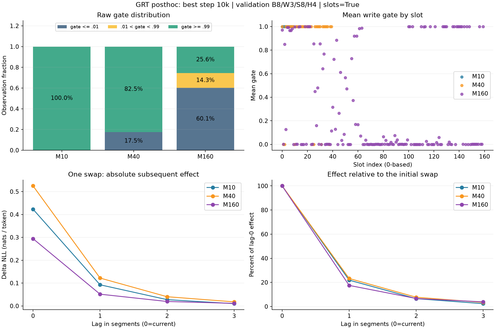
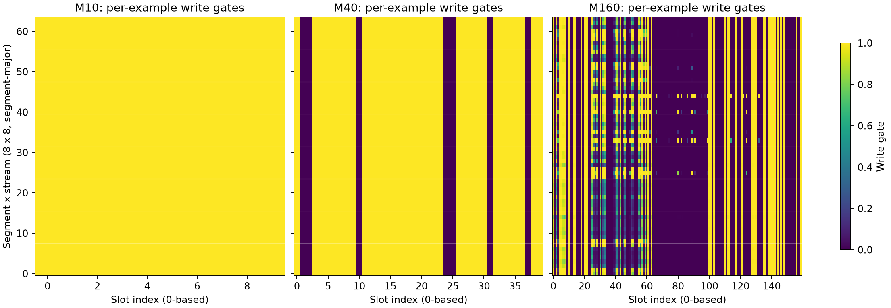
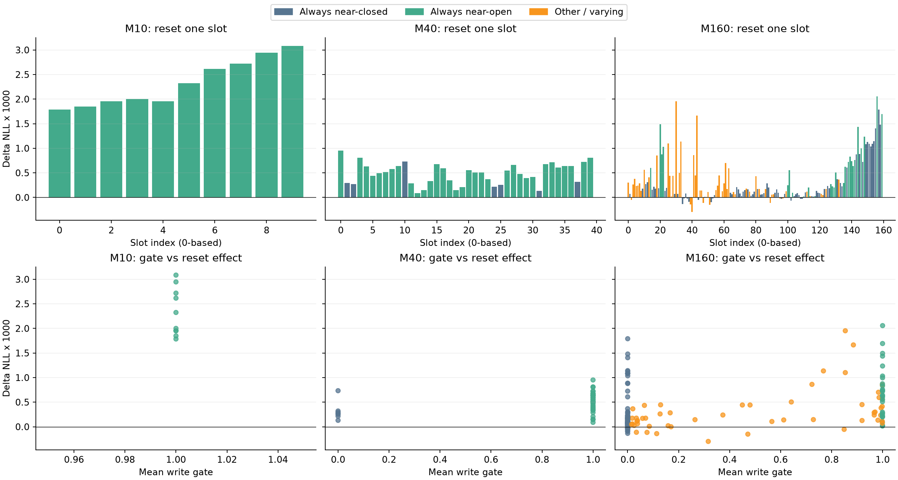

# small 모델의 레지스터 용량 비교 실험

실험 시작: 2026-10-12 · 갱신: 2026-10-15 · 상태: NeoX/RMT baseline과 GRT M10/M40/M160의 10k 학습·슬롯별 사후 분석 완료, 선택 M 미정

[공통 실행 안내](../20261011_experiment_workflow.md) · [Colab 사후 분석 방법](../20261011_experiment_workflow.md#posthoc-colab) · [원본 JSON 보관 규칙](../../results/README.md)

## 1. 현재 결론과 결정할 점

**GRT 후보 중 전체 validation 품질은 M160, 학습 비용은 M10, 고정 probe의 정상 품질·state 개입 민감도는 M40이 유리하다.** M10/M40은 write가 포화된 경로로 동작하고 M160은 일부 슬롯에서 example·segment별 변화가 나타난다. write가 닫힌 슬롯도 예측에 기여하므로 열린 슬롯 수만 실효 메모리 용량으로 세지 않는다.

| 사용자 결정 | 판단 / 근거 |
|---|---|
| 품질·메모리 사용 방식·비용을 고려한 선택 M | |
| M512 또는 M256/320의 추가 용량 확인 여부 | |
| 다른 window·그룹 초기화·추가 seed가 필요한지 | |
| 선택 M 이후 MLP128/256/512/1024 탐색 우선순위 | |

이 문서는 이 실험 주제의 계획·결과·해석·판단을 계속 갱신하는 단일 기록이다. MLP·segment·모델 크기 탐색을 시작하면 각각 새 실험 문서에 조건과 결과를 모은다.

## 2. 질문과 실험 조건

질문은 고정된 small backbone에서 레지스터 수 M이 segment 사이의 정보 전달 용량과 압축 압력, 실제 예측 기여에 어떤 차이를 만드는가이다. M10/40/160은 segment150 대비 강한 압축·중간 용량·비슷한 크기의 state를 비교한다. register 하나를 token 하나와 대응시키거나 M≈segment를 최적점으로 가정하지 않는다. state는 여러 segment의 정보를 누적하며 K는 gradient 범위이지 기억 길이의 상한이 아니다.

| 항목 | 고정 조건 |
|---|---|
| 데이터 / tokenizer | WikiText-103-v1 / 동일 GPT-2 BPE artifact, vocabulary50,257 |
| Backbone | small D256, 6 layers, 8 heads, FF1024, tied embedding, 공통 NeoX |
| segment / 학습량 | 150 BPE tokens / 10,000 updates / 실제383,917,824 targets |
| 학습 | global256, Adam LR5e-4·beta2=.999·decay0, cosine·warmup0, clip.25 |
| 정규화 / 수치 | residual dropout.1, attention dropout0, FP32 |
| 과거 BPTT | RMT/GRT K3, 현재까지 최대4 segments 재계산; NeoX K0 |
| GRT | MLP hidden512, router attention D256/head8, read gate off, write bias−2, gate dropout0 |
| 평가 / seed | validation batch10, 1k마다 평가, model/data seed54, test 미평가 |
| GPU 배치 | T4×2, auto_batch on/예약 VRAM 목표95%, microbatch×accumulation×GPU수=global256 |

95%는 예약 VRAM의 목표 상한이며 정확히 채운다는 뜻은 아니다. 준비된 데이터·tokenizer hash, 학습 target 수, 평가 범위는 다섯 run에서 같다. validation은248,420 BPE targets를 사용하고 모든 best checkpoint는 step10,000이다.

비교 조건의 차이는 다음과 같다. M0/K0 NeoX와 K3 메모리 모델은 계산량이 다르며 parameter 수도 다르다. M10은 micro64×accum2, M40/M160은 micro32×accum4여서 dropout RNG·수치 차이가 남는다. M160 학습은 Python3.12.13/PyTorch2.10.0+cu128, 나머지는3.13.15/2.11.0+cu128이며 Transformers4.45.2/CUDA12.8은 같다. 실행 코드 commit 간 차이는 결과 문서·원본 JSON이고 학습 코드는 동일함을 확인했다. 용량만 완전히 통제한 비교나 여러 seed 평균으로 해석하지 않는다.

## 3. 학습 품질·비용과 학습 곡선

### 3.1 완료 결과

| ID | 모델 | M / K | parameters | best val NLL | best val PPL |
|---|---|---|---:|---:|---:|
| B0 | neox | 0 / 0 | 17,604,864 | 3.636507 | 37.9590 |
| B1 | rmt | 10 / 3 | 17,607,424 | 3.551781 | 34.8754 |
| R0 | grt | 10 / 3 | 18,669,588 | 3.555054 | 34.9897 |
| R1 | grt | 40 / 3 | 18,708,048 | 3.548059 | 34.7458 |
| R2 | grt | 160 / 3 | 18,861,888 | 3.530795 | 34.1511 |

RMT는 NeoX보다 PPL3.0836 낮다. GRT M10은 RMT보다0.1143 높고 M40/M160은 각각0.1296/0.7243 낮다. M160은 M40보다0.5947 낮으나 단일 seed의 결과다. 전체 품질과 아래 고정 probe의 품질 순위는 다르므로 구분한다.

| ID | micro × accum × GPU | wall h | GPU-hours | 학습 allocated GiB/GPU | preflight reserved GiB/GPU |
|---|---|---:|---:|---:|---:|
| B0 | 64 × 2 × 2 | 2.610 | 5.220 | 6.899 | 8.686 |
| B1 | 64 × 2 × 2 | 5.366 | 10.731 | 11.049 | 13.064 |
| R0 | 64 × 2 × 2 | 5.812 | 11.623 | 11.269 | 13.156 |
| R1 | 32 × 4 × 2 | 7.009 | 14.018 | 6.538 | 7.436 |
| R2 | 32 × 4 × 2 | 13.150 | 26.300 | 9.713 | 10.752 |

시간은 학습·평가·checkpoint 저장과 GRT의 RTLA를 포함하며 준비/preflight는 제외한다. GPU-hours는 시간×GPU수이며 Kaggle quota 차감량을 뜻하지 않는다. M40의 VRAM이 M10보다 작은 것은 microbatch 차이가 있어 큰 M 자체의 메모리가 더 적다는 뜻이 아니다. RMT 시간에는 GRT 전용 RTLA가 없으므로 GRT와의 차이를 순수 모델 연산 비용으로 보지 않는다. M160의 학습 시간은 M40의 약1.88배다.

### 3.2 validation 학습 곡선

| update | NeoX | RMT | GRT M10 | GRT M40 | GRT M160 |
|---:|---:|---:|---:|---:|---:|
| 1,000 | 90.4616 | 91.0054 | 123.4827 | 208.9937 | 737.4491 |
| 2,000 | 62.2051 | 60.1944 | 87.7662 | 432.5057 | 964.1900 |
| 3,000 | 50.7699 | 49.0132 | 79.3278 | 727.0352 | 1244.3458 |
| 4,000 | 46.1166 | 42.9223 | 43.1153 | 43.8405 | 45.5080 |
| 5,000 | 43.1198 | 39.9501 | 40.1375 | 40.5349 | 43.9151 |
| 6,000 | 40.6935 | 37.6279 | 37.7818 | 37.8219 | 41.9157 |
| 7,000 | 39.3211 | 36.2604 | 36.4037 | 36.3005 | 36.0280 |
| 8,000 | 38.6221 | 35.5079 | 35.6394 | 35.4525 | 35.4295 |
| 9,000 | 38.0851 | 35.0009 | 35.1090 | 34.9164 | 34.9406 |
| 10,000 | 37.9590 | 34.8754 | 34.9897 | 34.7458 | 34.1511 |

M40/M160은 초기1k→3k validation이 악화됐다가4k에 크게 회복한다. 세 GRT run은 초기 reset 효과가 음수였고3k→4k 평가 사이에 양수로 바뀐다. 짧은 pilot의 gate나 PPL만으로 후보를 너무 일찍 제외하면 이 전환을 놓칠 수 있다.

| 모델 / 구간 | write mean 전→후 | relative update 전→후 | reset ΔNLL 전→후 |
|---|---:|---:|---:|
| R0 · 3k→4k | 0.6999→1.0000 | 0.0769→0.0860 | -0.4302→0.2206 |
| R1 · 3k→4k | 0.3211→0.8250 | 0.0180→0.0766 | -1.8893→0.2527 |
| R2 · 3k→4k | 0.0671→0.3809 | 0.0077→0.0475 | -2.0430→0.2395 |
| R2 · 6k→7k | 0.3811→0.3270 | 0.0610→0.0751 | 0.2707→0.2893 |

write 변화와 품질 전환의 선후관계는1k 간격 로그로 구분하지 못한다. M160은6k→7k에 평균 write가 줄어도 품질·실제 relative update가 개선됐다. 따라서 큰 평균 write 하나를 학습 성공의 기준으로 삼지 않는다.

마지막1k PPL 감소는 NeoX0.1261, RMT0.1255, GRT M10/M40/M160이0.1193/0.1706/0.7895다. 마지막 LR0인10k cosine 결과이므로 고정 예산의 비교로 사용하며 완전 수렴을 확정하지 않는다. 더 긴 확인은 새 schedule의 새 run으로 진행한다.

## 4. 동일 checkpoint의 메모리 활용 분석

최신 슬롯별 사후 보고서3개는 모두 best step10k, validation·batch8/warmup3/측정8/segment150/horizon4/slots=true, Colab Tesla T4 단일 GPU·FP32·TF32 off다. Python3.13.15/PyTorch2.11.0+cu130/Transformers4.45.2/CUDA13.0, 분석 코드 `7bdb37b`와 주요 source hash가 동일하다. 각 lag의 target 수는9,600이다.

checkpoint의 원래 run 경로·model/optimizer 설정·data manifest와 best RTLA 지표로 학습 run에 연결했다. report의 `training_config.data.options.path`만 Colab prepared 경로로 기록돼 있고 나머지는 기존 학습 Config와 같다. 학습 report에는 checkpoint hash가 없어 과거 bytes 동일성까지 검증하지 못하며, 아래 사후 hash를 향후 식별 기준으로 쓴다.

`Δ_reset=NLL(S0 초기화)−NLL(정상 state)`, `Δ_swap=NLL(다른 stream state)−NLL(정상 state)`다. 양수는 정상 과거 state가 그 probe에서 도움이 됐다는 근거다. 큰 delta는 잘못된 state에 대한 민감성도 나타낼 수 있어 단독으로 최대화하지 않는다. baseline의 GRT 전용 RTLA 미측정값은0으로 대체하지 않는다.

| 지표 | M10 | M40 | M160 |
|---|---:|---:|---:|
| 정상 probe PPL | 32.9314 | 32.4541 | 34.0898 |
| reset ΔNLL | 0.294231 | 0.345704 | 0.323459 |
| swap ΔNLL | 0.422916 | 0.524916 | 0.294080 |
| write mean | 1.000000 | 0.825000 | 0.325191 |
| slot cosine | 0.999348 | 0.759750 | 0.529918 |
| relative update | 0.078745 | 0.083919 | 0.080673 |

probe PPL과 전체 validation PPL은 서로 다른 target 범위다. 이번 평가 환경의 통일은 이미 학습된 가중치의 학습 조건 차이까지 통제하지 않는다. relative update는 실제 갱신 norm/(이전 state norm+candidate norm)이며, candidate 변화와 gate 적용 후 실제 update를 구분한다. read gate off의 값을 읽기량으로 쓰지 않고 write pooling attention을 token→register 읽기 attention으로 해석하지 않는다.

### 4.1 gate 평균의 실체: 포화와 변화

각 슬롯에서8 segments×8 examples=64개 gate 원값을 분석했다. near-closed는<=0.01, near-open은>=0.99다. 관측 비율과 전체64개 관측에 걸친 슬롯 분류를 구분한다.

| 지표 | M10 | M40 | M160 |
|---|---:|---:|---:|
| near-closed 관측 비율 (%) | 0.00 | 17.50 | 60.13 |
| 중간값 관측 비율 (%) | 0.00 | 0.00 | 14.26 |
| near-open 관측 비율 (%) | 100.00 | 82.50 | 25.62 |
| 모든 관측에서 near-closed인 슬롯 | 0 | 7 | 77 |
| 모든 관측에서 near-open인 슬롯 | 10 | 33 | 26 |
| 위 두 고정 포화 분류에 속하지 않는 슬롯 | 0 | 0 | 57 |
| probe 내 gate 범위(max−min)>=0.1인 슬롯 | 0 | 0 | 45 |
| closed/open 양쪽 threshold를 넘나든 슬롯 | 0 | 0 | 17 |

#### M10: 전면 write 포화

640개 gate 관측이 모두 정확히1이다. 이번 probe에서는 입력·segment에 따른 gate 조절이 보이지 않는다. state는 매번 candidate로 교체되지만 candidate가 이전 state를 읽으므로 장기 기억이 매번 지워진다는 뜻은 아니다. cosine≈0.99935는 state 방향의 유사성을 보여주나, 위치·norm·projection 효과가 있어 동일 기능이나 낮은 유효 rank를 직접 증명하지 않는다. 양의 reset/swap과 아래 retention은 유용한 과거 정보 전달이 존재함을 보여준다.

#### M40: 평균0.825는 사실상 고정된 슬롯 분할

33개 슬롯은64개 관측 내내 near-open,7개는 내내 near-closed다. 닫힌 slot index는 **1,2,10,24,25,31,37 (0-based)**다. 평균0.825가 모든 슬롯의 부드러운0.825 혼합에서 나온다는 해석은 배제할 수 있다. segment·example에 따른 gate 변화는 수치적으로 극히 작다(평균 표준편차 약10⁻²⁹). 이번 probe에서는 동적인 write 선택보다 거의 고정된 write 경로 분할로 동작한다.

다만 write가 닫힌 슬롯도 token이 읽을 수 있다. warmup 이전의 갱신이나 학습된 S0의 역할을 이 gate 통계로 판정할 수 없으므로7개를 불필요·미사용 슬롯으로 부르지 않는다. 또한 최종 checkpoint의 포화가 학습 초기부터 지속됐다고 추정하지 않는다.

#### M160: 포화된 부분과 변하는 부분이 공존

전체 gate 관측의60.13%는 near-closed,25.62%는 near-open,14.26%는 중간이다. 전체64개 관측에서 고정 near-closed인 슬롯은77개, 고정 near-open은26개, 나머지는57개다. 이57개 중45개는 관측 범위가0.1 이상이며17개는 closed와 open 양쪽 threshold를 넘나든다. 따라서 평균write0.325만으로 거의 갱신하지 않는 모델로 해석하기 어렵다.

평균 slot별 segment 표준편차(batch 평균의 변화)는0.02759, 동일 segment 내 example 표준편차의 평균은0.04003이다. M10/M40보다 입력·state·segment에 따라 gate가 달라지는 현상이 분명하다. 어떤 요인이 그 변화를 일으켰는지는 이 관측만으로 분리할 수 없다. 고정 분류 밖57개가 모두 유용하거나 모두 강하게 변한다는 뜻도 아니다.

### 4.2 한 번의 state 교환 이후 영향과 회복

각 측정 segment 시작점에서 state를 한 번 교환하고, 이후에는 교환된 branch를 계속 진행한다. lag0은 현재 segment, lag1/2/3은 다음1/2/3 segments다. 각 lag는9,600 targets이며, 서로 겹치는 정상 target·개입 시작점을 사용하므로 lag들을 독립 표본으로 세지 않는다.

| lag | M10 ΔNLL | M40 ΔNLL | M160 ΔNLL |
|---:|---:|---:|---:|
| 0 | 0.422916 | 0.524916 | 0.294080 |
| 1 | 0.092503 | 0.121971 | 0.051419 |
| 2 | 0.027552 | 0.040327 | 0.019505 |
| 3 | 0.009960 | 0.017808 | 0.011249 |

| lag0 대비 잔여 효과 | M10 | M40 | M160 |
|---|---:|---:|---:|
| lag1 (%) | 21.87 | 23.24 | 17.48 |
| lag2 (%) | 6.51 | 7.68 | 6.63 |
| lag3 (%) | 2.36 | 3.39 | 3.83 |

세 모델 모두 교환 피해가 다음 segment에서 크게 줄고 이후에도 감소한다. M40의 절대 ΔNLL은 모든 lag에서 가장 크며 lag3에도0.017808이다. 다만 초기 피해로 정규화한 lag3 잔여 비율은 M160 3.83%, M40 3.39%, M10 2.36%로 M160이 조금 더 크다. **절대 민감도와 감쇠 비율은 서로 다른 지표이므로 M40의 기억이 무조건 가장 오래 간다고 결론내리지 않는다.**

lag3의 PPL 악화율 `exp(ΔNLL)−1`은 M10 1.00%, M40 1.80%, M160 1.13%다. 각 모델의8개 개입 시작점에 대한 batch 평균 delta는 모든 lag에서 양수였다. 이는 해당 probe에서 방향이 일관된다는 관측이며, 겹치는 token/문맥을 가진8개 시작점으로 독립 seed 검증이나 통계적 유의성을 대신하지 않는다.

이 결과는 잘못된 기억의 영향이 남아 있다가 회복되는 양상이다. 정보가 정확히 몇 segment 저장되는지, gate가 직접 복사한 state와 candidate를 거친 경로 중 어느 것이 영향을 유지하는지, 일반적인 장기 기억 능력이 얼마인지는 아직 구분하지 못한다.

### 4.3 슬롯별 초기화 기여: 현재 segment의 조건부 영향

슬롯 j의 delta는 `NLL(S의 j만 S0로 초기화)−NLL(정상 S)`다. 양수면 그 초기화가 예측을 악화시키고 음수면 이 probe 평균에서 개선시킨다. 다른 슬롯을 그대로 둔 상태의 단일 개입 효과이며 저장 정보량·읽기 횟수·독립적인 기여 지분은 아니다.

| 지표 | M10 | M40 | M160 |
|---|---:|---:|---:|
| 양의 평균 delta 슬롯 (>1e−6) | 10 | 40 | 140 |
| 음의 평균 delta 슬롯 (<−1e−6) | 0 | 0 | 19 |
| 작은 평균 delta 슬롯 (절대값<=1e−6) | 0 | 0 | 1 |
| 최소 단일 슬롯 ΔNLL | 0.00178523 | 0.00008886 | -0.00029821 |
| 최대 단일 슬롯 ΔNLL | 0.00308472 | 0.00095180 | 0.00205707 |
| 슬롯별 평균 ΔNLL | 0.00232307 | 0.00048377 | 0.00034899 |
| 8개 개입 시작점의 batch 평균이 모두 양수인 슬롯 | 8 | 2 | 2 |

1e−6은 작은 관측값을 별도로 표시하기 위한 기준이며 유의수준이나 검증된 수치 오차 범위가 아니다. M160의 작은 값1개는 실제로 약−3.11e−7이다. 여러 시작점에서 부호가 바뀌는 슬롯이 많으므로 평균 부호만으로 안정적인 역할을 확정하지 않는다.

#### 슬롯 기여 상위5개 · index는0-based

| M | 슬롯 | ΔNLL | mean write | probe 내 gate 분류 |
|---:|---:|---:|---:|---|
| 10 | 9 | 0.00308472 | 1.000000 | 고정 near-open |
| 10 | 8 | 0.00294604 | 1.000000 | 고정 near-open |
| 10 | 7 | 0.00271820 | 1.000000 | 고정 near-open |
| 10 | 6 | 0.00261607 | 1.000000 | 고정 near-open |
| 10 | 5 | 0.00232447 | 1.000000 | 고정 near-open |
| 40 | 0 | 0.00095180 | 1.000000 | 고정 near-open |
| 40 | 39 | 0.00081048 | 1.000000 | 고정 near-open |
| 40 | 3 | 0.00080621 | 1.000000 | 고정 near-open |
| 40 | 10 | 0.00073328 | 0.000000 | 고정 near-closed |
| 40 | 38 | 0.00072606 | 1.000000 | 고정 near-open |
| 160 | 156 | 0.00205707 | 0.999931 | 고정 near-open |
| 160 | 30 | 0.00195264 | 0.853732 | 기타/가변 |
| 160 | 157 | 0.00179062 | 0.000285 | 고정 near-closed |
| 160 | 159 | 0.00169288 | 0.999755 | 고정 near-open |
| 160 | 43 | 0.00166439 | 0.885462 | 기타/가변 |

#### gate가 닫힌 슬롯도 예측에 영향을 준다

| M / gate 그룹 | 슬롯 수 | 양 / 음 / 작은 delta 개수 | 그룹 내 평균 ΔNLL |
|---|---:|---:|---:|
| M10 / 고정 near-open | 10 | 10 / 0 / 0 | 0.00232307 |
| M40 / 고정 near-closed | 7 | 7 / 0 / 0 | 0.00031645 |
| M40 / 고정 near-open | 33 | 33 / 0 / 0 | 0.00051927 |
| M160 / 고정 near-closed | 77 | 66 / 11 / 0 | 0.00026898 |
| M160 / 고정 near-open | 26 | 26 / 0 / 0 | 0.00070713 |
| M160 / 기타/가변 | 57 | 48 / 8 / 1 | 0.00029371 |

**M40은40개 슬롯 모두 평균 delta가 양수이며 닫힌7개도 전부 포함된다.** 특히 닫힌 slot10은0.00073328로 전체4위다. 따라서 열린33개만을 실효 메모리 용량으로 세는 해석은 맞지 않는다. 닫힘은 측정8 segments에서 관측한 write 동작이다. warmup 때의 쓰기 여부는 이 trace에 없고, 이미 형성된 state는 write가 작아도 읽힐 수 있다.

**M160의 고정 near-closed77개 중66개는 양의 평균 효과**이며 slot157/158은 각각0.00179062/0.00147925로 상위권이다. 고정 near-open26개는 전부 양수지만, gate 평균이 크다고 반드시 기여 순위가 높은 것은 아니다. 낮은 평균 write를 사용하지 않는 메모리로 해석하지 않는다.

M10은10개 모두 양수이고 개별 제거 피해가 다른 두 모델의 평균보다 크다. 높은 cosine에도 모든 슬롯이 정확히 같은 역할이거나 무의미하다고 볼 수 없다. M160은 일부 슬롯에 영향이 집중되면서 다수의 작은 효과가 함께 나타난다. 양의 단일 슬롯 delta 합에서 상위 약25% 슬롯(M10은3개로 올림)의 비중은 M10 상위3/10개37.66%, M40 상위10/40개38.24%, M160 상위40/160개71.65%다. 이 비중은 단일 개입값의 분포 요약이며 전체 예측 이득의 지분이 아니다.

#### 합산·음의 delta의 해석 한계

| 지표 | M10 | M40 | M160 |
|---|---:|---:|---:|
| 단일 슬롯 ΔNLL의 단순 합 | 0.023231 | 0.019351 | 0.055839 |
| 전체 state reset ΔNLL | 0.294231 | 0.345704 | 0.323459 |

단일 슬롯 효과의 합은 전체 reset과 크게 다르다. 서로 겹치는 표현, 슬롯 간 상호작용, attention 재분배, joint reset의 비선형 효과가 있으므로 합을 전체 기억량이나 설명된 성능 비율로 쓰지 않는다. 어느 원인이 지배적인지는 그룹 개입 등으로 구분해야 한다.

M160의 가장 음수인 slot40은−0.00029821로, 이 probe에서 초기화하면 NLL이 소폭 낮아졌다. 이것만으로 해당 슬롯을 제거하면 일반화 성능이 좋아진다고 주장하지 않는다. 단일 window의 작은 효과이며 다른 문맥·seed·그룹 개입에서 확인해야 한다. 최대 단일 슬롯 제거의 probe PPL 악화율도 M10 약0.309%, M40 약0.095%, M160 약0.206%로 작다.

## 5. 해석과 한계

| 가설 | 이번 관측이 주는 근거 | 남아 있는 구분 |
|---|---|---|
| M10은 bandwidth가 제한된다 | 방향 유사도가 매우 높고 gate는 전부1; 더 큰 M에서 전체 품질이 개선됨 | M10도 유용한 state를 사용하며, 명목 M이 실제 정보량을 직접 재지는 않음 |
| M40이 압축과 전달량의 적절한 균형이다 | M10보다 낮은 PPL, 강한 probe 개입 효과, M160보다 짧은 학습 시간 | gate는 거의 고정 분할이며 전체 품질은 M160이 더 좋음; 최적 압축률을 증명하지 않음 |
| M160은 압축 압력이 약해진다 | 큰 명목 용량과 더 낮은 cosine이 관측됨 | 포화된 부분·가변적인 부분이 공존하고 정상 품질도 개선됨; 과거 여러 segments를 저장하므로 무압축이라고 할 수 없음 |
| write 변화가 학습 전환을 결정한다 | 기존3k→4k 로그에서 gate·품질·reset 효과가 함께 바뀜 | 이번은 최종 checkpoint의 probe만 관측; 원인/결과의 선후관계는 초기 checkpoint 또는 제어 학습이 필요 |

새로 가장 분명해진 것은 **M10/M40의 포화된 write와 M160의 부분적으로 변하는 write가 서로 다르며, write가 닫힌 슬롯도 예측에 기여한다**는 점이다. 높은 swap 효과·낮은 cosine·높거나 낮은 gate 중 하나를 건강함의 단독 기준으로 쓰지 않는다. 다음 M 선택은 전체 품질·문맥 개입·gate 동작·비용을 함께 보고 사용자가 판단할 수 있도록 남긴다.

## 6. 후속 실험·운영 계획

| 단계 | 비교 / 변경할 값 | 현재 상태 |
|---|---|---|
| Baseline | B0 NeoX, B1 RMT M10 | 완료 |
| 레지스터 | R0/R1/R2 M10/40/160, MLP512 고정 | 학습·슬롯별 사후 분석 완료 |
| 추가 용량 | R3 M512, T4에 맞지 않으면 M256/320 검토 | 비용·목적 검토 후 결정, 미실행 |
| 레지스터 선택 | 전체 품질·개입 효과·gate/slot·시간/VRAM | 사용자 판단 전 |
| MLP | H0/H1/H2/H3 hidden128/256/512/1024, 선택 M 고정 | 선택 후 별도 실험; hidden512는 해당 R 결과 재사용 |

현재 단계에서는 attention D256/head8을 고정한다. MLP 탐색에서도 attention 차원/head는 바꾸지 않는다. 노트북의 수동 선택값·실행·파일 내보내기는 공통 workflow를 따른다.

### 추가 분석과 후속 주제

- Colab 분석을 확장해 첫 window의 유형을 다른 두 window에서 검증하고 logit 포화·중심화한 state/update의 rank/CKA·그룹 초기화/교환·동일 크기 무작위 대조·손상 곡선을 한 JSON에 기록하도록 준비했다. 새 분석의 실제 GPU 결과는 아직 없으며 위 완료 수치는 기존 report 기준이다. 새 그룹 분석은 start×lag×example 효과와 token 수를 보존한다. 여러 swap permutation·과거 입력 구간 교란·학습 초기 gradient/probe는 후속 선택지다. 단일/그룹 효과는 합산하지 않는다.
- 초기 write 전환의 원인을 보려면 당시 checkpoint/trace와 필요시 write bias −4/−2/0 등의 제어 학습을 사용한다. raw gate·norm·cosine이나 최종 checkpoint 분석만으로 원인을 확정하지 않는다.
- segment150/75/50 등은 별도 실험으로 NeoX/RMT baseline도 함께 비교한다. 저비용 탐색 후보는 L과 M을 함께 줄여 M/L을 유지하고 처음부터 학습하는 조건이며, M 고정의 segment 축소와 구분한다. global B, segment L, target 예산 T에서 updates≈T/(B×L)이므로 update 수만 같게 하지 않는다. K3 고정과 과거450-token BPTT(K3/6/9)를 구분하고 replay 비용도 기록한다.
- segment를 바꾸는 RTLA는 같은 token 범위·stream partition을 맞춰야 한다. 예를 들어450-token warmup/1200-token 측정은 L150/75/50에서 warmup3/6/9, 측정8/16/24다. 현재 segment 수만 고정하면 비교 token과 과거 범위가 달라진다.
- read gate on/off, write dropout, clip/LR/beta2/optimizer/warmup은 해당 질문을 정한 뒤 탐색한다. state의 scalar read gate는 LayerNorm에서 크기 효과가 상쇄될 수 있어 logits와 다음 state 경로를 먼저 확인한다. K0은 현재 GRT write router의 다음 segment credit 경로가 끊기는 별도 control이다. AdamW·stream warmup·clip 빈도 metric은 실제 사용 전에 지원 범위를 확인한다.
- 더 큰 모델은 small에서 선택한 설정을 출발점으로 삼되 baseline과 용량·batch·속도를 다시 측정한다. 작은 품질 차이의 최종 주장은 추가 seed와 필요시 더 긴 새 schedule로 확인하고, test는 선택 후 평가한다.
- raw-v1·WT2·WT103 문서 subset은 별도 데이터 계열로 다룬다. BPE PPL을 word PPL과 직접 비교하지 않는다. WT2/WT103 평가 기사는 겹치며, 현재 v1의 `<unk>` 치환은 BPE로 복구되지 않는다. 줄 EOS를 기사 경계로 가정하지 않는다.
- 첫 탐색은 수동 grid와 기존 W&B를 유지한다. 필요할 때 Optuna/W&B Sweeps 등을 검토하되 NLL·RTLA를 임의 가중합으로 합치지 않고 품질 허용 후보의 Pareto·재현성을 본다. token milestone 중단/promotion과 자동 runner는 별도 구현이 필요하다.

이 항목들은 후속 선택지이며 실행 완료 결과가 아니다. 초기 HPO 제안의 미확정 grid·예산을 현재 확정 조건으로 사용하지 않는다.

### 자원 배치

Kaggle 주30h는 baseline·본 학습, Colab 하루4~5h는 사전 측정·사후 분석 또는 시간 내 독립 run에 사용한다. 실제 quota 정책과 세션 길이를 확인하고 checkpoint·prepared 데이터를 세션 밖에 보존한다. 사후 분석은 단일 GPU에서 가능하지만 학습 재개는 같은 Config·world_size·데이터 조건을 지켜야 한다. `max_seconds`는 누적 상한이므로 일별 세션 제한으로 쓰지 않는다.

Vast.ai의 RTX4080 등 유료 자원은 무료 quota 부족 시 별도 예산을 정하고 필요한 후보만 실행하는 선택지다. T4 실측을 다른 GPU에 단순 비례 환산하지 않고 새 환경에서 batch·ETA를 측정한다. preflight ETA는 RTLA·준비·저장 비용을 제외하므로 본 학습 wall time과 구분한다.

### 참고 근거

[RMT 2022](https://papers.neurips.cc/paper_files/paper/2022/file/47e288629a6996a17ce50b90a056a0e1-Paper-Conference.pdf)의 word-level/Transformer-XL 결과는 현재 NeoX·GPT-2 BPE·full-softmax PPL의 직접 목표값이 아니다. 데이터 계열은 [WikiText 설명](https://huggingface.co/datasets/Salesforce/wikitext/blob/main/README.md)과 [WikiText 원 논문](https://arxiv.org/pdf/1609.07843)을 참고한다. 자동화 도입 시 [Optuna 다목적](https://optuna.readthedocs.io/en/stable/tutorial/20_recipes/002_multi_objective.html)·[Trial API](https://optuna.readthedocs.io/en/stable/reference/generated/optuna.trial.Trial.html)의 pruning 제약과 [W&B sweep schema](https://github.com/wandb/sweeps/blob/master/src/sweeps/config/schema.json)의 단일 metric 계약을 확인한다.

## 7. 원본과 재현성

전체 설정·hash·학습/분석 배열은 다음 JSON을 기준으로 확인한다. 학습5개와 최신 slots=true 사후3개를 보관하며 다른 환경 결과를 CSV로 누적하지 않는다. 새 결과가 오면 이 문서의 해당 표·해석을 갱신한다. 미실행·미측정은0으로 채우지 않는다.

| 학습 ID | 원본 | 학습 코드 | W&B |
|---|---|---|---|
| B0 | [JSON](../../results/0f4be0ee5d5c4a77b8ce50d591932c69.json) | [e238ac3](https://github.com/YeoJune/GRT/commit/e238ac356bbfcbf5766fc20466105617a7944354) | [run](https://wandb.ai/joyyoj1-korea-university/grt-research/runs/633dd52b) |
| B1 | [JSON](../../results/24b2e511de2e419eb0ac7f9b52769d89.json) | [e238ac3](https://github.com/YeoJune/GRT/commit/e238ac356bbfcbf5766fc20466105617a7944354) | [run](https://wandb.ai/joyyoj1-korea-university/grt-research/runs/92d08d99) |
| R0 | [JSON](../../results/22ab31a56cb546f993197e5ce937e5de.json) | [e238ac3](https://github.com/YeoJune/GRT/commit/e238ac356bbfcbf5766fc20466105617a7944354) | [run](https://wandb.ai/joyyoj1-korea-university/grt-research/runs/e284b89f) |
| R1 | [JSON](../../results/22cfd16b44964befbe42912c4aba28c5.json) | [c36920d](https://github.com/YeoJune/GRT/commit/c36920d0e4423ecf714b6d34e5785fe3a3beae72) | [run](https://wandb.ai/joyyoj1-korea-university/grt-research/runs/710b2330) |
| R2 | [JSON](../../results/0e0ead4744594b59a7d9a771049c79a1.json) | [555d837](https://github.com/YeoJune/GRT/commit/555d8371e852bab78fcfada5ed909ea34425f817) | [run](https://wandb.ai/joyyoj1-korea-university/grt-research/runs/19167540) |

| M | checkpoint SHA256 앞12자 | 사후 원본 | 분석 시간 s / peak allocated GiB |
|---:|---|---|---:|
| 10 | `cc0daecfb590` | [JSON](../../results/posthoc/2542d67f74964180bb6dcf421452068e.json) | 6.063 / 0.553 |
| 40 | `520315a746d3` | [JSON](../../results/posthoc/3a2607fb35a543569debcb393eecf2c2.json) | 14.148 / 0.554 |
| 160 | `cbac55d5f46f` | [JSON](../../results/posthoc/54218437e5074f3487500da34a0aff3c.json) | 54.002 / 0.562 |

데이터 식별값 앞12자는 train `2e43bd7c329c`, validation `a2bc335cb8a1`, tokenizer `1fe93b615295`다. JSON은 checkpoint 가중치를 포함하지 않는다. 사후 시간은 복원·슬롯별 초기화·분석·그림 저장을 포함하며 순수 forward 속도가 아니다.

보고서 정리 과정에서 실제 GPU 학습을 추가 실행하지 않았다. 사용자 제공 완료 report로 T4×2 학습과 Colab T4 사후 분석을 확인했다. 구현의 CPU 검증 범위·실행 방법은 workflow에서 관리하며 단일 seed·고정 probe의 관측과 기능 검증을 구분한다.
