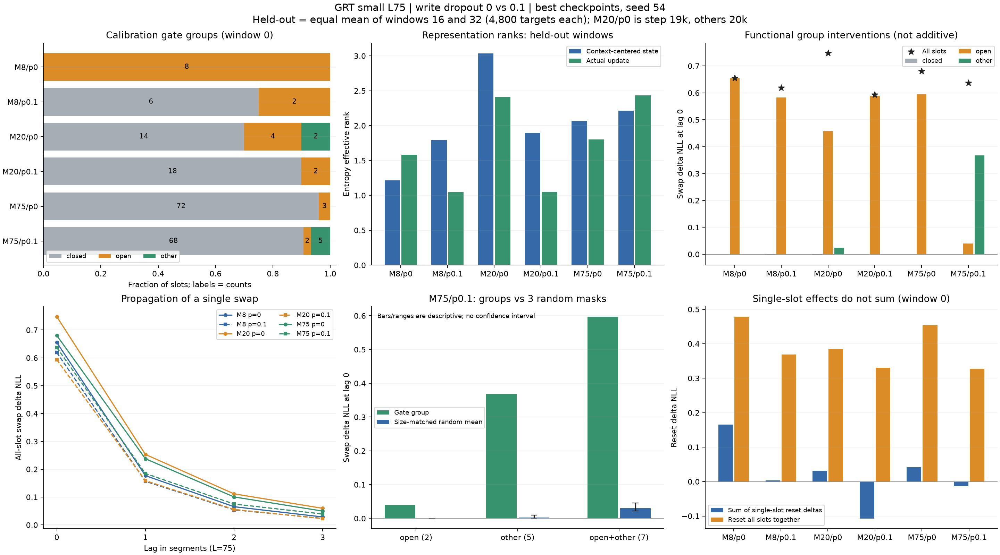

# L75 small: write dropout과 bias 비교

작성: 2026-10-15 · 갱신: 2026-10-16 · 상태: dropout A단계 학습·확장 사후 분석 각6개 완료, bias B단계 미실행

[공통 실행 안내](../20261011_experiment_workflow.md) · [이전 L150 용량 실험](20261012_small_register_sweep.md) · [원본 보관](../../results/README.md)

## 1. 목적과 고정 조건

L과 M을 함께 줄인 별도 실험으로, write dropout이 품질·분화에 미치는 영향과 초기 write bias에 따른 차이를 확인한다. 현재 단계에서 NeoX/RMT를 새로 학습하지 않는다. 이전 L150 결과는 참고 자료이며 L75 baseline이나 동일 조건 대조군으로 사용하지 않는다.

| 항목 | 조건 |
|---|---|
| 모델 / 데이터 | GRT small D256·6 layers·FF1024 / 기존 WikiText-103 GPT-2 BPE prepared artifact 재사용 |
| L / M | L75 고정, M8 / 20 / 75 |
| M/L | 0.1067 / 0.2667 / 1.0000; 이전10/150·40/150·160/150와 유사한 범위, 정확한 축소 복제는 아님 |
| Router | attention D256/head8, MLP hidden512 고정; head 수는 M의 배수 조건이 아님 |
| Read gate / S0 | read gate 항상 off; 학습 가능한 S0를 0으로 초기화 |
| 기본 write | bias 초기값0, write dropout0; 아래 두 단계에서만 변경 |
| 학습 예산 | 새 초기화에서20,000 optimizer updates; nominal targets=256×75×20,000=384M, 실제 tail 반영 수는 report 기준 |
| BPTT | 이전3 segments 유지: 과거225 tokens, 현재 포함 최대300 tokens 재계산 |
| Optimizer / schedule | Adam LR5e−4, betas(.9,.999), decay0, cosine20k·warmup0, global norm clip.25 |
| Dropout / precision | backbone residual.1 / backbone·router attention0 / FP32 |
| 배치 / seed | global256, model/data seed54; auto_batch·예약 VRAM 목표95%, micro×accum×GPU수 유지 |
| 평가 | validation batch10·매1k updates·best validation checkpoint, test 미평가; 학습 중 RTLA on |

20k는 update 수다. L150/10k와 nominal target 예산은 같지만 optimizer update 횟수, 과거 token 기준 BPTT, write 빈도·메모리 용량이 달라 동일 학습 조건은 아니다. 이번 두 단계 안에서는 L/M별 고정 조건과20k schedule을 유지한다.

## 2. 실험 순서: 총12개 고유 run

**A. 각 M에서 bias0으로 dropout0과0.1을 비교한다(6회).** best validation NLL/PPL을 우선 보고 학습 곡선·시간·분화 지표를 함께 확인한다. 품질 차이를 확신하기 어려우면 dropout0을 우선하는 잠정 선택을 기록한다. 한 seed에서 작은 차이를 확정하지 않는다.

**B. 각 M에서 선택한 dropout을 고정하고 bias−2/0/+2를 비교한다(추가6회).** bias0은 A의 해당 run/checkpoint/report를 그대로 재사용한다. bias만 바꾼 두 조건은 매번 새로 초기화해20k 학습한다. dropout 선택은 M별로 기록한다. 서로 다른 dropout을 고른 M 사이의 비교는 선택된 조건의 비교이며 순수 M 효과로 해석하지 않는다.

Bias는 모든 슬롯의 write MLP 마지막 bias 초깃값이며 학습 가능하다. bias−2/0/+2의 sigmoid 기준값은 약.119/.500/.881이지만 실제 gate는 hidden 출력에 따라 달라진다. write dropout.1은 학습 중 example·slot별 확률.1로 write logit을−∞로 만들어 기존 state를 보존하며, state를 지우거나 rescaling하지 않는다. 평가·사후 분석에서는 dropout을 끈다. 새 정규화·분화 보조 손실은 이번 비교에 넣지 않는다.

| M | A의 잠정 선택 dropout | 근거 / best PPL (p0 → p.1) | B 실행 여부 |
|---:|---:|---|---|
| 8 | 0 | 34.1048 → 34.2791; 차이가 작아 p0 우선 | 미실행 |
| 20 | 0 | 33.7436 → 34.2129; 한 seed에서 더 낮은 validation NLL | 미실행 |
| 75 | 0.1 | 33.7629 → 32.8984; 한 seed에서 더 낮은 validation NLL | 미실행 |

선택은 B단계를 진행하기 위한 잠정 기준이다. 사용자 최종 판단 전이며, seed54 한 번의 결과로 유의성을 주장하지 않는다. 선택한 bias0 run을 재사용하고 새 bias−2/+2만 학습하면 된다.

## 3. 학습 결과 기록

각 행은 별도 run이다. B의 bias0 결과는 A에서 선택한 행을 참조해 중복 학습하지 않는다. 실제 micro/accum/GPU·환경·target 예산·코드 hash는 원본 report에 보관하고 차이가 있으면 판단에 적는다.

| ID | M | bias init | write dropout | 상태 | best step / PPL(best·20k) | wall h / peak GiB | 학습 JSON / 확장 사후 JSON |
|---|---:|---:|---|---|---|---|---|
| A8-0 | 8 | 0 | 0 | 완료 | 20,000 / 34.1048 · 34.1048 | 5.511 / 10.849 | [학습](../../results/ccf041592f3e4ebe8f287e69195205a5.json) / [사후](../../results/posthoc/10b47cdf69034d8d91a842f60f226ede.json) |
| A8-1 | 8 | 0 | 0.1 | 완료 | 20,000 / 34.2791 · 34.2791 | 6.054 / 10.849 | [학습](../../results/746ab4ab41e84ec0bdd0f3f0ed6bffdb.json) / [사후](../../results/posthoc/17f1bc032be54c249e645fa01275bac2.json) |
| A20-0 | 20 | 0 | 0 | 완료 | 19,000 / 33.7436 · 33.7718 | 6.695 / 11.721 | [학습](../../results/86fb2481ac1e45f29da0164863b28d66.json) / [사후](../../results/posthoc/5435927747a34aa895d5804c2b5772a6.json) |
| A20-1 | 20 | 0 | 0.1 | 완료 | 20,000 / 34.2129 · 34.2129 | 6.442 / 11.721 | [학습](../../results/51bafa3f611d48c2808a7a55d732c91d.json) / [사후](../../results/posthoc/1ae377fe64e243749040cf61991c37f0.json) |
| A75-0 | 75 | 0 | 0 | 완료 | 20,000 / 33.7629 · 33.7629 | 10.093 / 8.326 | [학습](../../results/b4b4414578524de0a6e9de50851b91b2.json) / [사후](../../results/posthoc/f5a1825cc5d84f6da400eb249ec409ac.json) |
| A75-1 | 75 | 0 | 0.1 | 완료 | 20,000 / 32.8984 · 32.8984 | 10.041 / 8.326 | [학습](../../results/06fe396a3e6b4e258b779481409de1ba.json) / [사후](../../results/posthoc/df797486d1cd4606acc91fc478535e33.json) |
| B8− | 8 | -2 | 0 (잠정) | 미실행 | | | |
| B8+ | 8 | +2 | 0 (잠정) | 미실행 | | | |
| B20− | 20 | -2 | 0 (잠정) | 미실행 | | | |
| B20+ | 20 | +2 | 0 (잠정) | 미실행 | | | |
| B75− | 75 | -2 | 0.1 (잠정) | 미실행 | | | |
| B75+ | 75 | +2 | 0.1 (잠정) | 미실행 | | | |

### 3.1 조건 검증과 품질·비용

6개 모두 Kaggle Tesla T4×2·FP32·global256·동일 model/data seed54·코드 `90d407c`에서20k를 완료했다. Python3.13.15/PyTorch2.11.0+cu128/Transformers4.45.2/CUDA12.8과 prepared manifest가 일치한다. 실제 학습 target은 각383,975,424개, validation은248,420개이며 test는 평가하지 않았다. 같은 M의 두 Config는 write dropout·출력/run 이름 이외에 동일하다. M8/20은 micro128×accum1×GPU2, M75는 micro64×accum2×GPU2다. M 사이의 RNG·수치 차이는 남지만 dropout 쌍 안의 배치는 같다.

| M | p.1−p0 best ΔNLL | p.1−p0 best ΔPPL | PPL 상대 변화 | 잠정 선택 |
|---:|---:|---:|---:|---:|
| 8 | +0.005099 | +0.1744 | +0.51% | 0 |
| 20 | +0.013814 | +0.4694 | +1.39% | 0 |
| 75 | -0.025941 | -0.8646 | -2.56% | 0.1 |

M8은 작은 차이로 p0을 유지하고, M20은 p0, M75는 p.1을 우선한다. 가장 낮은 best PPL은 M75/p.1의32.8984다. **M20/p0의 best는19k(33.7436), 최종20k는33.7718**이므로 selected RTLA도19k 기준으로 정리한다. 나머지는 best=20k다. 최종20k끼리 비교해도 dropout 선택 방향은 같다.

학습 wall time은6개 합계44.836h(T4×2, 단순 GPU-hours89.672)다. 평가·기본 RTLA·저장을 포함하며 preflight·준비는 제외한다. GPU-hours는 Kaggle quota 차감량을 뜻하지 않는다. p.1의 시간 차이는 M별 방향이 달라 dropout의 고유 속도 효과로 단정하지 않는다. 경고·metrics parse 오류·W&B 실패는 없고 모든 run이20k까지 기록됐다.

### 3.2 학습 전환과 후반 경향

| step | M8 p0 | M8 p.1 | M20 p0 | M20 p.1 | M75 p0 | M75 p.1 |
|---:|---:|---:|---:|---:|---:|---:|
| 1,000 | 111.5782 | 119.7384 | 146.7764 | 155.7687 | 339.4793 | 310.9276 |
| 6,000 | 55.3052 | 90.3683 | 141.2861 | 132.7306 | 766.3398 | 393.8043 |
| 7,000 | 43.1608 | 55.9326 | 45.1793 | 56.1340 | 44.1882 | 53.3275 |
| 12,000 | 36.5148 | 55.1371 | 38.4342 | 49.4047 | 38.3717 | 64.3067 |
| 13,000 | 35.9216 | 36.9852 | 35.8741 | 36.6402 | 40.2011 | 35.9088 |
| 18,000 | 34.2506 | 34.8845 | 34.0446 | 34.4091 | 34.8954 | 33.8390 |
| 19,000 | 34.1368 | 34.4075 | 33.7436 | 34.2452 | 33.7674 | 32.9583 |
| 20,000 | 34.1048 | 34.2791 | 33.7718 | 34.2129 | 33.7629 | 32.8984 |

여러 run이6k까지 악화/정체했다가7k에 크게 회복한다. p.1의 세 run은12k→13k에도 큰 품질 전환이 나타나므로 짧은 pilot로 결과를 판단하면 이번 최종 순위를 놓친다. 마지막1k 개선은 M8 p0/.1이0.0320/0.1283, M20 p0는0.0282 악화·p.1은0.0323 개선, M75 p0/.1은0.0045/0.0600 개선이다. cosine20k 종료의 작은 변화는 고정 예산 후반 안정화 근거이며 완전 수렴 증명은 아니다.

학습 manifest의 train118,436,938 tokens를 global256으로 나누면 stream당462,644 tokens이고 epoch당6,169 updates다. 코드가6,169/12,338/18,507 이후 epoch를 시작할 때 state와 BPTT 이력을 초기화한다. 큰 전환이 그 직후 첫 평가와 맞물리므로, 학습 전환을 분화 발생 시점으로만 해석하지 않는다. 데이터 재노출·S0 재노출·state 초기화·LR 변화의 인과관계는 현재 로그만으로 분리되지 않는다.


## 4. 분화 분석과 판단란

새 학습은 마지막 report 셀에서 각 best checkpoint를 자동 분석한다. 이미 완료된 run은 기존 Colab 사후 분석 노트북에 best checkpoint를 넣어 같은 helper로 분석할 수 있다. batch8·warmup3·측정8·horizon4·window0/16/32·random 반복3/seed54·slots/registers=true를 공통 사용한다. L/M은 checkpoint에서 읽는다. L75에서 warmup225/측정600 tokens이며, 이전 L150 probe와 절대 token 범위는 다르다. 이번 run끼리는 같은 조건으로 비교한다.

| 비교 | 전체 val 품질 / 학습 안정성 | 현재 기본 RTLA에서 보이는 차이 | 판단 / 확장 분석 |
|---|---|---|---|
| M8 dropout0 vs .1 | p0가0.1744 PPL 낮음; p.1의 후반 회복이 늦음 | p.1에서 write·cosine 감소, 품질 개선으로 이어지지는 않음 | p0 잠정; 열린8→2·actual update rank 감소, 품질 이득 없음 |
| M20 dropout0 vs .1 | p0가0.4694 PPL 낮음 | p.1에서 write 감소·cosine 증가 | p0 잠정; 열린4/중간형2→열린2, 극단 포화·갱신 rank 감소 |
| M75 dropout0 vs .1 | p.1이0.8646 PPL 낮음 | p.1에서 write·relative update 증가, cosine 감소 | p.1 잠정; 중간형5개에 문맥 기여 집중, 품질 개선과 일치 |
| M8 bias−2/0/+2 | 미실행 | | |
| M20 bias−2/0/+2 | 미실행 | | |
| M75 bias−2/0/+2 | 미실행 | | |

### 4.1 받은 report에 실제 포함된 기본 RTLA

best checkpoint의 고정 window0·batch8/warmup3/측정8·L75, 정상 target4,800개의 결과다. eval mode이므로 p.1 학습 run에서도 write dropout은 꺼져 있다. write 평균 차이를 평가 때10%를 무작위로 끈 결과나0.9 rescaling으로 해석하지 않는다.

| ID | best step | probe PPL | write mean | relative update | slot cosine | reset ΔNLL | swap ΔNLL |
|---|---:|---:|---:|---:|---:|---:|---:|
| A8-0 | 20,000 | 36.1425 | 1.000000 | 0.142461 | 0.991730 | 0.478807 | 0.779855 |
| A8-1 | 20,000 | 35.8145 | 0.250000 | 0.037800 | 0.800519 | 0.368968 | 0.750425 |
| A20-0 | 19,000 | 35.8678 | 0.229072 | 0.037654 | 0.693341 | 0.384911 | 0.852954 |
| A20-1 | 20,000 | 35.8817 | 0.100000 | 0.017578 | 0.825199 | 0.330863 | 0.696968 |
| A75-0 | 20,000 | 36.5850 | 0.040000 | 0.006818 | 0.911851 | 0.454511 | 0.767104 |
| A75-1 | 20,000 | 34.9636 | 0.087290 | 0.019172 | 0.633101 | 0.327613 | 0.740750 |

모든 reset/swap 평균이 양수로 해당 probe에서 과거 state가 예측에 도움을 준다. 다만 큰 delta는 잘못된 state에 대한 민감성도 나타내므로 단독으로 최대화하지 않는다. M8/p.1은 probe PPL이 더 낮아도 전체 validation은 p0가 더 낮다. 선택에는 전체 validation을 우선한다.

M8/p0는 write 평균1·cosine≈.992로 강한 포화/유사화가 의심되고, p.1에서는 write.25·cosine≈.801로 바뀌었다. M20에서는 반대로 p.1의 cosine이.825로 높아져 dropout이 항상 분화를 늘린다고 할 수 없다. M75/p.1은 p0보다 cosine이.912→.633, state norm이15.799→2.035로 낮고, write.040→.087·실제 update norm.362→.773은 커졌다. **평균 gate와 norm만으로 세 유형의 비율·동적 분화를 확정하지 않는다.** 학습 report에는 raw gate/logit·슬롯/그룹 개입·rank/CKA가 없으며, 이번 수신 사후 report로 아래4.3~4.8에 보완했다.

write 평균만으로 학습 전환을 설명할 수 없다. M8/p.1은12k→13k에 write.25를 유지하면서 PPL55.1371→36.9852로, M75/p.1도 write≈.0933인 채64.3067→35.9088로 바뀐다. 후자는 cosine.868→.635·reset ΔNLL−.212→+.282 변화도 동반한다. candidate state·backbone·읽기 등의 변화를 구분하려면 확장 분석이 필요하다.

### 4.2 Colab 자동 실행 범위 확인

| 경로 | 자동 실행 내용 | 이번 수신 확인 |
|---|---|---|
| `colab.ipynb` / `kaggle.ipynb`의 `job.train()` | RTLA on이면 validation마다 및 종료 후 best 복원 시 정상/reset/swap·gate/state/update 평균 | 6run 모두 step별 RTLA20건과 selected_rtla 포함 |
| 학습 노트북 마지막 `job.report(posthoc=True, ...)` | best.pt의 확장 분석 후 experiment_results.zip에 학습·사후 JSON 동봉 | 2026-10-16 연결; 이번에 별도 사후 JSON6개 수신 |
| 별도 `colab_analysis.ipynb`의 `job.run()` | 지정 checkpoint의 slot·retention·3window·logit·rank/CKA·group 개입을 일괄 실행 | 같은 helper의 사후 JSON6개 완료 확인; 사용 진입점은 파일만으로 구분하지 않음 |

학습 중 기본 RTLA는 `WikiTextRun` → `train_stream` → `adapter.log_analysis` → `analyze_stream(horizon=0, slots=False)`를 유지한다. 기존 수신6개 report도 horizon0·slot/retention 배열이 비어 있다. **2026-10-16부터 학습 노트북 마지막 셀에서 `job.report(posthoc=True, ...)`가 별도 `WikiTextPosthoc`을 호출해 전체 사후 분석을 실행한다.** 학습 JSON을 먼저 보존하고 두 결과를 ZIP 하나로 묶는다. 이후 수신한 별도 사후 JSON6개로 기존6개 best checkpoint의 확장 분석 완료를 확인했다. 근거는 [학습 루프](../../src/grt/stream_training.py), [공통 notebook helper](../../src/grt/utils/kaggle.py), [기본 분석](../../src/grt/memory_analysis.py)이다.

6조건의 best.pt 사후 분석을 아래에 통합했다. 추가 checkpoint는 기존 [Colab 분석 노트북](../../notebooks/colab_analysis.ipynb)에서 같은 옵션으로 분석하거나 학습 마지막 report 셀을 사용한다. M20/p0의 best는19k로 다른20k best와 step이 다름을 기록하고, 엄밀한 동일 step 비교가 필요하면 모든 조건의 last.pt/20k를 별도로 분석한다.

세 유형의 균등 분배나 높은 rank 자체를 성공 기준으로 삼지 않는다. threshold 민감도·동일 개수 무작위 그룹·단일 효과의 비가산성·reset과swap 차이를 함께 본다. 학습 중 RTLA로 전환 시점을 보고, 최종 checkpoint 사후 관측으로 학습 원인을 확정하지 않는다. 추가 seed·긴 학습·다음 구조 실험은 아래 사후 해석과 사용자 판단을 바탕으로 결정한다.

### 4.3 사후 분석의 연결·집계 기준

6개 모두 원래 학습 Config·prepared manifest·selected step·학습 중 best RTLA의 모든 scalar 지표가 정확히 일치한다. M20/p0는19k, 나머지는20k이며, 파일명 대신 checkpoint의 실제 Config로 M/dropout을 연결했다. checkpoint hash는 각 사후 원본에 보관한다. 학습 JSON 자체에는 hash가 없으므로 전달받지 않은 가중치를 별도로 재해시한 것은 아니다.

사후 실행은 코드 `fbb9a53`·clean checkout·동일30개 source hash(현재 repo와 일치)·Colab T4 단일 GPU·FP32/TF32 off다. Python3.13.15/PyTorch2.11.0+cu130/CUDA13.0/Transformers4.45.2가6개 모두 같다. 원래 학습의 PyTorch cu128/CUDA12.8과는 다르지만 첫 probe의 기존 RTLA는 전 항목 동일하게 재현됐다. 설정은 batch8·warmup3·측정8·horizon4·slots/registers true·window0/16/32·random3·seed54·손상 비율10/25/50/75%다.

**window0에서 그룹을 정의하고, 아래 별도 표의 대표값은 평가 window16·32의 동일 가중 평균으로 집계한다.** 각 window/lag에4,800 targets가 있어 token 가중 평균과 같다. 세 window는 각각 S0로 시작해225 tokens warmup 후600 tokens를 측정하며, 이어225 tokens까지 개입 branch를 추적한다. 연속적인 긴 문맥3개를 이어서 분석한 것이 아니다. 단일 슬롯 기여는 window0에서만 측정한다. random 범위는 같은3개 mask 각각의 두 평가 window 평균에서 min/max를 계산하며 신뢰구간이 아니다.

| ID | checkpoint step | 사후 T4 seconds | peak MiB | checkpoint SHA256 앞12자리 |
|---|---:|---:|---:|---|
| A8-0 | 20,000 | 61.36 | 337.71 | `5aa9d458db84` |
| A8-1 | 20,000 | 94.44 | 337.71 | `be6f249c6745` |
| A20-0 | 19,000 | 163.58 | 338.43 | `919e91014cda` |
| A20-1 | 20,000 | 104.86 | 338.43 | `d56a848c6426` |
| A75-0 | 20,000 | 112.75 | 341.71 | `1de8e1540d5c` |
| A75-1 | 20,000 | 178.46 | 341.71 | `9f53f8caa514` |

사후 분석은6개 합계715.44초(11.92분, 단일 T4 약0.199 GPU-hours)다. 보고된 분석 본체 시간이며 코드 설치·Drive 복사 등은 제외한다. 이번 고정 probe의 비용으로, 모델 크기·측정 길이·슬롯 수를 늘린 분석 시간으로 일반화하지 않는다.

### 4.4 Gate 분화와 포화: dropout의 방향이 M마다 다르다

closed는 calibration의 모든 관측에서 gate<=.01, open은 모두>=.99, other는 그 밖이다. **other는 관측 분류이며 자동으로 유용한 선택형 메모리를 의미하지 않는다.** 아래 포화율·logit·router 값은 두 평가 window 평균이다. |logit|>20은 극단 포화의 기술 지표이며 닫힘/열림 양쪽을 포함한다.

| ID | closed / open / other (window0) | 평가 window 유형 유지율 | \|logit\|>20 | median \|logit\| | router context norm / MLP hidden norm |
|---|---|---|---:|---:|---:|
| A8-0 | 0 / 8 / 0 | 100.00% / 100.00% | 100.00% | 59.24 | 87.09 / 272.11 |
| A8-1 | 6 / 2 / 0 | 100.00% / 100.00% | 100.00% | 153.25 | 91.24 / 396.98 |
| A20-0 | 14 / 4 / 2 | 95.00% / 100.00% | 35.16% | 18.08 | 44.36 / 108.06 |
| A20-1 | 18 / 2 / 0 | 100.00% / 100.00% | 100.00% | 276.33 | 160.74 / 778.41 |
| A75-0 | 72 / 3 / 0 | 100.00% / 100.00% | 100.00% | 88.29 | 134.57 / 484.43 |
| A75-1 | 68 / 2 / 5 | 98.67% / 97.33% | 4.34% | 10.63 | 6.29 / 37.54 |

M8/p0·M8/p.1·M20/p.1·M75/p0는 세 window와 threshold.001/.01/.05 모두 동일한 이진 그룹 분할이다. M8/p.1은6개 닫힘/2개 열림으로 나뉘지만 모든 logit이 극단 포화돼, 부드럽고 문맥에 따라 쓰기를 조절하는 슬롯이 늘어난 것은 아니다. M20/p.1도18/2/0으로 변하며 median |logit|이18.08→276.33, hidden norm이108.06→778.41로 커진다. dropout이 router를 항상 안정화하지는 않는다.

M75/p.1은 반대로 |logit|>20 비율100%→4.34%, context norm134.57→6.29, hidden norm484.43→37.54로 낮아진다. window0의68/2/5는 평가 window에서68/3/4·68/4/3으로 바뀐다. threshold.001/.01/.05에 따른 window0 그룹은67/0/8·68/2/5·68/4/3이므로 정확한 세 유형 비율은 threshold에 민감하다. 다만 기본 threshold에서 닫히지 않은7개 슬롯 묶음은 두 평가 window에서도 유지되고, 그 내부의 open/other 분류가 달라진다.

마지막 write bias의 학습 후 절댓값 최대는6run 모두.042 미만이다. 따라서 현재 극단 logit을 마지막 bias 값 자체만으로 설명할 수 없으며 context·hidden·출력 weight 경로의 기여가 크다. 이 관찰이 초기 bias의 최적화 경로 영향을 배제하지는 않으므로 예정된 bias 실험은 여전히 의미가 있다.

### 4.5 표현 다양성: cosine 감소와 실제 갱신의 분화를 구분한다

rank는 각 state의 slot×feature 행렬에서 squared singular value 에너지로 구한 entropy effective rank를 평균한 값이다. 문맥 평균 제거는 슬롯별 관측 평균을 빼고, actual update는 실제 S_next−S다. CKA는 같은64개 segment/example 관측의 off-diagonal 슬롯쌍 평균이며, 문맥에 따른 표현 변화 유사도의 기술 통계다.

| ID | raw state rank | 문맥 평균 제거 rank | 실제 update rank | 평균 slot CKA |
|---|---:|---:|---:|---:|
| A8-0 | 1.0468 | 1.2156 | 1.5821 | 0.9931 |
| A8-1 | 1.7987 | 1.7898 | 1.0486 | 0.9310 |
| A20-0 | 2.8119 | 3.0334 | 2.4098 | 0.9016 |
| A20-1 | 1.6723 | 1.8974 | 1.0508 | 0.9654 |
| A75-0 | 1.7026 | 2.0655 | 1.8039 | 0.9757 |
| A75-1 | 1.9522 | 2.2142 | 2.4346 | 0.9150 |

M8의 dropout은 state rank1.05→1.80·전체 CKA.993→.931로 표현 차이를 늘리지만, actual update rank1.58→1.05다. 두 open 슬롯 사이 CKA도.9986으로 매우 높다. 즉 닫힌 묶음/열린 묶음 사이의 차이가 커진 것과, 갱신하는 슬롯끼리 정보가 다양해진 것은 다르다.

M20은 문맥 평균 제거 rank3.03→1.90·update rank2.41→1.05·CKA.902→.965로, dropout 후 표현·갱신이 더 유사해지는 방향이다. open 내부 CKA도.844→.998로 높아진다. M75는 update rank1.80→2.43·CKA.976→.915로 개선되며 정상 validation 개선과 일치한다. 다만75개 슬롯에 비해 rank는 여전히 낮고, M20/p0가 문맥 평균 제거 rank는 더 높아도 최저 PPL은 M75/p.1이다. rank 최대화를 성능 목표로 삼지 않는다. M75/p.1에서도 전체 CKA는.915로 여전히 높고, open2개 내부는.9904, other5개 내부는.8509다. 낮아진 cosine만으로75개 슬롯이 독립적으로 분화됐다고 할 수는 없다. CKA는 관측64개/feature256의 제한과 작은 변동 진폭에도 높아질 수 있는 특성이 있어 gate·그룹 개입과 함께 본다.

### 4.6 그룹 개입: M75의 중간형은 기능적으로도 구별된다

아래는 각 calibration 그룹을 따로 reset/swap한 평가 window의 lag0 ΔNLL이다. 양수면 손상, 음수면 해당 probe에서 개선이다. **원래 group mask를 평가 window에서도 그대로 사용하며, 각 행의 효과를 합산하지 않는다.**

| ID | closed reset / swap | open reset / swap | other reset / swap | 전체 reset / swap |
|---|---:|---:|---:|---:|
| A8-0 | +0.0000 / +0.0000 | +0.4549 / +0.6553 | +0.0000 / +0.0000 | +0.4549 / +0.6553 |
| A8-1 | -0.0078 / -0.0031 | +0.3017 / +0.5824 | +0.0000 / +0.0000 | +0.3622 / +0.6191 |
| A20-0 | +0.0155 / -0.0028 | +0.1045 / +0.4575 | -0.0005 / +0.0246 | +0.3547 / +0.7480 |
| A20-1 | +0.0043 / -0.0018 | +0.2977 / +0.5880 | +0.0000 / +0.0000 | +0.3053 / +0.5932 |
| A75-0 | +0.0825 / -0.0007 | +0.2190 / +0.5938 | +0.0000 / +0.0000 | +0.4389 / +0.6804 |
| A75-1 | +0.0151 / -0.0007 | +0.0068 / +0.0397 | +0.1178 / +0.3678 | +0.3002 / +0.6373 |

M8/p.1과M20/p.1은 open2개에 swap 손상이 각각.5824/.5880으로 집중된다. 같은 크기의 무작위 그룹 평균은.0363/−.0009다. 전체 swap 손상.6191/.5932와 가깝지만 이를 기여율로 나누지는 않는다. 두 슬롯의 높은 CKA·update rank≈1을 함께 보면, 크기가 작은 동적 경로에 기능이 집중된 상태와 부합한다.

M20/p0의 other2개는 단독 reset−.0005·swap+.0246으로 작지만, 다른 슬롯을 모두 바꾼 상태에서 이 둘만 정상으로 복원하면 reset 손상을.2314, swap 손상을.2659 줄인다. 무작위 대조군3개 중 하나가 우연히 other2개와 완전히 같아 other 단독 효과는 대조군 최대와 같다. 따라서 이 조건의 other를 독립적으로 특별하다고 과장하지 않으며, 큰 **조건부 복원 효과와 상호작용**을 기록한다.

M75/p.1에서는 other5개가 두 평가 window 각각에서 swap+.3707/+.3649이며, 동일 크기 random 최대+.0081/+.0105를 크게 넘는다. 두 window를 평균한 비교는 다음과 같다.

| M75/p.1 그룹 | 슬롯 수 | reset ΔNLL | swap ΔNLL | 같은 수 random swap 평균 [min,max] | 전체 swap 후 해당 그룹 정상 복원 효과 |
|---|---:|---:|---:|---|---:|
| open | 2 | +0.0068 | +0.0397 | -0.0004 [-0.0004, -0.0004] | +0.2380 |
| other | 5 | +0.1178 | +0.3678 | +0.0026 [-0.0008, +0.0093] | +0.5929 |
| open+other | 7 | +0.2604 | +0.5974 | +0.0301 [+0.0225, +0.0452] | +0.6380 |

M75/p.1의 open2개보다 other5개를 교환했을 때 손상이 크고, other만 정상으로 복원하는 효과도.5929다. other의 swap 영향은 lag3에도.0305 남고 같은 크기 random 평균은−.0007이다. **M75에서는 dropout 후 생긴 중간형 묶음이 문맥에 유용한 정보를 담는다는 개입 근거가 있다.** 다만 서로 다른 두 모델을 비교한 것이므로 이 분화가 PPL 개선의 원인임을 확정하거나, 모든 중간형 슬롯이 같은 의미적 역할을 한다고 결론내리지는 않는다.

닫힌 슬롯도 곧 미사용은 아니다. M8/p.1 closed6개는 측정 중 update norm=0이지만 문맥별 state 변동 norm 평균12.88이고, M75/p0 closed72개도 각각0·8.29다. 측정 전 warmup에서 형성된 문맥 상태를 보존할 수 있기 때문이다. 특히 M75/p0의 closed reset은+.0825이지만 swap은−.0007로, S0와의 차이와 올바른 donor 문맥의 중요성이 다르게 나타난다. M75/p.1 closed는 변동 norm.0474·update norm.00084로 더 작아, 전체 슬롯 CKA만으로 닫힌 묶음의 정보량을 비교하면 오해하기 쉽다. reset/swap 분석은 슬롯을 삭제하거나 attention에서 제외한 실험이 아니므로 pruning 성능을 보장하지 않는다.

단일 슬롯 초기화 효과의 합계도 활용성 지표로 충분하지 않다. window0에서 M20/p.1의 단일 reset ΔNLL 합은−.1076이지만 전체 reset은+.3309, M75/p.1은−.0124이지만 전체 reset은+.3276이다. M8/p0도 합+.1655 대 전체+.4788이다. 그룹 단위에서도 M75/p.1은 전체 swap.6373과 세 그룹 단독 합.4068 사이 차이가.2305다. 음의 개별 효과나 작은 단독 효과를 근거로 불필요 슬롯을 확정하지 않는다.

### 4.7 Retention과 무작위 손상: 장기 보존 개선은 확인되지 않았다

한 번 전체 state를 swap한 뒤 정상 입력을 계속 주었을 때의 ΔNLL이다. lag0는 현재 segment, lag3은225 tokens 뒤 segment이며 분기 전체가 원래 trajectory와 다를 수 있다. 손상이 오래 남는 것은 유용한 정보의 장기 보존과 동의어가 아니다.

| ID | lag0 | lag1 | lag2 | lag3 |
|---|---:|---:|---:|---:|
| A8-0 | 0.6553 | 0.1770 | 0.0655 | 0.0287 |
| A8-1 | 0.6191 | 0.1566 | 0.0543 | 0.0234 |
| A20-0 | 0.7480 | 0.2533 | 0.1116 | 0.0597 |
| A20-1 | 0.5932 | 0.1590 | 0.0557 | 0.0226 |
| A75-0 | 0.6804 | 0.2377 | 0.1006 | 0.0497 |
| A75-1 | 0.6373 | 0.1847 | 0.0751 | 0.0392 |

세 M 모두 dropout 후 평균 swap 손상이 lag0~3에서 작아진다. M20은 lag3 .0597→.0226으로 특히 줄어든다. 정상 PPL도 악화되고 update rank도 낮아져 장기 문맥 활용이 약해졌을 가능성과 부합하지만, 서로 다른 모델의 손상 회복률이므로 원인을 단정하지 않는다. M75는.0497→.0392로 줄어도 정상 품질이 좋아진다. 따라서 dropout이 전반적으로 장기 기억을 늘렸다는 주장은 지지되지 않으며, 더 나은 표현·조건부 활용과 개입 강건성 변화로 나누어 해석한다.

무작위 슬롯50% 교환의 lag0 손상은 M8 .1438→.1247, M20 .1138→.1166, M75 .0994→.2084다. M75는 전체 swap 손상이 줄어도 부분 swap 손상은 오히려 커질 수 있다. 사용 슬롯의 위치·개수, 원래/교환 문맥이 섞이는 효과와 그룹 상호작용이 관여하므로 dropout을 보편적 손상 강건성 개선으로 부르지 않는다. 무작위 mask는3개뿐이며 손상 곡선의 작은 차이를 통계적 차이로 해석하지 않는다.



### 4.8 이번 사후 분석을 반영한 판단

**성능 기준 잠정 선택은 M8=0, M20=0, M75=.1로 유지한다.** M8의 dropout은 외형적 표현 차이를 늘려도 갱신 effective rank≈1·open2개에 집중되고 품질은 좋아지지 않는다. M20은 dropout 후 극단 포화·중간형 소실·갱신 rank 감소·PPL 악화가 함께 관측돼 이번 조건에서 부정적 근거가 가장 일관된다. M75는 극단 포화 완화·중간형의 무작위 대조군 대비 기여·갱신 rank 상승·PPL 개선이 함께 관측돼 가장 유망하다.

이번 결과는 “세 유형이 있다는 것”보다 **그룹의 비율·포화 정도·문맥별 표현·조건부 기여를 함께 봐야 한다**는 판단을 강화한다. 균등 비율이 최적이라는 근거는 없고, 같은 dropout도 M에 따라 반대 결과를 낸다. 분화 실험의 목표를 단순 cosine 감소나 other 수 증가로 두지 않고, validation 품질과 held-out 그룹 기여의 동반 개선으로 둔다.

다음 bias 실험은 기존 계획대로−2/0/+2를 새 초기화에서 비교하되 위 지표와 gate/context scale을 같이 본다. 추가 확인의 우선순위는 warmup 길이 변화에 따른 그룹 안정성, epoch 경계 전후 checkpoint의 gate·표현 변화, 효과가 큰 M75의 추가 seed다. 현재 분석은 단일 seed·세 짧은 window·horizon4의 최종 관측이며 긴 문맥/완전 수렴·분화의 학습 원인·다른 seed 재현성을 검증한 것은 아니다. 새로운 학습이나 분석 코드는 이번 결과 정리에 추가하지 않았다.

## 5. 기존 노트북에서 실행

새 노트북이나 run별 YAML을 만들지 않는다. 기존 [Kaggle](../../notebooks/kaggle.ipynb) / [Colab 학습](../../notebooks/colab.ipynb)의 선택 셀을 사용한다.

```python
models = ('grt',)
segment_len = 75
num_registers = 8        # 8 / 20 / 75
budget = '20k'
router_hidden = 512
write_gate_bias = 0.0    # A: 0, B: -2 / 0 / +2
write_dropout = 0.0      # A: 0 / .1, B: 해당 M에서 선택한 값
```

Read gate off는 model override에 명시한다. 값을 바꾸면 기존 공통 helper의 설정 hash가 달라져 별도 run이 된다. 같은 값·환경은 기존 last.pt를 재개하므로, 동일 조건을 새 폴더에서 재실행하려면 명시적 run_id를 사용하고, 독립 seed 검증은 seed를 바꾼다. GPU 수가 다른 환경으로 학습을 재개하지 않는다. 초기값·dropout·M·L을 바꾼 기존 checkpoint에서 이어 학습하지 않는다.

순서는 setup → 기존 prepared 데이터 복원 → preflight → train → report다. preflight의 실제 micro/accum·target tokens/update·예상 시간을 확인한다. 새 L/M의 시간을 이전 T4 실측에서 단순 환산하지 않는다. 예약 VRAM 목표95%는 정확한 점유율 보장이 아니다. 장시간 run/checkpoint·데이터는 세션 밖에 보존한다.

학습 노트북 마지막 `job.report(posthoc=True, download=True, posthoc_options=...)`의 **experiment_results.zip** 하나를 보내면 안의 학습·사후 JSON을 이 문서의 해당 ID에 반영한다. 마지막 셀에서 batch8·warmup3·측정8·horizon4·slots/registers true·window0/16/32·group_repeats3을 직접 바꿀 수 있다. 기존 학습 JSON과 별도 사후 JSON도 계속 받을 수 있다. 여러 환경 결과를 CSV로 누적하지 않는다. 미실행·미측정은 빈칸/상태로 남긴다.

## 6. 준비 검증

관련 CPU 검사55개가 통과했다. 기존 카탈로그에20k 예산을 추가하고, 실제 Kaggle/Colab 선택 셀에서 M3개×bias3개×dropout2개의 설정 전달·고유 run hash·read off·실질 배치256·384M nominal targets를 확인했다. 기존 gate/write 구현과 공통 utils를 사용하며 모델 구조·checkpoint 형식·기존 결과는 바꾸지 않았다. 2026-10-16 사용자 제공6개 report로20k GPU 학습·시간·기본 RTLA 완료를 확인했다. 같은 날 사후 JSON6개를 추가 수신해 gate 원값·threshold·3window·그룹별 token 가중 ΔNLL을 검증하고 위 표·그림에 반영했다. 기존 원본은 보존했다.

## 7. 원본과 재현성

| ID | report ID / 원본 | W&B |
|---|---|---|
| A8-0 | [ccf041592f3e4ebe8f287e69195205a5](../../results/ccf041592f3e4ebe8f287e69195205a5.json) | [run](https://wandb.ai/joyyoj1-korea-university/grt-research/runs/748b71bf) |
| A8-1 | [746ab4ab41e84ec0bdd0f3f0ed6bffdb](../../results/746ab4ab41e84ec0bdd0f3f0ed6bffdb.json) | [run](https://wandb.ai/joyyoj1-korea-university/grt-research/runs/edf5664c) |
| A20-0 | [86fb2481ac1e45f29da0164863b28d66](../../results/86fb2481ac1e45f29da0164863b28d66.json) | [run](https://wandb.ai/joyyoj1-korea-university/grt-research/runs/54d2c635) |
| A20-1 | [51bafa3f611d48c2808a7a55d732c91d](../../results/51bafa3f611d48c2808a7a55d732c91d.json) | [run](https://wandb.ai/joyyoj1-korea-university/grt-research/runs/48443a79) |
| A75-0 | [b4b4414578524de0a6e9de50851b91b2](../../results/b4b4414578524de0a6e9de50851b91b2.json) | [run](https://wandb.ai/joyyoj1-korea-university/grt-research/runs/feb72c65) |
| A75-1 | [06fe396a3e6b4e258b779481409de1ba](../../results/06fe396a3e6b4e258b779481409de1ba.json) | [run](https://wandb.ai/joyyoj1-korea-university/grt-research/runs/761c6ca9) |

원본 JSON bytes를 그대로 보관했다. best·최종20k·selected RTLA를 구분해 검증했고, 학습 curve20개 평가점·기본 RTLA20건·환경·Config를 대조했다. 결과 정리 시 학습을 추가 실행하지 않았다. 이후 2026-10-16 사용자 요청으로 학습 노트북 마지막 셀의 확장 분석과 ZIP 전달을 연결했다. 기존 수신 원본은 수정하지 않았다.

| ID | 사후 원본 report ID | 전체 checkpoint SHA256 |
|---|---|---|
| A8-0 | [10b47cdf69034d8d91a842f60f226ede](../../results/posthoc/10b47cdf69034d8d91a842f60f226ede.json) | `5aa9d458db8495bb70197fd910576b640db270f16eeb62857845f2263f64daf6` |
| A8-1 | [17f1bc032be54c249e645fa01275bac2](../../results/posthoc/17f1bc032be54c249e645fa01275bac2.json) | `be6f249c6745d8e34c41b0ad69b2754fb31ef4395d6d678397fd6b06305eed27` |
| A20-0 | [5435927747a34aa895d5804c2b5772a6](../../results/posthoc/5435927747a34aa895d5804c2b5772a6.json) | `919e91014cda899df36e4346a952627beb258c00624a8340e8065dd3eda1281a` |
| A20-1 | [1ae377fe64e243749040cf61991c37f0](../../results/posthoc/1ae377fe64e243749040cf61991c37f0.json) | `d56a848c64267afb71a09ae951a12cd8397a5512f6986b332c399cdd35740a59` |
| A75-0 | [f5a1825cc5d84f6da400eb249ec409ac](../../results/posthoc/f5a1825cc5d84f6da400eb249ec409ac.json) | `1de8e1540d5cbd216acdf2e20d25e0b93e245ea7302f0c0b80c63ee594d71ed0` |
| A75-1 | [df797486d1cd4606acc91fc478535e33](../../results/posthoc/df797486d1cd4606acc91fc478535e33.json) | `9f53f8caa51467c29beee91f098dae758dcec9635c5336d267ac26cbcbb877e3` |

사후 원본6개의 bytes를 그대로 보관했다. 원본 학습·사후 JSON과 기존 L150 결과는 수정하지 않았다. 이번 추가 분석은 받은 자료를 재집계한 것으로 GPU 추론·학습을 새로 실행하지 않았다.
