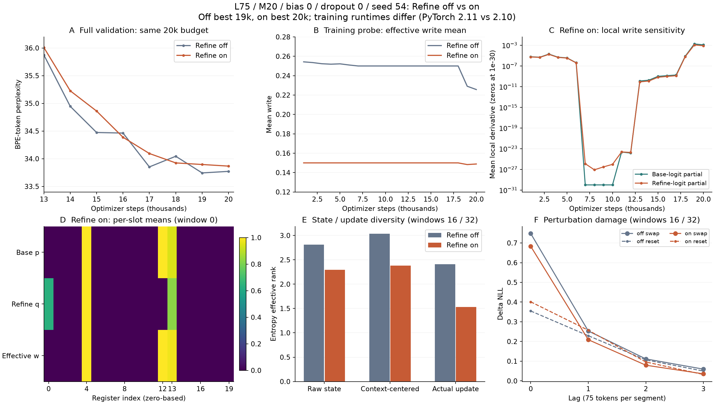

# L75/M20: 중립 초기화 Refine gate 비교

작성: 2026-10-17 · 갱신: 2026-10-18 · 상태: seed54 비교에서 Refine 단독 효과 없음; 추가 seed 중단, Uniform 단독 비교로 전환

[실행 workflow](../20261011_experiment_workflow.md) · [기존 dropout/bias 결과](20261015_l75_write_gates.md) · [원논문](https://arxiv.org/abs/1910.09890)

## 1. 비교 조건

질문은 초기 write 분포를 유지한 채 gate 보정 경로를 추가하면, 초반 고착·문맥별 갱신·품질이 달라지는가이다. 첫 seed54의 off 결과는 기존 A20-0을 재사용하고 on만 새로 학습했다. 유망하면 추가 두 seed로 확인할 계획이었으나, 이번 결과는 그 조건을 충족하지 않아 추가 학습을 진행하지 않는다. Uniform Gate Initialization, 추가 regularization loss는 이번에 넣지 않는다.

| 항목 | 조건 |
|---|---|
| 모델 / 데이터 | GRT small D256·6 layers·head8·FF1024, 동일 WikiText-103 GPT-2 BPE artifact |
| L / M / router | 75 / 20 / attention D256·head8·MLP hidden512 |
| Gate | base write bias0, write dropout0, read gate off, 학습 가능한 S0의0 초기화 |
| 학습 | seed54, 새 초기화20k, FP32·global256·BPTT 이전3segments |
| Optimizer | Adam LR5e−4·betas(.9,.999)·decay0·clip.25·cosine20k·warmup0 |
| 평가 | 매1k 전체 validation·기본 RTLA, best validation CE 선택, test 미평가 |
| 첫 비교 환경 | 기존 off는 Kaggle T4×2·micro128×accum1. on도 같은 환경을 우선하며 preflight에서 실제 배치를 확인 |

## 2. 이번 구현의 범위

`model.register.refine_gate`의 카탈로그/typed Config 기본은false다. on은 기존 write hidden h에서 기본 logit a와 추가 logit b를 만든다.

```text
p = sigmoid(a)                         # 기존 write MLP 출력
q = sigmoid(refine_head(h))            # read gate와 별개의 보정 gate
w = p + (2*q - 1)*p*(1-p)             # 최종 유효 write
S_next = (1-w)*S + w*C
```

추가 head의 weight·bias를 모두0으로 초기화해 q=.5, w=p에서 시작한다. 이 초기화는 RNG를 소모하지 않아 같은 seed의 공통 파라미터와 초기 학습 RNG도 보존한다. M20/hidden512에서10,260 parameters가 추가된다. 기존 pooling·MLP hidden을 공유하는 GRT용 적용이며, 논문의 전체 UR-LSTM 재현은 아니다. off는 기존 sigmoid·dropout 경로와 state-dict parameter 구성을 유지한다.

Refine on에서 write dropout을 별도로 켜면 최종 유효 w를0으로 mask해 상태를 보존한다. 이번 비교에서는0으로 고정한다. Gate는 segment 전체 입력과 시작 state로 결정하지만 write-back은 stack 뒤 한 번이며 다음 segment에만 영향을 준다. 기존 token causal 읽기 구조를 유지한다.

## 3. 실행과 전달

기존 [Kaggle](../../notebooks/kaggle.ipynb) / [Colab](../../notebooks/colab.ipynb) 선택 셀을 사용한다. 새 노트북·개별 YAML은 만들지 않는다. 당시 실행한 on 조건은 다음과 같다. 현재 노트북 기본은 별도 [Uniform 단독 실험](20261018_l75_uniform_gate.md)으로 전환했다.

```python
models = ('grt',)
segment_len = 75
num_registers = 20
budget = '20k'
router_hidden = 512
write_gate_bias = 0.0
write_dropout = 0.0
refine_gate = True
seed = 54
```

`refine_gate`는 기존 `overrides['model']['register']`로, seed는 `WikiTextRun(seed=seed)`로 전달한다. CLI에서는 `--set model.register.refine_gate=true`를 사용한다. 설정 hash가 달라 on/off는 별도 run이다. 기존 off checkpoint에서 on 학습을 재개하지 않는다. off 학습은 이번 첫 비교에서 새로 실행할 필요가 없다.

setup → prepared 데이터 복원 → preflight → train → 기존 마지막 `job.report(posthoc=True, download=True, ...)`를 실행한다. **experiment_results.zip 하나**를 전달하면 학습·사후 JSON을 원본으로 보관하고 아래 결과란에 반영한다.

## 4. 기록할 지표와 판단

주 기준은 같은20k 예산에서 best validation NLL/PPL이며 최종20k도 함께 기록한다. 초기 고착·문맥별 갱신·메모리 기여의 개선은 보조 근거다. 유효 gate의 극단화 자체는 실패 기준이 아니며, 단일 seed 결과를 재현성 주장으로 쓰지 않는다.

- 기존 `grt/write_mean`과 슬롯 유형·그룹 개입은 **유효 w** 기준이다.
- validation마다 `grt/refine/base_write_mean`, `refine_mean`, 두 `*_abs_logit_mean`, 두 `*_logit_derivative_mean`을 학습 JSON·W&B에 추가한다. 국소 logit 미분이며 parameter gradient 측정은 아니다.
- 확장 사후 JSON의 `diagnostics.gate_logits`는 기본 p의 logit/기본 sigmoid slope다. on에는 scope를 명시하고 `diagnostics.refine_gate`에 p·q·q logit 원값과 두 국소 미분을 따로 기록한다. `diagnostics.write_gates`는 최종 w다.
- 같은 사후 protocol: batch8·warmup3·측정8·horizon4·window0/16/32·slots/registers true·random3/seed54.

| Seed | Refine | 상태 | best step / val NLL / PPL | 최종20k PPL | wall h / peak GiB | 학습 / 사후 원본 |
|---:|---|---|---|---:|---|---|
| 54 | off | 기존 A20-0 재사용 | 19,000 / 3.518790 / 33.7436 | 33.7718 | 6.695 / 11.721 | [학습](../../results/86fb2481ac1e45f29da0164863b28d66.json) / [사후](../../results/posthoc/5435927747a34aa895d5804c2b5772a6.json) |
| 54 | on | 완료 | 20,000 / 3.522433 / 33.8667 | 33.8667 | 6.954 / 11.721 | [학습](../../results/89571cd181a4465b8e818a2407be8924.json) / [사후](../../results/posthoc/450dd855d0634475af09aefef2239125.json) |
| 55 | off | 추가 실행 안 함 | | | | |
| 55 | on | 추가 실행 안 함 | | | | |
| 56 | off | 추가 실행 안 함 | | | | |
| 56 | on | 추가 실행 안 함 | | | | |

후속 결정(2026-10-18): Refine 단독은 이번 조건에서 효과가 없었던 것으로 기록하고 추가 seed를 중단한다. [Uniform 단독 실험](20261018_l75_uniform_gate.md)을 먼저 진행한다.

## 5. Seed54 결과 분석

**결론: 이번 L75/M20·seed54의 중립 초기화 Refine 단독 실험에서는 성능 개선과 초기 고착 완화 효과가 없었다.** Best PPL 차이는+0.1231(+0.365%)로 작지만, 기본·refine logit의 동반 포화와 낮은 갱신 다양성은 목표했던 동작 개선이 나타나지 않았음을 보여준다. 단일 seed와 실행 환경 차이 때문에 Refine 일반의 성능 악화를 확정하지 않는다.

### 5.1 설정 연결과 비교 한계

학습·사후 Config는 경로까지 일치하며 selected RTLA scalar 전 항목이 재현됐다. L75/M20·small·bias0·dropout0·read off·seed54·FP32·global256·micro128×accum1×T4×2·20k이고, 두 Config는 refine flag·출력/run 이름 외에 같다. Prepared manifest가 일치하며 학습 target은 둘 다383,975,424개, 전체 validation은248,420개다. Test는 평가하지 않았다. Refine on의 학습·분석 commit은 `454cd58`, clean checkout이며 분석 source hash30개가 해당 코드와 일치한다. 파라미터는18,682,408→18,692,668로10,260개 증가했다.

**소프트웨어 환경은 동일하지 않다.** Off 학습은Python3.13.15/PyTorch2.11.0+cu128, on은3.12.13/2.10.0+cu128이다. CUDA12.8·Transformers4.45.2·T4·FP32는 같다. 사후 분석도 off는PyTorch2.11.0+cu130/CUDA13.0, on은2.10.0+cu128/CUDA12.8이다. Config·같은 seed만으로 동일 수치 trajectory를 보장하지 않는다. Step1 train loss는 둘 다10.854577541351318이지만, 전달받지 않은 초기 가중치의 hash를 소급 확인한 것은 아니다.

Off best는19k/364,775,424 targets, on best는20k/383,975,424 targets다. 아래 표현·개입 비교는 각 best 기준이며 정확한 동일 step 비교가 아니다. 최종20k 품질도 별도로 비교한다. 사후 protocol은batch8·warmup3·측정8·horizon4·windows0/16/32·random3/seed54로 같다. 그룹은window0, 후속 표의 대표값은window16/32 평균이다. 각 window/lag4,800targets로 동일 token 가중 평균이며, 단일 슬롯 reset은window0에서만 측정했다.

### 5.2 전체 품질과 비용

| 항목 | Refine off | Refine on |
|---|---:|---:|
| Best step | 19,000 | 20,000 |
| Best NLL / PPL | 3.518790 / 33.7436 | 3.522433 / 33.8667 |
| 최종20k NLL / PPL | 3.519627 / 33.7718 | 3.522433 / 33.8667 |
| 15k~20k의6개 PPL 평균 | 34.0582 | 34.1717 |
| Wall hours / peak GiB | 6.695 / 11.721 | 6.954 / 11.721 |

On−off best ΔNLL=+.003643, ΔPPL=+.1231(+.365%)다. 최종20k도+.0949PPL(+.281%)로 방향이 같고, 후반 평균에서도 개선은 없다. 일부 평가점에서는on이 좋지만 지속적인 우위는 아니다. 추가 wall time은약15.53분(+3.87%), peak 차이는약.265MiB다. 환경이 달라 이 시간 차이 전체를 Refine 연산 비용으로 귀속하지 않는다. On의 경고·metrics parse 오류·W&B 실패는 없고 step1+매10step2,001개 로그, validation·기본 RTLA20개가 있다.



### 5.3 학습 중 고착: 평균은 일찍 .15에 붙었고 국소 민감도도 작았다

아래 write와 도함수는 각 checkpoint의 고정 RTLA probe 평균이다. 도함수는 유효w의 내부 기본/refine logit에 대한 국소 편미분이며, task parameter gradient를 직접 측정한 값이 아니다.

| step | off PPL / write | on PPL / write | on 평균 abs logit: 기본 / refine | on 국소 도함수: 기본 / refine |
|---:|---:|---:|---:|---:|
| 1,000 | 146.7764 / 0.254258 | 146.2787 / 0.149999 | 9.26 / 5.88 | 5.87e-06 / 5.34e-06 |
| 6,000 | 141.2861 / 0.251004 | 186.0947 / 0.150000 | 11.45 / 7.29 | 4.08e-07 / 3.88e-07 |
| 7,000 | 45.1793 / 0.250000 | 45.7414 / 0.150000 | 59.73 / 39.31 | 0.00e+00 / 1.26e-26 |
| 12,000 | 38.4342 / 0.250000 | 39.7470 / 0.150000 | 56.91 / 37.45 | 1.43e-24 / 1.88e-24 |
| 13,000 | 35.8741 / 0.250000 | 36.0087 / 0.150000 | 63.81 / 41.40 | 1.21e-10 / 8.15e-11 |
| 18,000 | 34.0446 / 0.250000 | 33.9245 / 0.149993 | 61.55 / 39.79 | 7.33e-06 / 6.12e-06 |
| 19,000 | 33.7436 / 0.229072 | 33.8959 / 0.148260 | 54.98 / 35.50 | 1.76e-03 / 1.12e-03 |
| 20,000 | 33.7718 / 0.225676 | 33.8667 / 0.148850 | 54.84 / 35.40 | 1.18e-03 / 7.88e-04 |

On은 첫1k부터 write≈.15이고, 7k~17k도 거의.15다. 3/20에 가까운 평균과 작은 국소 민감도는 적은 수의 고정 write 경로와 부합하지만, 중간 checkpoint의 슬롯 원값이 없어 초기의 정확한 슬롯 분할은 확정하지 않는다. 6k→7k에는 평균 write가 그대로인데 기본 logit 절댓값 평균은11.45→59.73, refine은7.29→39.31로 커지고 국소 민감도는 거의 사라진다. 반면 PPL은186.09→45.74로 개선된다. **Gate의 학습 민감도와 task 전체의 학습 진행은 구분해야 한다.** Backbone·candidate 등의 개선이 가능하다.

19k 이후에는 국소 민감도와 평균에 변화가 있어 전혀 회복하지 않는 모델은 아니다. 다만 최종 변화는 아래의 거의 한 슬롯에 집중된다. 큰 전환은 기존 실험과 같은 epoch 경계6,169/12,338/18,507 뒤 평가와도 겹치므로, 인과관계의 선후를1k 간격 관측으로 분리하지 않는다.

### 5.4 최종 gate: 보정 경로가 다수 슬롯을 재활성화하지 못했다

| 항목 | off | on |
|---|---:|---:|
| closed / open / other (window0) | 14 / 4 / 2 | 17 / 2 / 1 |
| 유효 write 평균 / 슬롯별 std 평균 | 0.229279 / 0.001158 | 0.149114 / 0.000527 |
| 기본 logit abs>20 | 35.16% | 94.69% |
| 기본 logit abs 중앙값 | 18.08 | 55.44 |
| Router context / MLP hidden norm | 44.36 / 108.06 | 87.51 / 298.76 |

On의17/2/1은 세 window에서 같은 슬롯 분할이다. 다만 threshold.05에서는 window0/16이17/3/0, window32가17/2/1로 달라진다. Other 한 개도 크게 열고 닫히는 슬롯이라고 보기는 어렵다. Refine 쪽도 abs logit>20이79.38%, abs 중앙값37.82로 두 내부 경로가 함께 극단화됐다. 표의94.69%는 기본 p의 logit 통계이며, 유효 w의 포화율과 구분한다.

**실제 Refine 보정은 거의 슬롯13(0-based)에만 나타난다.** 평가 window16/32의 기본 p 평균은.9603/.9474, refine q는.8509/.8294, 유효 w는.9862/.9784다. 이 슬롯에서는 쓰기를 억제하기보다 p를 더 여는 방향으로 작동한다. w 범위는 각.9708~.9968/.9425~.9944이며, 전체20개 슬롯에서 평균 보정은+.001423, 최대 관측 보정은+.049017이다. 두 국소 logit 민감도의 총합도 거의 전부 이 슬롯에 집중된다.

슬롯0은 q 평균이 약.64여도 p가 거의0이어서 w도 거의0이다. 슬롯12는 q가 약.0002~.0005여도 p=1이어서 w=1이다. **q는 독립적인 write 허가 스위치가 아니라 p(1−p) 범위 내의 보정**이므로, q 평균만으로 메모리 활용이나 회복을 판단하지 않는다.

### 5.5 표현과 기능: 유용한 기억은 남지만 다양화 근거는 약하다

| 표현 지표 | off | on |
|---|---:|---:|
| raw state rank | 2.8119 | 2.2956 |
| 문맥 평균 제거 rank | 3.0334 | 2.3794 |
| 실제 update rank | 2.4098 | 1.5316 |
| 평균 slot CKA | 0.9016 | 0.9451 |

On은 문맥 평균 제거 rank3.033→2.379, 실제 update rank2.410→1.532, CKA.902→.945로, 관측된 문맥 변화·갱신이 더 적은 방향에 집중됐다. 선택 step과 runtime이 달라 원인을 Refine 하나에 귀속하지 않지만, 이 run에서 목표한 다양화는 보이지 않는다.

아래는 같은 정의로 집계한 lag0 ΔNLL이다. 그룹 효과를 합쳐 전체의 기여율로 쓰지 않는다. Random은 같은 개수의3개 mask 평균이다.

| 조건 / 그룹 | 슬롯 수 | reset ΔNLL | swap ΔNLL | 같은 수 random swap 평균 | 전체 swap에서 조건부 복원 효과 |
|---|---:|---:|---:|---:|---:|
| off / closed | 14 | +0.0155 | -0.0028 | +0.3892 | +0.0398 |
| off / open | 4 | +0.1045 | +0.4575 | +0.0783 | +0.7196 |
| off / other | 2 | -0.0005 | +0.0246 | +0.0075 | +0.2659 |
| on / closed | 17 | +0.0508 | -0.0027 | +0.6770 | +0.0293 |
| on / open | 2 | +0.0573 | +0.2546 | +0.0212 | +0.6097 |
| on / other | 1 | +0.0087 | +0.0686 | +0.0306 | +0.4159 |

On의 open2개는 swap+.2546으로 같은 수 random+.0212보다 크며, 문맥 정보를 쓰는 경로가 남는다. Other1개는 단독 swap+.0686, 조건부 복원+.4159지만 random3개 mask의 최대+.0933보다 작아 특별한 단독 기능이라고 확정하지 않는다. 전체 swap은+.6830으로 세 그룹의 단독 합+.3205보다 크다.

닫힌17개는 측정 중 update norm이0이지만, 문맥별 state 변동 norm 평균이 약9.08이다. Reset은+.0508, swap은−.0027로 S0와의 차이와 donor 문맥 차이가 다르게 나타난다. 닫힌 슬롯을 미사용·제거 가능으로 취급하지 않는다. 단일 슬롯 reset의 window0 합도 on+.1138 대 전체+.4163으로 비가산적이다. Off의+.0313 대+.3849와 다른 것을 총 메모리량 증가로 해석하지 않는다.

| 전체 개입 | off lag0 / lag3 | on lag0 / lag3 |
|---|---:|---:|
| reset | 0.3547 / 0.0500 | 0.4012 / 0.0326 |
| swap | 0.7480 / 0.0597 | 0.6830 / 0.0358 |

On의 swap 손상은 lag3에서.0358(off .0597)로 작다. 손상 회복과 유용한 장기 보존은 다른 현상이라 이것만으로 기억 능력의 개선·악화를 판단하지 않는다. 첫 window probe PPL은35.8678→35.1193으로 개선되지만, 평가 window16/32의 합성 PPL은33.3691→33.3695로 거의 같다. 국소 probe는 전체 validation의 품질 개선을 뒷받침하지 않는다.

### 5.6 보정 경로가 자동으로 고착 방지가 되지는 않는다

중립 초기화는 q=.5에서 초기 forward를 일치시키지만, 음의 피드백이나 포화 억제 loss를 추가한 것은 아니다. 공유 hidden h에서 초기에는 ∂w/∂a=p(1−p), ∂w/∂b=.5p(1−p)이므로 task loss가 주는 refine 출력층 weight/bias gradient는 기본 출력층의.5배로 같은 방향이다. 이 관계는 작은 CPU 모델의 여러 segment CE에서 확인했다. Adam의 업데이트와 이후 경로가 같다는 뜻도, 이것만으로 이번 GPU 고착의 원인이 증명됐다는 뜻도 아니다.

이 구조는 강한 보존·갱신을 학습하기 쉽게 하는 재매개화이며, logit 크기·세 그룹 비율·문맥별 다양성을 제약하지 않는다. p가 극단화하면 q의 작용도 p(1−p)로 좁아진다. 원논문의 주요 조건 UR은 Uniform Gate Initialization을 결합한다. 이번 공유 hidden·중립 refine head 조건의 결과를 논문 전체의 부정으로 확대하지 않는다.

**분석 제안:** 당초의 “유망하면 추가2seed” 조건을 이번 결과는 충족하지 못한다. 같은 조건을 바로4run 추가하는 우선순위는 낮다. Refine의 인과 효과를 엄밀히 확인하려면 이번과 같은 Python/PyTorch 환경의 off 대조군이 먼저 필요하다. 방법 탐색이 우선이라면 두 logit의 scale을 제한하는 방법이나 원논문에 가까운 초기화를 별도 조건으로 검토할 여지가 있다. 이는 미구현·미실행 제안이며 이번 실험 설정을 바꾸지는 않았다.

후속 결정: 추가 Refine seed를 실행하지 않고, Refine off에서 Uniform 초기화만 비교한다. 그 조건·결과는 [별도 실험 문서](20261018_l75_uniform_gate.md)에 기록한다.

### 5.7 원본과 확인 범위

- 학습 report ID: [89571cd181a4465b8e818a2407be8924](../../results/89571cd181a4465b8e818a2407be8924.json), [W&B run](https://wandb.ai/joyyoj1-korea-university/grt-research/runs/ec563b7a).
- 사후 report ID: [450dd855d0634475af09aefef2239125](../../results/posthoc/450dd855d0634475af09aefef2239125.json), checkpoint SHA256: `86bbb718a2f313ce3d1a01c05988da39ce303c3e03cc1fb0bd37750a51894dff`.
- 수신 원본2개를 bytes 변경 없이 보관했다. GPU 학습·분석을 새로 실행하지 않고 JSON을 재집계했으며, 수식의 작은 CPU 검증을 별도로 수행했다. Raw gate의 threshold 재분류, 유효 write와 국소 도함수, start/lag/example 배열의 token 가중 ΔNLL, Config·manifest·selected RTLA 일치를 확인했다.

## 6. 검증 범위

관련 CPU 검사126개가 통과했고 optional W&B package가 필요한2개는 미설치로 생략됐다. on/off 중립 초기화·RNG·초기 forward 일치, recurrent task gradient와 head 갱신, 유효 gate dropout·범위, decoder causality, 정확한 학습 재개, 2-rank CPU 분산 학습·preflight, checkpoint 복원 후 확장 사후 JSON까지 확인했다. 별도로 off router를 변경 전 HEAD 구현과 대조해 parameter·RNG·forward·gradient가 write dropout을 포함해 정확히 일치함을 확인했다. 2026-10-18 사용자 제공 학습·사후 JSON으로 seed54의20k GPU 학습과 분석 완료를 확인했다. 에이전트가 GPU 학습·추론을 새로 실행한 것은 아니다. 추가 seed와 동일 runtime의 on/off 반복은 미실행이다.
