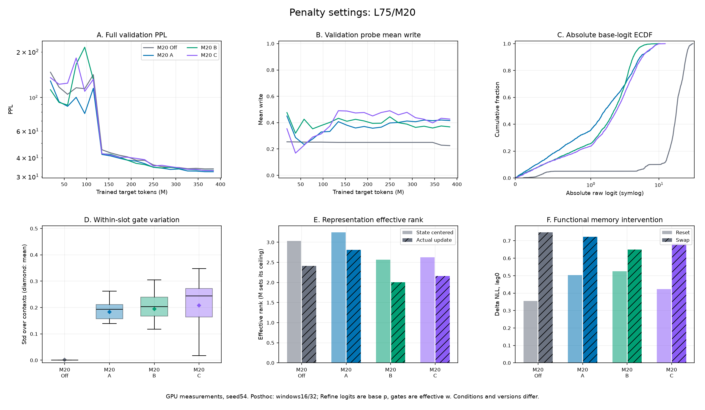
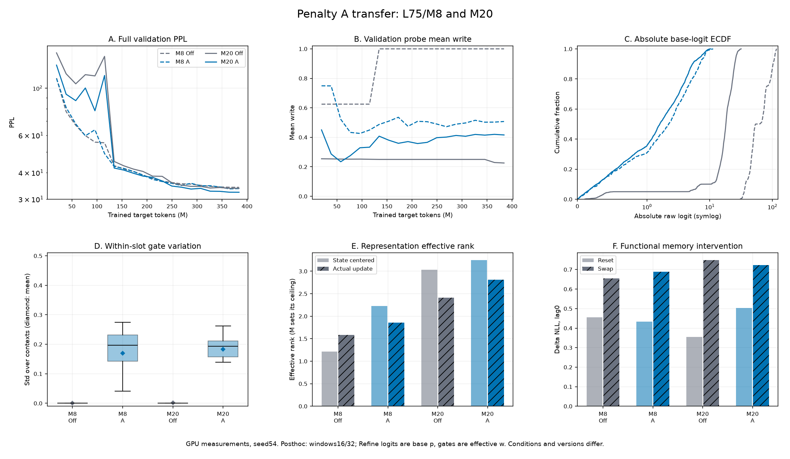
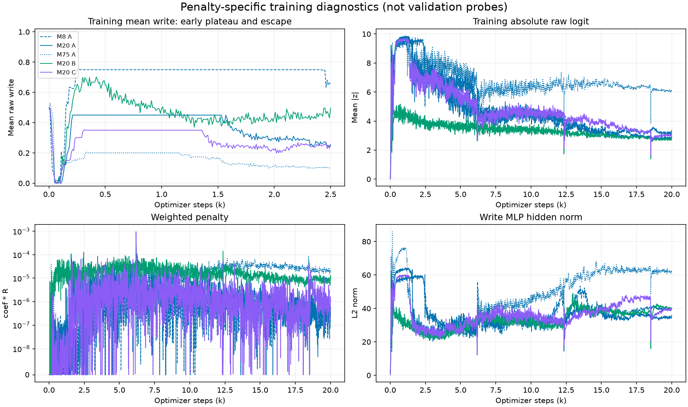
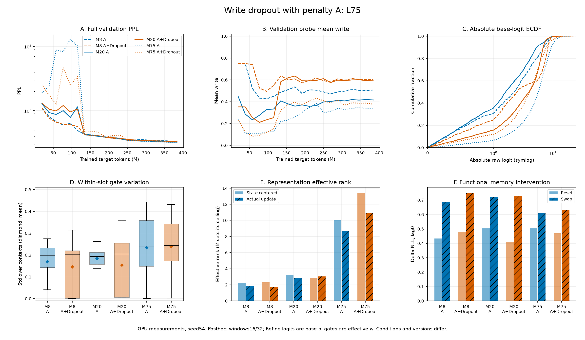
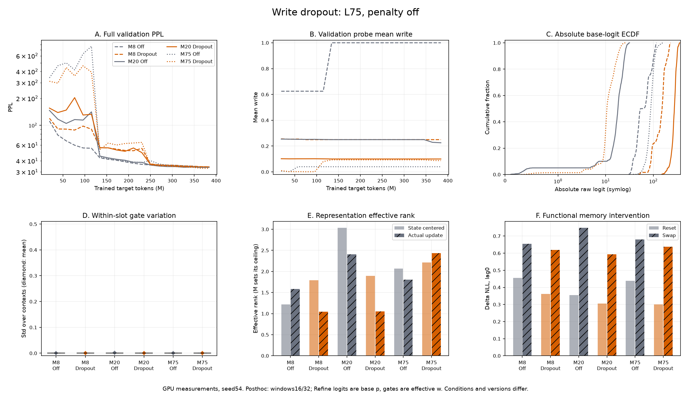
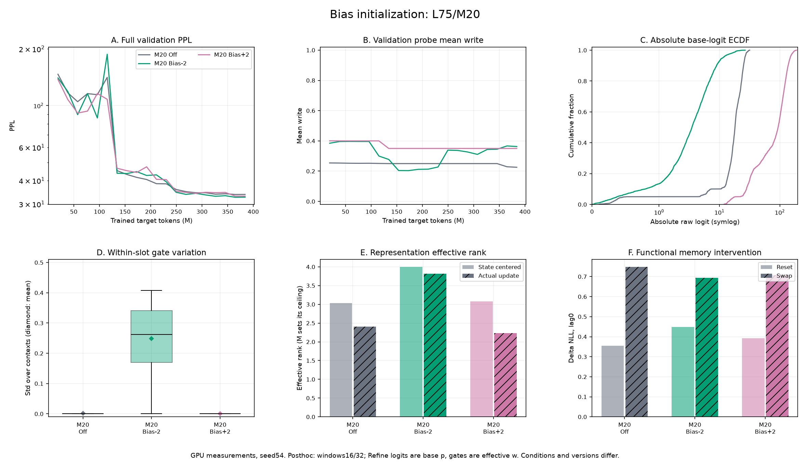
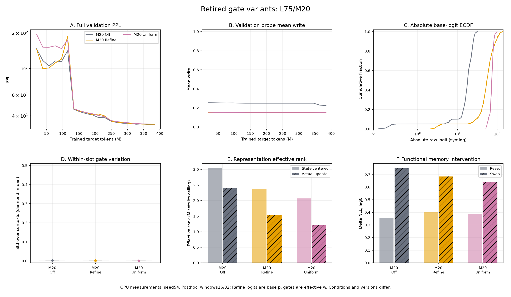
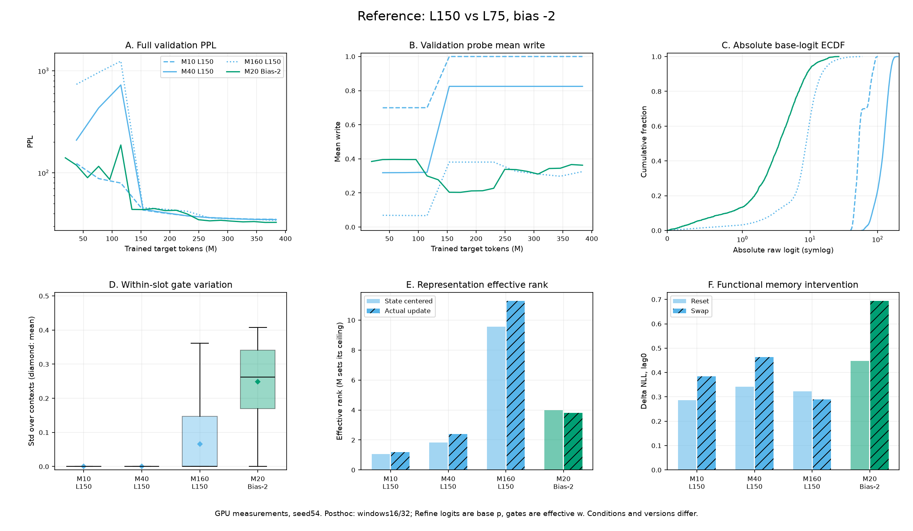

# L75 small · gate 안정화

갱신: 2026-10-20 · **탐색 완료 · 후속 실험: 패널티 A + write dropout off** · 단일 seed·20k 예산의 결과

[실행 안내](../20261011_experiment_workflow.md) · [모델 명세](../20261011_current_spec.md) · [원본](../../results/README.md) · [L150 용량 비교](20261012_small_register_sweep.md) · [이전 설계·상세 기록](../archive/README.md)

## 1. 현재 선택과 진행 상태

**후속 실험은 모든 M에서 패널티 A를 유지하고 write dropout을 끈다.** 패널티 A는 M8·M20·M75에서 극단 포화를 줄이고 문맥별 gate 변화와 전체 validation 품질을 개선했다. Dropout.1 추가 시20k 품질은 M8에서 개선, M20·M75에서 악화됐으나 모든 조건의 수렴이 확인된 것은 아니다. 특히 M75의 일부 분화 지표 개선은 보존하고, dropout의 장기 효과 판단은 유보한다.

| 선택 | 확인된 결과 | 현재 해석 |
|---|---|---|
| 패널티 A: threshold10 / coef1e-4 | M8 best PPL34.1048→33.5383, M20 33.7436→32.3376, M75 33.7629→32.0361 | 세 M에서 개선. 최적값·다른 seed의 일반성은 미확정 |
| Write dropout0/.1 | penalty off에서 M75 33.7629→32.8984; M8·M20은 악화 | M에 따른 보조 조건. 모든 M의 고착을 해결하는 방법은 아님 |
| A + write dropout.1 | 최종 PPL: M8 33.6620→33.0829, M20 32.3376→33.1606, M75 32.0361→32.4831 | 20k 내 효과는 혼합. 후속 실험은 off로 통일하고 장기 학습에서 재검증 |

**L75/small/seed54의 예정된 penalty×dropout×M 탐색은 이번 보고서로 마무리한다.** 후속 실험은 M8을 포함해 A/dropout0으로 통일한다. 현재 탐색의 변수를 줄이고 dropout의 장기 효과 판단은 유보하는 운영 결정이다. 더 긴 학습에서 dropout0/.1을 다시 비교한다. 완료 상태와 판단 범위는 [6절](#logit-tail-expansion), Bias·Refine·Uniform 이력은 [7절](#retired-studies)에 모은다.

안정화 dropout 조건을 선택한 뒤 진행할 [gate 정보 경로 실험](20261019_l75_gate_paths.md)은 별도 주제로 관리한다. State 참조를 고정하고 M20의 독립 attention/별도 gate linear/candidate 출력 공유→지표 선정→선택적 detach→다른 M 검증을 진행한다.

## 2. 공통 비교 기준

### 고정 조건과 평가 범위

L75, GRT small(D256·6layers·head8·FF1024), router attention D256/head8·MLP512, 학습 가능한0 초기 S0, read off, 동일 WikiText-103 GPT-2 BPE artifact, model/data seed54, FP32, global256이다. 새 학습은20k이며 실제 targets383,975,424개다. Adam LR5e-4·betas(.9,.999)·decay0·clip.25·cosine·warmup0, BPTT 이전3segments, residual dropout.1·attention dropout0을 사용했다. Baseline은 같은 M의 penalty off/bias0/dropout0이다.

전체 validation은 batch10·248,420 targets,1k마다 평가하며 **순수 LM NLL/PPL**로 best checkpoint를 선택한다. 사후 분석은 그 best에서 batch8·warmup3·측정8·horizon4·window0/16/32·random3으로 수행한다. 각 window는 S0에서 독립적으로 시작하며 dropout off·FP32다. Test는 평가하지 않았다.

- **학습 곡선:** 전체 validation PPL과 고정 RTLA probe의 write 평균. 서로 다른 loss/평균을 같은 관측으로 취급하지 않는다.
- **사후 표:** 연속값은 평가 window16/32의 동일 가중 평균이다. 중앙값도 window별 중앙값의 평균이다. 각 window의 관측·target 수가 같아 이 평균을 사용한다.
- **그룹:** C/O/T는 window0에서 모든 관측의 gate가≤.01인 closed, ≥.99인 open, 나머지 other다. 유형은 시간척도·역할의 정답이 아니고 threshold/문맥에 민감하다.
- **Source:** 사용자 GPU JSON만 사용한다. CPU 모델 출력·초기화 재구성·가상 bias 대입값은 연구 지표에서 제외한다. 보고서 재생성은 저장된 배열의 산술 집계다.

### 공통 지표 사전

| 지표 | 동일하게 사용하는 정의 | 해석의 한계 |
|---|---|---|
| Best / 최종 PPL·NLL | 전체 validation, best step과 최종20k를 따로 표시 | 사후 짧은 probe PPL과 다름. 예산 내 품질이지 수렴 후 우열은 아님 |
| Write 평균 | 실제 유효 gate w의 평균 | 정보량·슬롯 기여율과 같지 않음 |
| 슬롯 내 gate std | 각 슬롯이 문맥에 따라 변하는 std를 슬롯 평균 | 전체 슬롯을 섞은 std와 다름. 가변성만으로 내용 분화를 증명하지 못함 |
| 절대 logit 중앙값 / >20 | raw write logit의 scale·극단화 | Refine만 기본 p의 logit, 유효 w와 구분 |
| MLP hidden L2 norm | write MLP의 GELU 뒤·출력 Linear 직전 벡터 norm | 레지스터 state norm·weight norm·gradient norm이 아님 |
| 문맥 중심화 state rank | 슬롯별 문맥 평균을 제거한 state의 에너지 effective rank | M에 따라 상한이 달라 다른 M의 절댓값을 효율 순위로 쓰지 않음 |
| 실제 update rank | S_next−S의 같은 rank | candidate 변화와 다름. 큰 rank가 자동으로 좋은 품질은 아님 |
| 평균 slot CKA | off-diagonal 슬롯쌍의 linear CKA 평균 | 낮은 값만으로 기능 분화가 입증되지 않음 |
| Reset / swap ΔNLL | 같은 probe의 정상 대비 전체 state 개입 NLL 증가 | 양수는 의존성 근거지만 기여율·기억 품질 순위가 아님 |
| Swap lag3 | 정상 write 재개 뒤3segments 시점의 잔여 영향 | 기억 수명과 같지 않으며 복구 속도도 섞임 |

### 공통 그림 읽기

모든 비교 그림은 같은6패널이다. **A: 전체 validation PPL, B: validation probe write, C: 사후 절대 logit ECDF, D: 슬롯 내 gate std, E: 중심화 state/update rank, F: 전체 reset/swap ΔNLL(lag0)**다. A/B의 가로축은 실제 처리 target tokens(M)로 통일한다. D의 마름모는 슬롯 평균이며 box는 슬롯 간 분포다. C는 동수인 두 평가 window를 합친 ECDF라 표의 window별 중앙값 평균과 미세하게 다를 수 있다.

방법별 색은 고정하고 M은 선 모양으로 구분한다. 표·그림의 공통 정의는 이 절에서만 설명하고, 각 실험에는 질문·관측·추가 지표·판단을 적는다.

## 3. 선택한 방법 ① Logit tail 패널티

<a id="logit-tail"></a>

### 설계와 M20의 조건 선택

`phi(z)=relu(abs(z)-c)^2`, `total_loss=LM_loss+coef*R`다. R은 슬롯 평균을 유효 predictor token 수로 가중한 평균이며, BPTT replay(target=-100)는 직접 패널티 가중치0이다. state를 통한 BPTT gradient는 유지한다. M/L을 추가로 곱하거나 각 run의 logit을 자체 표준편차로 나누지 않는다. Write dropout 마스킹 전 logit을 사용한다.

| 조건 | threshold / coef | 비교 질문 |
|---|---|---|
| A · 현재 선택 | 10 / 1e-4 | 극단 증폭을 약하게 억제 |
| B · 종료된 수치 비교 | 5 / 1e-4 | 더 이른 구간부터 억제 |
| C · 종료된 수치 비교 | 10 / 1e-3 | 같은 범위 밖에서10배 강한 압력 |

같은 logit에서 A의 패널티는 항상 B·C 이하다. A가 유용한 쓰기를 덜 제한해 품질에 유리했을 가능성이 있지만, 서로 다른 학습 분포와 환경 때문에 그 원인을 확정하지 않는다. B/C는 같은 loss의 수치 ablation이며 별도 구현 분기가 아니다.

[ST-MoE §3.3](https://arxiv.org/abs/2202.08906)의 softmax router z-loss와 계수1e-3은 관련 선례다. 우리 loss는 독립 sigmoid·FP32의 고착을 다루는 별도 설계이며 원문 재현이나 계수의 동등한 강도로 표현하지 않는다. 자세한 후보 설계는 [아카이브](../archive/20261016_write_regularization.md)에 둔다.

<!-- gate-report:penalty:start -->
| 조건 | best step / PPL | 최종 PPL / NLL | wall h / peak GiB | 학습 / 사후 원본 |
|---|---|---|---|---|
| M20 Off | 19,000 / 33.7436 | 33.7718 / 3.519627 | 6.695 / 11.721 | [학습](../../results/86fb2481ac1e45f29da0164863b28d66.json) / [사후](../../results/posthoc/5435927747a34aa895d5804c2b5772a6.json) |
| M20 A | 20,000 / 32.3376 | 32.3376 / 3.476231 | 7.028 / 11.757 | [학습](../../results/b0420e8b63f64d0094ed84a8d273f14b.json) / [사후](../../results/posthoc/0661b28486074874ba3688183326aa8c.json) |
| M20 B | 20,000 / 33.0368 | 33.0368 / 3.497622 | 6.146 / 11.757 | [학습](../../results/31a7d55d4d64400e81578e055d88b2e1.json) / [사후](../../results/posthoc/dd6827efb9ad4505a3b973cc77b152b3.json) |
| M20 C | 20,000 / 32.9088 | 32.9088 / 3.493740 | 6.961 / 11.757 | [학습](../../results/93d019b472434814b3e057ea5732f616.json) / [사후](../../results/posthoc/3a96051e1cd946b2944a95f8468eeb4d.json) |

| 공통 지표 | M20 Off | M20 A | M20 B | M20 C |
|---|---:|---:|---:|---:|
| C/O/T (window0) | 14/4/2 | 0/1/19 | 0/0/20 | 0/1/19 |
| Write 평균 | 0.229279 | 0.471292 | 0.407538 | 0.486842 |
| 슬롯 내 gate std | 0.001158 | 0.183397 | 0.194820 | 0.208015 |
| 절대 logit 중앙값 | 18.078 | 1.595 | 2.190 | 2.345 |
| 절대 logit >20 (%) | 35.16 | 0.00 | 0.00 | 0.00 |
| MLP hidden L2 norm | 108.064 | 28.508 | 33.932 | 33.427 |
| 문맥 중심화 state rank | 3.033 | 3.245 | 2.567 | 2.626 |
| 실제 update rank | 2.410 | 2.813 | 2.008 | 2.164 |
| 평균 slot CKA | 0.902 | 0.667 | 0.786 | 0.846 |
| 전체 reset ΔNLL, lag0 | +0.354744 | +0.502921 | +0.525509 | +0.423115 |
| 전체 swap ΔNLL, lag0 | +0.748015 | +0.722187 | +0.649062 | +0.683123 |
| 전체 swap ΔNLL, lag3 | +0.059669 | +0.082597 | +0.102224 | +0.098842 |


<!-- gate-report:penalty:end -->

**관측:** 세 조건 모두 Off보다 품질이 좋고 gate 가변성이 회복됐다. A의 best PPL 개선은4.17%다. A는 update rank·CKA도 개선 방향이지만 B/C의 중심화 state/update rank는 Off보다 낮다. Gate 가변성 회복과 높은 차원의 표현 분화는 별개다. A의 raw state rank도2.812→1.779로 낮아 모든 rank가 개선된 것은 아니다.

**판단:** A를 현재 수치로 선택한다. 새 세 조건은 best가20k이고 Off는19k여서 최종20k NLL도 함께 비교한다. A는 Python3.12/PyTorch2.10, B/C·Off는3.13/2.11이므로 A의 우위를 threshold/coef만의 효과로 단정하지 않는다.

### M8·M75 전달성

같은 A를 새 초기화로 M8·M75에 적용해 세 M의 penalty 단독 비교를 완료했다. 다음 비교는 같은 M의 Off 대비 변화에 초점을 둔다.

<!-- gate-report:transfer:start -->
| 조건 | best step / PPL | 최종 PPL / NLL | wall h / peak GiB | 학습 / 사후 원본 |
|---|---|---|---|---|
| M8 Off | 20,000 / 34.1048 | 34.1048 / 3.529438 | 5.511 / 10.849 | [학습](../../results/ccf041592f3e4ebe8f287e69195205a5.json) / [사후](../../results/posthoc/10b47cdf69034d8d91a842f60f226ede.json) |
| M8 A | 19,000 / 33.5383 | 33.6620 / 3.516369 | 6.328 / 10.881 | [학습](../../results/1006dcd4d956442097dba6780d07ab69.json) / [사후](../../results/posthoc/88d85d847bfb4762902538ea4f303bb0.json) |
| M20 Off | 19,000 / 33.7436 | 33.7718 / 3.519627 | 6.695 / 11.721 | [학습](../../results/86fb2481ac1e45f29da0164863b28d66.json) / [사후](../../results/posthoc/5435927747a34aa895d5804c2b5772a6.json) |
| M20 A | 20,000 / 32.3376 | 32.3376 / 3.476231 | 7.028 / 11.757 | [학습](../../results/b0420e8b63f64d0094ed84a8d273f14b.json) / [사후](../../results/posthoc/0661b28486074874ba3688183326aa8c.json) |
| M75 Off | 20,000 / 33.7629 | 33.7629 / 3.519364 | 10.093 / 8.326 | [학습](../../results/b4b4414578524de0a6e9de50851b91b2.json) / [사후](../../results/posthoc/f5a1825cc5d84f6da400eb249ec409ac.json) |
| M75 A | 20,000 / 32.0361 | 32.0361 / 3.466865 | 10.994 / 8.354 | [학습](../../results/70bea6e32c584668ad3078de871cd66c.json) / [사후](../../results/posthoc/e9d2ee22c7344315be1a64b908873405.json) |

| 공통 지표 | M8 Off | M8 A | M20 Off | M20 A | M75 Off | M75 A |
|---|---:|---:|---:|---:|---:|---:|
| C/O/T (window0) | 0/8/0 | 0/0/8 | 14/4/2 | 0/1/19 | 72/3/0 | 0/3/72 |
| Write 평균 | 1.000000 | 0.529519 | 0.229279 | 0.471292 | 0.040000 | 0.372126 |
| 슬롯 내 gate std | 0.000000 | 0.169983 | 0.001158 | 0.183397 | 0.000000 | 0.234121 |
| 절대 logit 중앙값 | 59.242 | 2.217 | 18.078 | 1.595 | 88.294 | 5.637 |
| 절대 logit >20 (%) | 100.00 | 0.00 | 35.16 | 0.00 | 100.00 | 0.00 |
| MLP hidden L2 norm | 272.113 | 32.866 | 108.064 | 28.508 | 484.428 | 58.487 |
| 문맥 중심화 state rank | 1.216 | 2.225 | 3.033 | 3.245 | 2.065 | 10.027 |
| 실제 update rank | 1.582 | 1.859 | 2.410 | 2.813 | 1.804 | 8.700 |
| 평균 slot CKA | 0.993 | 0.781 | 0.902 | 0.667 | 0.976 | 0.676 |
| 전체 reset ΔNLL, lag0 | +0.454872 | +0.432938 | +0.354744 | +0.502921 | +0.438900 | +0.504464 |
| 전체 swap ΔNLL, lag0 | +0.655296 | +0.689234 | +0.748015 | +0.722187 | +0.680441 | +0.607893 |
| 전체 swap ΔNLL, lag3 | +0.028658 | +0.077033 | +0.059669 | +0.082597 | +0.049721 | +0.077487 |


<!-- gate-report:transfer:end -->

**관측:** M8의 best PPL은1.66% 개선됐다. 같은20k 최종 PPL도34.1048→33.6620으로 낮지만19k best33.5383보다는 높다. Off의 전부 열린 고정 경로에서 문맥별 gate 변화가 회복됐고 중심화 state/update rank·CKA도 개선 방향이다. M8 A의 사후는19k, Off는20k다.

**추가 구분:** M8 A는 window0에서0/0/8이지만 평가 window16/32에서는0/1/7이다. Other8은 window0의 전체 state이므로 그 그룹의 개입을 별도의 기능 분화 증거로 중복 계산하지 않는다. M8 Off/A의 학습은 둘 다PyTorch2.11이지만 commit과 사후 build 차이는 남는다.

**M75 관측:** Off와 A 모두 best=최종20k다. PPL33.7629→32.0361(−5.11%), NLL3.519364→3.466865로 개선됐다. 기존 penalty off/dropout.1의 PPL32.8984보다도 낮다. 두 장치의 결합 효과는 [4절](#write-dropout)에서 비교한다. 같은 T4×2·micro64×accum2·FP32·실제383,975,424 targets이며 학습은 둘 다Python3.13.15/PyTorch2.11.0+cu128이다. Train commit과 사후 cu130→cu128 차이는 남는다. Wall10.093→10.994h, peak8.326→8.354GiB다.

M75의 슬롯 내 gate std는거의0→.234121, abs logit>20은100%→0%, 중심화 state rank2.065→10.027, 실제 update rank1.804→8.700, CKA.976→.676이다. 학습 중 최대 절대 logit은36.08로 threshold를 넘었지만 best의 평가 window에서는>20이 없었다. Hidden norm은484.43→58.49로 낮아졌으나 기존 dropout 단독37.54보다는 높다. 따라서 norm 하나를 품질 순위로 쓰지 않는다. 다른 M보다 큰 rank는 M의 상한 차이도 포함한다.

M75 A의 C/O/T는 window0에서0/3/72, window16에서0/2/73, window32에서0/3/72다. Other72가 곧72개의 독립 기능을 뜻하지 않는다. 이 그룹의 평가 평균 swap ΔNLL(lag0)은+.400730으로 같은 수 random+.545911보다 작고, open3은+.035181 대 random+.001698이다. 그룹 효과는 비가산적이며 random3은 신뢰구간이 아니다. 전체 reset 영향은Off보다 크지만 swap lag0은.680441→.607893으로 작아졌다. 문맥별 write 회복과 품질 개선은 관측됐으나 모든 기억 지표가 커진 것은 아니다.

### 패널티에만 필요한 학습 지표



이 그림은 **새 segment의 training 관측**이다. 공통 그림의 validation write와 구분한다. M20 A/C는500~1,000step에 평균 write가약.45/.35, M8 A는500~2k에약.75로 정체됐다가 이후 변화했다. 초반 평균값 정체만으로 최종 실패를 판단하지 않는다. Training 슬롯별 trajectory가 없어 어떤 슬롯이 언제 바뀌었는지는 확정하지 못한다.

계수는 끝까지 유지했지만 실제 패널티 비용은 대부분 작아졌다. M20 A/B/C의 최종 coef*R은 각각5.94e-7/9.15e-6/9.40e-7, M8 A는3.43e-7, M75 A는1.91e-5다. 작은 loss가 작은 parameter gradient를 의미하지는 않으며 gradient 비율은 미측정이다. Soft penalty라 학습 중 threshold 초과는 허용됐고 최대 절대 logit은 M20 A/B/C에서27.85/20.88/22.95, M75 A에서36.08이었다.

B/C의 validation에는4k~6k에서 큰 악화도 있었다. M75 A도1k PPL189.53에서5k1,305.62까지 악화됐다가7k43.17로 내려왔고 이후20k32.0361까지 개선됐다. Training write는500~1k에약.20,2.5k에약.106,20k에약.376이었다. 첫 epoch 경계6,169 뒤의 품질 전환까지 gate 제어 하나로 설명하지 않는다. 최종 gate 포화 완화와 전체 LM 학습 안정성은 구분한다.

## 4. Write dropout: 패널티와의 결합 및 단독 효과

<a id="write-dropout"></a>

### A에 dropout.1을 추가한 세 조건

새 결과는 모두20k 완료, best19k다. A(10,1e-4)·bias0·read off를 고정하고 write dropout만0→.1로 바꿨다. M별 micro/accum·global256·실제 처리 targets·평가 batch·사후 설정·dataset manifest는 해당 A 단독과 같고, source JSON의 Config 차이는 dropout과 run 이름/경로뿐이다.

<!-- gate-report:combined:start -->
| 조건 | best step / PPL | 최종 PPL / NLL | wall h / peak GiB | 학습 / 사후 원본 |
|---|---|---|---|---|
| M8 A | 19,000 / 33.5383 | 33.6620 / 3.516369 | 6.328 / 10.881 | [학습](../../results/1006dcd4d956442097dba6780d07ab69.json) / [사후](../../results/posthoc/88d85d847bfb4762902538ea4f303bb0.json) |
| M8 A+Dropout | 19,000 / 33.0576 | 33.0829 / 3.499015 | 5.719 / 10.881 | [학습](../../results/d3b3358f21f949bd84e58b7b1ed0aee5.json) / [사후](../../results/posthoc/247fde592b8e4698a9f4700e40c247cb.json) |
| M20 A | 20,000 / 32.3376 | 32.3376 / 3.476231 | 7.028 / 11.757 | [학습](../../results/b0420e8b63f64d0094ed84a8d273f14b.json) / [사후](../../results/posthoc/0661b28486074874ba3688183326aa8c.json) |
| M20 A+Dropout | 19,000 / 33.1184 | 33.1606 / 3.501361 | 6.544 / 11.757 | [학습](../../results/8c2eec49e4cc43989a9847ccd7b942c9.json) / [사후](../../results/posthoc/bc0e8167eafd473b918dca1d6685f173.json) |
| M75 A | 20,000 / 32.0361 | 32.0361 / 3.466865 | 10.994 / 8.354 | [학습](../../results/70bea6e32c584668ad3078de871cd66c.json) / [사후](../../results/posthoc/e9d2ee22c7344315be1a64b908873405.json) |
| M75 A+Dropout | 19,000 / 32.4633 | 32.4831 / 3.480719 | 11.133 / 8.354 | [학습](../../results/ba51ccddc849423a9e7aa5bc26729b9c.json) / [사후](../../results/posthoc/e3f7126def0a4e37b0b6512c74cd312f.json) |

| 공통 지표 | M8 A | M8 A+Dropout | M20 A | M20 A+Dropout | M75 A | M75 A+Dropout |
|---|---:|---:|---:|---:|---:|---:|
| C/O/T (window0) | 0/0/8 | 0/3/5 | 0/1/19 | 0/0/20 | 0/3/72 | 0/0/75 |
| Write 평균 | 0.529519 | 0.633081 | 0.471292 | 0.622220 | 0.372126 | 0.420362 |
| 슬롯 내 gate std | 0.169983 | 0.145452 | 0.183397 | 0.153758 | 0.234121 | 0.238975 |
| 절대 logit 중앙값 | 2.217 | 2.492 | 1.595 | 3.917 | 5.637 | 4.029 |
| 절대 logit >20 (%) | 0.00 | 0.00 | 0.00 | 0.00 | 0.00 | 0.06 |
| MLP hidden L2 norm | 32.866 | 28.835 | 28.508 | 41.954 | 58.487 | 43.767 |
| 문맥 중심화 state rank | 2.225 | 2.298 | 3.245 | 2.889 | 10.027 | 13.433 |
| 실제 update rank | 1.859 | 1.746 | 2.813 | 3.026 | 8.700 | 10.952 |
| 평균 slot CKA | 0.781 | 0.798 | 0.667 | 0.802 | 0.676 | 0.531 |
| 전체 reset ΔNLL, lag0 | +0.432938 | +0.479568 | +0.502921 | +0.409239 | +0.504464 | +0.470103 |
| 전체 swap ΔNLL, lag0 | +0.689234 | +0.751375 | +0.722187 | +0.728671 | +0.607893 | +0.630010 |
| 전체 swap ΔNLL, lag3 | +0.077033 | +0.088983 | +0.082597 | +0.088281 | +0.077487 | +0.063782 |


<!-- gate-report:combined:end -->

### 같은20k 예산에서의 추가 효과

`dropout ΔNLL = NLL(dropout.1)−NLL(dropout0)`이며 음수가 개선이다. 차이의 차이는 `ΔNLL(A)−ΔNLL(Off)`다. Best step 차이를 피하려고 이 표는 모두최종20k를 사용한다. 다른 시점의 best끼리 비교해도 방향은 같으며 M8 −1.43%, M20 +2.41%, M75 +1.33%의 PPL 변화다.

<!-- gate-report:effects:start -->
| M | Off: dropout0 → .1 최종 PPL | A: dropout0 → .1 최종 PPL | dropout ΔNLL (Off) | dropout ΔNLL (A) | 차이의 차이 |
|---|---|---|---:|---:|---:|
| 8 | 34.1048 → 34.2791 | 33.6620 → 33.0829 | +0.005099 | -0.017354 | -0.022453 |
| 20 | 33.7718 → 34.2129 | 32.3376 → 33.1606 | +0.012977 | +0.025130 | +0.012153 |
| 75 | 33.7629 → 32.8984 | 32.0361 → 32.4831 | -0.025941 | +0.013855 | +0.039796 |
<!-- gate-report:effects:end -->

**M8:** 최종 PPL이1.72% 개선됐다. Closed는두 조건 모두0이고 C/O/T가0/0/8→0/3/5로 바뀌었다. Write 평균은.530→.633이지만 슬롯 내 std는.170→.145, 실제 update rank는1.859→1.746으로 낮아지고 CKA는.781→.798로 높아졌다. 반면 전체 reset/swap·swap lag3 영향은 커졌다. 더 많은 other나 큰 update rank 없이도 품질이 개선됐으므로, 유형 비율 하나를 건강한 분화의 목표로 정하지 않는다.

**M20:** 최종 PPL이2.54% 악화됐다. C/O/T는0/1/19→0/0/20이지만 gate std는.183→.154, 중심화 state rank3.245→2.889, CKA.667→.802로 바뀌었다. Update rank2.813→3.026과 swap lag3 .0826→.0883의 소폭 증가는 품질 악화를 뒤집지 못한다. 단독 A는PyTorch2.10/Python3.12, 결합은2.11/3.13이므로 순수 dropout 효과의 인과 해석에는 환경 차이가 남는다.

**M75:** 최종 PPL이1.40% 악화됐다. C/O/T는0/3/72→0/0/75, std.234→.239, 중심화 state rank10.027→13.433, update rank8.700→10.952, CKA.676→.531로 외형상 분화는 더 뚜렷하다. 그러나 swap lag3은.0775→.0638로 작아졌다. 현재20k 예산에서는 분화 지표 개선이 전체 validation 품질 개선으로 이어지지 않았으며, 수렴 후에도 같은 관계일지는 미확정이다. 결합의 사후 정상 probe는두 평가 window 모두 A 단독보다 PPL이 낮지만, 전체 validation은반대이므로 현재 예산의 품질 순위는 전체 validation으로 판단한다.

### 학습 경로·그룹 개입과 비교 한계

패널티를 함께 쓰면 세 M 모두 사후 gate 가변성이 남았으며, dropout 단독의 M8·M20처럼 완전히 정적인 경로로 굳지는 않았다. 다만 M75 결합은 평가 window16/32에서abs logit>20이.0625% 남았다. Soft penalty는 포화나 threshold 초과를 완전히 금지하는 장치가 아니다.

M8 결합의 training raw write는500~2k에약.75로 A 단독처럼 정체됐다가 변했다. M20 결합은500~2k에약.35로 정체됐다가 이후 변했다. M75 결합은 validation PPL이4k472.13까지 악화됐으며7k46.68로 내려왔어도11k·12k에 다시 악화됐다. A 단독의 초반 최대1,305.62보다는 낮지만 매끄러운 수렴을 입증한 것은 아니다. 모든 결합에서 best19k 뒤20k PPL이 소폭 올랐다. Training write는mask 이전값이고, 사후 std는dropout off에서 계산했으므로 마스크 잡음을 분화로 집계하지 않는다.

**수렴 해석:** 모든 조건에서 충분한 수렴을 확인하지 못했으므로 위20k 비교를 수렴 후 우열로 확대하지 않는다. Write dropout의 추가 규제가 최적화 경로를 바꾸고 더 긴 학습을 요구할 가능성은 있으나, 이번 자료로 그 원인이나 필요 학습량을 확정하지 못한다. Best19k 뒤20k의 작은 악화도 수렴 완료나 과적합의 단독 증거가 아니다. 분화 지표 개선과 현재 예산의 품질 차이를 모두 기록하고 장기 성능 판단은 보류한다.

M8 결합의 open3/other5는 아래와 같다. 같은 크기 random3 비교는 신뢰구간이나 그룹 기여율이 아니다. 두 그룹의 swap 효과는 random보다 크지만 차이는작고, 슬롯별 독립 기능이나 균형 잡힌 분화를 확정하지 않는다.

| M8 A+dropout.1 그룹 | 수 | reset ΔNLL,lag0 | 같은 수 random reset | swap ΔNLL,lag0 | 같은 수 random swap |
|---|---:|---:|---:|---:|---:|
| open | 3 | +0.054377 | +0.025914 | +0.114100 | +0.082964 |
| other | 5 | +0.134187 | +0.089283 | +0.322465 | +0.278697 |

M20·M75 결합의 window0 other는각각전체20/75개이므로 그 그룹 개입은 전체 개입과 같고 같은 수 random 대조는 없다. 평가 window16에서는M20이0/2/18, M75가0/1/74가 되며, window32에서는각각0/0/20과0/0/75다. Window0 분류를 평가 window에서 다시 선정하지 않았다. Other 비율은 관측 범위에 민감하며 모든 슬롯의 기능이 같다는 뜻도 아니다.

M8·M75의 A 단독/결합은 학습·사후 모두Python3.13.15/PyTorch2.11.0+cu128이고 동일 M의 배치도 같다. Commit은2876bcf→403e9de, M20 결합은d7d2995이나 이들 사이 `src/`·`configs/` 변경은 없다. 다만 dropout 자체가 RNG 소비와 이후 학습 경로를 바꾸므로 단일 seed 결과를 평균 효과로 해석하지 않는다. 사후는결합세 개 모두19k인 반면 A 단독은M8만19k·M20/M75는20k다. 따라서 사후 차이는동일 학습 step을 통제한 기전 비교가 아니다. 위 최종20k 품질 비교에는이 step 차이가 없다.

### 패널티 없이 수행한 선행 dropout 비교

현재 사용 가능한 p0/.1 조건을 penalty off에서 먼저 비교한 결과다. 학습 때 write를0으로 만드는 mask이며 rescale하지 않는다. 평가·사후에는 꺼져 있으므로 아래 gate 가변성에 무작위 dropout을 섞지 않는다.

<!-- gate-report:dropout:start -->
| 조건 | best step / PPL | 최종 PPL / NLL | wall h / peak GiB | 학습 / 사후 원본 |
|---|---|---|---|---|
| M8 Off | 20,000 / 34.1048 | 34.1048 / 3.529438 | 5.511 / 10.849 | [학습](../../results/ccf041592f3e4ebe8f287e69195205a5.json) / [사후](../../results/posthoc/10b47cdf69034d8d91a842f60f226ede.json) |
| M8 Dropout | 20,000 / 34.2791 | 34.2791 / 3.534537 | 6.054 / 10.849 | [학습](../../results/746ab4ab41e84ec0bdd0f3f0ed6bffdb.json) / [사후](../../results/posthoc/17f1bc032be54c249e645fa01275bac2.json) |
| M20 Off | 19,000 / 33.7436 | 33.7718 / 3.519627 | 6.695 / 11.721 | [학습](../../results/86fb2481ac1e45f29da0164863b28d66.json) / [사후](../../results/posthoc/5435927747a34aa895d5804c2b5772a6.json) |
| M20 Dropout | 20,000 / 34.2129 | 34.2129 / 3.532604 | 6.442 / 11.721 | [학습](../../results/51bafa3f611d48c2808a7a55d732c91d.json) / [사후](../../results/posthoc/1ae377fe64e243749040cf61991c37f0.json) |
| M75 Off | 20,000 / 33.7629 | 33.7629 / 3.519364 | 10.093 / 8.326 | [학습](../../results/b4b4414578524de0a6e9de50851b91b2.json) / [사후](../../results/posthoc/f5a1825cc5d84f6da400eb249ec409ac.json) |
| M75 Dropout | 20,000 / 32.8984 | 32.8984 / 3.493423 | 10.041 / 8.326 | [학습](../../results/06fe396a3e6b4e258b779481409de1ba.json) / [사후](../../results/posthoc/df797486d1cd4606acc91fc478535e33.json) |

| 공통 지표 | M8 Off | M8 Dropout | M20 Off | M20 Dropout | M75 Off | M75 Dropout |
|---|---:|---:|---:|---:|---:|---:|
| C/O/T (window0) | 0/8/0 | 6/2/0 | 14/4/2 | 18/2/0 | 72/3/0 | 68/2/5 |
| Write 평균 | 1.000000 | 0.250000 | 0.229279 | 0.100000 | 0.040000 | 0.087262 |
| 슬롯 내 gate std | 0.000000 | 0.000000 | 0.001158 | 0.000000 | 0.000000 | 0.000590 |
| 절대 logit 중앙값 | 59.242 | 153.255 | 18.078 | 276.328 | 88.294 | 10.633 |
| 절대 logit >20 (%) | 100.00 | 100.00 | 35.16 | 100.00 | 100.00 | 4.34 |
| MLP hidden L2 norm | 272.113 | 396.977 | 108.064 | 778.406 | 484.428 | 37.535 |
| 문맥 중심화 state rank | 1.216 | 1.790 | 3.033 | 1.897 | 2.065 | 2.214 |
| 실제 update rank | 1.582 | 1.049 | 2.410 | 1.051 | 1.804 | 2.435 |
| 평균 slot CKA | 0.993 | 0.931 | 0.902 | 0.965 | 0.976 | 0.915 |
| 전체 reset ΔNLL, lag0 | +0.454872 | +0.362176 | +0.354744 | +0.305347 | +0.438900 | +0.300231 |
| 전체 swap ΔNLL, lag0 | +0.655296 | +0.619064 | +0.748015 | +0.593159 | +0.680441 | +0.637313 |
| 전체 swap ΔNLL, lag3 | +0.028658 | +0.023372 | +0.059669 | +0.022567 | +0.049721 | +0.039209 |


<!-- gate-report:dropout:end -->

**관측:** M8·M20의 품질은 악화됐고 M75는개선됐다. M20에서는 가변성이 오히려 사라지고 극단 포화가100%가 됐다. M75에서는 logit/hidden scale이 낮아지고 유용한 other 그룹이 생겼다. 위 A 결합 결과에서는M8만 추가 개선돼, dropout의 효과가패널티·M 조건에 따라 달라졌다.

### Dropout에 필요한 그룹 기능 지표

아래는 window0에서 정한 other 그룹의 평가 window16/32 평균이다. 빈 그룹은 미측정으로 표시하며0이라는 기능 결과로 해석하지 않는다. 같은 크기 random은3개 mask의 평균이고 신뢰구간이 아니다.

| 조건 | other 수 | reset ΔNLL,lag0 | swap ΔNLL,lag0 | 같은 수 random swap |
|---|---:|---:|---:|---:|
| M20 off | 2 | −0.000491 | +0.024590 | +0.007508 |
| M20 dropout.1 | 0 | — | — | — |
| M75 off | 0 | — | — | — |
| M75 dropout.1 | 5 | +0.117792 | +0.367802 | +0.002645 |

M75 other5의 구별되는 swap 영향은 단순 유형 수보다 기능적 근거가 강하다. 다만 그룹 효과는 비가산적이고, 닫힌 슬롯도 warmup에서 형성한 문맥 state를 보존할 수 있다. Reset/swap은 슬롯 제거·pruning 실험이 아니다. 더 긴 retention 개선은 현재 horizon4만으로 확정하지 않는다.

## 5. 구현 확인과 비교 한계

| 범위 | 현재 상태 |
|---|---|
| 선택한 학습 장치 | 표준 sigmoid write + logit tail loss. Write dropout은 지원하되 후속 실험에서는 off |
| 후속 실험 공통 설정 | bias0·read off·threshold10/coef1e-4·write dropout0. M에 따른 dropout 예외를 두지 않음 |
| 공통 초기화·모델 설정 | Config에 기록. Bias 초기값은 과거 checkpoint와 실험 출처 확인에도 사용하며 별도 gate 알고리즘이 아님 |
| Refine·Uniform | 전용 head·초기화·config 분기는 제거됨. 원본 결과 해석만 유지 |
| 그 밖의 제안 | gate 전용 warmup·write mean loss·router normalization·softmax 전환은 현재 구현하지 않음 |

LM은 `F.cross_entropy`, 규제는 PyTorch의 `abs/clamp/square`와 명시적인 가중 평균이다. Native `F.mse_loss(excess,0,reduction='none')` 기준식과 M8/20/75×A/B/C의9조건에서 값·gradient를 대조했다. 이는 CPU 기능 검증이며 GPU 실험 지표가 아니다. 평가·PPL·best 선택은 순수 LM loss이고 사후 분석은 dropout off다. Loss 경로를 바꿔 기존 A의 연속성을 깨지 않는다.

**초기 Adam 비교 한계:** R=0이어도 penalty graph가 연결되므로 첫 update 등에서 Off의 grad=None과 새 분기의 grad=0이 optimizer state 생성·step 수에 차이를 만들 수 있다. 세 조건의 step10 penalty는0인데 task loss는 모두9.2738533020으로 Off9.2738418579와 약1.14e-5 다르다. 이 관측만으로 원인을 확정하지 않는다. JSON에는 optimizer 본체가 없어 직접 상태를 확인하지 못했다. Loss 수식·reduction의 일관성과 순수 tail 압력의 인과 효과는 별도의 질문이다.

다른 한계도 공통으로 적용한다. 단일 seed·유한 학습 예산·짧은 사후 window이고, A와 B/C·Off의 라이브러리가 다르다. 전체 validation과 사후 정상 probe의 품질 순위도 다를 수 있다. 같은 seed/global batch만으로 동일 수치 경로를 보장하지 않는다. 포화율·유형·rank·개입 지표 하나로 성공을 선언하지 않는다.

**모든 방법에 같은 판정 범위를 적용한다.** 관측 사실은 해당 seed·학습 예산·평가 조건 안에서 신뢰하고, 그 관측을 바탕으로 다음 실행 설정을 선택한다. 수렴 후 우열·다른 seed의 일반성은 패널티 A·Bias·Refine·Uniform·Dropout 모두 미확정이다. A는세 M에서 포화 완화와 품질 개선이 함께 관측돼 채택했고, Refine·Uniform은이번 조건에서 목표한 개선이 관측되지 않아 탐색에서 제외했다. 이는 각 방법의 보편적 성공·실패 판정이 아니다. Dropout의 수렴 지연 설명도 가설이며, 장기 재검증의 우선순위와 판정상의 예외를 구분한다.

## 6. 최종 결론과 후속 방침

<a id="logit-tail-expansion"></a>

고정: small·L75·20k·seed54·bias0·read off·A(10,1e-4)·global256·FP32다. 2026-10-20 수신 결과로 아래 여섯 조건과 각각의 사후 분석을 모두 완료했다. 재현은 기존 노트북의 `num_registers`와 `write_dropout`으로 선택한다. Micro/accum을 조정해도 global batch·평가 batch는 고정한다. 마지막 `job.report(posthoc=True, download=True, ...)`의 ZIP 하나를 전달한다.

| 순서 | 조건 | 상태 | best / 최종 PPL |
|---|---|---|---|
| 1 | M8 A / dropout0 | 완료 | 33.5383 / 33.6620 |
| 기준 | M20 A / dropout0 | 완료 | 32.3376 / 32.3376 |
| 1 | M75 A / dropout0 | 완료 | 32.0361 / 32.0361 |
| 2 | M8 A / dropout.1 | 완료 | 33.0576 / 33.0829 |
| 2 | M20 A / dropout.1 | 완료 | 33.1184 / 33.1606 |
| 2 | M75 A / dropout.1 | 완료 | 32.4633 / 32.4831 |

각 M에서 기존 off/dropout0·off/dropout.1과 A/dropout0·A/dropout.1의 네 칸을 비교했다. 기존 결과를 재사용하므로 같은 스택에서 새로 수행한 완전 요인 실험으로 표현하지 않는다. 같은20k validation NLL을 우선하고 best PPL을 보조로 기록했다. Dropout의 추가 효과는 [4절](#write-dropout)의 `NLL(A,.1)-NLL(A,0)`와 기존 off의 같은 차이에 모았다.

**후속 실험은 패널티 A(threshold10/coef1e-4) + write dropout off로 통일한다.** M8에서 dropout.1의20k 이득은 관측 사실로 유지하지만, 이를 M별 고정 설정으로 채택하지 않는다. 모든 조건에서 수렴이 확인되지 않았고, 추가 규제가 더 긴 최적화를 요구할 가능성도 남기 때문이다. 현재는 dropout 변수를 고정하고 다음 실험을 진행한다.

**수렴 후 우열은 모든 방법에서 유보한다.** 그중 dropout은 M75의 rank·CKA 등 분화 지표 개선을 관측했고 후속 장기 검증 대상으로 남긴다. 향후 더 긴 실험에서 같은 모델·데이터·학습 예산·스케줄로 dropout0/.1을 비교하고, 후반 validation 추이·최종 품질·분화 및 기능 지표를 함께 확인한다. 현재20k의 품질 차이는 예산 내 관측이며, dropout에만 특별히 수렴 후 개선 가능성을 인정하는 근거로 쓰지 않는다.

이번 게이트 안정화 탐색은 위 방침으로 마무리한다. 전체 조건 중 가장 낮은20k PPL은M75 A/0의32.0361이나, M20 A/0의32.3376보다 많은 메모리 슬롯·연산을 사용한다. 모델 효율 선택은 품질 순위와 구분하며, 여러 seed·다른 L/size·수렴 후 일반성과 인과 기전은 별도 검증 범위로 남긴다.

후속 run의 기본 모니터링은 [공통 workflow의 네 그룹](../20261011_experiment_workflow.md#rtla-학습-중-모니터링과-사후-분석)을 따른다. 이 보고서의 과거 training logit/hidden 통계·그림은 수신 원본의 기록으로 유지하며, 해당 안정화 전용 상시 측정 구현은 제거했다. 상세 gate/logit·rank/CKA·그룹 개입은 사후 분석에서 계속 측정한다.

## 7. 이전 시도

<a id="retired-studies"></a>

### 7.1 Bias 초기값 −2 / 0 / +2

M20/dropout0에서 비교했다. 기준0보다−2와+2 모두 PPL이 좋았지만, 동적 gate 회복은−2에서만 뚜렷했다. 현재 실행은 bias0에 A를 더하는 조건이며, bias sweep은 종료했다.

<!-- gate-report:bias:start -->
| 조건 | best step / PPL | 최종 PPL / NLL | wall h / peak GiB | 학습 / 사후 원본 |
|---|---|---|---|---|
| M20 Off | 19,000 / 33.7436 | 33.7718 / 3.519627 | 6.695 / 11.721 | [학습](../../results/86fb2481ac1e45f29da0164863b28d66.json) / [사후](../../results/posthoc/5435927747a34aa895d5804c2b5772a6.json) |
| M20 Bias-2 | 19,000 / 32.6100 | 32.6552 / 3.486005 | 6.423 / 11.721 | [학습](../../results/3001e7328e87456395275745ada7b946.json) / [사후](../../results/posthoc/3cb39cb5ceaf40e4b2ac4790af009b6d.json) |
| M20 Bias+2 | 19,000 / 33.0599 | 33.0679 / 3.498563 | 6.698 / 11.721 | [학습](../../results/0bb9e51192d54a398d771bab611e9fb1.json) / [사후](../../results/posthoc/b9d1e1ea89bd4499989c6968dfc63957.json) |

| 공통 지표 | M20 Off | M20 Bias-2 | M20 Bias+2 |
|---|---:|---:|---:|
| C/O/T (window0) | 14/4/2 | 0/0/20 | 13/7/0 |
| Write 평균 | 0.229279 | 0.394144 | 0.350000 |
| 슬롯 내 gate std | 0.001158 | 0.248303 | 0.000000 |
| 절대 logit 중앙값 | 18.078 | 3.495 | 94.247 |
| 절대 logit >20 (%) | 35.16 | 0.39 | 95.00 |
| MLP hidden L2 norm | 108.064 | 24.485 | 286.954 |
| 문맥 중심화 state rank | 3.033 | 3.995 | 3.079 |
| 실제 update rank | 2.410 | 3.817 | 2.236 |
| 평균 slot CKA | 0.902 | 0.617 | 0.815 |
| 전체 reset ΔNLL, lag0 | +0.354744 | +0.447834 | +0.391926 |
| 전체 swap ΔNLL, lag0 | +0.748015 | +0.693603 | +0.707364 |
| 전체 swap ΔNLL, lag3 | +0.059669 | +0.059706 | +0.065762 |


<!-- gate-report:bias:end -->

추가로 학습된 출력 bias 범위는−2에서−2.0333~−1.8428,0에서−.0101~+.0134,+2에서1.9639~2.0039로 초기값 근처다. 출력 weight 행 norm 평균은1.196/.626/.754다. Bias 이동만으로 차이를 설명하기 어렵고 hidden·입력 scale·학습 경로가 함께 달라졌다. 최종 offset과 초기화 효과는 분리하지 못했다.

### 7.2 Refine → Uniform 초기화

같은 M20/dropout0에서 순서대로 비교했고 두 전용 구현은 종료했다. Refine은 기본 `p=σ(a)`, 보정 `q=σ(b)`에서 `w=p+(2q−1)p(1−p)`이며 q=.5로 중립 초기화했다. Uniform은 `u~U[1/M,1−1/M]`, `bias=logit(u)`만 적용했다. 입력까지 반영한 실제 초기 gate의 균등 분포를 보장한 것은 아니다.

<!-- gate-report:initialization:start -->
| 조건 | best step / PPL | 최종 PPL / NLL | wall h / peak GiB | 학습 / 사후 원본 |
|---|---|---|---|---|
| M20 Off | 19,000 / 33.7436 | 33.7718 / 3.519627 | 6.695 / 11.721 | [학습](../../results/86fb2481ac1e45f29da0164863b28d66.json) / [사후](../../results/posthoc/5435927747a34aa895d5804c2b5772a6.json) |
| M20 Refine | 20,000 / 33.8667 | 33.8667 / 3.522433 | 6.954 / 11.721 | [학습](../../results/89571cd181a4465b8e818a2407be8924.json) / [사후](../../results/posthoc/450dd855d0634475af09aefef2239125.json) |
| M20 Uniform | 20,000 / 33.9524 | 33.9524 / 3.524960 | 6.605 / 11.721 | [학습](../../results/51a6bf7d37db4e5b82ce96709c15885f.json) / [사후](../../results/posthoc/dafd436622a6482092a621db3bbd0b3c.json) |

| 공통 지표 | M20 Off | M20 Refine | M20 Uniform |
|---|---:|---:|---:|
| C/O/T (window0) | 14/4/2 | 17/2/1 | 17/3/0 |
| Write 평균 | 0.229279 | 0.149114 | 0.150000 |
| 슬롯 내 gate std | 0.001158 | 0.000527 | 0.000000 |
| 절대 logit 중앙값 | 18.078 | 55.444 | 73.258 |
| 절대 logit >20 (%) | 35.16 | 94.69 | 100.00 |
| MLP hidden L2 norm | 108.064 | 298.757 | 217.123 |
| 문맥 중심화 state rank | 3.033 | 2.379 | 2.066 |
| 실제 update rank | 2.410 | 1.532 | 1.206 |
| 평균 slot CKA | 0.902 | 0.945 | 0.959 |
| 전체 reset ΔNLL, lag0 | +0.354744 | +0.401240 | +0.387380 |
| 전체 swap ΔNLL, lag0 | +0.748015 | +0.683010 | +0.642072 |
| 전체 swap ΔNLL, lag3 | +0.059669 | +0.035829 | +0.033352 |


<!-- gate-report:initialization:end -->

두 방법 모두 Off보다 좋은 품질·문맥별 갱신 회복을 보이지 않았다. Refine의17/2/1과 Uniform의17/3/0 분할, 작은 gate std·낮은 update rank가 함께 나타났다. Uniform의 열린3개에는 유용한 메모리가 남았지만 고착 완화 성공을 뜻하지 않는다. Refine의 기본 p logit과 최종 유효 w를 같은 gate로 해석하지 않는다.

[Gu et al., ICML2020](https://arxiv.org/abs/1910.09890)의 원래 전체 UR-LSTM을 재현한 실험이 아니라 GRT에 옮긴 단독 조건이다. 이번 실패를 원논문 전체의 부정으로 확대하지 않는다. 당시 가설·세부 관측은 [정리 전 기록](../archive/20261019_gate_stabilization_history.md)에 보존한다.

## 8. L150 참고와 전체 출처

<a id="all-gate-gpu-measurements"></a>

L150의 M10/40/160은 모두 bias−2였다. 아래 L75/M20/bias−2와는 nominal 처리 token 예산이 비슷하지만 L·M·write 빈도·BPTT token 범위·probe 문맥이 다르다. 같은 M/L이나 bias만으로 같은 분화를 보장하지 않았다는 참고다. 전체 용량 결과는 [별도 보고서](20261012_small_register_sweep.md)에 둔다.

<!-- gate-report:reference:start -->
| 조건 | best step / PPL | 최종 PPL / NLL | wall h / peak GiB | 학습 / 사후 원본 |
|---|---|---|---|---|
| M10 L150 | 10,000 / 34.9897 | 34.9897 / 3.555054 | 5.812 / 11.269 | [학습](../../results/22ab31a56cb546f993197e5ce937e5de.json) / [사후](../../results/posthoc/bb780916fdef402189e4c73ea0c45b2d.json) |
| M40 L150 | 10,000 / 34.7458 | 34.7458 / 3.548059 | 7.009 / 6.538 | [학습](../../results/22cfd16b44964befbe42912c4aba28c5.json) / [사후](../../results/posthoc/602b5d3014244be6a6ae7f7bd3f55fcc.json) |
| M160 L150 | 10,000 / 34.1511 | 34.1511 / 3.530795 | 13.150 / 9.713 | [학습](../../results/0e0ead4744594b59a7d9a771049c79a1.json) / [사후](../../results/posthoc/85aa236c51ae451a8df185b90cdd4f92.json) |
| M20 Bias-2 | 19,000 / 32.6100 | 32.6552 / 3.486005 | 6.423 / 11.721 | [학습](../../results/3001e7328e87456395275745ada7b946.json) / [사후](../../results/posthoc/3cb39cb5ceaf40e4b2ac4790af009b6d.json) |

| 공통 지표 | M10 L150 | M40 L150 | M160 L150 | M20 Bias-2 |
|---|---:|---:|---:|---:|
| C/O/T (window0) | 0/10/0 | 7/33/0 | 77/26/57 | 0/0/20 |
| Write 평균 | 1.000000 | 0.825000 | 0.322063 | 0.394144 |
| 슬롯 내 gate std | 0.000000 | 0.000000 | 0.066238 | 0.248303 |
| 절대 logit 중앙값 | 52.779 | 123.633 | 8.755 | 3.495 |
| 절대 logit >20 (%) | 100.00 | 100.00 | 3.79 | 0.39 |
| MLP hidden L2 norm | 365.376 | 551.057 | 50.974 | 24.485 |
| 문맥 중심화 state rank | 1.054 | 1.833 | 9.571 | 3.995 |
| 실제 update rank | 1.195 | 2.403 | 11.278 | 3.817 |
| 평균 slot CKA | 0.999 | 0.801 | 0.500 | 0.617 |
| 전체 reset ΔNLL, lag0 | +0.285657 | +0.342306 | +0.322763 | +0.447834 |
| 전체 swap ΔNLL, lag0 | +0.384280 | +0.463843 | +0.289818 | +0.693603 |
| 전체 swap ΔNLL, lag3 | +0.006073 | +0.009612 | +0.011476 | +0.059706 |


<!-- gate-report:reference:end -->

현재21개 GRT source pair의 공통 지표·조건·환경·checkpoint 연결은 [구조화된 집계](../tables/gate_stabilization_metrics.json)에 있다. 모든 수치는 raw JSON으로 되돌아갈 수 있다. 2026-10-18의13개 상세 spreadsheet는 [이력 snapshot](../tables/history/20261018_gate_gpu_statistics.xlsx)이며 최신 집계로 사용하지 않는다.

<details>
<summary>학습·사후 환경과 checkpoint 출처21개</summary>

<!-- gate-report:sources:start -->
| 조건 (L/M) | best step | train / post commit | train / post PyTorch | micro×accum×GPU | checkpoint SHA256 |
|---|---:|---|---|---|---|
| Off (75/8) | 20,000 | `90d407c` / `fbb9a53` | 2.11.0+cu128 / 2.11.0+cu130 | 128×1×2 | `5aa9d458db8495bb70197fd910576b640db270f16eeb62857845f2263f64daf6` |
| Dropout (75/8) | 20,000 | `90d407c` / `fbb9a53` | 2.11.0+cu128 / 2.11.0+cu130 | 128×1×2 | `be6f249c6745d8e34c41b0ad69b2754fb31ef4395d6d678397fd6b06305eed27` |
| A (75/8) | 19,000 | `2876bcf` / `2876bcf` | 2.11.0+cu128 / 2.11.0+cu128 | 128×1×2 | `deb4e0ca4a352af4aaa23ea1a16986ecee770a8958add78824c518a42eb885bb` |
| A+Dropout (75/8) | 19,000 | `403e9de` / `403e9de` | 2.11.0+cu128 / 2.11.0+cu128 | 128×1×2 | `0b4e95747bd5b91cd6aba7d9c2a6c3cb2c3e13a25bd9bacb2d4412e422a4f4f9` |
| Off (75/20) | 19,000 | `90d407c` / `fbb9a53` | 2.11.0+cu128 / 2.11.0+cu130 | 128×1×2 | `919e91014cda899df36e4346a952627beb258c00624a8340e8065dd3eda1281a` |
| Dropout (75/20) | 20,000 | `90d407c` / `fbb9a53` | 2.11.0+cu128 / 2.11.0+cu130 | 128×1×2 | `d56a848c64267afb71a09ae951a12cd8397a5512f6986b332c399cdd35740a59` |
| A (75/20) | 20,000 | `2876bcf` / `2876bcf` | 2.10.0+cu128 / 2.10.0+cu128 | 128×1×2 | `f7f45bf28d90f1e6e61ae6310d3e2d2ee460795699bc1343229ba7d638f8bf71` |
| A+Dropout (75/20) | 19,000 | `d7d2995` / `d7d2995` | 2.11.0+cu128 / 2.11.0+cu128 | 128×1×2 | `566e064c5966a82cc7e2191facb33a999d08e7bc680801e598f5383833fc9666` |
| B (75/20) | 20,000 | `2876bcf` / `2876bcf` | 2.11.0+cu128 / 2.11.0+cu128 | 128×1×2 | `dbdddf174ebe41f8baa4ddd270a3ac0503b01fd6f068aaf91b6a5dbb8087ed45` |
| C (75/20) | 20,000 | `2876bcf` / `2876bcf` | 2.11.0+cu128 / 2.11.0+cu128 | 128×1×2 | `322a7ce5dbe2c1ea5671aecfeacab3371e72705cde00155b4bddb37b1f034b13` |
| Bias-2 (75/20) | 19,000 | `56510e6` / `1d495c8` | 2.11.0+cu128 / 2.11.0+cu130 | 128×1×2 | `9e5c3815d522be15e6068fbc14553966f3ebd0dc84876f2c941ca696ea6658dc` |
| Bias+2 (75/20) | 19,000 | `56510e6` / `1d495c8` | 2.11.0+cu128 / 2.11.0+cu130 | 128×1×2 | `ffc7bfd5f8b614125a4bba0bbddf2e292df7d6aa9e872cfdb7d84056b75660c3` |
| Refine (75/20) | 20,000 | `454cd58` / `454cd58` | 2.10.0+cu128 / 2.10.0+cu128 | 128×1×2 | `86bbb718a2f313ce3d1a01c05988da39ce303c3e03cc1fb0bd37750a51894dff` |
| Uniform (75/20) | 20,000 | `1a493c1` / `1a493c1` | 2.10.0+cu128 / 2.10.0+cu128 | 128×1×2 | `12a6ff8bc60a01f8b9a3581a6cc499dd5a3975a9dbd6d654c5c3ef1ef159f5ad` |
| Off (75/75) | 20,000 | `90d407c` / `fbb9a53` | 2.11.0+cu128 / 2.11.0+cu130 | 64×2×2 | `1de8e1540d5cbd216acdf2e20d25e0b93e245ea7302f0c0b80c63ee594d71ed0` |
| Dropout (75/75) | 20,000 | `90d407c` / `fbb9a53` | 2.11.0+cu128 / 2.11.0+cu130 | 64×2×2 | `9f53f8caa51467c29beee91f098dae758dcec9635c5336d267ac26cbcbb877e3` |
| A (75/75) | 20,000 | `2876bcf` / `2876bcf` | 2.11.0+cu128 / 2.11.0+cu128 | 64×2×2 | `e9ea651a272e5a52e6a09857f666af37d586184662dae9a65a810458ac8028ec` |
| A+Dropout (75/75) | 19,000 | `403e9de` / `403e9de` | 2.11.0+cu128 / 2.11.0+cu128 | 64×2×2 | `88fd59ece752eaa801b7dc971b9a03d470c3d57a13f66296777be82d8204f471` |
| L150 (150/10) | 10,000 | `e238ac3` / `89dd4c2` | 2.11.0+cu128 / 2.11.0+cu130 | 64×2×2 | `cc0daecfb5904df79c9fa460092d3c5ed7abb54be720528bdbed29319519c129` |
| L150 (150/40) | 10,000 | `c36920d` / `89dd4c2` | 2.11.0+cu128 / 2.11.0+cu130 | 32×4×2 | `520315a746d332cc6c979035e5f29b86ec22e02c9a3cd78086d19429bace4f0f` |
| L150 (150/160) | 10,000 | `555d837` / `89dd4c2` | 2.10.0+cu128 / 2.11.0+cu130 | 32×4×2 | `cbac55d5f46f5f6480cfea76b6da47e8182e950551a4b3e7b04055691d85231c` |
<!-- gate-report:sources:end -->

</details>

## 9. 갱신 규칙

수신 JSON은 report ID로 원본 bytes를 보존한다. 해석은 이 문서에만 갱신하고 과거 설계는 archive에 둔다. 새 run은 `scripts/report_gate_stabilization.py`의 RUNS와 해당 GROUPS에 등록한 뒤 다음 명령으로 공통 표·그림·집계를 재생성한다.

```bash
python scripts/report_gate_stabilization.py
```

스크립트는 모델을 import하거나 checkpoint를 실행하지 않는다. Markdown의 `gate-report` 표시 구간만 갱신하므로 실험별 해석은 보존한다. 공통 정의를 바꿀 때는 모든 표·그림을 함께 재생성하고, 특이 지표는 해당 실험의 추가 분석으로 명시한다. 미실행·미측정은0으로 채우지 않는다.
