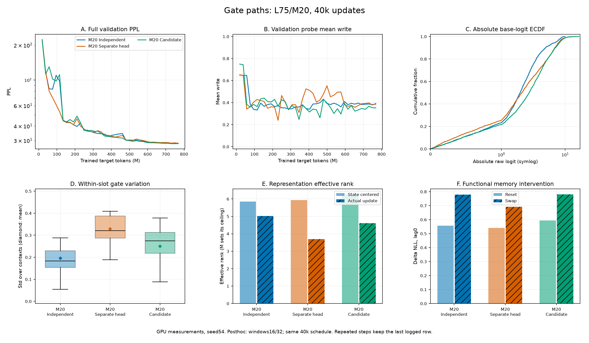

# L75 small · write gate 정보 경로 비교 — M20 최종 보고서

갱신: 2026-10-21 · **M20 세 경로 비교·선정 완료: candidate 채택, 기본값 반영** · 다른 M 전달성은 후속 검증

[실행 안내](../workflow.md) · [모델 명세](../specification.md) · [선행 안정화 실험](20261018_l75_gate_stabilization.md) · [원본 보관](../../results/README.md)

## 1. 최종 결정

**성능 차이가 크지 않은 가운데 reset·swap 진단이 양호하고, 구조가 단순하며 파라미터·근사 연산량이 가장 적은 candidate를 선택한다.** Best validation PPL은 candidate28.1781 / independent28.2550 / separate_head28.4120이다. Candidate는 reset ΔNLL이 가장 크고 swap ΔNLL은 independent와 거의 같아 문맥에 맞는 과거 state를 활용한다는 근거가 있다. 개입 손실 자체를 기억 품질의 절대 점수로 취급하지는 않는다.

**기본값만 `write_source='candidate'`로 바꾸고 `independent`·`separate_head` 구현과 선택 옵션은 모두 유지한다.** 단일 seed에서 관측한 차이가 작으므로 두 경로를 열등한 구현으로 판정해 제거하지 않는다. `write_detach_source=False`, 현재 state attention, A와 write dropout0은 유지한다. Detach 대조는 미시행이며 이번 기본값 변경에 추가하지 않는다.

이 문서는 M20 비교와 선택의 최종본이다. 처음 계획한 전체 실험 중 다른 M에서의 전달성 검증은 남아 있으며, M20 결과를 모든 M의 우위로 확대하지 않는다.

## 2. 비교 조건과 구현

공통 조건은 **L75/M20·GRT small(D256, 6layers, head8, FF1024)·seed54·FP32·global256·각40k updates**다. A(threshold10, coef1e-4)·write dropout0·read off·bias0·router hidden512, Adam LR5e-4·clip0.25·BPTT 이전3segments를 고정했다. Warmup5%(2k) 뒤 cosine 최소 LR 비율1%(5e-6)를 사용했다. 전체 validation248,420 targets를1k마다 평가해 best를 고르고 test는 평가하지 않았다.

세 run 모두 train commit `fb9ba36`·Python3.13.15·PyTorch2.11.0+cu128·Transformers4.45.2·T4×2·micro128×accum1이다. Dataset manifest와 경로·run 식별자 이외의 설정이 일치하며 실제 새 targets는 각각767,950,848이다. 초기화 RNG 소비·dropout 표본까지 같다는 의미는 아니다.

| 경로 | Gate feature F | 입력 형태 | 추가 feature head |
|---|---|---|---|
| independent | 원래 token embedding의 독립 attention pooling | 전역 벡터[B,D] | 없음 |
| separate_head | 최종 출력 정규화 직전 register hidden H_reg의 Linear(D,D) | 슬롯별[B,M,D] | 256→256, bias 포함 |
| candidate · 채택 | 최종 정규화를 마친 실제 candidate C 공유 | 슬롯별[B,M,D] | 없음 |

세 경로 모두 현재 segment 시작 state S를 `V=RegisterAttention(F,S,S)`로 참조하고, `concat(F,V)`의2D를 GELU MLP(hidden512)에 넣어 슬롯별 scalar write를 예측한다. Independent는 전역 hidden에서 M개 출력, 나머지는 슬롯별 hidden에 해당 출력 weight 행을 적용한다. State 참조 방식은 같지만 query 내용·개수는 다르다.

```text
[X; S] ─ NeoX stack ─ 기존 최종 출력 정규화 ─ [Y; C]
C ─ F ─┬─ concat(F,V) ─ GELU MLP ─ sigmoid ─ w
S ─────┴─ RegisterAttention(F,S,S) ─ V
S_next = (1-w) * S + w * C
```

위 그림은 채택한 candidate다. Token은 모든 layer에서 시작 S만 읽고 중간 candidate hidden을 K/V로 읽지 않는다. 전체 stack 뒤 write-back은 한 번이며, 기존 candidate 출력 경로·명칭은 유지한다. 별도 gate linear는 separate_head에만 존재한다.

| 방식 | 전체 파라미터 | Router 파라미터 | Router forward (M MAC) | Write 경로만 (M MAC) |
|---|---:|---:|---:|---:|
| independent | 18,682,408 | 1,072,424 | 18.83 | 13.04 |
| separate_head | 18,211,860 | 601,876 | 12.01 | 12.01 |
| candidate | 18,146,068 | 536,084 | 10.70 | 10.70 |

파라미터는 실제 집계, MAC은 batch1·segment1회 forward의 attention/linear shape 근사다(FLOPs≈2×MAC). 공통 backbone·LM head·backward·softmax/GELU/정규화 등은 제외한다. Independent의 router 합계는 read off에서도 실행하는 기존 read head 약5.80M MAC을 포함한다. 세 write MLP는 각각272,916개이며 separate_head는 candidate보다65,792개·약1.31M MAC을 추가한다. 이 근사값을 전체 학습 속도 개선율로 해석하지 않는다.

## 3. 성능과 레지스터 분석

<!-- gate-report:gate_paths:start -->
| 조건 | best step / PPL | 최종 PPL / NLL | wall h / peak GiB | 학습 / 사후 원본 |
|---|---|---|---|---|
| M20 Independent | 38,000 / 28.2550 | 28.2876 / 3.342424 | 12.530 / 11.797 | [학습](../../results/c4b4660b71164924a0bef45863d42a92.json) / [사후](../../results/posthoc/d5afa997eeb84bd99d34f15640d37b57.json) |
| M20 Separate head | 40,000 / 28.4120 | 28.4120 / 3.346810 | 13.670 / 11.778 | [학습](../../results/d598c992d4734bd9aa327cbff78b96c5.json) / [사후](../../results/posthoc/7b46ce088d5a428da7819b3ae15c1303.json) |
| M20 Candidate | 39,000 / 28.1781 | 28.2030 / 3.339429 | 12.488 / 11.766 | [학습](../../results/73881fe675194b53b499eab9e754a6d2.json) / [사후](../../results/posthoc/8f43885f4f3e4ab890c84186e6bc4594.json) |

| 공통 지표 | M20 Independent | M20 Separate head | M20 Candidate |
|---|---:|---:|---:|
| C/O/T (window0) | 0/1/19 | 0/0/20 | 0/1/19 |
| Write 평균 | 0.442457 | 0.409248 | 0.404264 |
| 슬롯 내 gate std | 0.196136 | 0.328546 | 0.249819 |
| 절대 logit 중앙값 | 1.958 | 2.097 | 2.702 |
| 절대 logit >20 (%) | 0.00 | 0.00 | 0.00 |
| MLP hidden L2 norm | 26.068 | 63.144 | 17.645 |
| 문맥 중심화 state rank | 5.842 | 5.937 | 6.259 |
| 실제 update rank | 5.017 | 3.696 | 4.607 |
| 평균 slot CKA | 0.526 | 0.607 | 0.565 |
| 전체 reset ΔNLL, lag0 | +0.557522 | +0.540895 | +0.594935 |
| 전체 swap ΔNLL, lag0 | +0.779388 | +0.692431 | +0.780243 |
| 전체 swap ΔNLL, lag3 | +0.090288 | +0.091688 | +0.139034 |


<!-- gate-report:gate_paths:end -->

사후 연속 지표는 best checkpoint의 window16/32 동일 가중 평균, C/O/T는 window0 고정 그룹이다. 사후 조건은 batch8·warmup3·측정8·horizon4·random3이며, 학습 중 고정 probe와 구분한다. 그림 A/B의 가로축은 실제 누적 새 target 수다.

Candidate는 best/final PPL·파라미터·VRAM에서 소폭 유리하다. 레지스터 진단의 강점은 나뉜다. **문맥 중심화 state rank는 candidate가 가장 높고, 실제 update rank와 낮은 slot CKA는 independent가 유리하다.** Separate_head는 gate 변동이 가장 크지만 update rank가 가장 낮고 CKA는 가장 높아, 활발한 gate 변화가 다양한 갱신으로 바로 이어지지는 않았다.

Reset ΔNLL은 candidate > independent > separate_head, swap은 candidate≈independent > separate_head다. 세 경로 모두 과거 state 의존성이 확인된다. Candidate의 큰 lag3 잔여 영향은 기억 지속성과 손상 후 복구 속도가 섞여 있어 별도 우위 점수로 쓰지 않는다. 모든 선택 checkpoint의 사후 평가에서 abs(logit)>20 관측은0이었다.

## 4. 학습 경향과 실측 시간

| 전체 validation PPL | independent | separate_head | candidate |
|---|---:|---:|---:|
| 2k | 116.7816 | 117.8646 | 112.3227 |
| 3k | 83.9502 | 80.3902 | 130.1678 |
| 4k | 83.3166 | 70.1662 | 101.9435 |
| 5k | 109.7603 | 61.2607 | 97.8959 |
| 6k | 97.9811 | 53.3368 | 111.2475 |
| 7k | 44.8678 | 44.4186 | 44.6452 |
| 10k | 41.0161 | 41.1531 | 43.4457 |
| 20k | 32.5498 | 33.3163 | 32.5329 |
| 30k | 29.7816 | 30.0160 | 29.3663 |
| 35k | 28.5179 | 28.7906 | 28.4915 |
| 40k | 28.2876 | 28.4120 | 28.2030 |

Separate_head는3k–6k에 연속 개선되어 가장 매끄러웠으나7k에는 세 경로가44대로 모이고,10k→11k에는 separate_head도41.1531→46.2408로 악화됐다. Candidate의 최종 우위를 초반부터 빠르거나 안정적이었던 결과로 해석하지 않는다. 2k→3k mean write는 separate_head0.647→0.341 / candidate0.744→0.384로 함께 줄었지만 PPL 반응은 달라 평균 gate 변화만으로 원인을 설명할 수 없다.

후반30k<step≤40k training 극단 logit 비율 평균은 independent0.00009766% / separate_head0.00066406% / candidate0.00923828%다. 사후 probe의0%와는 측정 범위가 다르다. 사후 hidden norm은26.068 / 63.144 / 17.645로 별도 head가 가장 크지만, 이것만으로 발산이나 detach 필요성을 판정하지 않는다. 세 경로의 clipping 전 gradient norm 최대는 epoch 재시작 직후12,340 step에서89.661 / 95.017 / 53.452로 관측됐다. 초반 validation의 매끄러움과 전체 gradient 안정성은 구분한다.

| 실측 항목 | independent | separate_head | candidate |
|---|---:|---:|---:|
| 학습 누적 wall, HH:MM:SS 반올림 | 12:31:48 | 13:40:11 | 12:29:16 |
| 학습 누적 wall, seconds | 45,107.855 | 49,210.660 | 44,955.787 |
| GPU-hours (wall×2) | 25.059920 | 27.339255 | 24.975437 |
| 전체 wall / 40k (초/update) | 1.127696 | 1.230266 | 1.123895 |
| 실제 targets / wall (targets/s) | 17,024.77 | 15,605.38 | 17,082.36 |
| Peak allocated VRAM / GPU (GiB) | 11.797234 | 11.778123 | 11.766379 |
| Preflight 평균 (초/update) | 0.999471 | 1.022358 | 0.983648 |
| 별도 사후 분석 wall (초) | 90.935 | 58.439 | 82.490 |

학습 wall은 준비/preflight·별도 사후 분석을 제외하고 학습·validation·RTLA·저장을 포함한 기록이다. 재개 checkpoint 이후 버려진 작업·세션 사이 대기 시간은 빠질 수 있으며 GPU-hours는 Kaggle quota가 아니다. Candidate는 independent보다 약0.34% 짧고 separate_head보다 약1시간10분55초 짧았다. Run별 GPU 부하·재개가 섞이므로 실측 차이 전체를 경로 고유 속도 차이로 단정하지 않는다.

## 5. 수렴 정도와 원 RMT 학습량 비교

세 경로 모두40k cosine 스케줄의 수렴 후반에 접근했다. 마지막5k PPL 개선은 independent0.81% / separate_head1.32% / candidate1.01%다. Independent/candidate는 마지막2k에 순개선이 없지만 separate_head는40k에서 best를 갱신했다. 마지막 LR이 초기값의1%이므로 정체에 작은 LR의 영향이 섞인다. **이번 선택은40k의 운영 결정이며 완전 수렴 후의 보편적 우위를 뜻하지 않는다.**

비교 대상은 [NeurIPS2022 원 RMT 논문 §4·Table2](https://papers.neurips.cc/paper_files/paper/2022/file/47e288629a6996a17ce50b90a056a0e1-Paper-Conference.pdf)과 [저자 공개 run CSV](https://github.com/booydar/LM-RMT/blob/main/experiment_results/results_wt103_enwik8_all_parameters.csv)다. WT103의82개 run은 L150/batch60이34개, L50/batch128이48개이며 모두200k updates·고정 L이다. 본문은 linear schedule, 실제 CSV는 cosine이므로 현재와 같은 프로토콜로 표현하지 않는다.

| 새 target 노출량 비교 | 현재 GRT 각 run | RMT L150 | RMT L50 |
|---|---:|---:|---:|
| Token 단위 | GPT-2 BPE | word | word |
| L / global batch / updates | 75 / 256 / 40k | 150 / 60 / 200k | 50 / 128 / 200k |
| 누적 새 targets | 실제767,950,848 | 명목1,800,000,000 | 명목1,280,000,000 |
| 코퍼스 통과량 | 약6.48회 | 약17.44회 | 약12.40회 |
| 현재40k의 상대 노출량 | 기준 | 약37.2% | 약52.3% |
| 현재40k를 원 논문 step으로 환산 | 기준 | 약74.4k | 약104.6k |
| 논문 전체 노출량을 현재 step으로 환산 | — | 약107.6k | 약76.5k |

새 targets는 B×L×updates이며 memory와 과거 BPTT replay는 제외한다. 통과량의 분모는 현재 manifest118,436,938 BPE, [WikiText 원 논문 Table1](https://arxiv.org/pdf/1609.07843)의103,227,021 word tokens다. Tokenizer 차이를 반영한 근사이며 원 RMT targets는 실측 counter가 아니다. K3 문맥도 현재300 BPE(평균 약261 word 상당), 원 RMT L150: 600 words / L50: 200 words로 다르다. 원 RMT 약151M·Transformer-XL·word/adaptive softmax·test PPL과 현재 약18M·NeoX·BPE/full softmax·validation PPL의 절댓값·속도를 직접 비교하지 않는다. 약77k/108k는 노출량 환산값이며 필요한 수렴 예산이나 개선 보장이 아니다.

## 6. 반영과 후속 검증

Typed Config·카탈로그·Colab/Kaggle 선택 셀의 기본값을 candidate로 통일한다. 두 대안은 같은 `write_source` 옵션으로 계속 실행할 수 있다.

```python
write_source = 'candidate'  # 대안: 'independent', 'separate_head'
write_detach_source = False
num_registers = 20
budget = '40k'
warmup_ratio = 0.05
write_dropout = 0.0
write_logit_threshold = 10.0
write_logit_coef = 1e-4
```

실행 순서는 기존 `setup → prepare_data → preflight → train → report`를 따른다. 기존 checkpoint는 저장된 source 설정으로만 재개하고, source를 바꾸면 새 run을 사용한다. State on/off 설정은 없다. 선택적 detach 구현은 유지한다: candidate는 C 앞, separate_head는 gate linear 앞의 source 연결만 차단하며 head·state attention·MLP와 candidate write-back은 계속 학습한다. Independent detach는 허용하지 않는다.

| 단계 | 최종 기록 |
|---|---|
| M20 세 경로 비교·선정 | 완료: candidate 선택, 나머지 구현 유지 |
| 선택적 detach | 미시행; 기본 false 유지, 효과 미검증 |
| M8/M75 전달성 | 미검증; candidate·A·dropout0·40k를 고정해 같은 M의 independent와 비교 |

M 전달성에서 순위가 바뀌면 보존한 경로를 다시 비교한다. M별 rank 절댓값을 같은 척도의 효율 순위로 쓰지 않는다.

2026-10-24 실행 준비: [Kaggle 서버 재개 노트북](../../notebooks/kaggle_gate_transfer.ipynb)으로 M8/M75 × candidate/independent의40k 대조를 진행한다. 서버 prepared 캐시·주기적 snapshot을 사용하고12시간 제한 후 새 Save에서 같은 job을 **이어서 학습**한다. [실행·재개 순서](../server.md#gate-transfer-kaggle)를 따르며, 아직 추가 M의 GPU 결과는 수신하지 않았다.

## 7. 원본·재현성·기능 검증

세 ZIP의 학습·사후 JSON 총6개를 report ID로 보존했다. 최신 separate_head 학습 ID는 `d598c992d4734bd9aa327cbff78b96c5`이며, 동명 ZIP도 원본 링크·ID·checkpoint hash로 구분한다. Training config·manifest·selected step·probe metrics와 사후 보고서가 일치한다. 세 run 모두40k 완료, parse error·warnings 없음, W&B failures0·finished다.

<!-- gate-report:gate_path_sources:start -->
| 조건 (L/M) | best step | train / post commit | train / post PyTorch | micro×accum×GPU | checkpoint SHA256 |
|---|---:|---|---|---|---|
| Independent (75/20) | 38,000 | `fb9ba36` / `fb9ba36` | 2.11.0+cu128 / 2.11.0+cu128 | 128×1×2 | `f78cb5eda1a7d7e80030ded88f1edc3a358404d9975d6431dfa928852c681089` |
| Separate head (75/20) | 40,000 | `fb9ba36` / `fb9ba36` | 2.11.0+cu128 / 2.11.0+cu128 | 128×1×2 | `daa53fded26478ac62c4650b91f15d1ce61fb8db44b1fd077129d20e0d9d8074` |
| Candidate (75/20) | 39,000 | `fb9ba36` / `fb9ba36` | 2.11.0+cu128 / 2.11.0+cu128 | 128×1×2 | `552928bb2b51d48da0e9bb26744bfcb53022de92a6b683e72e98ec8f8278e0c8` |
<!-- gate-report:gate_path_sources:end -->

Independent / separate_head / candidate의 원본 로그는4016 / 4087 / 4027행이다. 재개 중복은 각각38,010–38,150의15개 / 34,010–34,860의86개 / 38,010–38,260의26개이며, 원본은 수정하지 않고 집계 시 step별 마지막 행을 남긴 각4001개를 사용한다. 표·그림·구조화 집계는 `python scripts/report_gate_stabilization.py`로 재생성한다.

2026-10-21 기본값 변경 후 CPU 검사272개가 통과했다. 분산 검사5개는 로컬 통신 제한으로 실패한 뒤 통신을 허용해 재실행했고 모두 통과했다. 세 경로·인과성·gradient·학습/재개·사후 분석·노트북 설정·결과 집계를 확인했으며 GPU 수렴 근거와 구분한다.

설계 참고는 [Guo et al. survey](https://arxiv.org/abs/2111.07624), [Chaudhari et al. survey](https://arxiv.org/abs/1904.02874), [Jiao et al. survey](https://www.techscience.com/cmc/v80n1/57427/html)다. 서베이는 정보 집계·결합 방식의 참고이며 이번 후보의 수렴·우위를 입증한 자료는 아니다.
