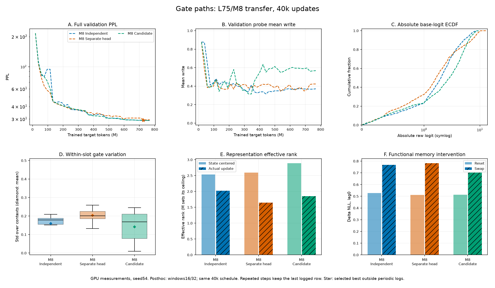
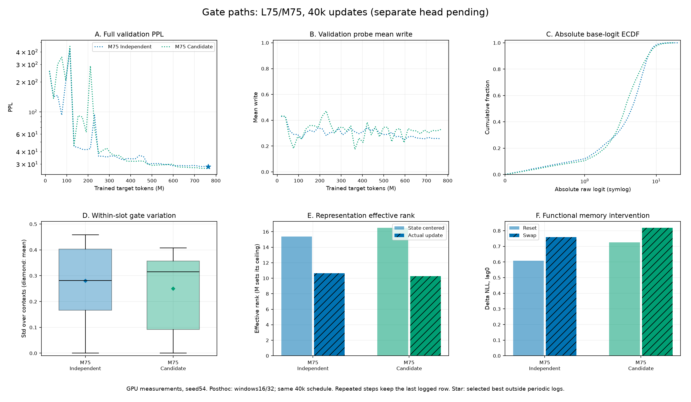

# L75 small · write gate 정보 경로 비교

갱신: 2026-10-27 · **candidate 기본 선택 유지 · M8/M20 세 경로 수신 · M75 independent/candidate 수신, separate_head 실험 중**

[실행 안내](../workflow.md) · [모델 명세](../specification.md) · [선행 안정화 실험](20261018_l75_gate_stabilization.md) · [원본 보관](../../results/README.md)

## 1. 최종 결정

**성능 차이가 크지 않은 가운데 reset·swap 진단이 양호하고, 구조가 단순하며 파라미터·근사 연산량이 가장 적은 candidate를 선택한다.** Best validation PPL은 candidate28.1781 / independent28.2550 / separate_head28.4120이다. Candidate는 reset ΔNLL이 가장 크고 swap ΔNLL은 independent와 거의 같아 문맥에 맞는 과거 state를 활용한다는 근거가 있다. 개입 손실 자체를 기억 품질의 절대 점수로 취급하지는 않는다.

**기본값만 `write_source='candidate'`로 바꾸고 `independent`·`separate_head` 구현과 선택 옵션은 모두 유지한다.** 단일 seed에서 관측한 차이가 작으므로 두 경로를 열등한 구현으로 판정해 제거하지 않는다. `write_detach_source=False`, 현재 state attention, A와 write dropout0은 유지한다. Detach 대조는 미시행이며 이번 기본값 변경에 추가하지 않는다.

M20의 선택에 후속 전달성 결과를 누적한다. M8은 candidate/independent의 품질이 거의 같고 separate_head는 두 경로보다 높다. M75는 candidate가 independent보다 best 약4.06%·final 약4.56% 낮아 선택을 지지한다. M75 separate_head는 실험 중이므로 세 경로 전체 결론은 미완료다. 여러 seed와 선택적 detach 효과도 미검증이다.

## 2. 비교 조건과 구현

공통 조건은 **L75/M20·GRT small(D256, 6layers, head8, FF1024)·seed54·FP32·global256·각40k updates**다. A(threshold10, coef1e-4)·write dropout0·read off·bias0·router hidden512, Adam LR5e-4·clip0.25·BPTT 이전3segments를 고정했다. Warmup5%(2k) 뒤 cosine 최소 LR 비율1%(5e-6)를 사용했다. 전체 validation248,420 targets를1k마다 평가해 best를 고르고 test는 평가하지 않았다.

세 run 모두 train commit `fb9ba36`·Python3.13.15·PyTorch2.11.0+cu128·Transformers4.45.2·T4×2·micro128×accum1이다. Dataset manifest와 경로·run 식별자 이외의 설정이 일치하며 실제 새 targets는 각각767,950,848이다. 초기화 RNG 소비·dropout 표본까지 같다는 의미는 아니다.

| 경로 | Gate feature F | 입력 형태 | 추가 feature head |
|---|---|---|---|
| independent | 원래 token embedding의 독립 attention pooling | 전역 벡터[B,D] | 없음 |
| separate_head | 최종 출력 정규화 직전 register hidden H_reg의 Linear(D,D) | 슬롯별[B,M,D] | 256→256, bias 포함 |
| candidate · 채택 | 최종 정규화를 마친 실제 candidate C 공유 | 슬롯별[B,M,D] | 없음 |

세 경로 모두 현재 segment 시작 state S를 `V=RegisterAttention(F,S,S)`로 참조하고, `concat(F,V)`의2D를 GELU MLP(hidden512)에 넣어 슬롯별 scalar write를 예측한다. Independent는 전역 hidden에서 M개 출력, 나머지는 슬롯별 hidden에 해당 출력 weight 행을 적용한다. State 참조 방식은 같지만 query 내용·개수는 다르다.

```text
[X; S] ─ NeoX stack ─ 기존 최종 출력 정규화 ─ [Y; C]
C ─ F ─┬─ concat(F,V) ─ GELU MLP ─ sigmoid ─ w
S ─────┴─ RegisterAttention(F,S,S) ─ V
S_next = (1-w) * S + w * C
```

위 그림은 채택한 candidate다. Token은 모든 layer에서 시작 S만 읽고 중간 candidate hidden을 K/V로 읽지 않는다. 전체 stack 뒤 write-back은 한 번이며, 기존 candidate 출력 경로·명칭은 유지한다. 별도 gate linear는 separate_head에만 존재한다.

| 방식 | 전체 파라미터 | Router 파라미터 | Router forward (M MAC) | Write 경로만 (M MAC) |
|---|---:|---:|---:|---:|
| independent | 18,682,408 | 1,072,424 | 18.83 | 13.04 |
| separate_head | 18,211,860 | 601,876 | 12.01 | 12.01 |
| candidate | 18,146,068 | 536,084 | 10.70 | 10.70 |

파라미터는 실제 집계, MAC은 batch1·segment1회 forward의 attention/linear shape 근사다(FLOPs≈2×MAC). 공통 backbone·LM head·backward·softmax/GELU/정규화 등은 제외한다. Independent의 router 합계는 read off에서도 실행하는 기존 read head 약5.80M MAC을 포함한다. 세 write MLP는 각각272,916개이며 separate_head는 candidate보다65,792개·약1.31M MAC을 추가한다. 이 근사값을 전체 학습 속도 개선율로 해석하지 않는다.

## 3. M20 성능과 레지스터 분석

<!-- gate-report:gate_paths:start -->
| 조건 | best step / PPL | 최종 PPL / NLL | wall h / peak GiB | 학습 / 사후 원본 |
|---|---|---|---|---|
| M20 Independent | 38,000 / 28.2550 | 28.2876 / 3.342424 | 12.530 / 11.797 | [학습](../../results/c4b4660b71164924a0bef45863d42a92.json) / [사후](../../results/posthoc/d5afa997eeb84bd99d34f15640d37b57.json) |
| M20 Separate head | 40,000 / 28.4120 | 28.4120 / 3.346810 | 13.670 / 11.778 | [학습](../../results/d598c992d4734bd9aa327cbff78b96c5.json) / [사후](../../results/posthoc/7b46ce088d5a428da7819b3ae15c1303.json) |
| M20 Candidate | 39,000 / 28.1781 | 28.2030 / 3.339429 | 12.488 / 11.766 | [학습](../../results/73881fe675194b53b499eab9e754a6d2.json) / [사후](../../results/posthoc/8f43885f4f3e4ab890c84186e6bc4594.json) |

| 공통 지표 | M20 Independent | M20 Separate head | M20 Candidate |
|---|---:|---:|---:|
| C/O/T (window0) | 0/1/19 | 0/0/20 | 0/1/19 |
| Write 평균 | 0.442457 | 0.409248 | 0.404264 |
| 슬롯 내 gate std | 0.196136 | 0.328546 | 0.249819 |
| 절대 logit 중앙값 | 1.958 | 2.097 | 2.702 |
| 절대 logit >20 (%) | 0.00 | 0.00 | 0.00 |
| MLP hidden L2 norm | 26.068 | 63.144 | 17.645 |
| 문맥 중심화 state rank | 5.842 | 5.937 | 6.259 |
| 실제 update rank | 5.017 | 3.696 | 4.607 |
| 평균 slot CKA | 0.526 | 0.607 | 0.565 |
| 전체 reset ΔNLL, lag0 | +0.557522 | +0.540895 | +0.594935 |
| 전체 swap ΔNLL, lag0 | +0.779388 | +0.692431 | +0.780243 |
| 전체 swap ΔNLL, lag3 | +0.090288 | +0.091688 | +0.139034 |


<!-- gate-report:gate_paths:end -->

사후 연속 지표는 best checkpoint의 window16/32 동일 가중 평균, C/O/T는 window0 고정 그룹이다. 사후 조건은 batch8·warmup3·측정8·horizon4·random3이며, 학습 중 고정 probe와 구분한다. 그림 A/B의 가로축은 실제 누적 새 target 수다.

Candidate는 best/final PPL·파라미터·VRAM에서 소폭 유리하다. 레지스터 진단의 강점은 나뉜다. **문맥 중심화 state rank는 candidate가 가장 높고, 실제 update rank와 낮은 slot CKA는 independent가 유리하다.** Separate_head는 gate 변동이 가장 크지만 update rank가 가장 낮고 CKA는 가장 높아, 활발한 gate 변화가 다양한 갱신으로 바로 이어지지는 않았다.

Reset ΔNLL은 candidate > independent > separate_head, swap은 candidate≈independent > separate_head다. 세 경로 모두 과거 state 의존성이 확인된다. Candidate의 큰 lag3 잔여 영향은 기억 지속성과 손상 후 복구 속도가 섞여 있어 별도 우위 점수로 쓰지 않는다. M20의 세 선택 checkpoint 사후 평가에서 abs(logit)>20 관측은0이었다.

## 4. 학습 경향과 실측 시간

| 전체 validation PPL | independent | separate_head | candidate |
|---|---:|---:|---:|
| 2k | 116.7816 | 117.8646 | 112.3227 |
| 3k | 83.9502 | 80.3902 | 130.1678 |
| 4k | 83.3166 | 70.1662 | 101.9435 |
| 5k | 109.7603 | 61.2607 | 97.8959 |
| 6k | 97.9811 | 53.3368 | 111.2475 |
| 7k | 44.8678 | 44.4186 | 44.6452 |
| 10k | 41.0161 | 41.1531 | 43.4457 |
| 20k | 32.5498 | 33.3163 | 32.5329 |
| 30k | 29.7816 | 30.0160 | 29.3663 |
| 35k | 28.5179 | 28.7906 | 28.4915 |
| 40k | 28.2876 | 28.4120 | 28.2030 |

Separate_head는3k–6k에 연속 개선되어 가장 매끄러웠으나7k에는 세 경로가44대로 모이고,10k→11k에는 separate_head도41.1531→46.2408로 악화됐다. Candidate의 최종 우위를 초반부터 빠르거나 안정적이었던 결과로 해석하지 않는다. 2k→3k mean write는 separate_head0.647→0.341 / candidate0.744→0.384로 함께 줄었지만 PPL 반응은 달라 평균 gate 변화만으로 원인을 설명할 수 없다.

후반30k<step≤40k training 극단 logit 비율 평균은 independent0.00009766% / separate_head0.00066406% / candidate0.00923828%다. 사후 probe의0%와는 측정 범위가 다르다. 사후 hidden norm은26.068 / 63.144 / 17.645로 별도 head가 가장 크지만, 이것만으로 발산이나 detach 필요성을 판정하지 않는다. 세 경로의 clipping 전 gradient norm 최대는 epoch 재시작 직후12,340 step에서89.661 / 95.017 / 53.452로 관측됐다. 초반 validation의 매끄러움과 전체 gradient 안정성은 구분한다.

| 실측 항목 | independent | separate_head | candidate |
|---|---:|---:|---:|
| 학습 누적 wall, HH:MM:SS 반올림 | 12:31:48 | 13:40:11 | 12:29:16 |
| 학습 누적 wall, seconds | 45,107.855 | 49,210.660 | 44,955.787 |
| GPU-hours (wall×2) | 25.059920 | 27.339255 | 24.975437 |
| 전체 wall / 40k (초/update) | 1.127696 | 1.230266 | 1.123895 |
| 실제 targets / wall (targets/s) | 17,024.77 | 15,605.38 | 17,082.36 |
| Peak allocated VRAM / GPU (GiB) | 11.797234 | 11.778123 | 11.766379 |
| Preflight 평균 (초/update) | 0.999471 | 1.022358 | 0.983648 |
| 별도 사후 분석 wall (초) | 90.935 | 58.439 | 82.490 |

학습 wall은 준비/preflight·별도 사후 분석을 제외하고 학습·validation·RTLA·저장을 포함한 기록이다. 재개 checkpoint 이후 버려진 작업·세션 사이 대기 시간은 빠질 수 있으며 GPU-hours는 Kaggle quota가 아니다. Candidate는 independent보다 약0.34% 짧고 separate_head보다 약1시간10분55초 짧았다. Run별 GPU 부하·재개가 섞이므로 실측 차이 전체를 경로 고유 속도 차이로 단정하지 않는다.

## 5. 수렴 정도와 원 RMT 학습량 비교

세 경로 모두40k cosine 스케줄의 수렴 후반에 접근했다. 마지막5k PPL 개선은 independent0.81% / separate_head1.32% / candidate1.01%다. Independent/candidate는 마지막2k에 순개선이 없지만 separate_head는40k에서 best를 갱신했다. 마지막 LR이 초기값의1%이므로 정체에 작은 LR의 영향이 섞인다. **이번 선택은40k의 운영 결정이며 완전 수렴 후의 보편적 우위를 뜻하지 않는다.**

비교 대상은 [NeurIPS2022 원 RMT 논문 §4·Table2](https://papers.neurips.cc/paper_files/paper/2022/file/47e288629a6996a17ce50b90a056a0e1-Paper-Conference.pdf)과 [저자 공개 run CSV](https://github.com/booydar/LM-RMT/blob/main/experiment_results/results_wt103_enwik8_all_parameters.csv)다. WT103의82개 run은 L150/batch60이34개, L50/batch128이48개이며 모두200k updates·고정 L이다. 본문은 linear schedule, 실제 CSV는 cosine이므로 현재와 같은 프로토콜로 표현하지 않는다.

| 새 target 노출량 비교 | 현재 GRT 각 run | RMT L150 | RMT L50 |
|---|---:|---:|---:|
| Token 단위 | GPT-2 BPE | word | word |
| L / global batch / updates | 75 / 256 / 40k | 150 / 60 / 200k | 50 / 128 / 200k |
| 누적 새 targets | 실제767,950,848 | 명목1,800,000,000 | 명목1,280,000,000 |
| 코퍼스 통과량 | 약6.48회 | 약17.44회 | 약12.40회 |
| 현재40k의 상대 노출량 | 기준 | 약37.2% | 약52.3% |
| 현재40k를 원 논문 step으로 환산 | 기준 | 약74.4k | 약104.6k |
| 논문 전체 노출량을 현재 step으로 환산 | — | 약107.6k | 약76.5k |

새 targets는 B×L×updates이며 memory와 과거 BPTT replay는 제외한다. 통과량의 분모는 현재 manifest118,436,938 BPE, [WikiText 원 논문 Table1](https://arxiv.org/pdf/1609.07843)의103,227,021 word tokens다. Tokenizer 차이를 반영한 근사이며 원 RMT targets는 실측 counter가 아니다. K3 문맥도 현재300 BPE(평균 약261 word 상당), 원 RMT L150: 600 words / L50: 200 words로 다르다. 원 RMT 약151M·Transformer-XL·word/adaptive softmax·test PPL과 현재 약18M·NeoX·BPE/full softmax·validation PPL의 절댓값·속도를 직접 비교하지 않는다. 약77k/108k는 노출량 환산값이며 필요한 수렴 예산이나 개선 보장이 아니다.

## 6. M 전달성과 후속 상태

Typed Config·카탈로그·Colab/Kaggle의 기본 `write_source='candidate'`, `write_detach_source=False`를 유지한다. Independent·separate_head 구현도 유지한다. 새로운 조건은 새 run으로 시작하고 기존 checkpoint는 같은 source·Config·manifest·world size로만 재개한다. [Kaggle 서버 재개 노트북](../../notebooks/kaggle_gate_transfer.ipynb)과 [새 Save 재개 절차](../server.md#gate-transfer-kaggle)를 따른다. Source detach는 candidate의 C 앞, separate_head의 gate linear 앞에만 적용하며 기본 off다.

| M·조건 | 현재 관측·상태 |
|---|---|
| M8 세 경로 | 수신 완료. Best: candidate < independent < separate_head; final: independent ≈ candidate < separate_head |
| M20 세 경로 | 수신 완료·candidate 선택. Best/final에서 근소 우세 |
| M75 independent/candidate | 수신 완료. Candidate가 best/final 모두 낮음 |
| M75 separate_head | 실험 중·결과 미수신. 아래 수치·그림에는 수신된 경로만 포함 |
| Detach·반복 seed | 미시행·미검증 |

### M8 · 세 경로40k 결과 (2026-10-27 갱신)

기존 independent/candidate에 이번 `experiment_results (2).zip`의 separate_head를 추가했다. 세 run 모두 L75·small·A(10,1e-4)·write dropout0·detach off·seed54·FP32·global256·warmup2k·최소 LR 비율1%, T4×2·micro128×accum1이다. 실제 targets767,950,848·validation248,420·dataset manifest와 source·실행 식별자 이외의 Config가 같다. 별도 head의 commit은 `35eb7f2`, 나머지는 `dde0e8f`이며 그 사이 `src/grt`·실험 카탈로그·학습/분석 진입점 변경은 없다. 세 경로의 Python3.13.15·PyTorch2.11.0+cu128·Transformers4.45.2도 같다.

<!-- gate-report:gate_transfer_m8:start -->
| 조건 | best step / PPL | 최종 PPL / NLL | wall h / peak GiB | 학습 / 사후 원본 |
|---|---|---|---|---|
| M8 Independent | 40,000 / 29.0066 | 29.0066 / 3.367525 | 11.580 / 10.898 | [학습](../../results/b847ae2264864871b0f132a1ee0ed61e.json) / [사후](../../results/posthoc/b67922afa77542ae8273c293fc27a50e.json) |
| M8 Separate head | 37,755 / 29.2163 | 29.4665 / 3.383254 | 11.550 / 10.815 | [학습](../../results/e1aad6f646664a52b986d0cf59eaff24.json) / [사후](../../results/posthoc/f1cf7609c3da46569bd97774579a7fd4.json) |
| M8 Candidate | 38,000 / 28.9268 | 29.0274 / 3.368242 | 12.323 / 10.810 | [학습](../../results/8908b33d329c4264b8c8f96872cada64.json) / [사후](../../results/posthoc/31787a5dc9c242768cf51d2a67b1a149.json) |

| 공통 지표 | M8 Independent | M8 Separate head | M8 Candidate |
|---|---:|---:|---:|
| C/O/T (window0) | 0/0/8 | 0/0/8 | 0/0/8 |
| Write 평균 | 0.424318 | 0.444096 | 0.585676 |
| 슬롯 내 gate std | 0.159794 | 0.204034 | 0.141607 |
| 절대 logit 중앙값 | 1.984 | 1.643 | 2.835 |
| 절대 logit >20 (%) | 0.00 | 0.00 | 0.00 |
| MLP hidden L2 norm | 27.655 | 53.320 | 37.905 |
| 문맥 중심화 state rank | 2.534 | 2.597 | 2.888 |
| 실제 update rank | 2.021 | 1.647 | 1.854 |
| 평균 slot CKA | 0.674 | 0.588 | 0.586 |
| 전체 reset ΔNLL, lag0 | +0.527423 | +0.512130 | +0.512922 |
| 전체 swap ΔNLL, lag0 | +0.767141 | +0.781647 | +0.702842 |
| 전체 swap ΔNLL, lag3 | +0.113452 | +0.118710 | +0.098716 |


<!-- gate-report:gate_transfer_m8:end -->

**품질:** best는 candidate28.9268 < independent29.0066 < separate_head29.2163이다. Final은 independent29.0066 / candidate29.0274 / separate_head29.4665다. Candidate의 best 이득은 independent 대비약0.28%지만 final은약0.07% 높아 사실상 동등하다. Separate_head는3k77.9369→6k54.8569로 초반이 매끄러웠지만20k34.8435·35k30.6824로 뒤처졌다. Best37,755는 정기 로그에 없는 추가 평가이며 summary·사후 checkpoint가 일치한다. 그래프의 별표는 이 실제 checkpoint이고 정기 로그를 보간하지 않는다.

**레지스터:** candidate가 state rank2.888로 가장 높고 CKA0.586은 separate_head0.588과 가깝다. 실제 update rank는 independent2.021 > candidate1.854 > separate_head1.647이다. 별도 head의 gate std0.204가 가장 크지만 다양한 갱신이나 더 낮은 PPL로 이어지지는 않았다. Reset ΔNLL은 independent0.527, 나머지약0.512이고 swap은 separate_head0.782 > independent0.767 > candidate0.703이다. 세 경로 모두 state 의존성이 있지만 이를 기억 품질의 절대 순위로 쓰지 않는다. C/O/T는모두0/0/8, 사후 abs(logit)>20 관측은모두0이다.

| 실측 비용 | independent | separate_head | candidate |
|---|---:|---:|---:|
| 전체 파라미터 / router | 18,667,024 / 1,060,112 | 18,202,632 / 595,720 | 18,136,840 / 529,928 |
| 누적 wall, HH:MM:SS 반올림 | 11:34:49 | 11:33:02 | 12:19:22 |
| 같은 wall, seconds | 41,688.952 | 41,581.574 | 44,361.847 |
| Peak allocated VRAM / GPU (GiB) | 10.898210 | 10.814883 | 10.810242 |
| Preflight 평균 (초/update) | 0.886629 | 0.852403 | 0.864496 |
| 별도 사후 분석 wall (초) | 61.103 | 56.750 | 58.299 |

세 실행은 `-g2` 경로이며 metrics는각4001행·고유4001step이다. 별도 head의 사후 checkpoint Config에는 이전 attempt의 output 경로·W&B 이름만 남고 나머지 조건은 일치한다. 집계 시 이 두 실행 식별자만 정규화한다. 단일 seed·유한 예산의 근소한 차이를 유의한 차이로 표현하지 않는다.

### M75 · independent/candidate40k 결과, separate_head 실험 중 (2026-10-27)

기존 independent에 이번 `experiment_results (1).zip`의 candidate를 추가했다. L75·small·A·write dropout0·detach off·seed54·FP32·global256·40k·warmup2k·최소 LR 비율1%, T4×2·**micro64×accum2**를 동일하게 유지했다. Dataset manifest·실제 targets767,950,848·validation248,420과 source·실행 식별자 이외의 Config가 같다. Commit은 independent `dde0e8f` / candidate `1deef36`이며 그 사이 연구 구현·카탈로그·학습/분석 진입점 변경은 없다. Python·PyTorch·Transformers 버전은 위 M8과 같다.

<!-- gate-report:gate_transfer_m75:start -->
| 조건 | best step / PPL | 최종 PPL / NLL | wall h / peak GiB | 학습 / 사후 원본 |
|---|---|---|---|---|
| M75 Independent | 39,768 / 28.3260 | 28.4754 / 3.349042 | 22.000 / 8.362 | [학습](../../results/bbd0eca2b36a43be94684b7226118291.json) / [사후](../../results/posthoc/f8e6cb1239514b04a66b13749ca7f4fd.json) |
| M75 Candidate | 39,000 / 27.1769 | 27.1776 / 3.302394 | 21.730 / 8.467 | [학습](../../results/1e0143312a004ef9b28e6c104f1dbe89.json) / [사후](../../results/posthoc/cd4418391a5449119ce1dc6219d1cf9f.json) |

| 공통 지표 | M75 Independent | M75 Candidate |
|---|---:|---:|
| C/O/T (window0) | 0/0/75 | 0/3/72 |
| Write 평균 | 0.318263 | 0.343481 |
| 슬롯 내 gate std | 0.280758 | 0.250348 |
| 절대 logit 중앙값 | 4.536 | 3.643 |
| 절대 logit >20 (%) | 0.01 | 0.00 |
| MLP hidden L2 norm | 37.969 | 23.400 |
| 문맥 중심화 state rank | 15.365 | 16.493 |
| 실제 update rank | 10.657 | 10.260 |
| 평균 slot CKA | 0.373 | 0.455 |
| 전체 reset ΔNLL, lag0 | +0.608752 | +0.725090 |
| 전체 swap ΔNLL, lag0 | +0.758999 | +0.818126 |
| 전체 swap ΔNLL, lag3 | +0.084984 | +0.123818 |


<!-- gate-report:gate_transfer_m75:end -->

**품질:** candidate best27.1769(39k) / final27.1776으로 independent best28.3260(39,768) / final28.4754보다 각각**약4.06% / 4.56% 낮다**. M8/M20의 근소한 차이보다 관측 격차가 크며 이번 seed·40k 조건에서 candidate 선택을 지지한다. Independent best39,768은 비정기 중단 시 추가 평가와 일치하는 기록으로, summary·사후 checkpoint를 대조했다. 그래프 별표의763,496,448 targets를 사용하며 평가 기회 수가 같다고 표현하지 않는다. Candidate의39k best와40k final 차이는약0.003%다.

Candidate가 초반부터 더 안정적이었던 것은 아니다. 3k/6k PPL은 candidate301.3023/455.9258, independent146.3578/423.6041이고10k도62.6708/41.7334다. 이후20k에는31.9647/34.2059,35k27.7352/28.7747로 candidate가 낮아진다. 후반 이득과 초반 변동을 구분하고 완전 수렴 후 보편적 우위로 확대하지 않는다.

**레지스터:** candidate는 state rank16.493 > independent15.365, reset/swap ΔNLL0.725/0.818 > 0.609/0.759로 state 의존성이 더 크다. 반면 update rank10.260 < 10.657, CKA0.455 > 0.373으로 다양성 지표가 모두 유리한 것은 아니다. Lag3 잔여 영향도0.124 > 0.085여서 지속 영향과 손상 후 복구를 구분한다. C/O/T는 candidate0/3/72 / independent0/0/75이며 상시 open3개만으로 전체 gate 붕괴를 판정하지 않는다. 사후 abs(logit)>20 비율은 independent0.01042% / candidate0%다. Rank 절댓값으로 다른 M의 효율 순위를 매기지 않는다.

| 실측 비용 | independent | candidate | separate_head |
|---|---:|---:|---:|
| 전체 파라미터 / router | 18,752,918 / 1,128,854 | 18,188,363 / 564,299 | |
| 누적 wall, HH:MM:SS 반올림 | 21:59:59 | 21:43:48 | |
| 같은 wall, seconds | 79,199.452 | 78,228.077 | |
| Peak allocated VRAM / GPU (GiB) | 8.361911 | 8.466918 | |
| Preflight 평균 (초/update) | 1.612502 | 1.618960 | |
| 별도 사후 분석 wall (초) | 74.498 | 105.535 | |

Candidate의 파라미터는 적지만 VRAM은약107.53MiB 더 크다. 누적 wall은약16분11초(1.23%) 짧으나 preflight는약0.40% 느려, 구조의 단순함이 모든 실측 자원의 우위로 이어졌다고 표현하지 않는다. Independent는 `-g3`, candidate는 `-g2` 경로이며 metrics는각4001행·고유4001step이다. Independent의 사후 Config는 이전 `-g2`의 output 경로·W&B 이름만 다르고, candidate는 학습·사후 Config가 정확히 일치한다.

**M75 separate_head는 사용자에 따르면 실험 중이며 결과 미수신이다. 수치 칸을 공란으로 유지하고 세 경로 최종 순위는 보류한다.** 모든 wall은 저장된 누적 시간으로 미저장 작업·세션 대기·GPU 부하까지 같은 조건의 속도 측정은 아니다. 재개에서는 기존 preflight를 재사용한다. M75의micro64와 M8/M20의micro128 VRAM을 같은 배치의 효율처럼 비교하지 않는다.

## 7. 원본·재현성·기능 검증

M20 세 ZIP·M8 세 ZIP·M75 independent/candidate ZIP의 학습·사후 JSON 총16개를 report ID로 보존했다. M20 separate_head 학습 ID는 `d598c992d4734bd9aa327cbff78b96c5`이며, 동명 ZIP도 원본 링크·ID·checkpoint hash로 구분한다. Training config(위 M8 separate_head·M75 independent의 실행 식별자 예외 명시)·manifest·selected step·probe metrics를 사후 보고서와 대조했다. 수신한 여덟 run 모두40k 완료, parse error·warnings 없음, W&B failures0·finished다.

<!-- gate-report:gate_path_sources:start -->
| 조건 (L/M) | best step | train / post commit | train / post PyTorch | micro×accum×GPU | checkpoint SHA256 |
|---|---:|---|---|---|---|
| Independent (75/20) | 38,000 | `fb9ba36` / `fb9ba36` | 2.11.0+cu128 / 2.11.0+cu128 | 128×1×2 | `f78cb5eda1a7d7e80030ded88f1edc3a358404d9975d6431dfa928852c681089` |
| Separate head (75/20) | 40,000 | `fb9ba36` / `fb9ba36` | 2.11.0+cu128 / 2.11.0+cu128 | 128×1×2 | `daa53fded26478ac62c4650b91f15d1ce61fb8db44b1fd077129d20e0d9d8074` |
| Candidate (75/20) | 39,000 | `fb9ba36` / `fb9ba36` | 2.11.0+cu128 / 2.11.0+cu128 | 128×1×2 | `552928bb2b51d48da0e9bb26744bfcb53022de92a6b683e72e98ec8f8278e0c8` |
| Independent (75/8) | 40,000 | `dde0e8f` / `dde0e8f` | 2.11.0+cu128 / 2.11.0+cu128 | 128×1×2 | `a51ec26f969920fe983517db03b0d1557ce4fe41d526abd244cbc54d92d7d9ae` |
| Separate head (75/8) | 37,755 | `35eb7f2` / `35eb7f2` | 2.11.0+cu128 / 2.11.0+cu128 | 128×1×2 | `992adf4d70c3921416237f31d9cb03cc9a5e59c80834487bc69bb558f4e4deba` |
| Candidate (75/8) | 38,000 | `dde0e8f` / `dde0e8f` | 2.11.0+cu128 / 2.11.0+cu128 | 128×1×2 | `7663f9cf5f3aeaa7a54c6a57e91eca12b8ffdccc2765eb7f1bd90e0672ff1145` |
| Independent (75/75) | 39,768 | `dde0e8f` / `dde0e8f` | 2.11.0+cu128 / 2.11.0+cu128 | 64×2×2 | `794cfa65b8b017c06f9c673123fc7abc998d47c384c7d4847fc619618904d6a5` |
| Candidate (75/75) | 39,000 | `1deef36` / `1deef36` | 2.11.0+cu128 / 2.11.0+cu128 | 64×2×2 | `630cb6b935737a3894dcfa79bacbc20def7ae25ae38b03cb239102f549e1b33a` |
<!-- gate-report:gate_path_sources:end -->

M20 independent / separate_head / candidate의 원본 로그는4016 / 4087 / 4027행이다. 재개 중복은 각각38,010–38,150의15개 / 34,010–34,860의86개 / 38,010–38,260의26개이며, 원본은 수정하지 않고 집계 시 step별 마지막 행을 남긴 각4001개를 사용한다. 표·그림·구조화 집계는 `python scripts/report_gate_stabilization.py`로 재생성한다.

2026-10-21 기본값 변경 후 CPU 검사272개가 통과했다. 분산 검사5개는 로컬 통신 제한으로 실패한 뒤 통신을 허용해 재실행했고 모두 통과했다. 세 경로·인과성·gradient·학습/재개·사후 분석·노트북 설정·결과 집계를 확인했으며 GPU 수렴 근거와 구분한다.

설계 참고는 [Guo et al. survey](https://arxiv.org/abs/2111.07624), [Chaudhari et al. survey](https://arxiv.org/abs/1904.02874), [Jiao et al. survey](https://www.techscience.com/cmc/v80n1/57427/html)다. 서베이는 정보 집계·결합 방식의 참고이며 이번 후보의 수렴·우위를 입증한 자료는 아니다.
